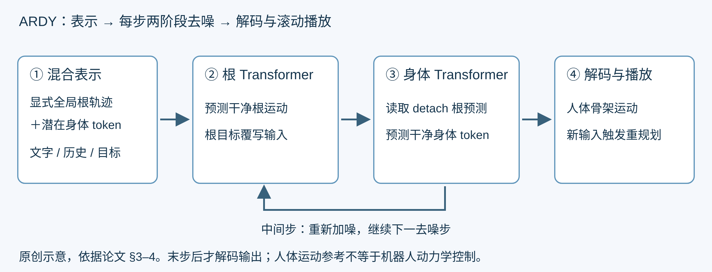

# ARDY：显式根运动与潜在身体表示的交互式动作生成

角色正在往前走，用户突然要求“向左绕弯，走到那个位置，然后弯腰”。系统既要及时改变后续动作，又要让路径、身体姿态和文字含义一致。ARDY 的做法是：**根轨迹保持显式，身体运动压进潜在表示；每次去噪先估计根运动，再根据干净根运动估计身体姿态，滚动生成下一段动作。**

[打开本地论文 PDF](../../../raw/papers/nvidia-series/nvidia-ardy-siggraph2026.pdf) · [arXiv v1](https://arxiv.org/abs/2607.08741v1) · [官方项目](https://research.nvidia.com/labs/sil/projects/ardy/)

论文发表于 ACM TOG / SIGGRAPH 2026；arXiv 首次提交为 2026-07-09。本文按已归档论文全文重读，未运行代码或复现实验。下文“§”和表号均指该本地论文。

## 1. 问题与输入输出

ARDY 输入当前文字提示、已生成的运动历史，以及指定时间的根位置、关节位置或旋转目标；输出人体骨架运动，包括根轨迹和关节姿态。输出可用于动画，或作为机器人管线中的运动参考，但不是关节力矩、PD 控制量，也不保证机器人可以稳定执行。

离线模型一次生成完整片段，便于安排远期目标，但不容易响应中途输入。只看很短历史的在线模型则可能忘记“弯腰”是否已经发生。ARDY 在自回归窗口中同时保留可变长历史及超出当前输出窗口的目标，让未来约束影响现在怎样起步。这里的“未来”是用户给定目标，不是观察到尚未发生的运动。见 §3.3。

## 2. 混合表示：哪些量保留显式，哪些量压缩

设一帧人体运动由根部和身体特征组成。论文使用 Y 轴竖直的坐标约定，根部为：

$$m_{root}=(p_x,p_y,p_z,\cos\psi,\sin\psi)\in\mathbb R^5.$$

$p$ 是全局根位置，$\psi$ 是航向角；用正余弦表示避免角度在正负 π 附近跳变。显式身体特征包括所有关节的全局 6D 旋转、减去根部平面位置后的非根关节位置、全局关节速度和四个脚部接触标签。位置、速度和角度属于不同量纲，不应把这些特征直接解释为统一的机器人动作单位。见 §3.1、式 (1)。

身体编码器把每 $P=4$ 帧压成一个潜在向量 $z_i\in\mathbb R^L$；对应四帧根特征直接拼接，得到：

$$x_i=[m_{root,i}^{patch};z_i]\in\mathbb R^{5P+L}.$$

默认 FSQ 潜在宽度为 128、每维 64 个量化等级；Transformer 的内部隐藏宽度 512 是另一个参数，不能混为一谈。根部保留显式表示，使路径约束可以直接写入；身体压缩则降低少步扩散学习的复杂度。见 §3.2、§3.5、§5.3。

## 3. 为什么解码器又把根运动转回局部量

生成器要显式全局根位置，方便命中场景目标；解码身体时，论文却把根条件转换为：

$$(\dot\psi,\dot p_x,\dot p_z,p_y).$$

这些量分别表示航向角速度、水平速度和根高度。局部运动条件让身体解码器更容易学习“怎样迈步配合根运动”，而不依赖角色在场景里的绝对位置。论文消融指出这种转换可以改善脚滑及约束误差。生成时保留全局位置、解码时使用局部条件，服务的是两个不同需求。见 §3.2 和表 2。

Tokenizer 使用因果 Transformer 编解码，训练重建身体运动，并惩罚接触脚的速度：

$$\mathcal L_{skate}=\frac{\sum_{j\in S_f}\hat c_j\|\dot{\hat J}_j\|_2}{\sum_{j\in S_f}\hat c_j}.$$

$S_f$ 为脚部关节集合，$\hat c_j$ 为预测接触标签，$\dot{\hat J}_j$ 为预测脚速度。公式解释论文损失，分母为零时的数值处理仍需代码核验；接触惩罚也不等于物理接触求解器。见式 (6)。

## 4. 历史、当前窗口与远期目标怎样接起来

令 $H$ 为历史 token 数，$C$ 为本次生成 token 数，$F$ 为窗口之外的未来目标范围，$s$ 为文字条件。论文问题形式为：

$$x^{1:C}=\mathcal F(s,x^{-H+1:0},g^{1:C+F}).$$

历史长度可变，因此模型既能从空历史启动，也能在已有运动上续写。目标 $g$ 用显式运动特征表示，同时提供同形状二值掩码 $v$：非零目标值本身不足以表达“指定为零”，所以必须另有掩码。见 §3.3–3.4。

对窗口内根约束，模型输入中的根特征被替换为：

$$\tilde m_{root}=(1-v_{root})\odot m_{root}+v_{root}\odot g_{root}.$$

身体约束与掩码拼入 token 特征；窗口外目标没有对应带噪 token，因此作为额外目标 token 输入。这样，“更晚到达左侧位置”可以改变当前生成的方向，尽管本轮还不输出那个时刻。目标条件不构成精确命中保证，论文仍用误差评估。见 §3.4。

*原创阅读示意，依据论文 §3–4；箭头表示条件与数据流。图片没有表达机器人动力学控制。*

## 5. 每次去噪为什么先预测根，再预测身体

设扩散步为 $k$，当前带噪混合 token 为 $x_k$。以下为统一记号，解释论文图 3：

$$\hat m_{root}=R_\theta(x_k,k,s,history,goals),$$

$$\hat z=B_\theta(x_{k,body},\operatorname{sg}(\hat m_{root}),k,s,history,goals),$$

$$\hat x_0=[\hat m_{root};\hat z].$$

$R_\theta$ 和 $B_\theta$ 分别是根、身体 Transformer；$\operatorname{sg}$ 表示根预测作为条件时 detach。它阻断该条件路径的反向梯度，并非冻结根分支，也不是执行期间禁止根运动改变。见 §3.4。

这个顺序的理由很具体：当“身体要怎样移动的根轨迹”已经较清楚时，生成配合它的步态和姿势，比同时猜轨迹和身体更容易。两阶段在**每个去噪步内交错**，不是先完整生成一条根轨迹，再独立生成全部身体运动。干净混合预测按采样过程重新加噪，送入下一去噪步，最后由 tokenizer 解码。

## 6. 训练信号：不能只在潜在空间里看起来正确

论文的去噪损失有四项：

$$\mathcal L=\mathcal L_{hybrid}+\mathcal L_{dec}+\mathcal L_{goal}+\mathcal L_{consist}.$$

- 混合表示损失：用 smooth L1 对齐预测与真值 token。
- 解码损失：比较解码后的显式身体特征，防止潜在误差与实际姿态误差脱节。
- 目标损失：只在掩码指定的目标区域强化误差约束。
- 运动学一致性：约束直接预测的关节位置与旋转经 FK 得到的位置一致。

这些项分别处理表示拟合、重建、目标命中和几何一致性。没有哪一项可以替代机器人动力学稳定性。训练先完成 tokenizer，再训练扩散去噪器；训练采样随机窗口、不同长度历史和未来约束，随机丢弃文字和约束以支持 classifier-free guidance。见 §3.5、式 (7)–(11)。

## 7. 实时重规划如何避免画面等待

演示以 20 fps 输出运动，每次生成 $G=40$ 帧，即 2 秒；由于 $P=4$，对应 $C=10$ 个 token。用户更改提示、目标，或者缓存即将耗尽时，系统重新规划。见 §4。

1. 保留尚未播放的 $B$ 帧动作作为缓冲。
2. 播放缓冲，同时把它计入新生成的历史条件。
3. 后台生成从缓冲结束处接上的新片段。
4. 切换到新片段，继续上述循环。

论文 RTX 4090 演示报告 4 步扩散平均 33 ms、10 步平均 63 ms；前者不用缓冲，后者用 1 帧。20 fps 的一帧是 50 ms，因此这些设置符合延迟补偿直觉。它们是一次生成调用的作者报告，不是模型每帧重新推理，也不能当作任意硬件端到端保证。见 §4.1–4.2。

论文表 1 汇总最大历史 8 秒、未来范围 10 秒；实际 demo 会截断上下文，§4.1 说明更远目标只有进入截断范围后才参与条件。它没有无限记忆，也不会始终看到一分钟后的所有目标。

## 8. 实验究竟支持哪些结论

Bones Rigplay 是约 700 小时、150 多位演员的专有动捕数据，处理成 27 关节骨架，训练采用最长 10 秒片段。它用于架构消融；HumanML3D 用于公开基准比较。两类实验不能混成同一个设置。见 §5–6。

在 HumanML3D 的自回归比较中，论文采用 9 秒测试序列、1 秒真值初始历史；窗口内目标每个生成窗口给定，窗口外目标在整段序列末尾给定。结果如下（表 5）：

| 目标设置 | 方法 | FID ↓ | 目标误差 cm ↓ | 延迟 s ↓ |
|---|---|---:|---:|---:|
| 窗口内 | DiP | 0.967 | 9.20 | 0.15 |
| 窗口内 | ARDY | 0.092 | 2.48 | 0.15 |
| 窗口外 | DiP | 1.453 | 17.64 | 0.15 |
| 窗口外 | ARDY | 0.100 | 2.92 | 0.15 |

此处延迟在 A100-SXM4-80GB 上测量，ARDY 使用 40 帧窗口、10 步扩散、vanilla AE tokenizer，不是 RTX 4090 的 4 步 FSQ 演示配置。两个实验必须分别引用。公开基准还排除了缺少原生关节旋转的 HumanAct12 子集，并采用保留旋转的重定向处理；原版评测器与此处理存在差异。见 §6.1。

结果支持 ARDY 在该基准下更好地兼顾目标与生成质量，不能推导真机成功率。表 4 还提供带额外优化的离线比较，不能把优化后精度和实时演示速度拼成同一个能力承诺。

## 9. 局限、SONIC 及 Spectral Skills

作者明确说明 ARDY 是**纯运动学模型**，不感知物理动力学，仍可能脚滑和抖动；长历史显式输入有成本，多步扩散也需要计算。有限窗口外的远期任务不是已解决的无限规划问题。见结论的 Limitations。

[SONIC](nvidia-sonic.md)面向机器人全身运动追踪；ARDY 可以在系统设计中提供上游参考，但本文不能把它视为 SONIC 的已验证替代品。[Spectral Skills 项目预览](spectral-skills-preview.md)则研究更适合低层策略的技能表示与组合，不能将其项目页结果与 ARDY 的人体生成误差直接排名。

[论文来源核验记录](../../../raw/entries/2026-11-08-ardy.md)。后续若阅读官方代码，将另行标注真正的实现行为和论文之间的差别。
