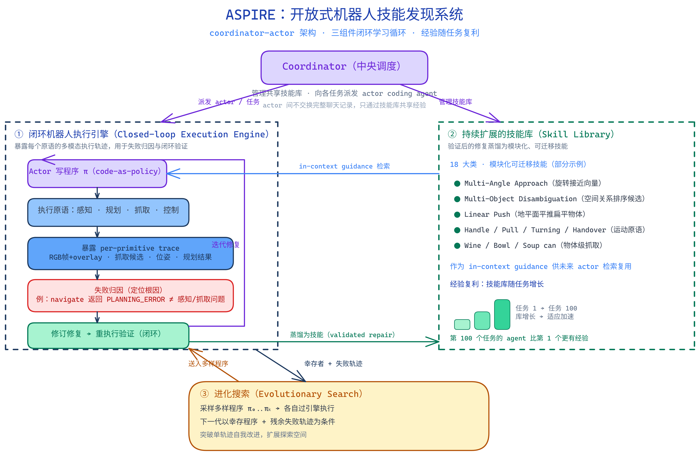

# ASPIRE：面向机器人的智能体技能发现系统

[打开本地论文 PDF](../../../raw/papers/nvidia-series/nvidia-aspire-261016.pdf)

## 概述

### 背景

1. 软件工程 agent（如 Claude Code 类）已能自主检查执行轨迹、定位失败、修订实现，并通过与执行环境的反复交互来改进代码；机器人领域由此催生 code-as-policy 范式：用大语言模型（LLM）把感知模块、规划 API 与控制原语组合成可执行的机器人控制程序。
2. 现有机器人 coding agent 只获得粗粒度的任务级反馈：一次 rollout 失败只告诉 agent "任务没成功"，却无法判断根因是感知错误、抓取不稳、运动规划失败，还是长程协调中某个下游恢复环节出错。
3. 现有系统不跨任务积累经验：一个任务完成后，调试中发现的修复策略随即被丢弃，于是处理第一百个任务的 agent 并不比处理第一个的更有经验。
4. 该工作由 NVIDIA GEAR lab 联合 UMich、UIUC、UC Berkeley、CMU 于 2026-06-30 发布，作者包括 Runyu Lu、Yubo Wu、Ethan Kou 等，项目负责人为 Yuke Zhu、Linxi "Jim" Fan 与 Guanzhi Wang。

### 解决思路

人类机器人工程师的做法截然不同：他们重放执行、检查感知输出与运动轨迹、定位失败子系统、修订实现，并把可复用的恢复策略内化下来，让调试经验随复利成可迁移知识。ASPIRE 要解决的核心问题正是：如何让机器人 coding agent 像人类工程师那样，从细粒度的执行证据中定位失败、验证修复，并把经验复利成可迁移的技能。为此，ASPIRE 构建了一个由三组件构成的开放式学习循环：

1. **闭环机器人执行引擎**：暴露每个原语的多模态轨迹用于失败归因，解决背景 2 的粗粒度反馈问题。
2. **技能库**：把验证过的修复蒸馏为可迁移技能，使经验跨任务复利，解决背景 3 的经验丢弃问题。
3. **进化搜索**：探索多样的候选程序，突破单轨迹修复的局部陷阱。

图：ASPIRE 系统架构：coordinator–actor 架构下的开放式学习循环，三组件（执行引擎、技能库、进化搜索）使经验随任务复利。

---

## 技术详解

### 原理

ASPIRE 的第一性原理是：把机器人行为显式表示为可检查、可编辑、可调试的程序，并赋予 agent 一个能像软件工程师那样"读证据—下诊断—开补丁—验证"的工作循环。要做到这一点，必须解决三件事：证据要细到能区分感知/规划/抓取/接触/协调哪一环出错；经验要能跨任务、跨本体复利；探索要能跳出反复修补同一失败策略的局部最优。ASPIRE 用三个组件分别对应这三件事，并通过 coordinator–actor 架构把它们组织成可并行、可扩展的持续学习系统。

### 技术实现

#### 闭环机器人执行引擎

执行引擎把过去粗粒度的 rollout 级反馈替换为 per-primitive 多模态轨迹。对每一次感知、规划、抓取或控制调用，引擎记录被调用的 API、输入输出、返回状态，以及调用前后的 RGB 关键帧、overlay、抓取候选、物体位姿与运动规划结果。agent 不接收完整视频帧，引擎只保留每次原语调用前后帧加对应 overlay 与返回值，使 agent 能聚焦于与失败因果链相关的调用周围的证据，而不被无关原始视觉上下文分散注意力。证据是开放式的：agent 自主选择查阅哪些原语日志、渐进式定位失败、并通过重执行 agent 写出的修复来闭环验证结果。引擎本身用 MuJoCo Playground 构建，robot API 来自开源 code-as-policy 框架 CaP-X。

输入输出与具体步骤可由论文 Figure 2 的 BEHAVIOR-1K "navigate-and-pick-up-radio" 调试 episode 说明：

1. 初始状态：机器人需抓取红色收音机，但收音机在起始位姿视野之外。
2. 感知扫描：调用 `find_object_base_rotate("red radio")`，经约 10 次底盘旋转后在 $[3.02, 4.91, 0.30]$ 找到收音机，距机器人约 1.91 m，需移动靠近。
3. 反复规划失败：连续对三个近距离目标 $[3.64,4.79]$、$[3.52,4.89]$、$[3.62,4.88]$ 调用 `navigate_to_pose`，均触发 cuRobo 碰撞避让并返回 `PLANNING_ERROR`。
4. 轨迹定位根因：agent 查阅原语返回值与关联日志，发现这些导航目标都落在桌子碰撞缓冲区内（距桌边约 20 cm），在桌子碰撞约束下目标位姿不可行。根因不是检测或抓取，而是目标位姿本身。
5. 编写补丁：agent 写出多角度接近例程，按 $180^\circ, -90^\circ, 90^\circ, -45^\circ, 45^\circ$ 旋转接近向量，每个角度把目标放到物体另一侧，逐一尝试直到找到可达侧。
6. 多角度找到开放区域：$180^\circ$（物体远端西侧）使 cuRobo 找到无碰撞路径，机器人一次移动 1.45 m 到 $[2.80, 4.90]$，距收音机 0.22 m。
7. 重新感知并抓取：从可达侧重新调用 `sample_grasp_pose`，得到 2 个抓取候选；执行 `grasp_object` 返回成功，抬臂后 `in_hand=True`、`reward=1.0`、`task_completed=1`。
8. 吸收为技能：验证后的修复被吸收为 "Multi-Angle Approach" 技能，写入共享技能库供未来任务检索。

#### 持续扩展的技能库

技能库存储的是异质的修复知识，而非整段任务程序：定位启发式、感知提示、抓取约束、导航恢复策略、运动原语、场景理解例程与调试工作流。技能不是预先规定的分类，而是从验证过的修复中归纳出来的。流程是：coding agent 从执行轨迹诊断失败、打补丁、在调试配置上验证修复，coordinator 审计这些发现、核验其符合允许的 API 策略，只把通过调试验证的可复用模式提升进共享库。每个技能以紧凑的上下文指导形式存储，包含失败签名、适用条件、修复策略，以及必要时一段代表性代码草图。论文列出 18 大类，包括 LOCALIZATION（如 Multi-Object Disambiguation，按 front/back/left/right 空间关系排序候选）、NAVIGATION（如 Multi-Angle Approach、Way hopping）、MOTION PRIMITIVES（如 Handle、Pull、Turning、Handover、Linear Push——地平面平推扁平物体）、SCENE UNDERSTANDING、OBJECT-LEVEL GRASPING（Wine、Push、"Soup can"、Bowl 等）以及 DEBUGGING 工作流。

在 coordinator–actor 架构里，中央 coordinator 管理共享技能库并向各任务派发 actor coding agent。关键设计是：actor 之间不交换完整聊天记录或原始 rollout 轨迹，只把可迁移经验蒸馏进技能库。这样每个 actor 的上下文窗口可以聚焦于当前任务规格、当前程序与当前失败关联的结构化执行轨迹，而不是被别的任务的冗长历史挤占。技能库因此成为 agent 间共享经验的唯一通道，使"第一百个任务的 agent 比第一个更有经验"成为可能。

#### 进化搜索

只靠 trace-guided 调试会塌缩进局部修复循环：agent 反复修补同一条失败策略，而不去探索本质上不同的解法。进化搜索把搜索目标直接设为机器人程序本身。每一轮，coding agent 基于技能库提出一个规模为 $K$ 的候选程序种群 $\pi_0,\ldots,\pi_k$，条件化于前几轮表现最好的程序与失败轨迹；每个候选在执行引擎中运行，产出任务结果与新的诊断轨迹；下一代 $\pi_0',\ldots,\pi_k'$ 再以幸存程序与其残余失败模式为条件生成，使搜索能探索不同策略而非反复精修同一解。搜索在候选解决调试配置或预算耗尽时终止；通过验证且能跨环境变体与任务泛化的修复才被收入技能库。算法上即 Algorithm 1：维护历史 $\mathcal{H}$，每轮 `ProposeRepairs` 以 `Top3`$(\mathcal{H})$、技能库 $\mathcal{L}$ 与 $\mathcal{H}$ 为条件，执行后更新最优 $P^\star$，命中阈值 $\theta$ 即停。

### 关键设计

ASPIRE 的几个关键设计选择值得指出。第一，反馈粒度的下沉：从"任务成功与否"下沉到"每个原语调用的输入输出、返回状态与视觉证据"，是失败归因可操作化的前提；论文消融显示机器人执行引擎贡献了最大的平均提升，把宏平均成功率从 14% 提到 62%。第二，经验以技能而非整程序为单位沉淀：可复用的很少是整段任务程序，而是局部修复模式，这种粒度才支持跨任务、跨仿真/真实、跨本体复用。第三，actor 间只共享蒸馏后的技能而非原始轨迹，既控制上下文成本又避免隐私/带宽膨胀。第四，进化搜索把"写—执行—调试"循环从单轨迹扩展为种群级并行探索，消融中在引擎之上再把宏平均从 62% 推到 72%，且前几轮收益最大、后续递减。第五，技能准入由 coordinator 把关并要求跨配置验证，防止过专或误导条目污染库；但作者也承认长期记忆管理尚未完全解决。

## 实验与对比

### 性能

实验在三个基准族上进行。仿真中 coding agent 使用 Claude Code（Claude Opus 4.6，1M token 上下文窗口），程序写在 CaP-X 框架内，agent、环境与 API 集在所有实验中固定。环境 seed 固定每个任务实例（物体位姿、干扰物、初始状态），调试与评估用不相交 seed：LIBERO-Pro 每任务在 seed 51–65 上学习、在 seed 1–50 上用单一生成程序评估；Robosuite 在 seed 101–125 学习、seed 1–100 评估；BEHAVIOR-1K 在 seed 26–35 学习、seed 1–25 评估并用增量块执行。

主要结果（宏平均成功率）：LIBERO-Pro 上，相对各套件最强基线，ASPIRE 在 Object 套件提升 77 个百分点、Goal 套件 41.5 个百分点、Spatial 套件 42.5 个百分点，多项超过人类专家手写程序。Robosuite 上双臂 handover 从基线 20% 提升到 92%（+72），并在多数接触密集任务上保持近饱和。BEHAVIOR-1K 上 navigate-and-pick-up-radio 的任务成功率从 CaP-Agent0 的 56% 提到 88%（+32），导航与任务完成分别统计。

零样本迁移方面，把 LIBERO-90 上积累的技能库迁移到 held-out 的 LIBERO-Pro Long：完整 $N=90$ 库下，位置扰动 23%、任务扰动 38%，宏平均约 31%，而先前方法（CaP-Agent0、$\pi_0.5$）饱和于约 4%。且成功率随技能库规模 $N\in\{0,25,50,90\}$ 增大而单调上升，表明短程任务上验证过的修复为更长程组合提供了可复用知识。

仿真到真实跨本体迁移方面，把三项仿真发现的技能（soda-can pickup、bowl-on-plate、drawer push/pull）作为上下文指导提供给真实双臂 YAM 工作站上的 coding agent（OpenAI Codex GPT-5.5，reasoning-xhigh）。检索对应技能时首次成功程序所需 token 更少、held-out 成功率更高：bowl 放置两组均 20/20 但带技能总 token 从 8.65M 降到 5.11M；soda can 从 13/20 提到 19/20 且总 token 从 61.94M 降到 6.58M；drawer 从 0/20 提到 11/20。这说明迁移的不是模拟器专属代码，而是可跨本体/API 指导真实程序合成的失败恢复知识。

### 与其他方法对比

| 维度 | ASPIRE | 传统 code-as-policy agent（CaP-Agent0） | 端到端 VLA 模型（OpenVLA/$\pi_0$/$\pi_0.5$） |
|---|---|---|---|
| 反馈粒度 | per-primitive 多模态轨迹（API/输入输出/返回状态/RGB 关键帧+overlay） | 粗粒度任务级反馈 + 视觉差分 | 端到端策略输出，无显式归因 |
| 跨任务积累经验 | 是，技能库持续扩展、跨任务检索 | 否，完成后丢弃 | 否（除非重新训练） |
| 探索方式 | 进化搜索，种群级并行候选 | 单轨迹反复重试 | 无显式搜索 |
| 可解释性 | 行为是可读程序，失败有原语级归因 | 程序可读但反馈粗 | 黑箱策略，难归因 |
| 依赖 | 冻结前沿 LLM（Claude Opus 4.6）+ 预定义原语 API | LLM + 预定义技能库 | 大规模机器人数据训练 |
| 评估方式 | 每任务单一生成程序跨 seed | 每 seed 重新生成程序 + 测试时推理重试 | 直接前向推理 |

### 优劣分析

优势方面，ASPIRE 让经验复利：技能库越大、后续任务越快越稳，LIBERO-Pro Long 零样本成功率随库规模单调上升即为证据。细粒度归因把"任务没成功"细化到具体原语与具体失败模式，使修复有的放矢。跨本体迁移初步成立：仿真发现的技能作为上下文指导能显著降低真实机器人编程的 token 成本并提升成功率，即便本体与 API 不同。

局限方面，作者明确列出五点。其一，尚非完全自主的真实世界终身学习者：真实部署仍需稳健的成功检测、安全复位、安全监控与标定维护，仿真中廉价程序化的检查与复位在真实世界并不便宜。其二，依赖冻结的前沿 LLM（Claude Opus 4.6，1M token 上下文），尚未验证更小或更弱 LLM 能否维持同一调试循环。其三，受预定义原语 API 限制：固定 API 保证调试安全但限制了可表达行为，任务需要 API 外的感知/控制能力时只能低效近似或靠人工扩展。其四，长期记忆管理未完全解决：库增大后部分条目可能过时、过专、冗余或误导，这也能解释零样本迁移中出现的非单调趋势，需要更强的检索、剪枝、排序与再验证机制。其五，调试加进化搜索的计算密集：每任务消耗大量 LLM 调用与 rollout，规模化需更便宜的推理或更样本高效的搜索。

## 参考

- `raw/papers/nvidia-aspire-261016.pdf`（2026-10-16 更新版，替代已删除的 `nvidia-aspire-260630.pdf`）
- 项目主页：[https://research.nvidia.com/labs/gear/aspire/](https://research.nvidia.com/labs/gear/aspire/)
- 代码：[https://github.com/NVlabs/ASPIRE](https://github.com/NVlabs/ASPIRE)
- arXiv：[2607.00272](https://arxiv.org/abs/2607.00272)（v1，2026-06-30；更新内容尚未同步到 arXiv）
- Runyu Lu, Yubo Wu, Ethan Kou, Haotian Lin, et al. *ASPIRE: Agentic Skill Programming through Iterative Robot Exploration*. NVIDIA · UMich · UIUC · UC Berkeley · CMU, 2026.

## 关联

- 与 VLA 的关系：ASPIRE 与端到端 VLA 路线互补——VLA 把行为压缩进神经策略权重，ASPIRE 把行为显式表示为可调试程序并跨任务积累修复经验；论文在 LIBERO-Pro 等基准上直接对比 OpenVLA、$\pi_0$、$\pi_0.5$ 等 VLA 基线。
- 与 SayCan 的关系：SayCan 用 LLM 对 affordance 排序选择技能，ASPIRE 则让 LLM 直接编写并迭代修复控制程序，技能由 agent 自主发现而非预定义。
- 与 扩散模型/Diffusion Policy 的关系：Diffusion Policy 是端到端动作生成范式，ASPIRE 走 code-as-policy 路线，两者代表了具身控制的程序化与策略化两条路径。
- 与 Transformer 的关系：ASPIRE 依赖的前沿 LLM 基于 Transformer 架构，但 ASPIRE 的贡献在系统层而非模型架构。
- 与 Agent 工程全景 的关系：ASPIRE 把软件工程 agent 的"检查执行轨迹—定位失败—修订实现"循环迁移到机器人领域，是 agentic coding 范式在具身智能的延伸。
- 与 NVIDIA 系列 VLA 技术解析 的关系：同属 NVIDIA GEAR lab 的具身智能工作，但 GR00T 走 VLA 大模型路线，ASPIRE 走 code-as-policy + 技能库路线，两者构成 NVIDIA 在具身智能上的双路径布局。
- 与 NVIDIA 智能体具身智能技术解析 的关系：把 ASPIRE 放回 CaP-X → ASPIRE → ENPIRE 谱系中，含与 GR00T/VLA 路线的系统对比与 2026-10 论文更新后的结论边界。
- 与 具身智能研究现状 的关系：ASPIRE 的 code-as-policy + 持续技能库代表了具身智能中"程序化与经验复利"一支的最新进展。

## 反向链接

- VLA
- SayCan
- NVIDIA 系列 VLA 技术解析
- Agent 工程全景和发展
- 具身智能研究现状
- NVIDIA 智能体具身智能技术解析
