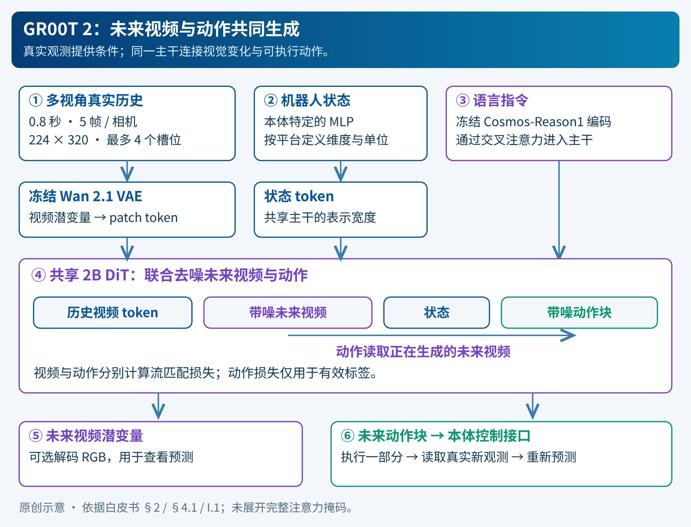
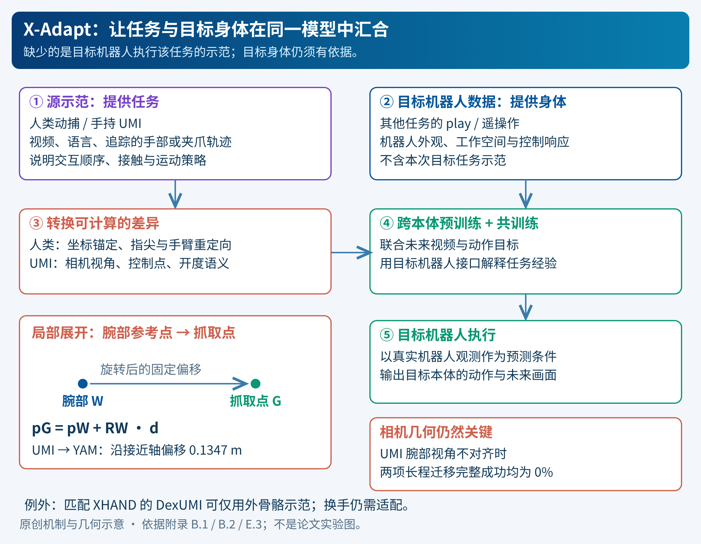
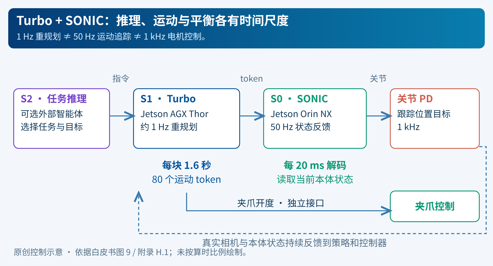

# GR00T 2：联合预测未来视频与动作的世界动作模型

让机器人学会“把滤纸放进漏斗，再用洗瓶润湿”，难点不只是识别物体。人类能轻松演示，但人手与机器人手的尺寸、关节、相机位置和控制响应不同；直接模仿人类关节角没有意义。GR00T 2 的办法是同时学习两件事：任务完成时场景应该如何变化，以及目标机器人怎样用动作产生这种变化。它把未来多视角视频与动作块放进同一个生成模型，形成世界动作模型（World-Action Model，WAM）。大规模人类视频提供交互经验，目标机器人的数据与控制接口把经验落到具体身体上。[白皮书 §2、§3.2、§4.4](../../../raw/papers/nvidia-series/nvidia-gr00t-2-whitepaper-2026-11.pdf#page=5)

这次变化需要与 [GR00T N1 系列的 Action Cascade](nvidia-gr00t-action-cascade.md) 区分：GR00T 2 的核心策略主干来自视频世界模型，联合生成视频与动作；在智能体系统中，外部推理模型还可以负责分解任务、检查进展和调用恢复技能。下面先解释单个 WAM，再讨论这些系统怎样组合。

[本地白皮书 PDF（135 页）](../../../raw/papers/nvidia-series/nvidia-gr00t-2-whitepaper-2026-11.pdf) · [官方项目页](https://research.nvidia.com/labs/gear/gr00t-2/) · [来源与核验记录](../../../raw/entries/2026-11-10-nvidia-gr00t-2.md)

## 1. 从一个操作例子理解输入与输出

考虑机器人已经拿起滤纸、准备放入漏斗的时刻。模型看到最近的头部和腕部相机图像、当前机器人状态，以及“放好滤纸并润湿”的指令。它一次预测一段未来相机画面与一段机器人动作。未来画面描述手与物体怎样运动，动作块则交给机器人的执行接口。执行一部分动作后，模型读取真实新观测并重新预测。

这是闭环执行：后续条件来自实际相机，而不是始终把自己想象出的画面当成事实。生成视频也不是任务完成的证明，更不能保证接触力、关节限位或碰撞约束自然成立。

| 接口 | 白皮书披露的表示 | 需要区分的事情 |
|---|---|---|
| 视觉历史 | 最近 0.8 秒，5 fps；每相机 5 帧，图像高 × 宽为 224 × 320；最多 4 个相机槽位 | 实际相机数量随本体变化；Dexter 的 3 个视角放入 4 个模型槽位 |
| 指令 | 自然语言，经冻结的 Cosmos-Reason1 编码 | 策略中的文本编码器与外部任务推理智能体是两种角色 |
| 本体状态 | 机器人自己的状态向量，经本体特定的 MLP 编码 | 不是所有机器人共享同一组关节或相同状态维数 |
| 视频输出 | 各相机的未来视频潜变量 | 控制无需先把潜变量解码成 RGB；RGB 解码主要用于查看预测 |
| 动作输出 | 长度为 $H$ 的动作块 $A\in\mathbb R^{H\times d_a}$ | $d_a$、单位、坐标系和执行速率由本体接口决定 |

这些接口来自[白皮书 §2、附录 I.1、图 60](../../../raw/papers/nvidia-series/nvidia-gr00t-2-whitepaper-2026-11.pdf#page=114)。例如，Dexter 的人类迁移实验使用 62 维状态与动作：状态含机器人基座坐标系中的绝对腕部位姿和手指关节位置；动作含相对当前状态的腕部位姿和绝对手指关节位置。不能把“相对动作”理解为所有通道都是关节增量，也不能将它套用到 G1 的 SONIC 隐空间接口。[附录 B.1.3](../../../raw/papers/nvidia-series/nvidia-gr00t-2-whitepaper-2026-11.pdf#page=45)

## 2. 架构：动作读取正在生成的未来

*原创数据流示意，依据白皮书 §2、§4.1 和附录 I.1 绘制；表示模块关系，不表示实际算时或完整注意力掩码。*

### 2.1 一个共享主干，若干本体接口

GR00T 2 从 **Cosmos-Predict2.5-2B** 视频扩散 Transformer 初始化。冻结的 Wan 2.1 视频 VAE 将每路视频在时间上压缩 4 倍、在两个空间方向各压缩 8 倍，再将潜变量切成 token；白皮书报告每个潜帧、每相机有 280 个视频 token。相机的可学习 view embedding 告诉模型哪个 token 来自头部或哪一侧手腕。

视频、状态和带噪动作进入一个共享的 2B 参数 Transformer；指令特征通过交叉注意力进入。状态编码器、动作编码器和动作解码器则可以按机器人配置。共享交互规律不要求把两指夹爪、22 自由度灵巧手和人形机器人硬塞进同一套电机输出。[白皮书 §2](../../../raw/papers/nvidia-series/nvidia-gr00t-2-whitepaper-2026-11.pdf#page=5)

### 2.2 联合预测的关键连接

视频 token 可以跨时间和相机相互注意；动作 token 可以读取全部视频 token，包括正在生成的未来。因此动作生成不只读取当前画面的视觉特征，还受模型预测的交互过程影响。未来视频与动作在联合去噪中逐步形成，不是必须先完成一部视频，再把它交给另一个独立逆动力学模型。

可以用下面的概率形式理解其目标：

$$
p_\theta(Z_{\mathrm{future}},A\mid O_t,s_t,\ell,e).
$$

这里 $Z_{\mathrm{future}}$ 是未来多视角视频潜变量，$O_t$ 是视觉历史，$s_t$ 是状态，$\ell$ 是指令，$e$ 标识本体接口。这是本文对联合建模的概括，并非白皮书给出的可直接求值概率密度。

作者将这种结构解释为“学习场景应该发生什么，再关联到机器人如何做到”。但模型并没有被显式约束成一个独立的、与本体完全无关的任务因子和一个动力学因子。与 GR00T 1.7 的对照同时改变了骨干和初始化，能支持整套 WAM 方案的价值，不能单独证明只有新增视频损失导致了全部提升。[附录 B.1.5](../../../raw/papers/nvidia-series/nvidia-gr00t-2-whitepaper-2026-11.pdf#page=47)

### 2.3 推理为什么可以少算视频

视频 token 很多，而动作 token 相对少。部署时可以交替进行联合视频动作更新与只更新动作的步骤；后者复用最近一次视频更新的注意力 K/V。白皮书的部署配置使用 1–2 次视频去噪和 2–4 次动作去噪，而不是每一步都重新计算整段视频。[§2、附录 I.1](../../../raw/papers/nvidia-series/nvidia-gr00t-2-whitepaper-2026-11.pdf#page=114)

这里的“想象未来”也不等于模型预测控制（MPC）：白皮书这条基本推理路径没有披露“枚举多条动作、逐条模拟、用代价函数挑选最优轨迹”的搜索步骤。它主要是条件生成策略，任务级选择和验证还可交给外部智能体。

## 3. 联合流匹配：同一时间变量，两类预测目标

白皮书说明视频与动作均用流匹配训练，但没有完整列出基础预训练的所有损失权重、采样分布与掩码。下面给出与其附录 F 的符号方向一致的**解释性重写**，不把它冒充为已核对的训练代码。

设 $X$ 是一个干净目标，可以是动作块 $A$，也可以是未来视频潜变量 $Z$。令 $\epsilon\sim\mathcal N(0,I)$，噪声级别 $\sigma\in[0,1]$：

$$
X_\sigma=(1-\sigma)X+\sigma\epsilon,
\qquad
\frac{\mathrm dX_\sigma}{\mathrm d\sigma}=\epsilon-X.
$$

$\sigma=1$ 对应噪声，$\sigma=0$ 对应数据。网络预测与 $X_\sigma$ 同维的速度场 $v_\theta$。一种说明性的联合目标是：

$$
\mathcal L=\lambda_v\,\mathbb E\!\left[
\left\|v^v_\theta-(\epsilon^v-Z)\right\|^2\right]
+\lambda_a\,\mathbb E\!\left[
\left\|M_a\odot\bigl(v^a_\theta-(\epsilon^a-A)\bigr)\right\|^2\right].
$$

$\lambda_v,\lambda_a$ 是两类目标的权重，$M_a$ 表示有效动作监督位置；$\odot$ 表示逐元素乘法。网络同时接收带噪视频、带噪动作与观测条件，公式省略了这些输入。**原文明确的是：只有存在有效动作标签时才应用动作损失。** 这里不指定实际训练如何归一化掩码、填充维度或采样各分支的噪声级别。[白皮书 §4.1、附录 F.1](../../../raw/papers/nvidia-series/nvidia-gr00t-2-whitepaper-2026-11.pdf#page=14)

推理时从噪声出发，沿减小的 $\sigma$ 积分，例如解释性的 Euler 更新：

$$
X_{\sigma+\Delta\sigma}
=X_\sigma+\Delta\sigma\,v_\theta,
\qquad \Delta\sigma<0.
$$

检查符号：如果一个动作目标是 $0.2$，噪声是 $-0.4$，则 $\sigma=0.5$ 时 $X_\sigma=-0.1$，理想速度为 $-0.6$。取 $\Delta\sigma=-0.1$，新值为 $-0.04$，确实朝目标 $0.2$ 移动。真实模型是在归一化表示中生成，执行前还要恢复机器人接口的单位。

有两条时间轴：机器人时间 $t$ 决定动作何时执行；生成时间 $\sigma$ 决定一次预测内部的去噪进度。多走一次去噪，并不意味着机器人多执行了一步。

## 4. 预训练：先学交互视觉，再连接动作

三个阶段有明确分工：[白皮书 §4.1](../../../raw/papers/nvidia-series/nvidia-gr00t-2-whitepaper-2026-11.pdf#page=14)。

1. **单视角视频预训练。** 从预训练视频模型出发，用自中心人类视频及机器人视频预测未来，先适配手与物体交互的视觉规律。
2. **多视角视频动作共训练。** 加入本体特定的状态与动作模块，用多视角交互预测和有效动作标签共同训练。机器人轨迹提供本体动作，人类数据中的追踪手部轨迹也可提供动作监督。
3. **提高机器人数据权重。** 继续联合训练，尤其增加 YAM 的贡献，同时保留灵巧手、人类与其他数据，增强具体执行能力。

| 来源 | 实际进入 GR00T 2 的规模 | 主要贡献 |
|---|---|---|
| Human-1M 筛选后数据 | 402,730 小时，约 1,375 万段 episode | 场景、物体、任务与交互多样性；其中 3,000 小时为更严格的机器人对齐采集 |
| UMI-10K | 10,184 小时，约 94.2 万段，2,897 类任务 | 无需占用机器人的双臂夹爪示范及动作轨迹 |
| 机器人遥操作 | 23,500 小时，约 116 万段 | YAM、Sharpa、Wuji、G1、DROID 等平台的身体、控制和接触经验 |

规模来自[§4.2、附录 C](../../../raw/papers/nvidia-series/nvidia-gr00t-2-whitepaper-2026-11.pdf#page=15)。Human-1M 的“百万小时”是原始数据集规模，不能写成 GR00T 2 使用了完整百万小时。官方另提供 [Human-1M-100K](https://huggingface.co/datasets/nvidia/PhysicalAI-Human-1M-100K) 的十万小时公开子集；它也不等于完整训练混合。

### 人类视频扩展实验究竟证明了什么

作者比较不使用人类视频，以及按任务抽取 Human-1M **多视角子集**的 1%、10%、100% 三档；时间步筛选后分别为 **0.87k、8.1k、84.4k 小时**。这里的 100% 不是前表完整的 402,730 小时。随后使用相同的目标 Dexter 遥操作数据训练，并在 72 项任务上评估。真机成功率为 **18%、27%、28%、41%**，任务进展为 **50%、58%、61%、70%**。真机每任务 3 次；成功由操作员判断，进展由视觉语言模型评分。生成视频的评估则使用模型自己预测的 rollout，不能与真机成功混为一谈。[图 10、§4.2.1、附录 C.1.5](../../../raw/papers/nvidia-series/nvidia-gr00t-2-whitepaper-2026-11.pdf#page=60)

这些结果支持“该配方下，人类经验能改善机器人表现”。不过，实验固定的是 epoch：数据越多，训练长度也随之增加；1%–100% 组还共享一个人类视频预训练起点，0% 组跳过这一阶段。因此它不是固定总算力、只改变视频量的纯消融，也不能据此计算一小时人类视频等价于多少机器人数据。项目页将图中误差条写为 1 SD，白皮书图 10 写为 ±1 SEM；本文保留白皮书口径并记录这一差异。

## 5. X-Adapt：任务来自人类，身体来自机器人

X-Adapt 的目标是补全没有出现过的“任务 × 场景 × 本体”组合。它通常并不要求目标机器人从未进入训练集；真正缺失的是**目标机器人执行该任务的示范**。

*原创机制示意，依据附录 B.1、B.2 与 E.3；几何转换在训练前完成，未来视频中的机器人外观由共训练学习。*

### 5.1 人类动捕 → Dexter：重定向后仍需身体数据

该实验使用头戴与腕部相机、Manus 手套和 PICO 腕部追踪器采集人类示范。流程是：

1. 校准追踪器与实际手腕的刚体变换，检查指尖投影与视频是否对齐。
2. 将人类腕部轨迹放到重力对齐的机器人基座坐标系，使用任务偏移将其置于机器人工作空间。
3. 用几何逆运动学把人类指尖与腕部目标映射到 7 自由度手臂和 22 自由度 Sharpa 手；保留捏持接触几何，而非照抄人类关节角。
4. 保留原始人类视频，转换动作标签；将数据降采样至 30 Hz，与不含目标任务的机器人 play data 按 1:1 共训练。
5. 部署时读取真实机器人的画面与状态，联合生成未来视频与机器人动作。

因此这里的“无需遥操作”准确含义是**不需要目标任务的机器人遥操作示范**；仍使用了机器人其他任务的 play data。[附录 B.1.1–B.1.4](../../../raw/papers/nvidia-series/nvidia-gr00t-2-whitepaper-2026-11.pdf#page=44)

在人类示范提供任务、目标任务零遥操作的条件下，滤纸设置、滴管取液、玻片擦拭、传送带抛包裹的成功率分别为 **65%、30%、10%、50%**，每项 20 次。滤纸结果说明这条路线可行，玻片的 10% 则说明它尚未普遍解决精细接触。[图 27](../../../raw/papers/nvidia-series/nvidia-gr00t-2-whitepaper-2026-11.pdf#page=46)

### 5.2 UMI → YAM：外观差异可以学，几何差异仍要处理

手持 UMI 与 YAM 的夹爪、相机和工作空间并不相同。作者用 41–75 条 UMI 目标任务示范与任务无关的 YAM 数据共训练，通常采样比例为 0.6:0.4。处理包括：

- **相机几何。** 将约 180° 的腕部鱼眼画面重投影成近似 YAM 的针孔视角，匹配视场与朝向。它不是把人类手臂擦除，也不能消除光心偏移产生的全部视差。
- **控制点。** UMI 的腕部参考点与 YAM 抓取点不同，按接近轴平移 0.1347 m 后再表达动作。
- **夹爪量纲。** UMI 记录毫米开度，YAM 使用归一化命令；手持夹爪满开 85.55 mm，YAM 满开 96 mm，必须按训练配方转换。
- **动作头。** 将 UMI 重表达为 YAM 的动作语义，并共享 YAM 的归一化统计与动作头；UMI 只有 YAM 32 维动作中的前 20 个末端相关通道，没有另外 12 个手臂关节标签。

控制点变换可用一个通用几何式理解：设 $p_W$ 是旧参考点在公共坐标系中的位置，$R_W$ 是其朝向，$d$ 是旧坐标系中指向新抓取点的固定偏移，则

$$
p_G=p_W+R_Wd.
$$

$p_W,p_G,d\in\mathbb R^3$，位置单位为米，$R_W\in SO(3)$。这里旋转偏移再加平移，不能把局部 13.47 cm 直接加到世界某个固定方向。该式为本文解释控制点转换的通用写法；完整相对位姿编码和左右乘约定仍应按数据接口核对。

默认配方让玩具卡车组装与 NIST 板拆解分别达到 **6/10、5/10** 完整成功；传送带任务为 **43/50 件物品**分拣成功。后者是按物品计数，不能称为 86% 的整段任务成功率。[附录 B.2、表 4](../../../raw/papers/nvidia-series/nvidia-gr00t-2-whitepaper-2026-11.pdf#page=49)

最有说明力的是相机消融：不做 YAM 视角对齐，两项长程任务完整成功都降到 0%，尽管任务进展仍有 79 和 76 分。粗略搬运还在，毫米级对接成为瓶颈。共享动作头也不是在所有任务上都最好：拆板任务使用独立头达到 60%，共享头为 50%；而且该对照同时改变了动作表示与统计量，不能把差异全归因于“共享”这个开关。[表 17、附录 E.3](../../../raw/papers/nvidia-series/nvidia-gr00t-2-whitepaper-2026-11.pdf#page=79)

另一个现实差异是，手持设备记录“已经到达的状态”，机器人的标签常是“发送给控制器的命令”。YAM 跟随器约有 4 帧、即 30 Hz 下约 133 ms 的滞后，且存在负载相关偏差。共享格式不等于命令与实际轨迹完全等价。[附录 E.3.3](../../../raw/papers/nvidia-series/nvidia-gr00t-2-whitepaper-2026-11.pdf#page=77)

### 5.3 DexUMI：用采集硬件缩小接触差异

GEAR DexUMI 外骨骼复现 XHAND1 Pro-U 的运动学、接触面和相机安装方式，并记录指尖三轴力。对匹配的 XHAND，可只用 DexUMI 示范后训练，无需额外机器人 play data；迁移到不同结构的 Sharpa 手则仍要重定向与共训练。这一条件与前两条路线不同。[附录 B.3–B.4](../../../raw/papers/nvidia-series/nvidia-gr00t-2-whitepaper-2026-11.pdf#page=50)

力不直接作为在线触觉输入，而是转换为动作监督：用手的 Jacobian 将指尖力映射为关节力矩，再按预测力矩降低刚度、调整虚拟位置目标。其关节力矩关系为

$$
\tau=B^\top\sum_i J_i(q)^\top f_i.
$$

$f_i\in\mathbb R^3$ 是第 $i$ 个指尖的力，单位 N；$J_i$ 把完整关节速度映射到指尖线速度；$B$ 将驱动关节坐标映射到完整关节配置，所以 $\tau$ 是驱动关节力矩，单位 N·m。力与 Jacobian 必须采用一致坐标表达。白皮书的 ACP 配方在负载变大时把刚度系数从 1 降到最低 0.3，再通过刚度与预测力矩计算虚拟目标。它提供基于示范的顺应性，尚不是触觉反馈闭环。[附录 B.3，式 (1)–(3)，§5](../../../raw/papers/nvidia-series/nvidia-gr00t-2-whitepaper-2026-11.pdf#page=52)

同样，DexUMI 的“WAM-native inpainting”具体实现是训练时扰动外骨骼掩码区域的颜色与亮度，使模型少依赖其外观；并非离线生成一段逼真的机器人手替换视频。部署输入仍是原始 RGB，不带掩码。[附录 E.6](../../../raw/papers/nvidia-series/nvidia-gr00t-2-whitepaper-2026-11.pdf#page=82)

### 5.4 单条人类视频 → 仿真 → 真机

这条路线还包含对象与手物运动重建、仿真 RL 专家训练、视觉随机化 rollout，以及 GR00T 2 后训练。锤钉任务达到 9/10 真机成功。“单条视频”描述的是源示范数量，不能理解成没有额外优化和数据生成，模型直接看一遍普通视频便会控制机器人。[§3.2、附录 B.5](../../../raw/papers/nvidia-series/nvidia-gr00t-2-whitepaper-2026-11.pdf#page=53)

## 6. 少样本适配：95% 的条件是什么

Dexter-50 的目标任务没有 Dexter 示范进入预训练，但在人类视频或 YAM 数据中出现过。直接部署的平均成功率为 40%；每任务用 1 条和 5 条 Dexter 示范做 LoRA 后训练，分别达到 71% 和 95%。这里“零样本”相对于目标机器人和任务的组合，并非模型从未接触该技能。[§3.1、附录 A.3](../../../raw/papers/nvidia-series/nvidia-gr00t-2-whitepaper-2026-11.pdf#page=41)

适配过程有几个可复用的设计：

1. 在 Transformer 每个线性层加 rank-32 LoRA，冻结原始权重、文本编码器、视频 VAE、状态和动作头。
2. 将每条示范切成 100 个均匀分布的训练窗口，用冻结模型的窗口损失作为采样权重，集中学习抓取、插入等困难阶段。
3. 使用原有的视频与动作联合流匹配目标，各任务共享超参数。
4. 单张 RTX 5090 上约训练 30 分钟，之后合并 LoRA，以原来的服务接口部署。五条示范合计少于 3 分钟，是每项任务的数据量，30 分钟也是每项适配运行的量级。

**最关键的评估条件：50 项任务从“五条示范后可达到至少 80% 成功”的任务中选出。** 因此 95% 部分来自筛选条件，不能外推成任意新任务五条示范都能达到 95%。零样本时 40/50 项“至少成功过一次”也不同于 80% 单次成功率；对应的平均单次成功仍是 40%。[§3.1、图 2](../../../raw/papers/nvidia-series/nvidia-gr00t-2-whitepaper-2026-11.pdf#page=8)

另一个独立的 71 项 Dexter 零样本基准，每模型每任务 3 次，GR00T 2 成功率 49.8%，Turbo 为 36.6%；它不是 Dexter-50，也不是人类视频扩展实验的 72 项任务，不能把这些数字拼成一条学习曲线。[附录 A.2，表 3](../../../raw/papers/nvidia-series/nvidia-gr00t-2-whitepaper-2026-11.pdf#page=41)

## 7. 接触精度：RL 怎样改进一个生成模型

预训练与模仿能提供大体正确的动作，但插线、插充电器、拧管件仍容易被小误差击败。白皮书比较三种后训练方式：冻结 WAM 后学习残差修正；直接更新 WAM 的 GRPO；以及从 GRPO 探索轨迹中提取成功数据再做自模仿。[§3.3、附录 F.1](../../../raw/papers/nvidia-series/nvidia-gr00t-2-whitepaper-2026-11.pdf#page=84)

### 7.1 探索与策略更新放在哪里

动作流原本采用确定性的积分更新。为获得随机探索和可计算的概率，作者使用 CPS，只在**将被执行的有效动作坐标**上加入随机噪声；视频去噪在给定初始潜变量后保持确定性。典型四次动作更新为“联合、缓存、联合、缓存”；GRPO 对第 0、2 次联合步骤的高斯动作转移密度计算比值。

这不是对整段最终动作或整个视频直接求精确似然：原文使用局部转移的 clipped surrogate，不跨去噪步骤连乘似然比；带入的中间潜变量会 detach，也不对完整去噪链反向传播。[附录 F.1.1、图 46](../../../raw/papers/nvidia-series/nvidia-gr00t-2-whitepaper-2026-11.pdf#page=85)

### 7.2 为什么需要保留每种场景的历史成绩

对同一重置场景 $g$ 尝试 $N_g$ 次，第 $i$ 次的二元成功回报为 $R_{g,i}$。如果只减去当前组均值，全成功或全失败的组就没有相对学习信号。作者把历史均值 $m_g$ 当作 $h_g$ 个伪样本，与组内其他尝试合并：

$$
b_{g,i}=\frac{h_gm_g+\sum_{j\ne i}R_{g,j}}{h_g+N_g-1},
\qquad A_{g,i}=R_{g,i}-b_{g,i}.
$$

首次遇到场景时 $h_g=0$，之后为 2；历史均值在计算本轮优势后才以 EMA 系数 0.25 更新。例如某场景历史成功率为 0.5，本轮 4 次全失败，则每次优势为 $-1/5=-0.2$，仍能提示策略这轮比过去更差。没有历史项则全为零。[附录 F.1.1，式 (12)–(15)](../../../raw/papers/nvidia-series/nvidia-gr00t-2-whitepaper-2026-11.pdf#page=85)

### 7.3 自模仿从哪里继续训练

GRPO-induced self-imitation 保留训练最佳 GRPO checkpoint 所用 rollout 集合中的成功 episode，然后**重新从与 GRPO 相同的 SFT 初始模型出发**，用原有联合视频动作目标训练一轮。它并不是必然接在 GRPO 最终权重上再训；任务成功负责挑选数据，监督目标负责吸收这些探索结果，无需为这一步再收集 rollout。[附录 F.1.1，式 (16)](../../../raw/papers/nvidia-series/nvidia-gr00t-2-whitepaper-2026-11.pdf#page=86)

在固定管件、手指放置、网线插入、充电器插入四项任务上，该方案分别达到 **88%、98%、94%、96%**，各项每方法 50 次，图中误差条为 95% Wilson 区间。管件和手指任务带 CPS 采样噪声；不能把它们与其他表里不同起始条件或采样方式的 SFT 数字直接相减。[图 5](../../../raw/papers/nvidia-series/nvidia-gr00t-2-whitepaper-2026-11.pdf#page=10)

## 8. 智能体控制：把任务推理与动作生成接起来

外部多模态推理智能体作为 System 2，通过工具接口读取相机和机器人状态、调用 GR00T 2、执行 code-as-policy（CaP）恢复程序。GR00T 2 仍是主要操作执行器；[ASPIRE](nvidia-aspire.md) 生成的技能可以把掉落物重新放好、解除卡住状态，再把控制权交回 WAM。[§3.4、附录 G.1](../../../raw/papers/nvidia-series/nvidia-gr00t-2-whitepaper-2026-11.pdf#page=98)

| YAM 杂乱组装任务 | SFT | SFT + DAgger | 再加入智能体恢复 |
|---|---|---|---|
| 玩具飞机 | 69/100 | 84/100 | 98/100 |
| 玩具拖拉机 | 51/100 | 71/100 | 97/100 |
| Hot Wheels | 23/100 | 78/100 | 97/100 |

这些数据来自[图 7、附录 G.1](../../../raw/papers/nvidia-series/nvidia-gr00t-2-whitepaper-2026-11.pdf#page=11)：每次由人把零件随机倒在桌上，单次通常 5–14 分钟；需要人工帮助的试验计为失败。292/300 是**纠正数据、WAM 与智能体恢复组成的系统结果**，不能写成基础模型直接部署达到 97%。其杂乱初始布局也比表 1 的摆好零件基准更难，不宜跨表解释某个训练模块的净提升。

### 视觉引导为什么比语言多一步

“把右边那个杯子放到后面的桶里”可能在指代、位置和用哪只手上都含糊。WAM API 可以让智能体在场景图上给出抓取点与释放点，并用颜色指明左右手，再加一句子任务指令。已有示范中的夹爪开合或指尖接触力用于检测事件，将对应末端位置投影到相机中，自动生成监督。

**它需要专门训练过的点条件模型。** 白皮书使用 20k 步 mid-training，并训练同数据、同算力、不带标记的语言对照；无需新增人工标注或新机器人示范，不等于完全不训练便能在任意基础模型图像上画点。[附录 G.2，表 21](../../../raw/papers/nvidia-series/nvidia-gr00t-2-whitepaper-2026-11.pdf#page=103)

| 白皮书表 22 的基准 | 原任务指令 | 智能体分步语言 | 分步语言 + 视觉标记 |
|---|---|---|---|
| YAM 短程指令，144 次/设置 | 41.7% | 55.6% | 83.3% |
| Dexter 短程指令，64 次/设置 | 29.7% | 32.8% | 70.3% |
| YAM 垃圾分类，完整任务 | 0/20 | 0/20 | 17/20 |
| YAM 拆板压力测试，完整任务 | 0/10 | 0/10 | 3/10 |
| Dexter 垃圾分类，完整任务 | 0/20 | 1/20 | 9/20 |

以[白皮书表 22](../../../raw/papers/nvidia-series/nvidia-gr00t-2-whitepaper-2026-11.pdf#page=106)为准：项目页的 40%→92% 指 YAM 短程任务中“做什么、去哪里”的子集，不是 144 次完整指令集的总体成绩。项目页还称 Dexter 长程垃圾分类很少完整成功，而白皮书表列为 9/20；本文保留两者差异，不自行假定是同一模型版本。白皮书也注明 Dexter 短程指令使用较早实现，YAM 长程设置未全部固定同一站点与操作员。

点坐标只能指定图像中的位置，无法完整表达物体最终 6D 朝向、倒水轨迹、抓取接近方向或接触力。“在哪里”更清晰不代表“如何做”已被全部指定。智能体也有开销：视觉引导垃圾分类实验中，YAM 与 Dexter 分别有约 38%、32% 的 episode 时间在等待智能体。[附录 G.2](../../../raw/papers/nvidia-series/nvidia-gr00t-2-whitepaper-2026-11.pdf#page=106)

## 9. Turbo 与 G1：世界模型不直接承担高频平衡

*原创控制接口图，依据白皮书图 9、附录 H.1；箭头标注数据与频率，夹爪开度不经过 SONIC。*

Turbo 将视频 VAE 换为 Wan 2.2，将空间压缩率从每轴 8 倍提高到 16 倍，空间潜网格减少为四分之一，动作 horizon 保持不变。**项目页称它使用更小 Transformer，但白皮书 §2、§5 和附录 I.1 均将标准与 Turbo 配置描述为 2B。** 本文能明确核验的是视频表示压缩，不据此断言参数量从某个更大的数下降到 2B。[白皮书 §2](../../../raw/papers/nvidia-series/nvidia-gr00t-2-whitepaper-2026-11.pdf#page=6)

这项取舍影响精细操作：七项 Dexter 长程后训练平均成功率从标准版的 **68.6% 降为 Turbo 的 34.3%**，六项 YAM 则从 71.7% 降为 65.0%。比较没有单独隔离全部成因，不能断言只由 VAE 分辨率导致，但足以说明压缩配置并非无损替换。[表 1、§5](../../../raw/papers/nvidia-series/nvidia-gr00t-2-whitepaper-2026-11.pdf#page=7)

### 9.1 三层控制，各自负责什么

- **S2：可选任务推理。** 选择任务与目标，必要时监测进度。
- **S1：GR00T 2 Turbo。** 在 G1 的 Jetson AGX Thor 上约每秒重规划一次，预测未来 1.6 秒、按 50 Hz 排列的 80 个全身运动 token 及夹爪开度。
- **S0：SONIC。** 在 Jetson Orin NX 上，每 20 ms 读取对应 token 和当前本体状态，输出全身关节位置目标；再由 1 kHz 关节 PD 控制执行。夹爪开度走独立执行接口。

因此 1 Hz 是重规划频率，50 Hz 是动作 token 和 SONIC 控制频率，1 kHz 是底层 PD 频率。不能把“124 ms 预测一次”写成全身平衡环以该延迟运行。[附录 H.1、图 9](../../../raw/papers/nvidia-series/nvidia-gr00t-2-whitepaper-2026-11.pdf#page=109)

### 9.2 延迟数字的计时边界

| 本体与模型 | 硬件 | BF16 eager 基线 → 优化后 p50 |
|---|---|---|
| Dexter，GR00T 2 | RTX 5090 | 449.20 → 152.78 ms |
| YAM，GR00T 2 | RTX 5090 | 550.96 → 179.79 ms |
| G1，Turbo | RTX 5090 | 224.73 → 38.40 ms |
| G1，Turbo | Jetson Thor，120 W | 720.41 → 123.97 ms |

数据来自[附录 I.1，表 27](../../../raw/papers/nvidia-series/nvidia-gr00t-2-whitepaper-2026-11.pdf#page=115)。每组对照使用相同 checkpoint 和观测配置；G1 的视频编码包含在请求时间中，但去噪配置从 2v4a 改为 1v2a。Dexter、YAM 优化后使用请求前已完成的 VAE 编码，而基线将编码计入。优化包括缓存、TensorRT、CUDA graphs 与按配置选择精度，并非单独一个量化开关的收益。图 19 的 G1 分解以预热 20 次后的 500 次预测中位数计。

这些都是**模型预测延迟**，没有涵盖观测准备、传输、响应处理和控制器调度的完整“观测到动作生效”链路。不同视角、horizon 与预取边界的数值不能直接当作模型速度排名。

### 9.3 动作块衔接与实际任务结果

作者在训练时 RTC 的已承诺动作前缀上加高斯噪声，推理时仍提供干净前缀，称为 noisy-prefix RTC。它试图同时保留连续性与新观测下的纠错能力；附录实验使用 25 Hz、固定 160/320 ms 模拟延迟，不能直接当成 G1 的实测。它也不同于 [π 系列 RTC](pi-rtc-real-time-chunking.md) 中对推理补绘机制的具体实现。[附录 I.2](../../../raw/papers/nvidia-series/nvidia-gr00t-2-whitepaper-2026-11.pdf#page=115)

G1 任务均在相同任务示范与 SONIC 接口下比较：Turbo 完成 48/48 次爆米花服务（每次两杯）、28/30 次桌面清理、25/30 次地面拾取，以及 14/30 次洒水清理。最后一项仅比 GR00T 1.7 的 13/30 多一次，不能把精选演示概括为所有全身任务均已稳定解决。[表 25](../../../raw/papers/nvidia-series/nvidia-gr00t-2-whitepaper-2026-11.pdf#page=111)

## 10. 仿真与评估：有用的代理仍需校准

仿真在这项工作中有三种不同职责：重建物理环境用于闭环评估和恢复技能开发；将真实运动重放到多样场景中生成示范；将另一个动作条件世界模型 DreamDojo 适配为 RL 环境。**WAM 自己输出的未来视频不自动成为可信环境。** 神经仿真路线还要训练任务完成检测器，并在神经环境之外验证学习效果。[§4.5、附录 F.5、J](../../../raw/papers/nvidia-series/nvidia-gr00t-2-whitepaper-2026-11.pdf#page=20)

在 25 项 YAM 任务、14 个 GR00T 2 策略上，匹配真机与仿真成功率的 Pearson 相关为 0.92，Elo 相关为 0.93。它支持在这些任务上用仿真筛选 checkpoint，并不等于全部接触任务、所有训练配方和新机器人都有相同相关性。[§4.5.2、§5](../../../raw/papers/nvidia-series/nvidia-gr00t-2-whitepaper-2026-11.pdf#page=21)

G1 仿真数据扩展尤其值得注意：固定真实数据，添加仿真示范后，分布外抓放的 Turbo 成功率从 6.7% 提升到 63.3%，GR00T 1.7 从 6.7% 提升到 40.0%。每格仅 30 次，对照是 19 次与 12 次成功；作者报告双侧 Fisher 检验 $p\approx0.12$。这提示 WAM 在该设置更善于利用仿真，但还不足以得出普遍且统计确定的“WAM 一定比 VLA 更会用仿真”。[表 26、附录 H.3](../../../raw/papers/nvidia-series/nvidia-gr00t-2-whitepaper-2026-11.pdf#page=112)

另外，GearArena 通过同场景、随机顺序、盲评的 A/B 比较与 Bradley–Terry 评分辅助选择模型，降低站点、时间和操作员漂移带来的影响。Elo 表示这些任务分布上的相对表现，不是总体成功率；任务集合与评价协议同样决定结论范围。[§4.3、附录 D](../../../raw/papers/nvidia-series/nvidia-gr00t-2-whitepaper-2026-11.pdf#page=16)

## 11. 读完后应保留的判断与未解问题

GR00T 2 最值得吸收的是一套可拆开的思路：用联合视频动作目标连接大量异构经验；用几何与接口转换缩小可计算的差异；用目标机器人数据提供身体；用少样本适配、RL 和系统恢复补足精度与可靠性。各层作用不同，不能把系统最终成功率归给某个单独网络。

它仍有具体边界：基础策略只有 0.8 秒视觉历史，长任务记忆更多依赖智能体；力主要作为输出而非触觉输入；未来预测究竟主要改善训练表示还是推理时决策，作者仍列为开放问题；视觉压缩对精细操作有明显代价；多数任务的十几到几十次评估尚不足以估计部署所需的极高可靠性。[白皮书 §5](../../../raw/papers/nvidia-series/nvidia-gr00t-2-whitepaper-2026-11.pdf#page=26)

截至 **2026-11-10**，项目页将 Code 标为 **Available in December**，没有给出本次 GR00T 2 的代码目标链接。本笔记核对了官方白皮书和项目页，未运行训练、推理或真机实验；实际软件细节以未来发布版本为准，不把旧版 Isaac-GR00T 实现当作 GR00T 2 的代码事实。

## 12. 关联阅读与原始来源

- [GR00T 系列综述](../../01-comprehensive/01-embodied-ai/nvidia-gr00t-series-overview.md)：N1 系列、WAM 转向及相关方法的位置。
- [GR00T Action Cascade](nvidia-gr00t-action-cascade.md)：N1 系列视觉语言条件与动作生成的分工。
- [EgoScale](nvidia-egoscale.md)：人类自中心视频与灵巧操作迁移。
- [SONIC](nvidia-sonic.md)：全身运动 token、追踪控制与平衡。
- [ASPIRE](nvidia-aspire.md)：任务程序、恢复技能与智能体编排。
- [官方白皮书在线版](https://research.nvidia.com/labs/gear/gr00t-2/assets/gr00t2_whitepaper.pdf)与[项目页](https://research.nvidia.com/labs/gear/gr00t-2/)：本文的原始技术来源，项目页差异另见[核验记录](../../../raw/entries/2026-11-10-nvidia-gr00t-2.md)。
