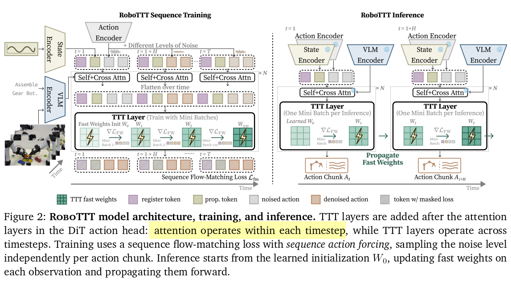
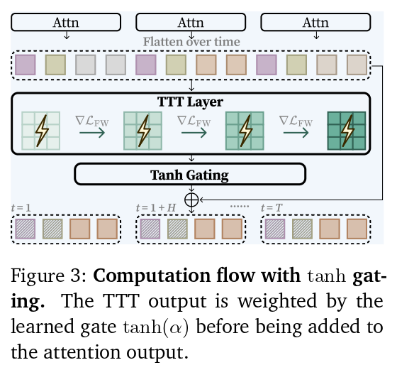
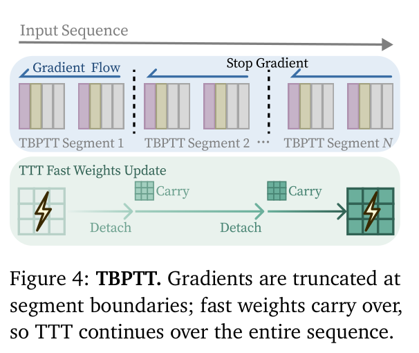
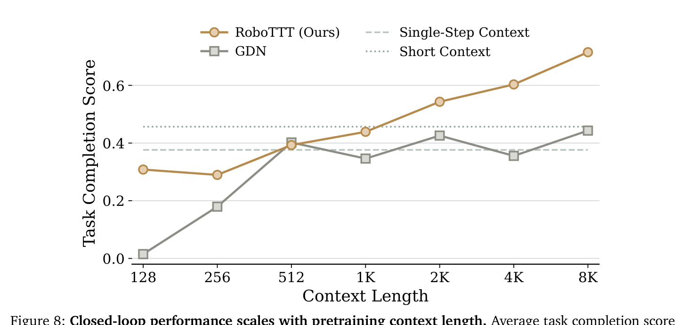

# RoboTTT：上下文缩放机器人策略

[打开本地论文 PDF](../../../raw/papers/nvidia-series/nvidia-robottt-context-scaling-2607.pdf)

## 概述

### 背景

1. 当前主流的机器人基础模型，包括各类 VLA，几乎都以单步或极短历史（通常 2~8 帧）的视觉运动上下文运行。在语言模型领域，上下文长度早已成为关键缩放轴——从 GPT-3 的 2K 到 Gemini 的 1M+ token，长上下文解锁了 in-context learning、多轮推理、长文档理解等能力。然而在机器人控制中，上下文长度这一维度尚未被系统探索：长视觉运动上下文对于从人类视频进行单次 in-context 模仿、从部署历史中持续在线改进、以及多阶段长程任务的闭环性能至关重要。
2. 将上下文扩展到数千时间步面临三个相互关联的挑战：**编码能力**——标准 Transformer 的 KV cache 随历史线性增长，在数千步机器人轨迹上推理延迟和显存消耗不可接受，传统 RNN 的固定大小向量状态容量有限；**利用效率**——如论文中 GDN（Gated DeltaNet）基线所示，循环记忆策略可以编码上下文信息，但在需要时却无法有效检索利用（"记住了但用不上"）；**推理开销**——直接拼接过多历史帧会引入虚假关联（spurious correlations），导致推理时面对分布略微不同的观测序列时性能急剧退化。
3. 核心问题：能否构建一个在任意长度的视觉运动上下文中学习并有效利用信息的机器人策略，同时保持推理成本恒定？

### 解决思路

1. RoboTTT 将 Test-Time Training（TTT）集成到机器人基础模型中，用**快速权重（fast weights）**作为序列模型的循环状态——它将历史压缩到权重空间，检索时只需一次前向传播，推理成本恒定，不随上下文长度增长。
2. 结合 Sequence Action Forcing（独立噪声采样）和 TBPTT（梯度截断但快权重跨段传递）的训练配方，使在 8K 时间步序列上的端到端训练变得可行。
3. 核心直觉：传统 RNN 用固定规则更新隐状态（如 LSTM 门控），"如何记住历史"是手工设计的；RoboTTT 用梯度下降更新快权重，"如何记住历史"本身是可学习的——外层任务损失通过二阶梯度同时优化快权重的初始化 $W_0$、更新规则（学习率 $\eta$）和输入投影矩阵，使得整个记忆机制针对下游任务自适应优化。

---

## 1. 技术详解

### 1.1. 原理

RoboTTT 的核心思想可以概括为：**用可学习的参数更新替代不可学习的隐状态传播**。

*Figure 2: RoboTTT 模型架构、训练与推理流程。左侧为训练时使用完整轨迹和 Sequence Action Forcing；右侧为推理时从 $W_0$ 开始逐步更新快权重。*

考虑输入 token 序列的 query/key/value 投影 $(Q, K, V)$，每个 TTT 层维护一套快权重 $W$，参数化一个小型神经网络 $f_W(\cdot): \mathbb{R}^d \to \mathbb{R}^d$（论文中使用 2 层 MLP）。在每个时间步 $t$ 执行两步操作：

**更新步（Update）**——将当前 token 信息压缩进快权重：
$$
W_t \leftarrow W_{t-1} - \eta \nabla_W \mathcal{L}_{\text{FW}}(f_{W_{t-1}}(K_t), V_t)
$$
其中 $\mathcal{L}_{\text{FW}}(\hat{v}, v) = \|\hat{v} - v\|^2$ 为 MSE 自监督损失，$\eta$ 是可学习的学习率。这一步将 key-value 关联编码进快模型的参数空间——直觉上，快模型学会了"给定这个 key，应该输出什么 value"。

**应用步（Apply）**——从快权重中检索信息：
$$
O_t = f_{W_t}(Q_t)
$$
用更新后的快权重处理当前 query，输出用于下游预测。

这个"先更新再应用"的过程在训练和推理两个阶段完全一致地运行。在推理时，TTT 将之前所有已处理的 token 压缩到其快权重中（固定大小的 MLP 参数），而标准全注意力则需要保留所有历史 K/V 并每步做注意力计算（KV cache 线性增长）。投影矩阵 $\theta_Q, \theta_K, \theta_V$ 和快权重初始化 $W_0$ 都通过外层任务损失联合学习，使得整个历史压缩-检索机制针对下游任务端到端优化。

### 1.2. 技术实现

#### 1.2.1. 输入与输出

输入：
- 图像观测 $o_t$（多视角 RGB，4 路摄像头）
- 本体感知 $q_t$（关节角度等）
- 语言指令 $l$（跨整条轨迹共享）
- 加噪动作 token $\tilde{A}_t$（Flow Matching 输入）

输出：
- $H$ 步去噪动作块 $A_t = [a_t, \dots, a_{t+H-1}]$，其中 $H = 16$
- 推理时使用 $K = 4$ 步去噪（Flow Matching 的 ODE 积分步数）

#### 1.2.2. 架构集成

RoboTTT 实例化在 GR00T N1.7 之上。GR00T N1.7 的双系统架构中：

- **System 2（VLM Backbone）**：Cosmos-Reason2-2B，冻结，将多视角图像和语言指令编码为 VL tokens $\Phi_t$。
- **System 1（DiT 动作头）**：16 层 Transformer + Flow Matching，接收 VL tokens 和本体感知，输出去噪动作。

RoboTTT 在 DiT 的每一层自注意力和交叉注意力之后插入 TTT 层。注意力层处理单时间步内的 token（register tokens $R_t$、状态 $q_t$、加噪动作 $\tilde{A}_t$），交叉关注该时间步的 VL tokens $\Phi_t$。各时间步的注意力输出沿时间维度拼接后送入 TTT 层进行跨时间维度的快权重更新。

为了计算效率，VL tokens $\Phi$ 不直接通过 TTT 层（否则每一步都需要重新编码所有历史 VL tokens），而是依赖每时间步前置的 $N = 16$ 个 learned register tokens 来跨时间步携带 VL 信息。Register tokens 通过交叉注意力从 $\Phi_t$ 中提取信息，然后作为 TTT 层的输入 token 之一参与快权重更新。

#### 1.2.3. Tanh 门控机制

*Figure 3: Tanh 门控的计算流程。TTT 层输出经 $\tanh(\alpha)$ 加权后与注意力输出相加。*

由于 RoboTTT 从预训练的 GR00T N1.7 权重初始化，需要保护预训练知识不被 TTT 层在训练初期破坏。每个 DiT 层学习一个门控参数 $\alpha \in \mathbb{R}^d$，初始化接近零（0.001），使得训练初期 $\tanh(\alpha) \approx 0$：

$$
O = \tanh(\alpha) \odot O_{\text{TTT}} + O_{\text{attn}}
$$

训练初期 TTT 贡献极小，模型行为接近原始预训练基线。随着训练推进，$\alpha$ 自适应地调节 TTT 层的贡献度，避免 TTT 在训练早期淹没预训练模型的计算结果。这是一种平滑的"预热"机制——门控参数从零开始增长，逐步让 TTT 层接管跨时间步的信息整合。

### 1.3. 训练配方：Sequence Action Forcing + TBPTT

RoboTTT 在完整的机器人轨迹序列上端到端训练，使快权重在序列内持续更新，同时学习合适的初始化 $W_0$ 和更新动态。外层优化器更新所有慢权重（投影矩阵 $\theta_Q, \theta_K, \theta_V$、门控参数 $\alpha$、$W_0$ 初始化）；内层循环则在每条轨迹上运行 TTT 更新快权重。

#### 1.3.1. Sequence Action Forcing

DiT 动作头使用 Flow Matching 目标。加噪动作通过线性插值获得：
$$
\tilde{A}_t = A_t^{\tau_t} = \tau_t A_t + (1 - \tau_t)\epsilon, \quad \epsilon \sim \mathcal{N}(0, I)
$$
其中 $\tau_t \in [0, 1]$ 是 flow-matching 时间步，控制噪声水平。

关键发现：**必须对序列中每个 action chunk 独立采样噪声水平 $\tau_t$**。如果共享同一噪声水平（全序列扩散），整个序列要么一致容易（低噪声）要么一致困难（高噪声），训练不稳定。具体采样策略为：
$$
\tau_t = s(1 - u), \quad u \sim \text{Beta}(1.5, 1), \quad s = 0.999
$$
Beta 分布偏向较小 $u$ 值，使得 $\tau_t$ 偏向较大值（即噪声水平偏向较高端），这有助于训练稳定性。

序列整体损失为各时间步的期望损失平均：
$$
\mathcal{L}_{\text{fm}}(\xi; W_0) = \frac{1}{T}\sum_{t=1}^{T} \mathbb{E}_{\tau_t,\epsilon}\left\|v_\theta(\Phi_t, A_t^{\tau_t}, q_t; W_{t-1}) - (A_t - \epsilon)\right\|^2
$$
其中 $v_\theta$ 是预测的向量场（Flow Matching 的速度预测），$W_{t-1}$ 是上一步更新后的快权重。注意 loss 依赖 $W_{t-1}$，而 $W_{t-1}$ 本身是 $W_0$ 通过梯度下降更新的结果——这产生了二阶梯度依赖，使 $W_0$ 的元学习成为可能。

#### 1.3.2. Truncated Backpropagation Through Time (TBPTT)

*Figure 4: TBPTT 示意图。梯度在各段边界截断，但快权重跨段传递，TTT 在整个序列上连续运行。*

全 BPTT 需要存储每个时间步的激活值，GPU 显存随序列长度线性增长。TBPTT 将输入序列分成多个段，梯度只在段内流动。关键设计是：**快权重跨段传递（carry over），其梯度在段边界 detach**。这样：

- GPU 显存取决于段长而非总序列长，允许在固定显存预算下训练任意长的上下文
- 快权重 $W_0$ 仍通过第一段的梯度接收更新信号（因为第一段的快权重更新直接源自 $W_0$）
- 快权重在段间的连续传播保持了序列的因果一致性，模型仍能学习长程依赖

### 1.4. 从上下文中有效学习：Loss Masking

RoboTTT 通过掩码特定时间步的 flow-matching loss，使其成为纯上下文——这些步骤只更新快权重而不提供动作监督目标。这解锁了两种新的学习能力。

#### 1.4.1. In-Context 单次模仿

将人类演示视频序列 $\xi_{\text{video}}$ 与同任务机器人轨迹 $\xi_{\text{robot}}$ 拼接为一条训练序列。视频部分的 loss 被掩码（只更新快权重，不计算动作 loss），机器人部分正常计算动作 loss。训练后，模型学会了从 in-context 视频中提取任务配置信息；测试时，只需在执行前提供一条未见配置的人类视频即可实现单次模仿，无需任何微调。

Circuit 任务上，RoboTTT 在 10 次试验中成功 6 次（65% 任务完成率），而 GDN 基线完全失败（0/10，33% 完成率）。这说明虽然循环记忆策略（GDN）能编码上下文信息，但难以有效利用——RoboTTT 通过查询由梯度下降更新的快模型，在需要时检索出视频中的配置信息。

#### 1.4.2. DAgger Distillation

DAgger Distillation 是 DAgger 思想在序列模型中的元学习实例化。当机器人在部署中犯错时，人类操作员介入纠正，产生交替轨迹 $\xi_{\text{DAgger}}$，其中每步动作 $A_t$ 要么是机器人次优动作 $A_t^R$，要么是人类纠正 $A_t^H$。

标准 DAgger 只用人类纠正微调，丢弃了次优机器人动作——但这些次优动作恰恰揭示了每次纠正所响应的错误模式。RoboTTT 不对称地使用两者：

- **所有执行的动作**（含次优机器人动作）→ 更新快权重作为上下文
- **flow-matching loss** → 只在人类纠正上计算

这种"失败为上下文、纠正为目标"的非对称性，正是将人类的失败→纠正映射蒸馏到快权重的机制。Pup Go Car 上，DAgger Distillation 比标准 DAgger 多获得 24% 的提升（+33% vs +9%），说明次优动作的价值在于作为上下文信息而非模仿目标。

### 1.5. 实验与性能

#### 1.5.1. 任务与平台

RoboTTT 在三个真实双臂灵巧装配任务上评估，使用 YAM 平台（4 路 RGB 摄像头）：

- **Pup Go Car**：玩具车组装，约 2 分钟，包含多个子步骤
- **Circuit**：电路板组装，80 种不同配置，测试泛化能力
- **Gear Bot**：10 阶段齿轮装配，约 5 分钟，测试长程多阶段能力

#### 1.5.2. 主评估结果

任务完成率（%，20 次试验/任务，Gear Bot 为 10 次）：

| 方法 | Pup Go Car | Circuit | Gear Bot |
|------|-----------|---------|---------|
| **RoboTTT** | **57%** | **65%** | **20%** |
| GR00T N1.7（单步） | 15% | 15% | 0% |
| GR00T N1.7 Hist.（1 帧历史） | 0% | 40% | 0% |
| GDN（DeltaNet 循环记忆） | 15% | 40% | 0% |

完全成功次数（即完整完成任务所有步骤）：
- RoboTTT: 9 / 13 / 2（Pup Go Car / Circuit / Gear Bot）
- 所有基线在 Gear Bot 上全部为 0 —— RoboTTT 是唯一完成过 5 分钟 10 阶段装配任务的方法

#### 1.5.3. Context Scaling Law

*Figure 8: 闭环性能随预训练上下文长度稳定上升。RoboTTT 从 128 到 8K 时间步持续改进无饱和迹象；GDN 不受益于更长上下文。*

这是论文最关键的发现之一：**首次观察到预训练上下文长度与机器人策略闭环性能呈稳定的正相关关系**，暗示上下文长度可能成为机器人基础模型的新缩放轴。

Pup Go Car 上不同预训练上下文长度的性能（任务完成率）：

| 预训练上下文 | RoboTTT | GDN | 单步基线 | 短上下文基线 |
|-------------|---------|-----|----------|-------------|
| 128 (~4s) | ~3% | ~3% | 42% | 46% |
| 256 (~9s) | ~18% | — | — | — |
| 512 (~17s) | ~38% | ~39% | — | — |
| 1K (~33s) | 44% | 43% | — | 46% |
| 2K (~67s) | 55% | 37% | — | — |
| 4K (~133s) | 60% | 39% | — | — |
| 8K (~267s) | **71.5%** | 44% | — | — |

关键观察：

- RoboTTT-8K 比 RoboTTT-1K 高约 63% 相对提升，比最佳短上下文基线高约 57%
- GDN（线性 delta rule 循环记忆）不受益于更长上下文——其性能在约 1K 后饱和甚至略微下降
- 差异来源：RoboTTT 的非线性快模型通过梯度下降更新，且外层损失元学习了 $W_0$ 和更新动态；GDN 的线性关联状态不具备这种元学习能力
- 低于 1K 时 RoboTTT 表现受限：rollout 地平线超出训练上下文窗口，位置嵌入延伸到未见位置，导致性能退化

#### 1.5.4. 新能力验证

**单次 In-Context 模仿**（Circuit 未见配置，10 次试验）：
- RoboTTT: 6/10 成功，65% 完成率
- GDN: 0/10 成功，33% 完成率

**外部扰动鲁棒性**（移除已安装部件后恢复，20 次试验）：

| 方法 | Roof 扰动恢复 | Tire 扰动恢复 |
|------|-------------|-------------|
| **RoboTTT** | **15/20** | **18/20** |
| GDN | 13/20 | 18/20 |
| GR00T N1.7 | 10/20 | 11/20 |
| GR00T N1.7 Hist. | 3/20 | 5/20 |

**DAgger Distillation vs 标准方法**（Pup Go Car，100 条 DAgger 轨迹）：
- DAgger Distillation（RoboTTT）: **+36%** 绝对提升
- DAgger Distillation（GDN）: +29%
- 标准 DAgger（仅人类纠正微调）: +9%
- 用完整轨迹（含次优动作）微调: 与标准 DAgger 相同 → 证明次优动作的价值在于作为上下文，而非模仿目标

#### 1.5.5. 消融实验

Pup Go Car 上的消融（任务完成率）：

| 设计选择 | 完成率 |
|---------|--------|
| **RoboTTT（完整）** | **~57%** |
| − Sequence Action Forcing | 显著下降（运动不准确，无法产生有意义动作） |
| − MLP 快模型 → Linear 快模型 | ~30%（−27%） |
| 仅 State Tokens 过 TTT | ~35% |
| + Action Tokens（+23% 相对提升） | ~43% |
| + Register Tokens（+18% 相对提升） | ~51% |
| GR00T N1.7 + Register Tokens（无 TTT） | 无帮助 |

关键结论：
1. **Sequence Action Forcing 不可或缺**：去掉后无法产生有意义的运动，说明独立噪声采样对训练稳定性至关重要
2. **非线性快模型重要**：MLP 比 Linear 层高 27 个百分点，与 TTT 在视觉/语言领域的发现一致——非线性参数空间提供更大的编码容量
3. **Register Tokens 只在有 TTT 时有益**：单独添加 register tokens 对 GR00T N1.7 无帮助，说明 register 的价值在于配合 TTT 的跨时间步建模，而非独立提供额外信息
4. **Token 组合渐进式改善**：State → +Action (+23%) → +Register (+18%)，每种 token 类型贡献独立且可叠加

#### 1.5.6. 与其他方法的多维对比

| 维度 | RoboTTT | GR00T N1.7（单步） | GDN（DeltaNet） |
|------|---------|-------------------|-----------------|
| 上下文长度 | 8K 步（~5 min） | 1 步 | 可变（固定状态大小） |
| 序列建模机制 | TTT 快权重（梯度下降更新） | 无 | Delta rule（线性关联更新） |
| 推理延迟增长 | 否（恒定） | 否 | 否 |
| 编码容量 | 高（MLP 参数空间） | N/A | 中（固定大小状态） |
| 元学习支持 | 是（$W_0$ 通过二阶梯度优化） | 否 | 否 |
| 单次模仿 | 支持（6/10 成功） | 不支持 | 不支持（0/10） |
| 在线自我改进 | 支持（DAgger Distillation） | 有限 | 支持（较弱） |
| 扰动鲁棒性 | 强（75-90%） | 弱（50-55%） | 中（65-90%） |
| 长程任务表现 | 最优（唯一完成 5min 任务） | 最弱 | 中等 |

---

## 2. 信息完备性检查（5W2H）

| 维度 | 评估 | 内容 |
|------|------|------|
| **What** | ✅ | 将 TTT 快权重集成到机器人 VLA 策略中，作为序列模型的循环状态，实现恒定推理成本的任意长上下文建模 |
| **Why** | ✅ | 当前 VLA 以单步/短历史运行，长上下文对于 in-context 模仿、在线改进、长程任务闭环至关重要；标准 Transformer KV cache 线性增长不可行 |
| **Who** | ✅ | NVIDIA GEAR 团队提出，基于 GR00T N1.7 构建，目标用户为机器人基础模型研究者和具身智能系统开发者 |
| **When** | ✅ | 论文发表于 2026 年 7 月（预印本），技术处于概念验证阶段 |
| **Where** | ✅ | 适用于多步机器人操作任务，尤其是需要长程上下文的双臂灵巧装配场景；当前验证限于 YAM 平台的三类装配任务，泛化到移动操作、导航等场景待验证 |
| **How** | ✅ | 方法步骤明确：TTT 快权重（MLP 参数化 + 梯度下降更新）+ Sequence Action Forcing（独立噪声采样）+ TBPTT（梯度截断）+ Tanh 门控保护预训练知识 + Loss Masking 解锁 in-context 模仿和 DAgger Distillation |
| **How much** | ⚠️ | 训练成本：在 8K 上下文序列上训练，需要多 GPU 并行（具体 GPU 数量和训练时长未披露）；推理延迟：声称恒定但未提供具体毫秒数；快权重参数量：未明确说明 MLP 的具体维度；数据规模：三个任务各使用多少条轨迹未详述；代码和模型未开源 |

**关键信息缺口**：

1. **训练计算成本**：论文未报告训练 8K 上下文模型所需的 GPU 数量、训练时长和总计算量（FLOPs），这对于评估方法的实际可行性至关重要
2. **推理延迟数据**：虽然声称推理成本恒定，但未提供绝对延迟数值（ms/step），无法与单步 VLA 的延迟做直接对比
3. **快权重参数量**：TTT 层的 MLP 具体维度（输入/隐藏/输出大小）未披露，无法评估快权重相对于 KV cache 的存储优势
4. **数据需求**：三个任务各需要多少条训练轨迹？数据效率如何？与单步基线相比，长上下文训练是否降低了数据效率？
5. **跨硬件平台延迟**：推理延迟实验在什么 GPU 上进行？不同硬件（如边缘设备 Jetson）上的表现如何？
6. **超出 8K 的行为**：上下文从 8K 继续扩展到 16K、32K 时曲线是否最终饱和？

---

## 3. 批判性分析

### 3.1. 论证强度评估

**强项**：

- **Context Scaling Law 的发现具有领域意义**：8K 内无饱和的持续提升是首次在机器人策略中观察到，且实验设计严谨——同一任务、同一模型架构、仅改变训练上下文长度，控制变量清晰
- **消融实验设计合理**：逐一拆解 Sequence Action Forcing、MLP 快模型、各 token 类型的贡献，因果链清晰；特别是 Register Tokens 只在 TTT 存在时有益的发现，排除了"register 本身提供额外信息"的替代解释
- **与 GDN 的对比有说服力**：GDN 作为线性循环记忆代表，在短上下文下与 RoboTTT 相当，但长上下文下性能停滞——直接证明了"非线性梯度下降更新"优于"线性规则更新"
- **DAgger Distillation 的不对称设计有洞察**：通过消融证明"次优动作作为上下文"而非"作为模仿目标"的价值，实验设计干净
- **多任务验证**：三个任务覆盖不同难度（2 分钟 vs 5 分钟）和不同泛化要求（80 种配置），Gear Bot 上 0→20% 的突破具有实际意义

**弱项**：

- **绝对成功率仍然偏低**：Pup Go Car 57%、Circuit 65%、Gear Bot 仅 20%，距离实用部署仍有显著差距。在 Gear Bot 上 10 次试验仅 2 次完全成功——论文将此作为"唯一完成的方法"来突出，但 20% 的成功率难以支撑"长上下文是关键"的强主张
- **训练成本未披露**：8K 上下文的 TBPTT 训练需要多少 GPU 天？相对于单步基线，长上下文训练带来的额外计算开销是否值得？
- **任务类型单一**：全部为双臂桌面装配，缺乏移动操作、导航、人机交互等不同任务类型，限制了"上下文缩放"作为通用现象的论证
- **与标准 Transformer 长上下文方案对比缺失**：论文主对比对象是 GDN（线性循环记忆），但未与使用 KV cache 压缩技术（如 RingAttention、StreamingLLM）的全注意力 Transformer 做对比——这些方案同样追求恒定推理成本
- **Gear Bot 的成功率解读**：20% 成功率虽然比 0% 好，但统计显著性存疑（10 次试验中 2 次成功），论文未提供置信区间或统计检验

### 3.2. 潜在逻辑问题

**幸存者偏差**：论文展示的缩放曲线（Figure 8）在 8K 处无饱和，但这是否意味着 16K、32K 也会持续提升？论文未测试超出 8K 的上下文长度，也未讨论可能的饱和点。在语言模型中，上下文长度的收益最终会饱和——机器人策略很可能也遵循类似规律。

**因果推断的替代解释**：论文将长上下文带来的性能提升归因于 TTT 快权重的编码能力。但替代解释包括：
- 更长上下文意味着模型看到了更多训练数据（每个序列包含更多时间步），提升可能来自数据量的增加而非上下文长度本身
- 更长上下文可能让模型在训练时看到了更多样的状态-动作组合，提升了泛化能力而非上下文利用能力
- 论文通过固定总训练步数来控制数据量，但未明确说明是否控制了每个序列的"有效信息密度"

**Gear Bot 基线选择**：Gear Bot 上所有基线为 0%，这可能是任务本身对单步策略过于困难，而非长上下文的独特优势。更公平的对比应包括：使用更多历史帧的 GR00T N1.7（如 8 帧、16 帧而非仅 1 帧），以及使用显式记忆模块的方案。

**Tanh 门控的初始化偏差**：$\alpha$ 初始化为 0.001，使得训练初期 TTT 几乎没有贡献。如果最终性能主要来自 TTT，那么训练初期的大量时间可能被浪费在"等 $\alpha$ 增长"上。论文未分析 $\alpha$ 的收敛速度和最终值。

**TBPTT 的梯度截断对元学习的影响**：$W_0$ 的元学习依赖于二阶梯度，但 TBPTT 在段边界截断梯度——这意味着 $W_0$ 只能通过第一段接收梯度信号。如果第一段的信息不足以学习好的初始化，$W_0$ 的元学习可能不充分。论文未讨论这一限制。

**基线的历史长度选择**：GR00T N1.7 Hist. 仅使用 1 帧历史，这明显不公平——如果单步 VLA 可以接入 2 帧、4 帧或 8 帧历史（通过拼接或简单的时序编码），性能可能显著提升。论文未系统性地探索短上下文基线在不同历史长度下的表现。

### 3.3. 未回答的关键问题

1. **长上下文收益的本质是什么？** 模型到底从长历史中学到了什么？是记住了更早的动作后果、学会了更长的因果链，还是仅仅多看了几个示例？可解释性分析缺失。

2. **快权重到底记住了什么？** 快权重是一个黑箱 MLP，无法直接解释其编码了什么信息。论文未提供任何可视化或探测分析。

3. **跨具身/跨任务的迁移能力如何？** 学到的 $W_0$ 初始化是否适用于新任务？是否需要重新训练？

4. **与 RL 的关系？** 论文提到"仍需结合 RL 直接优化任务成功率"，但未讨论 TTT 快权重与 RL 中的 credit assignment 如何交互。

5. **实时性？** 快权重的梯度下降更新增加了每步的计算量，虽然不随历史增长，但绝对延迟是否满足实时控制需求（通常 < 50ms）？

---

## 4. 第一性原理分析（First Principles）

> [占位] 本章将在后续迭代中补充，分析核心假设、还原到基本原理、评估方案最优性。

---

## 5. 系统思维分析（Systems Thinking）

> [占位] 本章将在后续迭代中补充，包括系统组件分析、因果循环图、杠杆点分析、跨领域模式识别。

---

## 6. 多视角评估（六顶思考帽）

> [占位] 本章将在后续迭代中补充，从白帽（事实）、红帽（直觉）、黑帽（风险）、黄帽（价值）、绿帽（创意）、蓝帽（过程）六个视角评估。

---

## 7. 逆向思维分析（Inversion）

> [占位] 本章将在后续迭代中补充，包括核心假设的逆向分析、预验尸（Pre-Mortem）、如何确保失败的推演。

---

## 8. 对比与关联

### 8.1. RoboTTT 与 PI-MEM 的记忆机制对比

RoboTTT 与 PI-MEM多尺度具身记忆 针对同一个痛点——**单步 VLA 搞不定长程任务**——但给出两条截然不同的"记忆"路线：RoboTTT 把历史压进模型权重（隐式快权重），PI-MEM 在外面挂一套显式多模态记忆库（显式分层）。

| 维度 | RoboTTT（隐式快权重） | PI-MEM（显式多模态记忆） |
|------|----------------------|--------------------------|
| 记忆本质 | 隐式——历史压进 2 层 MLP 快权重参数 | 显式——视频缓冲 + 自然语言日志 |
| 记忆结构 | 单一循环状态（快权重），短/长统一 | 双模态：视频短时 + 语言长时，刻意异构 |
| 策略数量 | 单一策略（GR00T N1.7 + TTT 层） | 双层策略 $\pi_{HL}$（控制器）+ $\pi_{LL}$（执行器） |
| 历史如何消费 | 每步过 TTT 更新，模型学到该保留什么 | 近期密集视频（K 秒）+ 稀疏语义事件（丢弃大部分原始历史） |
| 推理成本 | 恒定（快权重大小固定，不随上下文增长） | 视频窗固定 K 秒 + 语言极短，靠显式丢弃/压缩实现 |
| 可解释性 | 低（权重里，人看不懂记了啥） | 高（语言日志可读："已完成配料 X"） |
| 训练方式 | 元学习 $W_0$（二阶梯度）+ Sequence Action Forcing + TBPTT，在 8K 序列上训练 | 集成进 $\pi_{0.6}$（已有 RECAP/RL），$\pi_{HL}$ 是 VLM 产出语言+子目标 |
| 解锁能力 | 单次人类视频 in-context 模仿、DAgger Distillation 在线改进、扰动鲁棒 | 15min+ 分层任务执行、遮挡处理、语义进度跟踪、失败重规划 |
| Scaling 主张 | Context Scaling Law：预训练上下文越长闭环越好，8K 仍无饱和 | 多尺度记忆是长程关键；靠语言高压缩率撑 15min+ |

**核心分歧：记忆该"学"还是该"存"。** RoboTTT 认为"该记住什么"不该由人设计（如手工决定存哪些关键帧），而应让模型通过梯度下降自己学——快权重在训练和推理时都被同一自监督损失更新，自动保留显著特征、丢弃冗余。PI-MEM 则持相反立场："没有单一模态能解决所有记忆需求"，于是显式分层：近期精确空间信息用视频存（稠密但短），长程语义进度用自然语言存（高压缩但抽象），并配一个高层策略做语义压缩。

**一个旁证**：RoboTTT 的对照组 GDN（Gated DeltaNet，线性循环记忆）更接近 PI-MEM 视频记忆的"定长压缩状态"思路，但 RoboTTT 的非线性快权重（靠梯度下降更新）明显胜出，论证"学出来的"非线性压缩 > "规则式"的定长压缩。这正点出两条路线的优劣：PI-MEM 赢在可读、可迁移、可干预，RoboTTT 赢在表达力随上下文长度持续 scaling。

**两者互补而非竞争**：RoboTTT 在 8K（~5min）稠密连续记忆上最强且成本恒定、无饱和；PI-MEM 用显式语言记忆把跨度拉到 15min+ 且记忆人能读、能调试。二者甚至可叠加：用 RoboTTT 的 TTT 快权重做递归核心，再外接 PI-MEM 式自然语言长时记忆处理超长跨度的语义进度。

### 8.2. 与其他相关方法对比

> [占位] 本章将在后续迭代中扩展，加入与 WAM-TTT、[ASPIRE](nvidia-aspire.md)、RL-100 等方法的系统对比。

---

## 9. 总结与行动建议

> [占位] 本章将在后续迭代中补充，包括 Top 3 核心洞察、局限与未来方向。

---

## 10. 参考

- 论文原文（PDF）：`raw/papers/nvidia-robottt-context-scaling-2607.pdf`
- 项目页面：[https://research.nvidia.com/labs/gear/robottt/](https://research.nvidia.com/labs/gear/robottt/)
- GR00T N1.7 论文：[arXiv:2503.14734](../../../raw/papers/nvidia-series/nvidia-gr00t-n1-2503.14734.pdf)（[在线原文](https://arxiv.org/abs/2503.14734)）
- TTT 原始工作：[arXiv:2407.04620](https://arxiv.org/abs/2407.04620) (Sun et al.), [arXiv:2505.23884](https://arxiv.org/abs/2505.23884) (Zhang et al.)

---

## 11. 反向链接

- NVIDIA系列VLA技术解析 — RoboTTT 是 GR00T N1.7 的上下文扩展变体
- VLA视觉语言动作模型 — RoboTTT 属于 VLA 范畴，解决 VLA 的上下文长度瓶颈
- FlowMatching流匹配原理 — RoboTTT 使用 Flow Matching 作为动作生成目标
- CR-DAgger柔顺残差策略 — DAgger Distillation 的 DAgger 思想来源
- VLA基础和技术发展历程 — 代表 VLA 向长上下文方向的探索
- PI-MEM多尺度具身记忆 — 显式多模态记忆路线，同一长程痛点的对照方案
- WAM-TTT人类视频测试时引导 — 同样用 TTT 快权重，但记人类演示视频而非本体历史
- [ASPIRE智能体技能发现系统](nvidia-aspire.md) — 同为 NVIDIA GEAR 团队的具身智能研究项目
- RL-100真实世界操作强化学习 — 另一种提升机器人策略闭环性能的方法（RL 后训练）
- 机器人 In-Context Learning 与测试时引导综合 — 隐式快权重 vs 显式记忆、本体历史 vs 人类视频的综合对比
- Sunday Robotics 技术解析 — 家用机器人 Memo 与 ACT-1/2 基础模型、Skill Capture Glove/Skill Transform 数据引擎