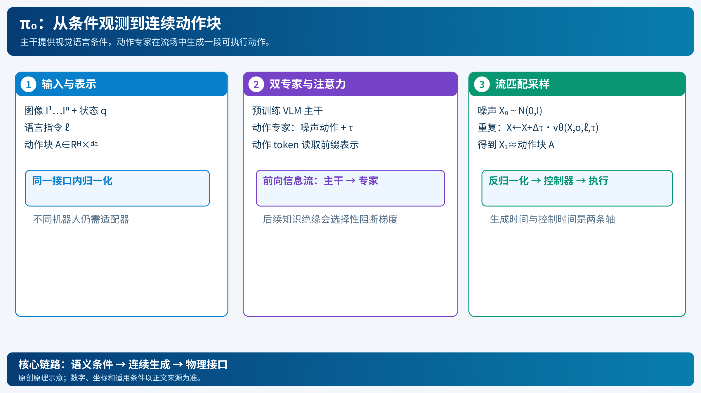

# π₀：把图像和指令变成连续动作

[打开本地论文 PDF](../../../raw/papers/pi-series/pi0.pdf)

机器人看见一堆衣服，收到“把衣服叠好”的指令。识别衣服只是第一步：机器人还得决定两只手如何抓、往哪里拉，以及夹爪何时松开。π₀研究的是怎样利用预训练视觉语言模型的知识，直接预测一小段连续机器人动作，而不用把每个关节角逐个翻译成文字。[论文 §IV–V](../../../raw/papers/pi-series/pi0.pdf)（[在线原文](https://arxiv.org/html/2410.24164v4#S4)）

## 1. 先理解动作块：一次预测一段，执行后再看

设当前控制时刻为 $t$，观测为 $o_t=(I_t^1,\ldots,I_t^n,q_t)$，其中图像 $I_t^i$ 来自第 $i$ 个相机，$q_t\in\mathbb R^{d_q}$ 是关节、夹爪等机器人状态；$\ell$ 是语言指令。策略预测

$$
A_t=[a_t,\ldots,a_{t+H-1}]\in\mathbb R^{H\times d_a},
\qquad A_t\sim\pi_\theta(\cdot\mid o_t,\ell).
$$

$H$ 是预测步数，$d_a$ 是动作维度。一个块内的动作具有相关性，例如“左手保持、右手拉开衣角”；逐维输出容易割裂这种协作。部署时可以只执行其中一部分，再用新观测预测下一块，从而形成反馈。

这里的 $a_t$ 是控制接口中的命令，不必是力矩。关节角、末端位置增量、夹爪开度不能混为同一种数；角度可能用弧度、位置可能用米，归一化后才进入模型。π₀论文的数据包含不同本体及动作接口，不能因为网络向量长度一致，就认为它们共享物理坐标系。[论文 §V-C、附录模型细节](../../../raw/papers/pi-series/pi0.pdf)（[在线原文](https://arxiv.org/html/2410.24164v4#S5)）

*原创示意：上半部分是模型信息流，下半部分是训练与采样；积分变量不是机器人控制时间。[SVG](../../imgs/pi-flow.svg)。*

## 2. 为什么需要动作专家

π₀从 PaliGemma 的预训练权重出发，用视觉语言主干处理图像和文字，再加入独立参数的动作专家处理状态、带噪动作和流匹配时间。原论文使用约 3B 参数的视觉语言模型和约 300M 参数的动作专家。[论文 §IV](../../../raw/papers/pi-series/pi0.pdf)（[在线原文](https://arxiv.org/html/2410.24164v4#S4)）

“专家”在这里是不同 token 使用不同权重，不能直接理解为每一步由一个门控器只挑选某个模块。动作 token 通过注意力读取图像和语言的表示，并在动作块内互相交流。分块注意力不让图像/语言前缀反过来依赖未来动作，既维持条件生成方向，也便于推理时缓存前缀。

这样分工有两个理由：预训练主干已有视觉语义能力；动作专家可以专门适配连续控制，并在多次去噪时复用已经算好的观测表示。缓存减少重复计算，但不会让相机采集、网络传输和控制执行的时间消失。

## 3. 流匹配到底学什么

想象把一段真实抓取轨迹与一段随机数连接起来。训练时让网络学习连接路径上的“移动方向”；推理时从随机数出发，沿学到的方向走到动作分布。

以下采用**论文的噪声到数据约定**：$\tau=0$ 是噪声，$\tau=1$ 是动作。对归一化真实动作块 $A$ 和独立标准高斯噪声 $\epsilon$，定义

$$
X_\tau=(1-\tau)\epsilon+\tau A,
\qquad u=A-\epsilon.
$$

$X_\tau,u\in\mathbb R^{H\times d_a}$。对这条直线路径求导，$dX_\tau/d\tau=A-\epsilon$，所以速度监督是 $u$，而不是动作本身。条件流匹配损失为

$$
\mathcal L_{\rm FM}
=\mathbb E_{A,o,\ell,\epsilon,\tau}
\left[\|v_\theta(X_\tau,o,\ell,\tau)-(A-\epsilon)\|_F^2\right].
$$

同一个带噪输入可能对应多个真实动作，网络拟合的是条件速度场；它并非记住一条从每个随机数到固定轨迹的配对。上式省略了样本与有效维度的掩码和损失归约细节，用于说明监督对象。[论文 §IV 的条件路径与目标](../../../raw/papers/pi-series/pi0.pdf)（[在线原文](https://arxiv.org/html/2410.24164v4#S4)）

这个约定还有一个容易检查的结果：

$$
X_\tau\mid A\sim\mathcal N\!\left(\tau A,(1-\tau)^2I\right).
$$

标准差系数是 $1-\tau$，因此协方差必须平方。旧文将该线性插值与 $(1-\tau)I$ 的协方差并列，二者不一致。

### 一个可以手算的例子

只看一个标量动作，令 $A=0.8$、$\epsilon=-0.2$。$\tau=0.3$ 时 $X_\tau=0.1$，目标速度为 $1.0$。若速度预测恰好正确，用步长 $0.1$ 积分得到 $0.2$，正好等于 $X_{0.4}$。真实网络需要在大量样本上学习这个关系，采样误差与离散积分误差都可能存在。

## 4. 训练与部署分开看

训练流程是：从机器人轨迹截取观测和未来动作块，按机器人接口归一化；采样噪声及 $\tau$；构造 $X_\tau$；输入主干和动作专家；用速度误差反向传播。π₀本身的动作专家梯度可以更新主干，后续[知识绝缘](pi-knowledge-insulation.md)改变了这一点。

部署流程是：采集新观测，编码图像和指令并缓存前缀；初始化 $X_0\sim\mathcal N(0,I)$；重复

$$
X_{\tau+\Delta\tau}=X_\tau+\Delta\tau\,
v_\theta(X_\tau,o,\ell,\tau);
$$

到达数据端后，反归一化、转换到机器人接口并送入控制器。积分十步不等于机器人只动十步；前者是生成动作块的数值求解，后者是控制时间轴。原论文使用十步采样，动作可按 50 Hz 执行；这些数值属于论文设置，并非所有硬件的端到端延迟保证。[论文附录推理细节](../../../raw/papers/pi-series/pi0.pdf)（[在线原文](https://arxiv.org/html/2410.24164v4#A1)）

预训练让模型见到多任务、多本体的广泛状态，后训练使用目标任务的高质量数据改善执行。π₀继承了 VLM 的互联网预训练知识，但不能因此说其机器人训练直接使用了任意互联网视频。π₀.₅明确加入更多视觉语言共训练任务，二者的数据阶段要分开。[论文 §V-A](../../../raw/papers/pi-series/pi0.pdf)（[在线原文](https://arxiv.org/html/2410.24164v4#S5.SS1)）

## 5. 实际代码为什么看起来符号相反

固定快照的 OpenPI 使用 $s=1$ 表示噪声、$s=0$ 表示数据：

$$
X_s=s\epsilon+(1-s)A,\qquad u_s=\epsilon-A,\qquad\Delta s<0.
$$

令 $s=1-\tau$ 就与前述公式对应。若只抄速度符号，却忘记积分方向，会把样本推向错误方向。代码中 `compute_loss` 构造这一目标，`sample_actions` 使用负步长，并缓存前缀 KV。[固定 commit 的 pi0.py](https://github.com/Physical-Intelligence/openpi/blob/215abfb217dbac7d5f1273282331b9b1866c0479/src/openpi/models/pi0.py#L189)

同一快照的默认配置是动作维度 32、预测长度 50；原论文有其自身的本体填充配置。32 是模型容器维度，不代表每台机器人的物理自由度，也不能拿它修改历史论文的描述。输入输出还需匹配训练时的归一化和适配器。[固定配置](https://github.com/Physical-Intelligence/openpi/blob/215abfb217dbac7d5f1273282331b9b1866c0479/src/openpi/models/pi0_config.py#L25)

## 6. 能力与限制

流匹配能直接生成相关的连续动作块，适合表达多种抓取策略；代价是多次网络计算。动作块可以缓解逐步生成的成本，却带来推理期间反馈过时、跨块策略不一致的问题，具体见[RTC](pi-rtc-real-time-chunking.md)。

多本体预训练提供迁移基础，但不能自动解决新机器人的标定、控制语义与训练覆盖。单帧观测还可能无法分辨任务进度，失败恢复与长程记忆也不是连续动作生成本身能保证的能力。

本文核验了论文机制和指定代码片段，没有运行训练、机器人评测或延迟复测。系列中的位置与后续改进见[π 系列综述](../../01-comprehensive/01-embodied-ai/pi-series-overview.md)；来源归档见[证据记录](../../../raw/entries/2026-11-06-pi-series.md)。
