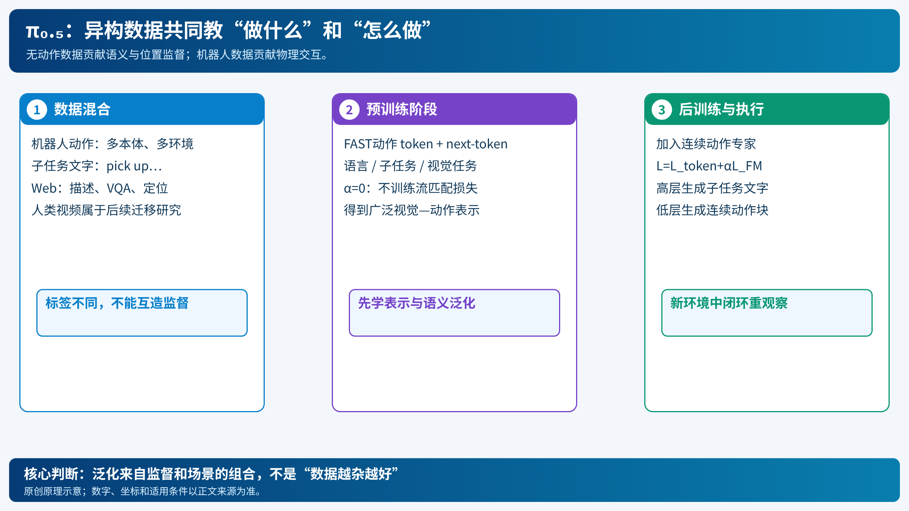

# π₀.₅：让“知道是什么”与“知道怎么动”共同学习

[打开本地论文 PDF](../../../raw/papers/pi-series/pi05.pdf)

机器人在实验室能把杯子放进水槽，换一个家庭却失败：可能认不出新杯子，可能不知道该收拾什么，也可能根本够不到目标。π₀.₅把这些困难看成不同层次的泛化问题，利用异构数据共同训练语义判断、子任务选择和连续控制。[论文 §I、IV](../../../raw/papers/pi-series/pi05.pdf)（[在线原文](https://arxiv.org/html/2504.16054v1#S4)）

“开放世界”在这里指作者测试中的新家庭环境和物体泛化，不能扩大为任意任务、任意机器人都无需适配。

## 1. 一个清理卧室的例子

用户给目标 $g=$“整理卧室”。模型先根据当前图像决定子任务 $\hat\ell=$“把枕头放到床上”，再以该子任务为条件预测机械臂动作块。执行一部分后重新观察；枕头处理完，再选择下一子任务。

可把这种依赖写成

$$
p_\theta(\hat\ell,A\mid o,g)
=p_\theta(\hat\ell\mid o,g)\,
p_\theta(A\mid o,g,\hat\ell).
$$

$o$ 包含相机观测和机器人状态，$A\in\mathbb R^{H\times d_a}$ 是连续动作块。这是对论文推理流程的统一记号：同一个模型承担高层和低层职责，不要求额外训练一个完全独立的规划器。高层文字通过自回归生成，低层动作用流匹配专家生成。[官方“Training and inference”](https://www.pi.website/blog/pi05)

*原创示意：数据提供不同监督，推理按子任务和连续动作分工；人类动作视频研究是后续工作。[SVG](../../imgs/pi-co-training.svg)。*

## 2. 为什么没有动作的数据也有用

动作演示教模型怎样抓放，但不一定覆盖新物体的名字与用途。视觉问答和图像描述可以监督“这是什么”；目标框监督物体位置；带子任务标签的机器人视频教模型“下一步做什么”。这些来源提供不同标签，不需要每条样本都有动作。

| 训练任务 | 输入 | 监督输出 | 补充的能力 |
|---|---|---|---|
| 多本体机器人动作预测 | 图像、状态、指令 | 动作序列 | 物理交互和运动技能 |
| 多环境机器人动作预测 | 不同家庭中的观测 | 动作序列 | 场景变化下的操作 |
| 子任务预测 | 观测、总任务 | 子任务文字 | 语义分解与阶段选择 |
| 视觉语言任务 | 图片、问题或指令 | 文字或位置标签 | 开放词汇语义与视觉理解 |

上述任务的输入输出都能写成 Transformer 可处理的序列，但损失按样本类型选择。不能拿没有动作的 Web 样本虚构动作监督；也不能把后来的“人类视频与机器人动作共微调”反写成 π₀.₅首发论文的全部训练配方。[论文 §IV-C–D](../../../raw/papers/pi-series/pi05.pdf)（[在线原文](https://arxiv.org/html/2504.16054v1#S4.SS3)）

## 3. 第一阶段：先把动作变成可预测的 token

用 FAST 将动作块编码为离散序列，使机器人样本也可用 next-token prediction。不同任务通过提示和标签格式区分。用一个解释性的混合目标表达：

$$
\mathcal L_{\rm pre}
=\sum_k w_k\,
\mathbb E_{(x,y)\sim D_k}
\left[-\sum_{i\in\mathcal M_k}\log p_\theta(y_i\mid x,y_{<i})\right].
$$

$D_k$ 是第 $k$ 类数据；$w_k$ 是抽样/加权含义的统一表示；$\mathcal M_k$ 只选择有监督的输出位置。该式不是论文给出的逐项配置，而是解释为什么不同标签可以共同更新主干。具体混合比例应查论文，而不能从这条公式推出。

选择离散动作的理由是训练效率和与语言模型训练形式的兼容性；FAST压缩动作中的时间冗余，详细编码见[FAST](pi-fast-action-tokenization.md)。这个阶段不需要连续动作专家参与流匹配训练。

## 4. 第二阶段：增加连续动作专家

直接部署自回归动作生成会有串行解码成本。π₀.₅在后训练阶段加入动作专家，同时保留离散输出任务，目标可以简写为

$$
\mathcal L_{\rm post}
=\mathcal L_{\rm token}+\alpha\mathcal L_{\rm FM}.
$$

$\mathcal L_{\rm token}$ 包含有监督的语言/离散输出，$\mathcal L_{\rm FM}$ 让专家输出连续动作块。原论文前阶段取 $\alpha=0$，后阶段取 $\alpha=10$；这是其配方中的损失系数，**不意味着连续动作“重要十倍”**，因为两类损失的量纲和归约方式不同。[论文 §IV-B、附录 E](../../../raw/papers/pi-series/pi05.pdf)（[在线原文](https://arxiv.org/html/2504.16054v1#S4.SS2)）

流匹配在噪声和动作之间学习速度，输入带噪动作 $X_\tau$、观测和指令，输出同维度速度；生成动作后还要反归一化并交给机器人控制接口。关节角与末端位置使用不同单位与坐标约定，这种共训练没有免除接口适配。基础推导可查[π₀](pi-0-flow-vla.md)，但本篇的两阶段训练逻辑不依赖先读它。

后训练更聚焦目标场景的成功、较高质量机器人轨迹，同时保留有关的视觉语言和子任务监督。这样既改善执行流畅度，也降低只适配动作、丢失语义能力的风险。[论文 §IV-D](../../../raw/papers/pi-series/pi05.pdf)（[在线原文](https://arxiv.org/html/2504.16054v1#S4.SS4)）

## 5. 从一条指令到一次控制循环

1. 读取当前多相机图像和机器人状态，输入总目标或用户当前指令。
2. 在需要更新高层决策时，生成文字子任务，例如“拿起地上的衣服”。
3. 用观测、状态和该子任务作为条件，连续动作专家从噪声生成未来动作块。
4. 适配器反归一化并转成当前机器人的目标关节命令，控制器执行约定的部分。
5. 重新观察与判断，继续当前子任务或生成下一个。

高层重新判断与底层控制不必同频；50个动作的预测块也不要求一次全数执行。首发系统中的同步推理会出现等待，后来的 RTC才专门处理异步连续性。[官方 π₀.₅说明](https://www.pi.website/blog/pi05)、[RTC背景](https://www.pi.website/research/real_time_chunking)

## 6. 实验证明了什么

论文通过去掉 Web、多环境、多本体数据的消融，区分语义泛化与物理经验的贡献；通过改变训练家庭数，测试环境多样性的影响。应分别阅读子任务完成评分、语言遵循指标和场景划分，不能把某个子任务百分比当作整套家务任务的端到端成功率。[论文 §V-B–C](../../../raw/papers/pi-series/pi05.pdf)（[在线原文](https://arxiv.org/html/2504.16054v1#S5.SS2)）

因此，更稳妥的判断是：合理组合异构监督能改善作者测试条件下的新环境泛化。它并未证明任意网络数据都能提升控制，也没有证明只要有语言规划就具备长期记忆。重复抓取失败、遗忘已经完成的步骤，分别需要经验学习与记忆机制进一步处理。

π₀.₅的优点是以统一模型连接语义与操作；代价是数据配方、标签和两阶段训练都更复杂。后续[知识绝缘](pi-knowledge-insulation.md)进一步研究如何同时训练主干与连续专家；[人类到机器人迁移](pi-human-to-robot.md)则扩展动作数据来源。关系比较见[综述](../../01-comprehensive/01-embodied-ai/pi-series-overview.md)。
