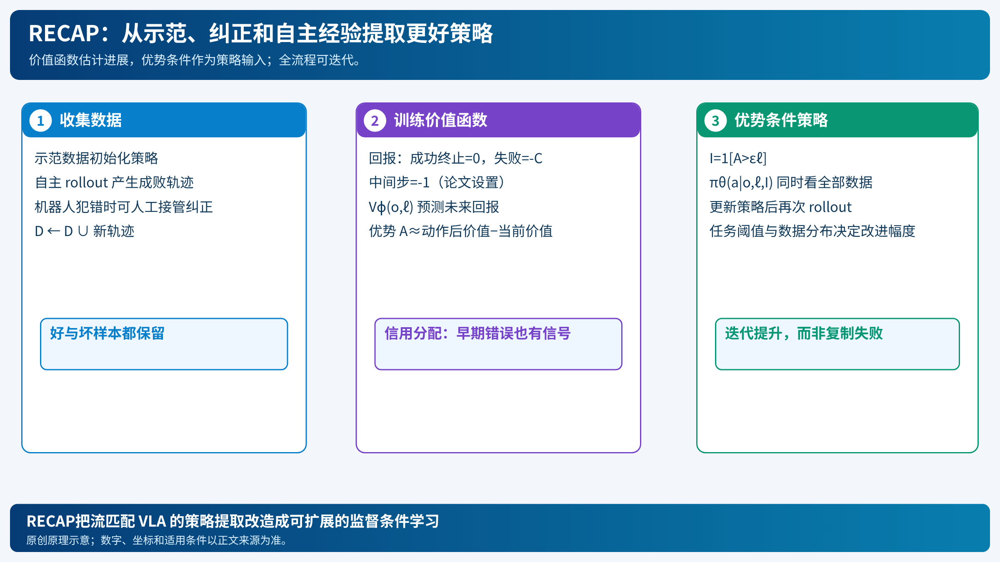

# π₀.₆ 与 RECAP：把“这次失败”变成下一次的训练信号

[打开本地论文 PDF](../../../raw/papers/pi-series/pi06.pdf)

模仿学习只要求机器人复制示范。一次抓取位置略偏，机器人进入示范中没有出现的状态，后续错误会累积。RECAP（RL with Experience & Corrections via Advantage-conditioned Policies）让策略收集自己的轨迹，再用价值函数估计哪些动作让任务更接近成功，最后把“较好/较差”作为策略输入。[论文](../../../raw/papers/pi-series/pi06.pdf)（[在线原文](https://arxiv.org/html/2511.14759v2)）

## 1. 价值函数先解决信用分配

一条轨迹 $\tau=(o_0,a_0,\ldots,o_T)$ 的奖励设置为：成功终止时 $0$，失败终止时 $-C_{fail}$，其余时间步为 $-1$。无折扣回报为

$$R_t=\sum_{t'=t}^{T}r_{t'},\qquad V^\pi(o_t,\ell)=\mathbb E[R_t\mid o_t,\ell].$$

论文将经验回报离散到 $B=201$ 个 value bins，训练分类器 $p_\phi(V\mid o_t,\ell)$：

$$
\min_\phi\;\mathbb E_{\tau\sim D}
\left[-\log p_\phi(R_t^B\mid o_t,\ell)\right].
$$

再用 bin 中心 $v(b)$ 得到连续期望

$$V_\phi(o_t,\ell)=\sum_{b=1}^{B}p_\phi(V=b\mid o_t,\ell)v(b).$$

如果早期抓取角度错误，后来才失败，价值曲线会在错误发生处下降；这比只给最后一步“失败”标签更有信用分配信息。它仍是基于轨迹回报的估计，并非知道真实环境动力学。

## 2. 优势条件化而非只筛好数据

对动作 $a_t$，优势表示其结果相对当前状态基线的改进。RECAP用价值变化构造 $A(o_t,a_t,\ell)$，按任务阈值 $\epsilon_\ell$ 二值化：

$$I_t=\mathbf 1[A(o_t,a_t,\ell)>\epsilon_\ell].$$

策略训练同时拟合没有条件的行为和带优势条件的行为：

$$
\mathcal L_\pi
=\mathbb E\left[-\log\pi_\theta(a_t\mid o_t,\ell)
-\alpha\log\pi_\theta(a_t\mid I_t,o_t,\ell)\right].
$$

全体数据都保留，$I_t$告诉模型当前动作是否值得偏好。与只保留 top 轨迹相比，失败数据仍覆盖模型会遇到的状态；与流模型直接做 policy gradient 相比，它可以使用监督式策略训练。阈值是按任务分布估计的，论文实现取价值的 30 百分位；这是配置选择，不是理论常数。

## 3. Algorithm 1 的两阶段循环

1. 在多任务示范上训练价值函数 $V_{pre}$。
2. 用优势条件训练预训练策略 $\pi_{pre}$。
3. 对目标技能加入示范，得到 $D_\ell$、$V_\ell^0$ 和 $\pi_\ell^0$。
4. 用当前策略自主执行；遇到大错时，专家接管给出纠正，把纠正片段并入数据。
5. 用新增数据重新训练价值函数，重算 $I_t$。
6. 以包含全部历史数据的条件监督更新策略，重复若干轮。

纠正解决明显、危险的错误；自主经验提供速度、成功率和细节改进。论文把 π₀.₆作为基础 VLA，加入 FAST 离散动作、流匹配连续动作和知识绝缘训练；RECAP是经验学习层，不等同于模型架构本身。[论文 §V](../../../raw/papers/pi-series/pi06.pdf)（[在线原文](https://arxiv.org/html/2511.14759v2#S5)）

## 4. 优势与边界

作者在咖啡、衣物和箱子任务报告吞吐与失败率改善，具体数值依赖机器人、任务、干预和迭代次数。它的优点是可利用坏轨迹、适配流匹配 VLA、把信用分配压缩成价值预测；边界是稀疏成功标签、价值函数偏差、任务阈值选择和真实机器人采集成本。不能把“策略学会从经验改进”写成没有安全探索风险。

后续 RLT把在线更新缩小到轻量 actor-critic，适合分钟级精细阶段；MEM则解决跨分钟历史。三者分别作用于策略改进、局部在线适应和上下文记忆。[RLT](pi-rlt-token.md)、[MEM](pi-mem-memory.md)
