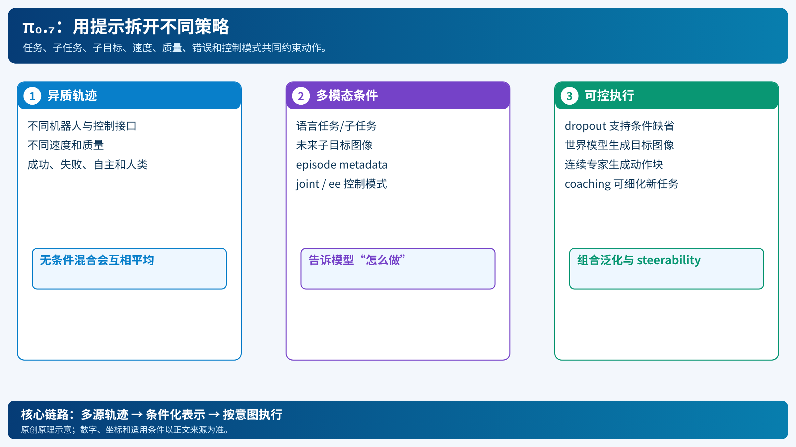

# π₀.₇：让模型知道同一任务可以怎样完成

[打开本地论文 PDF](../../../raw/papers/pi-series/pi07.pdf)

训练数据混合了快慢不同、质量不同、控制接口不同的轨迹。若只给“整理厨房”这一句，模型可能把多种策略平均成一个既慢又不稳的动作。π₀.₇把任务、子任务、目标图像、速度、质量、错误和控制模式放入提示，让模型学习“做什么”以及“按哪种方式做”。[论文](../../../raw/papers/pi-series/pi07.pdf)（[在线原文](https://arxiv.org/html/2604.15483v2)）

## 1. 提示不只是文本

给定当前历史观察 $o_{t-T:t}$，提示集合可写为

$$C=(\ell,\hat\ell,g^\*,m,c),$$

其中 $\ell$ 是总任务，$\hat\ell$ 是子任务，$g^\*$ 是未来子目标图像，$m$ 是速度/质量/错误等 episode metadata，$c\in\{joint,ee\}$ 是控制模式。策略输出

$$a_{t:t+H}\sim\pi_\theta(\cdot\mid o_{t-T:t},C).$$

这些条件解释了轨迹差异：速度标签不是奖励，质量标签不是动作本身，而是训练时告诉模型这段行为的属性。控制模式明确动作接口；同一空间目标在关节控制和末端控制下对应不同输出。

## 2. 子目标图像为何有帮助

语言“把盘子放到柜子里”允许多个路径；一张未来状态图像给出空间终点。模型可把动作生成视为从当前图像到目标图像之间的逆动力学问题。训练时使用真实未来帧和世界模型生成的目标帧，并随机丢弃部分条件，使运行时可以只有语言，也可以增加子目标。

子目标图像不是自动可验证的真值：世界模型可能生成不可能的几何状态，或目标图像与机器人可达性不一致。π₀.₇仍需通过控制器、碰撞检查和实际观察闭环修正。

## 3. 失败和低质量数据怎样纳入

低质量或自主轨迹本身不应被无条件模仿。π₀.₇为轨迹加粗粒度速度、质量和错误标注，并在训练时随机 dropout 条件：

$$
\mathcal L
=\mathbb E_{(o,C,A)}[-\log p_\theta(A\mid o,C)],
\qquad C\leftarrow\operatorname{Dropout}(C).
$$

模型学到条件分布后，测试时可要求高质量、特定速度或指定控制模式。这个方法与 RECAP的优势条件不同：RECAP用价值函数计算每个动作的改进标签；π₀.₇使用轨迹级元数据和视觉/语言子目标组织多源数据。

## 4. 运行循环

1. 输入任务指令和当前多视角观测。
2. 高层策略或人类 coaching 给出子任务；轻量世界模型可生成子目标图像。
3. 组合提示 $C$，连续动作专家生成 50 步动作块；π₀.₇还使用训练时 RTC应对延迟。
4. 执行部分动作，定时刷新子目标与提示，继续闭环。

论文报告在其评测中出现跨机器人、跨场景和组合任务泛化的迹象，包括未直接示范的电器操作。应把“emergent capabilities”理解为作者实验中的观察，不是对任意新任务成功的保证；每个机器人仍有动作接口、相机和安全约束。

π₀.₇把 π₀.₅的异构共训练扩展为更丰富的条件化，吸收人类、自治和不同质量数据；MEM提供历史记忆，RTC提供异步动作连续性。系列时间线和差异见[PI 系列综述](../../01-comprehensive/01-embodied-ai/pi-series-overview.md)。
