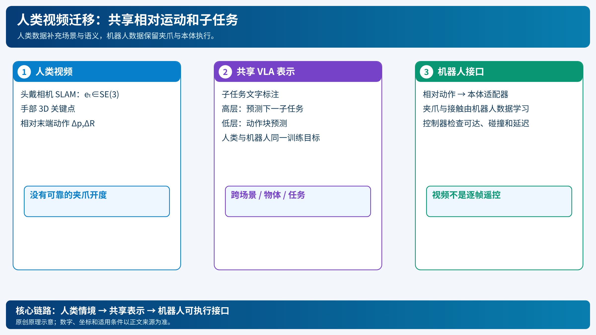

# 人类视频到机器人控制：先对齐动作表示，再让 VLA 学跨本体规律

[打开本地论文 PDF](../../../raw/papers/pi-series/human.pdf)

机器人示范昂贵，人类佩戴相机的视频却容易收集。困难在于人手、相机和机器人关节不是同一个动作空间：人手在画面中移动，不等于机器人夹爪应该如何张合。Physical Intelligence 的研究把人类视频当作另一种 embodiment，与机器人数据共同微调 π₀.₅，观察迁移是否从多样 VLA 表示中自然出现。[论文](../../../raw/papers/pi-series/human.pdf)（[在线原文](https://arxiv.org/abs/2512.22414)）

## 1. 原始输入与坐标

人类数据包含头戴相机轨迹 $e_t\in SE(3)$ 和头相机坐标系中的双手关键点 $h_t\in\mathbb R^{3\times17}$。使用视觉 SLAM估计头相机相对固定世界的 6D 位姿；手部关键点提供位置，不直接提供可靠的夹爪开度。[论文 §III](../../../raw/papers/pi-series/human.pdf)（[在线原文](https://arxiv.org/abs/2512.22414)）

对每只手，选掌部、 中指和无名指等关键点定义一个近似末端位姿。设头相机坐标系中的点为 $p^H_t$，相对动作写为

$$
\Delta p_t=(p^H_{t+1}-p^H_t),\qquad
\Delta R_t=(R^H_t)^\top R^H_{t+1}.
$$

相对变换而非世界绝对坐标，使“向当前物体移动”比“移动到房间某个固定坐标”更容易跨场景迁移。机器人端也用当前末端为参考构造相对位姿，再由本体适配器转成关节或末端控制命令。这里的相对关系是数据表示选择，不是保证人手与夹爪可达。

## 2. 动作维度如何与机器人数据接上

机器人样本可以用双臂末端轨迹、夹爪和底盘动作表示，例如每个时间步为 16 维左右的组合；人类轨迹则没有直接可用的夹爪信号。研究中不强行猜测手指开合，而是用人类数据监督末端位置/姿态及子任务文字，夹爪行为从机器人数据中学习。

人类数据还标注短子任务 $\ell_t^{sub}$。训练目标同时包含高层子任务预测与低层动作预测：

$$
\mathcal L_{human}
=\mathcal L_{AR}(\ell_t^{sub})
 +\mathcal L_{FM}(a_{t:t+H}\mid o_t,\ell_t^{sub}).
$$

人类和机器人样本采用相同的数据管线与 VLA 目标，不额外设计一个“人转机器人”的专用损失。这个简单配方依赖 VLA 表示已经能够把不同视觉、动作和语言模式放到可共享的语义空间；若坐标、相机视角或任务分布差异过大，简单混合不会自动解决域偏移。

## 3. 为什么能迁移“场景、物体、任务”

研究分别构造三类缺口：机器人数据没有目标家庭但人类视频覆盖该场景；机器人见过餐桌整理但没有新物体；机器人见过装鸡蛋却没有按颜色分拣的任务。人类视频提供缺失的视觉情境和高层动作规律，机器人数据提供真实执行接口和夹爪经验。

所以迁移不是把人手轨迹逐帧复制给机械臂，而是共享“看见关系—选择子任务—产生相对动作”的表示。评估应分别记录场景、物体和任务迁移，不能合成一个无条件的“人类数据提升百分比”。

## 4. 限制和验证边界

人类手与夹爪的接触几何不同，柔性物体、精确插入和双手协作尤其容易出现动作缺口；SLAM 漂移会污染相对轨迹；视频中不可见的接触力与夹爪状态仍需机器人数据补齐。论文研究的是共同微调后的迁移能力，不是无需机器人数据的零样本控制，也没有消除安全验证、碰撞和本体适配。

该路线与 π₀.₅ 的异构共训练相连，后来 π₀.₇把人类、机器人、自主和失败数据用速度、质量、控制模式等提示区分。详见[π₀.₇](pi-07-steerable.md)与[系列综述](../../01-comprehensive/01-embodied-ai/pi-series-overview.md)。

