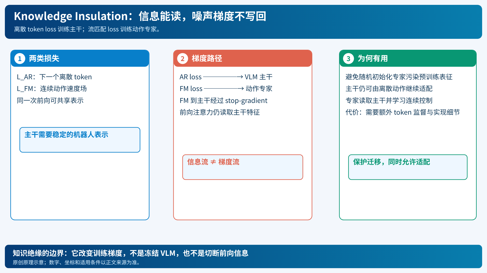

# Knowledge Insulation：让动作专家读到知识，却不把随机梯度写回主干

[打开本地论文 PDF](../../../raw/papers/pi-series/ki.pdf)

连续动作专家通常从随机权重开始，而视觉语言主干已经从大规模图像—文字数据学到语义。若流匹配误差直接穿过新专家更新主干，早期的随机梯度可能破坏已有表示；把主干完全冻结又阻止它学习机器人状态与动作语义。Knowledge Insulation（知识绝缘）在两者之间划出一条训练边界：前向的信息可以流动，动作专家的梯度不能回写主干。[论文](../../../raw/papers/pi-series/ki.pdf)（[在线原文](https://arxiv.org/abs/2505.23705)）

*原创示意：实线表示前向表示读取，虚线表示被 stop-gradient 阻断的反向路径。[SVG](../../imgs/pi-ki.svg)。*

## 1. 两个输出、两个学习信号

给定观测 $o$、语言 $\ell$、离散目标序列 $y$ 和连续动作块 $A$，模型同时有：

$$
\mathcal L_{\mathrm{AR}}
=-\sum_{j\in\mathcal M}\log p_\theta(y_j\mid o,\ell,y_{<j}),
$$

以及流匹配损失

$$
\mathcal L_{\mathrm{FM}}
=\mathbb E\left[\|v_\theta(X_\tau,o,\ell,\tau)-(A-\epsilon)\|_F^2\right].
$$

普通联合训练是 $\mathcal L=\mathcal L_{\mathrm{AR}}+\alpha\mathcal L_{\mathrm{FM}}$。知识绝缘的关键不是删掉第二项，而是令 FM 路径对主干输入使用 `sg`（stop gradient）：

$$
h_a=\operatorname{Attn}(q_a,\operatorname{sg}(k_b),\operatorname{sg}(v_b),x_a),
$$

其中下标 $b$ 是 backbone token，$a$ 是 action token。前向计算仍使用 $k_b,v_b$ 的数值；反向时 $\partial\operatorname{sg}(x)/\partial x=0$。因此主干获得 $\nabla\mathcal L_{\mathrm{AR}}$，动作专家获得两类损失中与其相连的梯度，FM 不再提供到主干的梯度。

这不等于冻结主干：AR loss仍使它适应机器人数据；也不等于切断动作专家读取主干。两条路径需要在代码和计算图中分别检查。

## 2. 一个最小计算图

1. VLM将图像、文字和状态编码为 $x_b$。
2. 动作专家将带噪 $X_\tau$ 编码为 $x_a$，用注意力读取 $x_b$。
3. 离散头计算 $\mathcal L_{\mathrm{AR}}$；连续头计算 $\mathcal L_{\mathrm{FM}}$。
4. 反向时只切断连续头经 $x_b$ 的分支，更新各自允许的参数。
5. 迭代训练并同时保持语义、机器人表示与控制精度。

如果把 `sg` 放在整个 backbone 输出上，AR梯度也会消失，模型变成冻结主干；如果放在前向注意力之外，专家可能无法读取条件。实现需用梯度检查验证这两个边界，而不能只看网络示意图。[论文 §III–IV](../../../raw/papers/pi-series/ki.pdf)（[在线原文](https://arxiv.org/html/2505.23705)）

## 3. 与前后路线的关系

π₀采用连续动作专家，但早期训练容易受联合梯度影响；π₀-FAST把动作离散化，训练快却有自回归推理成本；π₀.₅先以离散动作预训练、再加连续专家，降低初始化冲突。知识绝缘允许离散和连续目标在同一训练流程中共存，并保护主干适配。

它解决的是**优化信号污染**，不是异步推理连续性、长时记忆或在线 RL。分别参见[RTC](pi-rtc-real-time-chunking.md)、[MEM](pi-mem-memory.md)和[RECAP](pi-06-recap.md)。论文报告的训练动态与消融属于作者实验，本文没有复测。

