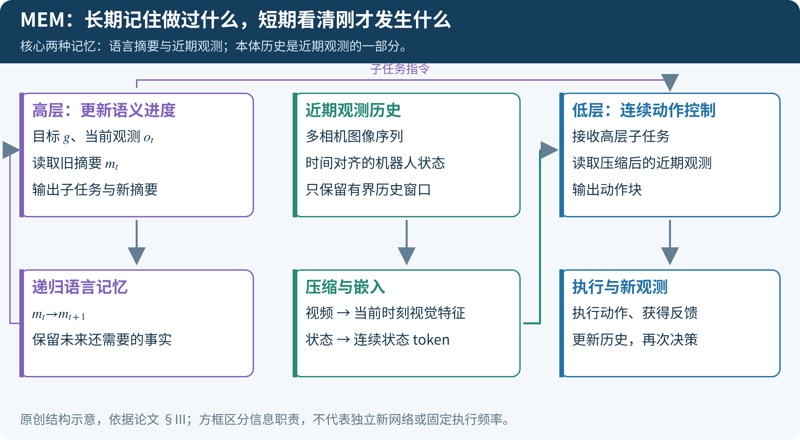
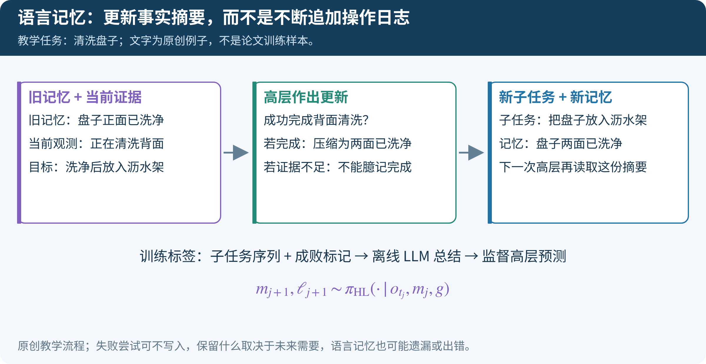
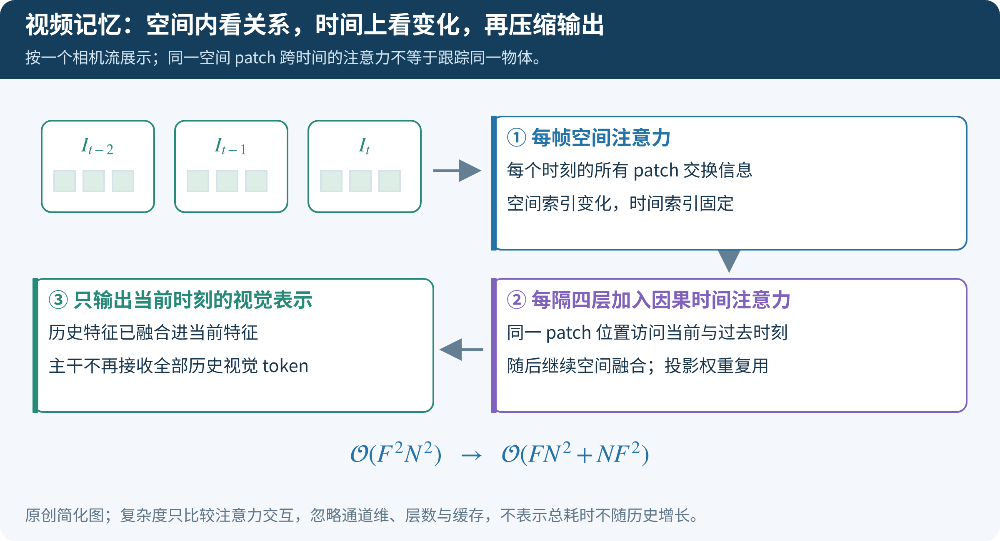
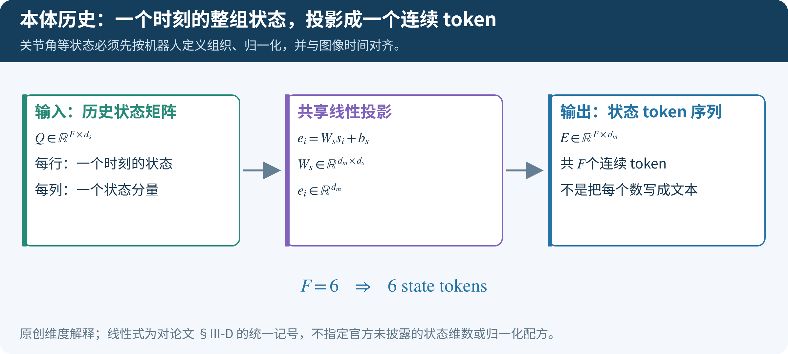

# MEM：怎样让机器人记住刚才看见的，也记住十分钟前做过的

洗盘子时，机器人低头看见的是一个盘子，却未必知道正面洗过没有；手臂挡住杯子时，当前画面也无法告诉它杯子刚才在哪里。**MEM（Multi-Scale Embodied Memory，多尺度具身记忆）的核心，是为不同问题选不同记忆表示：用近期视频保留空间与运动细节，用语言摘要保留长期任务进度。** 机器人状态历史也进入近期观测，但不是与视频、语言并列的一套独立长期记忆系统。

本页依据 Physical Intelligence 的 [MEM 原论文](../../../raw/papers/pi-series/mem.pdf) §III–IV、附录 C 和 [官方研究页](https://www.pi.website/research/memory) 重写。论文实际实例为 $\pi_{0.6}$-MEM；后文会区分论文实现、教学推导和向其他模型迁移的建议。没有复现论文实验。

## 1. 先看失败场景：为什么当前图像不够

设机器人收到目标：“把盘子两面洗干净，放到沥水架”。它的连续动作即使很熟练，也可能出现这些错误：

| 眼前画面相似，历史却不同 | 当前帧缺少什么 | 需要的记忆 |
|---|---|---|
| 盘子正面已洗／还没洗 | 哪些步骤已完成 | 长期语义进度 |
| 夹爪挡住杯子 | 遮挡前的杯子位置、抓取关系 | 近期视觉细节 |
| 反复抓筷子都从表面滑过 | 先前尝试的高度、动作与结果 | 近期视觉与本体历史 |
| 正在擦台面 | 这块区域刚刚擦了多少、是否该换位置 | 近期运动和更长期完成记录 |

这属于**部分可观测**：相同当前观测可能对应不同真实状态，合理动作取决于历史。记忆的作用是为策略补充判断依据，不是凭空得到被遮挡物体的真实位置，也不自动保证识别成功。

直接保存并输入全部历史看起来最完整，但十几分钟的多相机视频会产生大量视觉 token。反过来，把一切都压成一句话，又会丢失抓取位置和运动细节。MEM 在两者之间分工：**高带宽短期观测负责“刚才怎么动的”，低带宽语言负责“哪些事已经做过”。**

## 2. 总体架构：两种记忆怎样协作

*原创结构图，依据论文 §III-A–D。图中按职责划分方框，不表示每个框都是新增网络；高层的子任务指导低层，语言摘要则递归返回下一次高层。*

### 2.1. 先把输入输出说清楚

| 符号 | 表示 | 输入给谁 |
|---|---|---|
| $g$ | 用户总目标，文本 | 高层与低层 |
| $o_t$ | 当前观测，含相机图像及机器人状态等 | 根据模型接口进入策略 |
| $o_{t-K:t}$ | 近期观测窗口 | 低层的短期观测记忆 |
| $m_j$ | 上一次高层留下的语言摘要 | 高层 |
| $\ell_{j+1}$ | 下一子任务指令，例如“把盘子放入沥水架” | 低层 |
| $A_t$ | 未来一块连续机器人动作 | 执行系统 |

为避免把高层决策和底层控制误当成同频率，本文用 $j$ 表示高层决策次数，$t_j$ 表示该次对应的机器人时刻；不规定高层必须每个控制周期调用。动作块本文统一记作 $A_t=(a_t,\ldots,a_{t+H-1})$，包含 $H$ 个动作。每个动作的维度、单位与机器人接口有关，不能由 MEM 这个名字推断。

### 2.2. 高层产生子任务与语言记忆，低层产生动作

论文 §III-A 的结构分解可用上述记号写成：

$$\begin{aligned}
&\pi(A_{t_j},\ell_{j+1},m_{j+1}\mid o_{t_j-T:t_j},m_j,g)\\
&\quad\approx
\pi_{\mathrm{LL}}(A_{t_j}\mid o_{t_j-K:t_j},\ell_{j+1},g)
\,\pi_{\mathrm{HL}}(\ell_{j+1},m_{j+1}\mid o_{t_j},m_j,g),\qquad K\ll T.
\end{aligned}$$

$T$ 是完整任务历史长度，$K$ 是较短窗口的索引跨度。它表达一种**建模与接口分工**：把长期历史压入 $m_j$，用高层子任务影响低层；不把所有旧语言直接塞给动作控制器。这里不是严格声称真实世界满足某种条件独立性。

论文 §III-B 文字也将高层写成接收近期观测的形式，而 §III-A 分解式写当前观测。本文据主分解解释信息流，不据此断言高层永远只能读一帧；具体部署需要明确其观测接口。

**重点是：记忆不直接输出电机动作。** 语言记忆帮助高层决定下一阶段，短期观测特征帮助低层把阶段执行好；动作专家仍负责输出连续动作块。

## 3. 长期语言记忆：不是把历史指令一直拼接下去

### 3.1. 它存事实与进度，不必保留整段录像

假设原摘要是：“盘子正面已洗净，还未清洗背面。”当前子任务成功完成后，可以更新成：“盘子两面已洗净，尚未放入沥水架。”后续动作只需要完成状态，不需要记下每一次刷洗轨迹。

*原创洗盘子例子，非原论文样本。高层必须依据观测判断进度；“尝试过清洗”不应直接改写成“已经洗净”。*

高层调用可记为：

$$(\ell_{j+1},m_{j+1})\sim
\pi_{\mathrm{HL}}(\cdot\mid o_{t_j},m_j,g).$$

这里用分布记号描述生成，实际可使用确定解码。新记忆再作为下次输入，因此是**递归状态**，不是每次从全部视频重新总结。

### 3.2. 训练标签从哪里来

论文 §III-B 的标签流水线是：

1. 取机器人 episode 的子任务语言标注序列。
2. 同时提供子任务执行成功或失败的标记。
3. 用预训练 LLM 总结截至当时仍对后续任务重要的信息。
4. 指示 LLM 删除或压缩不必要细节，构造记忆更新训练标签。
5. 用这些标签监督高层预测子任务与更新摘要。

例如“浅绿碗、深蓝碗、黄色碗分别放进右上柜子”，可压成“三个碗已放入右上柜子”。这是论文说明的压缩原则；如果未来还要按颜色取碗，颜色就可能变成相关信息，不能机械删除。

**离线 LLM 生成标签，与部署时的高层记忆更新是两件事。** 不能把论文描述改写成“运行时必须再接一个外部聊天模型”，也不能不经确认就假定项目已有完整训练标签管线。

### 3.3. 为什么不用全部历史子任务文本

训练示范往往很顺利，一条子任务只出现一次；机器人运行时却可能反复失败，连续生成“抓碗、抓碗、抓碗”。若简单拼接，会把训练时少见的重复轨迹不断加入上下文。

论文 §IV-A 的分析是：摘要可以在某些失败尝试中保持不变，直到成功再更新，从而减轻这种训练与执行分布差异。**并非所有失败都删除**：若“这边门打不开，要换另一侧”对后续有用，就应保留相关事实。具体保留什么仍由训练监督与模型判断决定。

语言记忆的限制也在这里：若它把未完成写成已完成，下一次高层会继续依赖这个错误；若摘要过度压缩，则可能丢失未来必要信息。MEM 没有为摘要真实性提供形式化保证。

## 4. 短期视频记忆：历史帧如何变成当前特征

### 4.1. 先认识每个索引

为避免论文窗口跨度与帧数的记号混用，本节用 $F$ 表示**实际输入帧数**，$N$ 表示每帧 patch 数，$d$ 表示隐空间维度。一个相机流编码中的特征可记为 $z_{p,i}\in\mathbb R^d$，其中 $p\in\{1,\ldots,N\}$ 是 patch 位置，$i\in\{1,\ldots,F\}$ 按历史到当前排列。

例如三帧图像，每帧切成很多 patch；如果把全部 patch 一次做联合注意力，每个位置都能看所有时间、所有空间，交互数量会迅速增长。

*原创简化图，依据 §III-C 与附录 C。多个相机流的关系在此不展开；图中同位置跨时间连接不是物体追踪。*

### 4.2. 空间注意力看一帧中的关系

固定时刻 $i$，令同帧的所有 patch 相互注意。它帮助识别夹爪、物体、桌面等空间关系。这继承了原 ViT 的主要处理方式。

### 4.3. 时间注意力让同位置跨帧交换信息

论文在 ViT **每第四层**修改注意力模式，加入沿时间维的因果注意力：固定空间位置 $p$，读取该位置的当前及过去时刻。因果掩码禁止从未来取信息。

用通用缩放点积注意力重写一个时间更新，可表示为：

$$\begin{aligned}
\hat z_{p,i}&=z_{p,i}+e(\Delta t_i),\\
q_{p,i}&=W_Q\operatorname{LN}(\hat z_{p,i}),\quad
k_{p,i}=W_K\operatorname{LN}(\hat z_{p,i}),\quad
v_{p,i}=W_V\operatorname{LN}(\hat z_{p,i}),\\
\alpha_{i,r}^{(p)}&=\operatorname{softmax}_{r\leq i}
\left(\frac{q_{p,i}^{\mathsf T}k_{p,r}}{\sqrt{d_h}}\right),\\
h_{p,i}^{\mathrm{time}}&=\sum_{r\leq i}\alpha_{i,r}^{(p)}v_{p,r}.
\end{aligned}$$

$\Delta t_i\leq0$ 是相对当前的时间，$e$ 是固定正弦时间编码，$d_h$ 是单头维度。投影将 $d$ 维特征映到注意力头空间。这里省略多头合并、残差和后续 MLP，是对机制的统一教学写法；官方附录使用层和头索引，并在记号中省略归一化等细节，不能把本式当逐行代码。

时间更新与空间更新交替／组合，使跨帧信息经过空间融合进入当前表征。**同一 patch 位置不是同一物体**：相机和物体都可能运动，信息要通过网络层融合，不能解释为已建立精确三维对应。

### 4.4. 为什么能复用旧视觉模型

论文这套视频改造**不新增独立的可学习视频编码参数**：复用原 ViT 的查询、键、值投影，改注意力连接模式，再加固定时间编码。当前时刻编码满足 $e(0)=0$，作者据此设计单帧初始化与原模型行为一致。

这不等于“无需训练就有可靠记忆”，更不等于“整个系统完全没有新增参数”：本体状态线性嵌入等属于另外的接口改造。应区分**权重可复用、参数是否新增、记忆能力如何训练**三个问题。

### 4.5. 最后只把当前时间的视觉表示送给主干

历史帧已经通过时间注意力影响当前帧的特征。编码后丢弃过去时刻的视觉输出，只保留当前时刻表示，再送给 VLA 主干。因此增加历史帧不会按帧数成倍增加**主干接收的视觉 token 数**。

但历史视频仍然要编码，不能说总计算和内存完全不变。忽略隐维、头数、层数等因素，联合时空注意力与分解注意力的交互复杂度分别约为：

$$\mathcal O(F^2N^2),\qquad
\mathcal O(FN^2+NF^2).$$

如果某层不做时间注意力，其代价还会不同；上式是解释主要交互项的近似，不是实测延迟模型。论文图 3 的延迟比较使用单张 RTX 4090、四路相机的模型设置，不能把其结论直接换成任意硬件的毫秒预算。

## 5. 本体状态历史：为什么一个时刻只变成一个 token

图像以外，历史关节角等状态能告诉策略手臂刚才位于哪里。原模型以文本表达状态时，一长串历史数值会膨胀成大量文本 token。论文 §III-D 因此改用连续状态嵌入。

*原创维度说明。公式是对“线性投影整组状态”统一记号的展开，不指定论文未公开的状态字段与归一化参数。*

令单个时刻状态 $s_i\in\mathbb R^{d_s}$，主干 token 维度为 $d_m$，则可写：

$$e_i=W_s s_i+b_s,\qquad
W_s\in\mathbb R^{d_m\times d_s},\quad b_s\in\mathbb R^{d_m}.$$

$F$ 个时刻生成 $F$ 个连续状态 token，而不是把每一关节角分别展开成数字文本。按行堆叠时：

$$Q\in\mathbb R^{F\times d_s},\qquad
E=QW_s^{\mathsf T}+\mathbf1 b_s^{\mathsf T}\in\mathbb R^{F\times d_m}.$$

接入实际机器人时，必须明确状态字段、关节顺序、单位、归一化、时间戳以及与图像的对齐方式。不同机器人上的同一个数值维度未必代表同一物理量。论文只说明这种嵌入思路，不能替用户工程自动确定所有输入约定。

这一路是**短期观测记忆中的本体信息**，并非第三个具有独立长期更新规则的记忆库。

## 6. 帧数、时间跨度和十五分钟，分别指什么

| 原论文报告的设置 | 正确理解 | 不应推成 |
|---|---|---|
| 预训练六次观测，间隔一秒，含当前和五个过去时刻 | 若按端点差计算，覆盖约五秒历史 | 六帧就一定覆盖六秒 |
| 后训练实验最长十八帧、五十四秒观测记忆 | 作者报告的窗口配置／记忆范围；需按任务与具体采样定义解释 | 固定适用于所有部署的帧率或从帧数直接算出的跨度 |
| 最长约十五分钟记忆需求的长程任务 | 依靠语言语义记忆和短期观测协作 | 每轮低层输入十五分钟连续视频 |

十八帧与五十四秒的对应不宜自行补成“严格每三秒取一帧”；若只算相邻十八个采样点的端点跨度，三秒步长得到五十一秒。正文保留作者报告值，并区分窗口记忆范围、采样端点等约定。来源为 §III-D、§IV。

固定帧数和有界摘要控制输入规模，但长程能力仍依赖模型有没有学会保存正确事实，不能简单由“记忆保存时长”推出任务完成率。

## 7. 论文怎样在 $\pi_{0.6}$ 上训练与运行

### 7.1. 论文实际实例

§III-D 报告 $\pi_{0.6}$-MEM 从 Gemma 3-4B 视觉语言模型初始化，结合离散 FAST 动作预测与流匹配动作专家；动作专家约八点六亿参数。输入每路相机图像为 $448\times448$ 像素，最多四路相机，取决于机器人形态。

动作专家的梯度不流入 VLM 主干，这是 [Knowledge Insulation](pi-knowledge-insulation.md) 相关的梯度路由设计；**不是整个 VLM 冻结不训练**。可以结合 [FAST](pi-fast-action-tokenization.md)、[π₀ 连续动作模型](pi-0-flow-vla.md) 理解动作输出接口，本文不把不同版本的动作头细节混成一套实现。

### 7.2. 训练记忆能力不能只接输入接口

作者预训练混合了遥操作示范、策略 rollout、人类纠正、视觉语言任务和视频语言任务，用短观测序列培养时序信息利用能力；后训练再扩展窗口和适配任务。高层还需要前述记忆更新监督。

图 9 比较了“预训练中就有记忆”与“只在后训练引入记忆”，后者即使从同类数据训练的基础模型出发，仍较弱。它支持“记忆能力受训练过程影响”的判断，不能简化为“加载旧模型，只训新增小模块就等价复现”。

### 7.3. 一次洗盘子的完整闭环

1. 相机和机器人状态采样，更新对齐的短期缓冲区。
2. 高层读取目标、观测与旧摘要，判断当前阶段，产生“清洗背面”等子任务及摘要更新。
3. 视频编码器融合近期图像，状态投影器生成历史状态 token。
4. 低层读取子任务和近期观测特征，动作专家预测连续动作块。
5. 执行系统消费动作并获得新观测；后续决策利用最新证据，而非假设发出动作就等于完成。
6. 高层确认阶段推进后，把“正反两面已洗净”作为可压缩事实保存，继续下一子任务。

这是按论文机制展开的教学流程，不规定官方未披露的高层触发器或线程实现。所有真实机器人实验使用推理时或训练时 [RTC](pi-rtc-real-time-chunking.md) 做异步实时推理；RTC 处理动作块衔接，MEM 处理历史信息，两者作用不同。

## 8. 对参考图里的“接入 $\pi_{0.5}$／$\pi_{0.6}$”应怎样理解

| 参考图或常见推断 | 核验后的边界 |
|---|---|
| 三种独立记忆机制 | 核心两种：视频观测记忆与长期语言记忆；本体历史属于前者的观测扩展 |
| 新增一个带新权重的时间模块 | 论文视频注意力复用 ViT 投影权重，主要改变连接模式 |
| 冻结主干，只训练记忆模块 | 不是本论文的训练配方；动作专家梯度隔离不等于主干冻结 |
| 可以直接在任意 $\pi_{0.5}$ 权重上开启 | 论文验证的是 $\pi_{0.6}$-MEM；其他基础模型需适配接口并训练核验 |
| 记忆自动消除反复失败 | 它提供先前失败的信息，策略仍须学会利用；没有必然成功保证 |
| 图中折衣或洗台面流程是论文结果 | 可用于讲直觉，不能未经来源核验当作该设置的实验记录 |

若自己基于其他 VLA 实作，可将以下作为**工程建议，而非论文复现配方**：先打通图像／状态时间对齐与短窗口编码，再建立可检查的语言摘要监督，最后联合评估长程进度和控制延迟。冻结部分参数可以作为实验变量，但应与训练范围更广的基线比较，而不是预先当成等效方案。

## 9. 实验支持什么，又没有证明什么

论文 §IV-A 的长程任务包括食谱准备和厨房清理，分别需要跟踪取出的物品、关门、清洗步骤和已擦区域。它比较无记忆、仅视频、仅语言和组合记忆等配置；这些消融说明两种表示在所测任务中互补，不能代替任意场景的能力保证。

§IV-B 还测试通过历史失败改变抓筷子高度、开冰箱方向。这里的 **in-context adaptation** 是运行时根据历史改变行为，不是每次失败后在线反向传播更新模型参数；训练阶段另外采集了失败后人类纠正的数据并微调。

作者对长程任务／食谱的每个策略设置运行十次，图表报告均值与标准误；进度分数与完全成功率不是同一指标。本文不从图中估读精确提升数字，也不报告未复测的成功率。

仍需警惕：摘要误记会累积，短窗口无法找回已丢失的精确视觉信息，视频增多仍有编码代价，跨相机和跨机器人输入需一致定义。MEM 的上下文改变不等于 [RECAP](pi-06-recap.md) 的经验策略改进，也不等于 [RLT](pi-rlt-token.md) 的在线局部精调。

## 10. 阅读和实现时应该能回答的六个问题

1. 需要记住的是空间细节、运动过程，还是完成状态？
2. 每类信息用什么表示、保留多久、在何时更新？
3. 高层输出的哪部分给低层，哪部分给下一次高层？
4. 训练标签是否告诉模型“成功了什么”，还是只记录“发出过什么指令”？
5. 历史信息在进入主干前怎样压缩，哪些成本仍随窗口增加？
6. 声称的改造来自论文实现，还是自己的工程设想，是否做过对应训练与评估？

把这些问题答清，MEM 才不只是“给 VLA 加记忆”这句话，而是一套能检查输入、表示、监督与执行结果的具体方法。

## 来源与关联

- [MEM 本地论文](../../../raw/papers/pi-series/mem.pdf)，§III-A–D、§IV-A–C、附录 C。
- [官方研究页](https://www.pi.website/research/memory)、[arXiv 论文页](https://arxiv.org/abs/2603.03596)。
- [本次逐项核验记录](../../../raw/entries/2026-11-20-pi-mem.md)。
- [π 系列综述](../../01-comprehensive/01-embodied-ai/pi-series-overview.md)。
