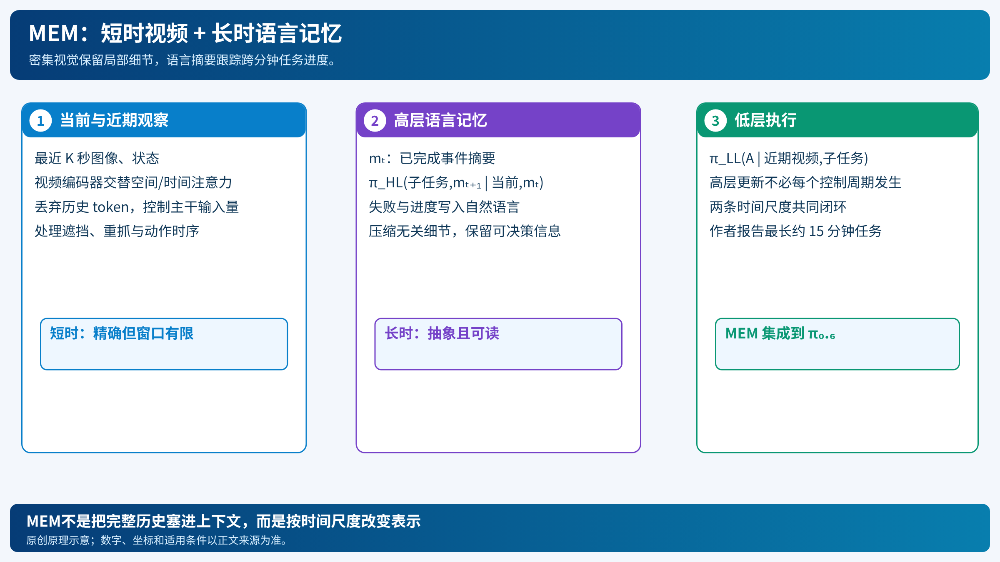

# MEM：用视频记住最近几秒，用语言记住已经完成的事

[打开本地论文 PDF](../../../raw/papers/pi-series/mem.pdf)

只看当前帧的策略会遇到两类不同问题：手臂遮住目标时需要几秒内的视觉细节；清理厨房持续十几分钟时需要知道哪些碗已经洗过。把所有历史图像直接拼进上下文会让 token、注意力和延迟随时间增长。MEM（Multi-Scale Embodied Memory）把短时与长时记忆拆成两种表示。[论文](../../../raw/papers/pi-series/mem.pdf)（[在线原文](https://arxiv.org/abs/2603.03596)）

## 1. 两个策略和一个分解

总策略输入历史观察 $o_{t-T:t}$、目标 $g$ 和记忆 $m_t$，输出动作块、下一子任务和下一记忆。MEM作近似分解：

$$
\pi(a_{t:t+H},\ell_{t+1},m_{t+1}\mid o_{t-T:t},m_t,g)
\approx
\pi_{LL}(a_{t:t+H}\mid o_{t-K:t},\ell_{t+1},g)
\pi_{HL}(\ell_{t+1},m_{t+1}\mid o_t,m_t,g),
$$

其中 $K\ll T$。低层只看近期密集观察；高层依据当前观察和语言摘要更新子任务及记忆。它是训练和系统结构的解释性分解，不是概率独立性的物理定律。

## 2. 语言记忆怎样更新

语言记忆 $m_t$ 是压缩的事件记录，例如“已把盘子放入柜子，并拿起下一个碗”。训练标签由子任务序列及成败信息生成，再要求摘要删除对未来无用的颜色、精确顺序等细节。高层可写作

$$
(\ell_{t+1},m_{t+1})=\pi_{HL}(o_t,m_t,g).
$$

自然语言的优点是压缩率高且可检查；缺点是摘要可能丢失接触几何、精确时间等低层信息。因此语言记忆不能替代近期视频。

## 3. 视频记忆怎样控制成本

输入帧先独立 patchify。大多数层做空间注意力，每隔若干层加入沿时间的因果注意力，让同一空间位置跨帧交换信息。若每帧有 $n$ 个 patch、时间窗口为 $K$，朴素联合注意力近似 $O((Kn)^2)$；时空分解约为 $O(Kn^2+nK^2)$。随后只把当前时间的表示送入 VLA 主干，历史信息已被视频编码器压进当前表示。

训练从短历史开始，论文后训练扩大到几十秒观测；长达约 15 分钟的任务依赖语言记忆，不是把 15 分钟视频全部输入。机器人状态历史也需要明确编码方式，不能用“记忆”掩盖状态单位和时间戳问题。

## 4. 一次长程执行

1. 当前帧和近期视频进入低层编码器；高层读取当前帧、旧语言记忆和总目标。
2. 高层写入下一子任务，如“把洗好的盘放入晾干架”。
3. 低层依据近期视觉和子任务生成连续动作块，执行一部分。
4. 若抓取失败或出现遮挡，视频记忆提供局部上下文；高层把事件写入 $m_{t+1}$，防止重复同一失败。
5. 任务跨阶段推进，语言摘要长度基本受控。

作者在食谱准备、烤三明治和清理厨房等场景报告最长约 15 分钟的记忆需求与上下文适应。结果依赖训练数据、摄像机、控制延迟和任务定义；本文没有复测成功率。

MEM改善的是上下文表示与长程闭环，不直接解决动作块异步切换（[RTC](pi-rtc-real-time-chunking.md)）、策略经验改进（[RECAP](pi-06-recap.md)）或局部在线精调（[RLT](pi-rlt-token.md)）。

