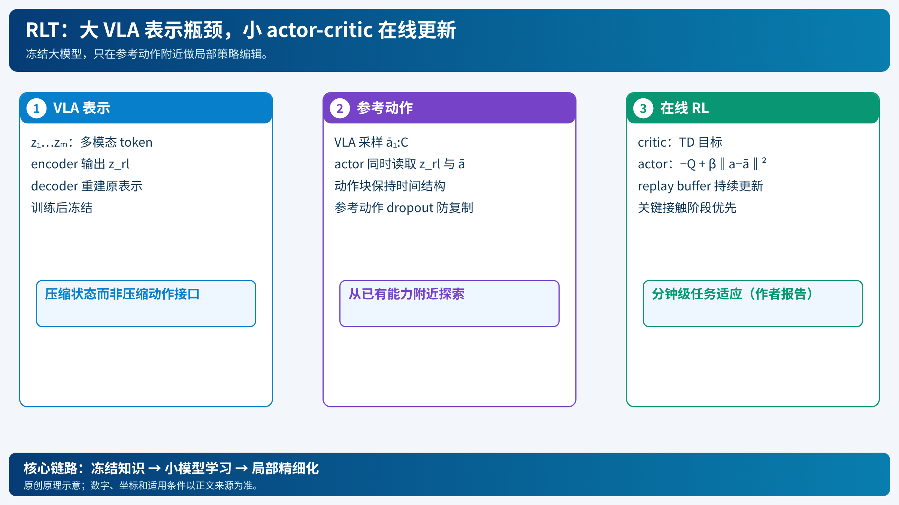

# RLT：冻结大 VLA，只让小 actor-critic 改进关键阶段

[打开本地论文 PDF](../../../raw/papers/pi-series/rlt.pdf)

整套 VLA 太大，直接在机器人上做在线 RL 更新昂贵；但插入螺丝、插网线这样的关键接触阶段，可能只需几分钟数据就能改善。RLT（RL Tokens）先从 VLA 内部表示提取紧凑 token，再训练小型 actor 和 critic，让它编辑 VLA 的动作块。[官方研究页](https://www.pi.website/research/rlt)

## 1. 表示瓶颈

设冻结 VLA 最后一层 token embedding 为 $z_{1:M}=f(s,\ell)$。新增轻量 encoder 在末尾加入可学习的 `<rl>` token：

$$z_{rl}=g_\phi([z_1,\ldots,z_M,e_{rl}])_{M+1}.$$

decoder 以 $z_{rl}$ 自回归重建原始 embedding 的停止梯度版本 $\bar z_i=\operatorname{sg}(z_i)$：

$$
\mathcal L_{ro}(\phi)=\mathbb E_D\sum_i
\|h_\phi(d_\phi([z_{rl},\bar z_{1:i-1}]))-\bar z_i\|_2^2.
$$

若 token 维度过大，decoder可轻易复制输入；若过小，任务相关信息丢失。重建目标迫使它在固定预算内保留对动作和价值有用的信息。训练完后冻结 VLA 和 $z_{rl}$。

## 2. Actor 如何编辑而不是从零控制

VLA先采样参考动作块 $\tilde a_{1:C}$，小 actor 接收 $x=(z_{rl},s_p)$、参考动作和状态，输出高斯动作块：

$$\pi_\theta(a_{1:C}\mid x,\tilde a_{1:C})=\mathcal N(\mu_\theta,\sigma^2I).$$

critic 用 replay buffer 中的块转移做 TD 学习：

$$
\hat Q=\sum_{t=1}^{C}\gamma^{t-1}r_t+\gamma^C\mathbb E_{a'\sim\pi_\theta}Q_{\psi'}(x',a').
$$

actor 最大化价值，同时正则化到参考动作：

$$
\mathcal L_\pi=\mathbb E[-Q_\psi(x,a)+\beta\|a-\tilde a\|_2^2].
$$

$\beta$ 防止早期探索抛弃 VLA 已有能力；参考动作 dropout 防止 actor 永远复制参考块。动作块长度 $C$ 与 VLA一致，学习的是具有时间结构的局部行为。

## 3. 训练流程与适用范围

1. 在少量目标任务示范上训练 RL token encoder-decoder，VLA可选小幅微调。
2. 冻结 VLA、token 和 encoder；小 actor-critic 在机器人上收集 replay。
3. 每次 rollout 由 VLA提出参考块，actor在关键阶段编辑；critic根据成功、时间和接触反馈更新。
4. 可把人类接管片段并入 replay，帮助摆脱卡死状态。

作者在电动螺丝刀、扎带、网线和电源插入等精细任务中报告最多约 15 分钟的真实数据即可改善关键阶段。分钟级数据是作者任务和硬件条件下的报告，不是所有技能的保证。RLT减少了在线更新的参数量，却仍需要安全探索、奖励设计和实机磨损控制。

它与 RECAP 的分工是：RECAP迭代改进完整 VLA的策略，RLT保持大 VLA冻结、用小 actor-critic做任务局部调整；与 MEM 的分工是：RLT改变动作策略，MEM提供跨时上下文。详见[RECAP](pi-06-recap.md)与[MEM](pi-mem-memory.md)。

