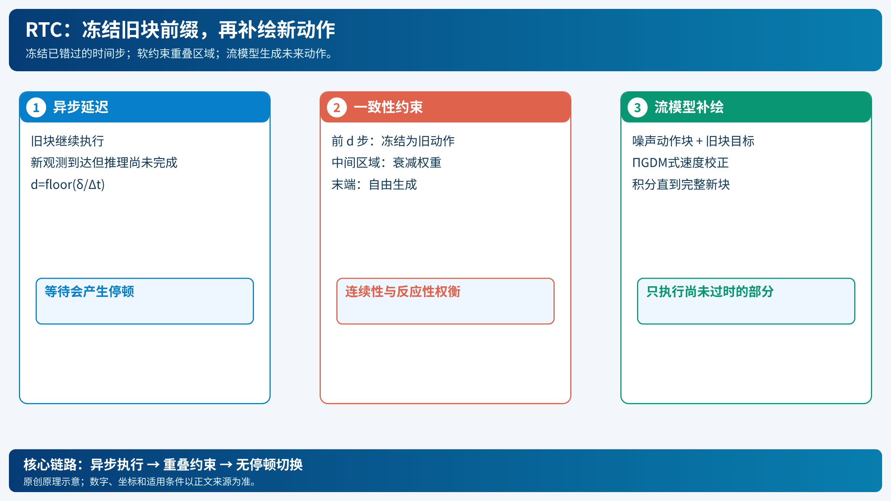

# RTC：把异步动作块切换变成流模型的补绘

[打开本地论文 PDF](../../../raw/papers/pi-series/rtc.pdf)

VLA生成一段动作需要时间。若机器人执行完旧块才等待新块，动作会停顿；若新块一生成就从中途切换，旧策略可能准备绕过障碍，新策略却准备从另一侧通过，速度和加速度会跳变。RTC（Real-Time Chunking）在推理时把新动作块的已知前缀固定，再用扩散/流匹配的 inpainting 补全后缀，不需要改变原模型的训练。[论文](../../../raw/papers/pi-series/rtc.pdf)（[在线原文](https://arxiv.org/abs/2506.07339)）

*原创示意：红色新块在推理延迟期间生成，绿色旧块提供重叠约束。[SVG](../../imgs/pi-rtc.svg)。*

## 1. 延迟如何变成离散步数

设控制周期为 $\Delta t$，策略生成动作块的时间为 $\delta$，则延迟步数

$$d=\left\lfloor\frac\delta{\Delta t}\right\rfloor.
$$

块长度为 $H$，每次希望至少执行 $s$ 个新动作。异步推理必须在旧块还剩 $d$ 步时启动；典型可行条件是 $d\le s\le H-d$。如果 $d$ 大于动作块能容纳的重叠范围，RTC无法凭算法消除延迟，需要更快模型、更多预测余量或更低控制频率。

π₀论文所示的 50 Hz 控制周期是 20 ms；RTC论文用硬件和人为延迟说明高延迟下的切换风险。这些是实验设置，不应直接当作所有设备的实时保证。[官方说明](https://www.pi.website/research/real_time_chunking)

## 2. 冻结区域和中间区域

当前旧块为 $A^{old}$，新观测生成候选块 $A^{new}$。新块的前 $d$ 步在它可用时已经错过，必须固定为旧块中将实际执行的动作：

$$
Y_{0:d}=A^{old}_{t:t+d},
\qquad A^{new}_{0:d}=Y_{0:d}.
$$

重叠但尚未执行的中间区域不应硬拷贝：它既要参考旧策略保证连续，也要允许新观测修正。用权重 $w_i\in[0,1]$ 表示约束强度，靠近冻结前缀时较大，向新鲜动作区域衰减。末端超出旧块的部分没有旧值，只由模型生成。

## 3. 为什么流模型能做补绘

设流模型在噪声时间 $\tau$ 输出速度 $v_\theta(X_\tau,o,\tau)$，$M$ 是冻结位置的掩码，$Y$ 是旧块提供的目标值。推理时在速度上加入使冻结部分回到目标的校正，抽象写为

$$
v'(X_\tau)=v_\theta(X_\tau,o,\tau)
 +\lambda(\tau)M\odot(Y-X_\tau).
$$

实际 RTC使用 ΠGDM 类梯度校正，并对中间区域做软注意力；上式只保留“模型方向 + 已知动作一致性”的核心。每个积分步都更新整块，最后只把当前时刻之后的可用动作交给控制器。

因此 RTC依赖动作分布是可迭代生成的。对普通自回归离散 token，不能直接套用同一个补绘公式；这也是它主要面向扩散/流 VLA 的原因。

## 4. 一个执行循环

1. 旧块持续执行，剩余 $d$ 步时异步启动下一次推理。
2. 取旧块尚未执行部分，构造冻结目标和软重叠区域。
3. 从噪声初始化新块，按流模型迭代并施加一致性校正。
4. 推理完成时，切换到新块的第一个未执行动作；前缀已与旧轨迹接上。
5. 记录实际延迟、切换处速度/加速度和任务结果，继续循环。

RTC改善的是动作块边界与等待时间。它不能修正错误的目标、碰撞约束、低层控制器或相机延迟；若新观测让策略确实应改变路线，中间区域的软约束也必须允许这种反应。后续训练时 RTC把延迟纳入训练，属于另一篇后续工作，不能与纯推理版本混写。

