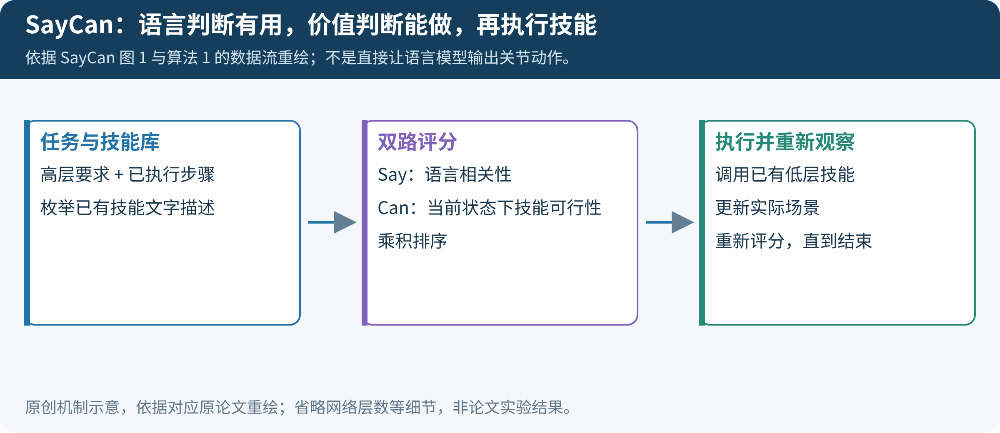
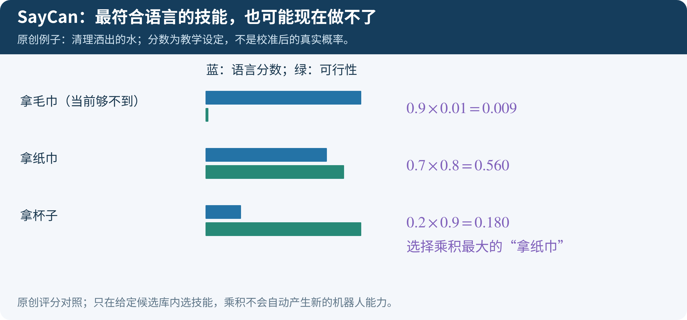

# SayCan：用技能价值约束语言规划

让语言模型回答“怎样清理洒出的水”，它可能提出合乎常识、当前机器人却做不到的步骤。SayCan 把“对任务有没有用”与“现在能不能做”分开评分，再从已有技能库中选下一步。**价值函数在这里是把语言建议落到当前机器人能力上的接口，而不是直接生成动作的网络。**

## 1. 它接收什么，又输出什么

输入是高层指令 $i$、当前状态或观测 $s_t$、已执行技能历史 $h_t$，以及技能库 $\Pi$。每个技能都有短文本 $\ell_k$、低层策略 $\pi_k$ 和相应可行性评分。输出是被选中的技能索引，再由低层策略执行；不是输出任意新代码或未学过的技能。

*据原论文图 1 及算法 1 的信息流原创重绘。每次执行后重新观察，防止把语言计划当作真实世界已完成的事实。*

## 2. 两个评分怎样合起来

语言模型对候选技能描述打分：

$$S_{\mathrm{lang}}(k)=p_{\mathrm{LM}}(\ell_k\mid i,h_t).$$

可行性模型评估从当前状态执行该技能成功的可能性：

$$S_{\mathrm{can}}(k)=\hat V_k(s_t).$$

选择规则为：

$$k^*=\arg\max_{k\in\Pi}S_{\mathrm{lang}}(k)S_{\mathrm{can}}(k).$$

可以在数值实现中相加对数分数，但要按原模型的技能文字评分和归一化约定处理。本文将乘积称作**组合选择分数**；未经校准和建模条件说明，不把它等同于完整长任务的真实成功概率。

*原创清理例子：毛巾当前够不到，纸巾可达。图中的分数为教学设定，不是论文实测。*

## 3. “Can” 的价值怎样学

原论文使用 TD 学习的语言条件价值模型作为技能可行性，低层技能策略可以来自 BC 或 RL；多任务参数共享避免每个技能各训完整独立网络。

稀疏成功奖励仅在终点给一、无折扣并正常终止时，价值可解释为技能成功概率。若训练用了折扣或不同奖励，这种解释需要相应修正。教学 TD 目标是 $y=r+\gamma(1-d)V_{\bar\phi}(s',\ell_k)$，以拟合它学习评分；完整算法还涉及技能策略和数据分布，不能只靠语言模型空口判断可达性。

这些角色与选技能流程见 [原论文 §2–4、算法 1](https://arxiv.org/html/2204.01691v2)。价值的概率解释前提见 [机器人价值函数](robot-value-functions.md)。

## 4. 一次完整的执行过程

1. 提供用户目标和已经执行的技能描述，枚举当前技能库。
2. LLM 给每个候选打“有用”分；价值模型给“能做”分。
3. 选组合分最大的技能，调用其低层控制策略。
4. 等技能执行完成或达到其终止条件，获取新场景状态。
5. 更新高层上下文并重新选技能，遇结束项停止。

这里是逐步贪心选择，不是对所有未来技能序列做精确全局规划。前一步失败会影响后续，场景观测和执行结果必须参与闭环。

## 5. 适用性与边界

它适合已有技能库的长任务编排，优点是决策能用语言描述、评分分工清楚。缺点是技能库缺失时再好的 LLM 也无法创造真实能力，价值模型在新场景可能误判，多步组合还会累积执行错误。可行性分数也不是安全约束，不能把高分当作碰撞或人身安全认证。

原论文在特定厨房机器人与指令集上分别评估规划和执行，二者不是同一指标。旧文“近两倍提升”不在本页抽离基线重复引用；具体数字应连同机器人设置、所用 LLM 和评估版本一起阅读。

## 来源与关联

- Ahn 等，[Do As I Can, Not As I Say: Grounding Language in Robotic Affordances](https://arxiv.org/abs/2204.01691)，2022；[官方项目](https://say-can.github.io/)。
- 与 [GVL](robot-value-2024-gvl.md) 的区别：SayCan 选已有技能的可行性，GVL 给视频帧生成进度估计。
- [时间线综述](../../01-comprehensive/01-embodied-ai/robot-value-reward-overview.md)、[来源与旧文修正](../../../raw/entries/2026-11-21-robot-values.md)。
