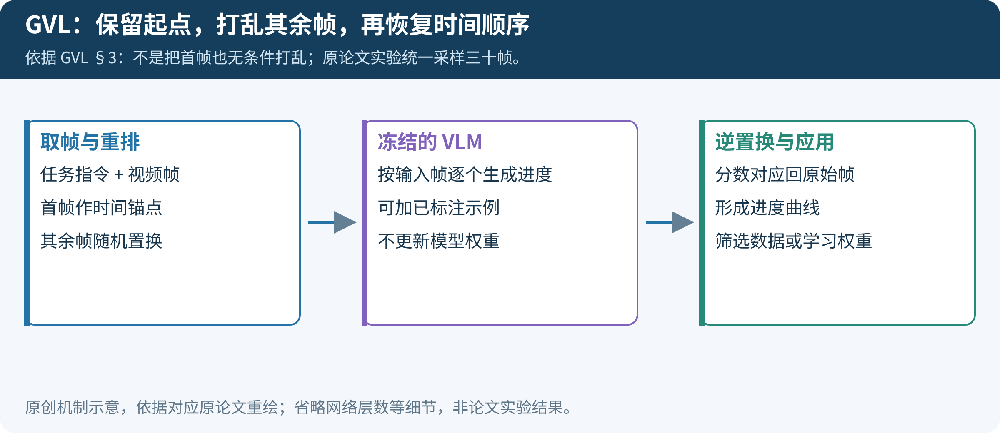
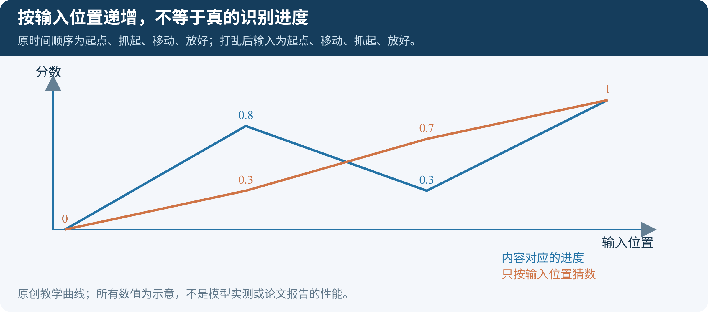

# GVL：让视觉语言模型从打乱的视频中判断任务进度

一段机器人视频播放到一半，不代表任务完成一半：它可能在等待，也可能一直抓取失败。GVL（Generative Value Learning）让冻结的 VLM 为多张观测图生成任务完成百分比，并通过打乱输入顺序减轻“按播放位置报数”的捷径。**这里的 value 主要是任务进度估计，不是经过 Bellman 学习、显式条件化某个策略的精确期望回报。**

## 1. 输入输出与关键的首帧锚点

输入是任务文字 $g$ 与抽取的视频帧 $o_1,\ldots,o_T$，输出是每帧整数百分比。论文实践统一抽取三十帧；这是实验设置，不是 VLM 必须接收的固定数量。

*据论文 §3 原创重绘。旧文把所有帧都打乱不准确：首帧保留作起点锚，避免正放和倒放都合理时方向无法辨认。*

设输入索引为 $\rho=(1,\rho_2,\ldots,\rho_T)$，其中后面的索引是其余帧的随机排列。模型自回归地产生：

$$(\hat P_{\rho_1},\ldots,\hat P_{\rho_T})=f_{\mathrm{VLM}}(g,o_{\rho_1},\ldots,o_{\rho_T}).$$

这只是输出接口的统一记号，不声称它是显式概率密度。将输出按逆置换放回原始时间，才能得到进度曲线。

## 2. 为什么打乱有帮助

若顺序输入，模型可能不看清内容也输出递增百分比。打乱后输入位置与原时间不同；想给对进度，至少需要利用图像内容、任务语义及起点关系。

*原创反例。位置报数也能形成漂亮递增线，但映射回原视频后并不对应任务变化；打乱并不保证完全消除捷径。*

“迫使理解”应理解为一种提示设计的作用方向，不能当作模型已经获得真实物理状态或因果理解的证明。

## 3. In-context learning 具体指什么

在待评估视频前加入其他视频与已知进度作为例子，模型可在上下文中学习输出模式。训练参数保持不变；增加示例不是重新反向传播训练一个价值网络。示例可以来自其他任务或人类视频，能否迁移依赖任务与模型能力。

这区分了零样本版本和少样本上下文版本：前者不需要此类标注示例，后者有示例成本。二者也都依赖已经预训练的大模型，不能说“完全不需要数据”。机制见 [原论文 §3](https://arxiv.org/html/2411.04549v1#S3)。

## 4. 如何评估，而不是只看曲线好不好看

原论文使用 VOC（Value-Order Correlation）考察专家轨迹上的预测分数次序与时间顺序的秩相关性，可概括成：

$$\operatorname{VOC}=\operatorname{RankCorr}((\hat P_t)_{t=1}^{T},(t)_{t=1}^{T}).$$

它利用专家执行总体向目标推进的假设。它不是任意失败轨迹的真实完成度标签，也不是成功概率校准度。光按时间递增的预测同样可能拿到高相关，因此还需要失败、错误任务、回退轨迹和下游策略评估。

## 5. 一个可重建的使用流程

1. 选择与视频匹配的任务描述，保留观测与原时间索引。
2. 按协议采样帧，保留第一帧，将其余帧置换。
3. 可选加入明确标注的上下文示例。
4. 调用 VLM 生成每帧数值，检查格式、数量与取值范围。
5. 逆置换还原分数，分别做排序、终点检测或动作片段加权。
6. 检查模型是否忽略关键接触、任务是否含不可见步骤，以及是否读取了未来画面。

整段视频联合打分是离线用途；不能未经改造就当实时因果奖励。原论文的实验涉及数据筛选、成功检测和加权回归，本页没有复现对应收益。

## 6. 与其他方法怎样区别

与 [TOPReward](robot-value-2026-02-topreward.md) 相比，GVL 要生成数字；后者读取候选 token 对数概率。后续论文在某些开源模型上的失败现象，不能推广成“所有开源 VLM 永远不能用 GVL”。与 [SayCan](robot-value-2022-saycan.md) 相比，GVL 估计的是视频内容的任务推进，不能直接替代技能特定的可行性模型。

## 来源

- Ma 等，[Vision Language Models are In-Context Value Learners](https://arxiv.org/abs/2411.04549)，首次公开 2024-11-07，§3–4；[官方项目](https://generative-value-learning.github.io/)。
- [机器人价值函数](robot-value-functions.md)、[时间线综述](../../01-comprehensive/01-embodied-ai/robot-value-reward-overview.md)、[核验记录](../../../raw/entries/2026-11-21-robot-values.md)。
