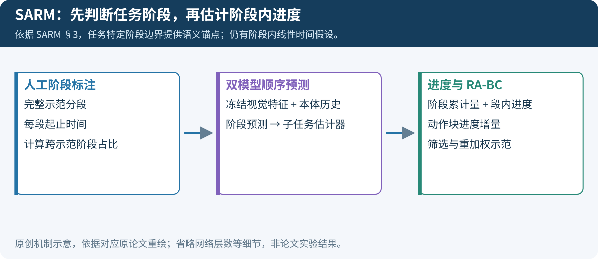
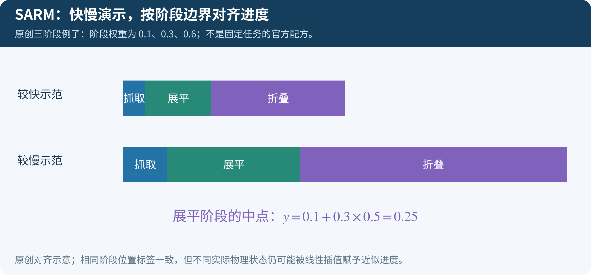

# SARM：用任务阶段对齐长程操作进度

同样是把衣服展平，有的示范很快，有的需要来回整理很久。如果直接用“当前帧／总帧数”标注进度，完全展平的画面可能被标成不同完成度。SARM 先把任务切成语义阶段，再在阶段内部估计细进度。**阶段边界提供稳定锚点，阶段内仍采用近似时间插值，不能把它说成彻底摆脱时间假设。**

## 1. 两个顺序预测的模型

输入包括多视角图像序列与本体状态；图像特征由冻结 CLIP 编码。阶段模型预测当前属于“抓取、展平、折叠”等哪一阶段，子任务估计器再利用预测阶段和观测估计段内进度。

*据论文 Figure 2 与 §3 原创重绘。这里把共享视觉特征和顺序预测画成机制图，不断言两个任务头共用所有可训练时序层。*

输出的全局分数是任务归一化进度。它不是关节动作，也不是某个待执行策略的校准成功概率。

## 2. 从阶段标注得到逐帧监督

假设有 $M$ 个示范，示范 $i$ 总长度为 $T_i$，阶段 $k$ 的长度为 $L_{i,k}$。先计算各阶段平均占比：

$$\bar\alpha_k=\frac1M\sum_{i=1}^{M}\frac{L_{i,k}}{T_i},\qquad P_k=\sum_{j=1}^{k}\bar\alpha_j.$$

阶段 $k$ 在一段示范中的起止为 $[s_k,e_k]$。若 $e_k>s_k$，定义局部进度 $\tau_t=(t-s_k)/(e_k-s_k)$，标注为：

$$y_t=P_{k-1}+\bar\alpha_k\tau_t.$$

*原创例子：阶段权重分别是 $0.1,0.3,0.6$。展平阶段中点标为 $0.25$，不取决于它在整段视频第几个百分比的位置。*

它固定的是语义边界与局部归一化位置，而不是保证所有物理上相同的状态都得到完全相同分数。阶段内长时间等待、反复试错仍可能让线性插值失真。标签构造见 [论文 §3.1，式 (1)–(4)](https://arxiv.org/html/2509.25358v4#S3)。

## 3. 奖励模型怎样训练和推理

1. 为具体任务定义阶段标注协议，人工标出各段起止。
2. 对满足协议的完整轨迹计算阶段占比与细粒度标签。
3. 冻结视觉编码特征，融合本体状态，用时序网络训练阶段分类。
4. 将预测阶段作为子任务估计器上下文，监督段内进度并合成全局分数。
5. 推理时输入观测历史，由模型自己预测阶段，不再要求实时人工告诉它正处于哪段。

原论文在准备训练集时排除了缺失规定阶段、含严重错误的轨迹。这是方法适用条件，不能声称原模型已经充分利用所有失败示范。

## 4. RA-BC：分数怎样影响动作学习

对动作块跨度 $H$，估计推进量：

$$\delta_t=\hat P_{t+H}-\hat P_t.$$

将其变成非负权重，再训练加权行为克隆：

$$\mathcal L_{\mathrm{RA\mbox{-}BC}}=
\frac{\sum_i w_i\,\ell(\pi_\theta(o_i),a_i)}{\sum_iw_i+\epsilon}.$$

$\ell$ 是该策略的动作训练损失，不限于某一种输出分布。论文具体权重使用运行均值、标准差构造裁剪 ramp，并结合先验阈值及有效性掩码；用统一记号表示软部分：

$$\tilde w_i=\operatorname{clip}\!\left(\frac{\delta_i-(\mu-2\sigma)}{4\sigma+\epsilon},0,1\right).$$

负增益、明显高增益与中间区域还有不同处理，不能把软公式当完整实现。这个进度差是优势代理，不自动等于 $Q^\pi-V^\pi$。它仍主要是在数据上进行监督式动作学习，而不是仅凭“有奖励模型”就变成在线 RL。

## 5. 用起来会遇到什么限制

阶段预测错误会影响后续分数；新任务需要重新定义阶段及相应监督；坏的奖励可能降低有效恢复片段的权重。评估应检查阶段准确性、分数与人工进度的一致性，以及加权后真实策略表现，不能只报告更平滑的曲线。

[SARM2](robot-value-2026-06-sarm2.md) 针对跨任务复用阶段的问题引入动作基元与专家路由，是独立工作，不能把它的多任务能力或 SPIRAL 流程写回 SARM v1。

## 来源

- Chen 等，[SARM: Stage-Aware Reward Modeling for Long Horizon Robot Manipulation](https://arxiv.org/abs/2509.25358)，首次公开 2025-09-29；本文公式核验 v4 §3。
- [ARM](robot-value-2026-04-arm.md) 改以相对三态变化监督；[机器人价值函数](robot-value-functions.md) 解释进度与价值边界。
- [时间线综述](../../01-comprehensive/01-embodied-ai/robot-value-reward-overview.md)、[核验记录](../../../raw/entries/2026-11-21-robot-values.md)。
