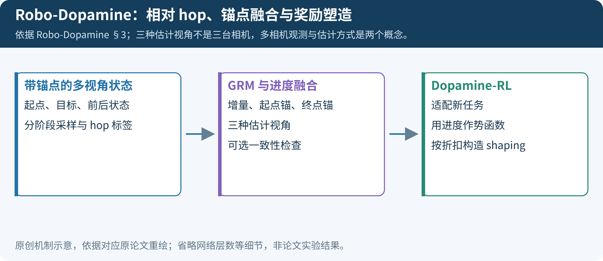
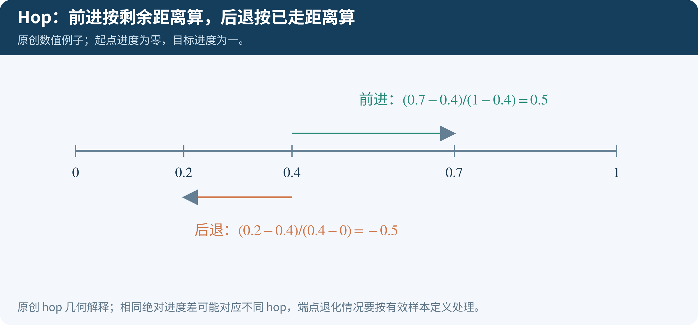

# Robo-Dopamine：从相对进度到策略不变奖励塑造

精细插接时，画面看起来接近目标，不代表已经插好；奖励若持续鼓励“保持接近”，策略甚至可能不愿完成最后一步。Robo-Dopamine 将工作分成两部分：Dopamine-Reward 学习细粒度进度，Dopamine-RL 将该分数接到奖励塑造与策略学习。**识别进度与设计优化目标是两个问题，不能因为奖励更密集就说目标一定正确。**

## 1. GRM 的输入不是只有单张当前图

GRM（General Reward Model）用任务文字、起点和目标锚点、前后两个多视角状态预测相对进展 hop。一个状态包含同步相机观测，而不是要求学习器获得完整物理真实状态。

*据原论文 §3 原创重绘。“多相机视角”和下文三种“进度估计视角”是不同概念。*

训练数据先用人工关键帧分段，再在每段内采样。将采样后的顺序进度记成 $\Phi(s_i)=i/M$，是一种阶段化监督约定，不是从真实世界测得的物理量。

## 2. Hop 为什么不直接等于两个进度相减

设起点进度为零、目标为一，两个状态进度为 $p,q$。按原论文式 (2) 的含义，用进退方向写成：

$$\mathcal H(p,q)=
\begin{cases}(q-p)/(1-p),&q\geq p,\ p<1,\\
(q-p)/p,&q<p,\ p>0.
\end{cases}$$

正向变化按剩余距离归一，退步按已经走过的距离归一。端点退化和零变化需按有效样本构造处理，不能直接除零。

*原创手算：从 $0.4$ 到 $0.7$，hop 为 $0.5$；从 $0.4$ 到 $0.2$，hop 为 $-0.5$。它们不是相同的绝对变化量。*

给定当前进度 $p$ 和预测 $h\in[-1,1]$，重建下一进度：

$$p'=\begin{cases}p+(1-p)h,&h\geq0,\\p+ph,&h<0.\end{cases}$$

在这些范围假设成立时结果仍在 $[0,1]$，但“数值不越界”不表示“语义预测准确”。标签和重建依据 [论文 §3.1，式 (2)–(5)](https://arxiv.org/html/2512.23703v1#S3)。

## 3. 三种估计方式为什么融合

连续增量细腻但会累积漂移，所以又加入从起点直接估计、从目标反向估计：

$$\hat\Phi_I(s_t)=\text{按前一进度递推},\quad
\hat\Phi_F(s_t)=\hat{\mathcal H}(s_0,s_t),\quad
\hat\Phi_B(s_t)=1+\hat{\mathcal H}(s_G,s_t).$$

基础版本取三者平均。原文还给出可选双向一致性检查：起点锚与目标锚分歧大时，降低状态更新幅度。这能当可靠性启发式，但一致地犯错仍然可能发生。

## 4. 从进度到奖励：折扣因子不能丢

把固定进度评估作为势函数，塑造为：

$$r'_t=r_{\mathrm{gold},t}+\gamma\Phi(s_{t+1})-\Phi(s_t).$$

为何不是简单加 $\Phi(s_{t+1})-\Phi(s_t)$？因为折扣累积下只有匹配的势差才能按相应边界条件望远镜消去。有限回合展开是：

$$\sum_{t=0}^{T-1}\gamma^t[\gamma\Phi(s_{t+1})-\Phi(s_t)]
=-\Phi(s_0)+\gamma^T\Phi(s_T).$$

因此需要明确终止状态的势和吸收状态处理，或无限折扣时的有界性；若分数有历史依赖，还需把必要历史纳入状态。只有这些条件匹配时，才讨论相对原任务的策略不变性。[原始 PBRS 理论](https://people.eecs.berkeley.edu/~russell/papers/icml99-shaping.pdf) 与 [本文 §3.2](https://arxiv.org/html/2512.23703v1#S3) 应合起来读。

尤其要区分理论与工程：原文用预测进度阈值自动产生稀疏成功信号。**相对这个代理奖励的策略不变，不意味着相对真正人类成功标准也一定不变。** 阈值误判和奖励投机仍须验证。

## 5. 新任务适配与使用边界

1. 从预训练 GRM 出发，用新任务示范适配相对 hop。
2. 提供符合设定的任务与起点／目标参考观测。
3. 在策略运行状态上预测进度，必要时做一致性过滤。
4. 按折扣和终止约定构造奖励，接入具体 RL 算法。
5. 用独立真实成功检测检验是否只优化了评估器漏洞。

本页未复现实机实验，不将旧文“一个小时九成五”等跨任务摘要当普遍保证；预训练数据成本、任务适配成本与在线交互成本应分开统计。

## 来源

- Tan 等，[Robo-Dopamine](https://arxiv.org/abs/2512.23703)，2025-12-29，§3；[本地论文](../../../raw/papers/robot-values/robo-dopamine.pdf)。
- [机器人价值函数](robot-value-functions.md)、[Robometer](robot-value-2026-03-robometer.md)、[时间线综述](../../01-comprehensive/01-embodied-ai/robot-value-reward-overview.md)、[核验记录](../../../raw/entries/2026-11-21-robot-values.md)。
