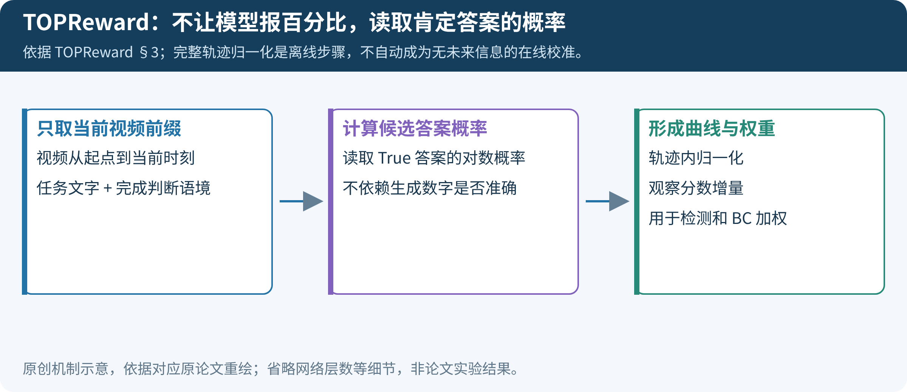
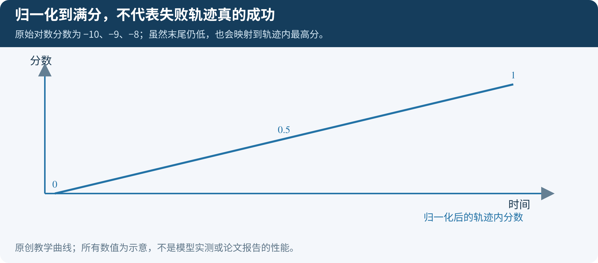

# TOPReward：读取 Token 概率估计机器人任务进度

VLM 可能看得出机器人快完成了，却不擅长为一串帧生成准确、格式整齐的百分比。TOPReward 不要求它直接报数字，而是询问“这段视频是否完成任务”，读取肯定答案的对数概率。**输出仍是视觉语言模型的评分代理，不能自动解释成经过现实成功数据校准的成功概率。**

## 1. 视频前缀到底是什么

设视频为 $\tau_{1:T}=(I_1,\ldots,I_T)$。时刻 $t$ 的前缀 $\tau_{1:t}$ 只包含视频开头到当前的帧。不是把整段未来视频一起看完，再声称在每一步都在线预测。

*据原论文 §3 原创重绘。每个前缀独立判断；内部可以按采样协议选帧，并不意味着每次输入未经压缩的所有原始帧。*

输入包括前缀、任务描述和完成判断文本语境。给定 VLM 参数 $\theta$，评分为：

$$r_t=\log p_\theta(a=\text{True}\mid c(\tau_{1:t},g)).$$

$\log$ 分数在 $(-\infty,0]$。若答案由多个 tokenizer token 组成，需按明确协议累加条件对数概率；不能换一个模板后默认与原方法同尺度。评分对象是候选答案，不是随机生成一次 True／False 后把结果当连续奖励。

## 2. 为什么它绕开了“生成数字”的困难

生成百分比要求模型同时理解视觉、遵守格式并维护数值对应关系。读取一个指定答案的概率，不必真的生成一串百分比。它仍依赖视频理解，也受文本措辞、tokenization 和模板影响。

原论文实验没有使用聊天模板，并通过消融观察其影响；这是特定模型与提示配置的经验结论，不是“任何聊天模板必定有害”的定理。见 [论文 §3.1](https://arxiv.org/html/2602.19313v2#S3)。

## 3. 归一化会不会把失败也变成满分

论文对一个 episode 内多个前缀的对数分数作 min-max：

$$s_{t_k}=\frac{r_{t_k}-\min_jr_{t_j}}
{\max_jr_{t_j}-\min_jr_{t_j}+\epsilon}.$$

*原创例子：原始分数 $-10,-9,-8$ 都可能很低，但归一化仍接近 $0,0.5,1$。曲线最高点不等于真实任务完成。*

所以需要分别看原始概率、轨迹内进度、终点标签以及独立成功检测。全轨迹极值要等轨迹结束才知道，不能直接作为严格实时在线归一化；若只用截至当前的极值，评分规则已经改变，需要重新评估。

## 4. 如何把曲线用于行为克隆

本文按已归档 v2 的式 (3) 解释下游权重：它使用原始 TOPReward 对数分数的增量，而不是整轨迹归一化分数：

$$w_{t_k}=\min\!\left\{\exp\!\left(\beta(r_{t_k}-r_{t_{k-1}})\right),w_{\max}\right\}.$$

$\beta$ 控制区分强度，$w_{\max}$ 限制极端权重。权重再乘动作训练损失。即使差分为负，指数权重仍为正；这与“所有倒退动作一律删除”不同，也不能把权重当成原始成功概率。

v1 的表述使用归一化分数增量和另一个尺度参数；v2 将因果原始分数、非因果可视化归一化，以及离线训练权重分开说清。这里保留首次公开日期，但方法公式以 v2 为准，避免跨版本混用。

一个可重复的流水线：采样多个前缀→固定提示与答案 token→读取对数概率→检查退化常数曲线→离线可视化时才做轨迹内归一化→由原始增量构造正权重→训练并评估策略。VLM 保持冻结，不表示下游动作策略也不需要训练。

## 5. 实验应该怎样比较

VOC 通常是在专家轨迹上与时间顺序相关，不等于失败识别能力。不同论文用不同数据、采样密度和 backbone，不能把旧文中的几个 VOC 数直接拼成普遍排名。应同时测试回退、错误指令、未完成轨迹，以及加权 BC 后的真实执行表现。

与 [GVL](robot-value-2024-gvl.md) 的主要区别在分数读出方式；与 [Robometer](robot-value-2026-03-robometer.md) 的区别在是否专门训练、用了哪些监督，不是某个数字永远谁高谁低。

## 来源

- Chen 等，[TOPReward](https://arxiv.org/abs/2602.19313)，2026，§3；[本地论文](../../../raw/papers/robot-values/topreward.pdf)、[项目页](https://topreward.github.io/webpage/)。
- [机器人价值函数](robot-value-functions.md)、[时间线综述](../../01-comprehensive/01-embodied-ai/robot-value-reward-overview.md)、[核验记录](../../../raw/entries/2026-11-21-robot-values.md)。
