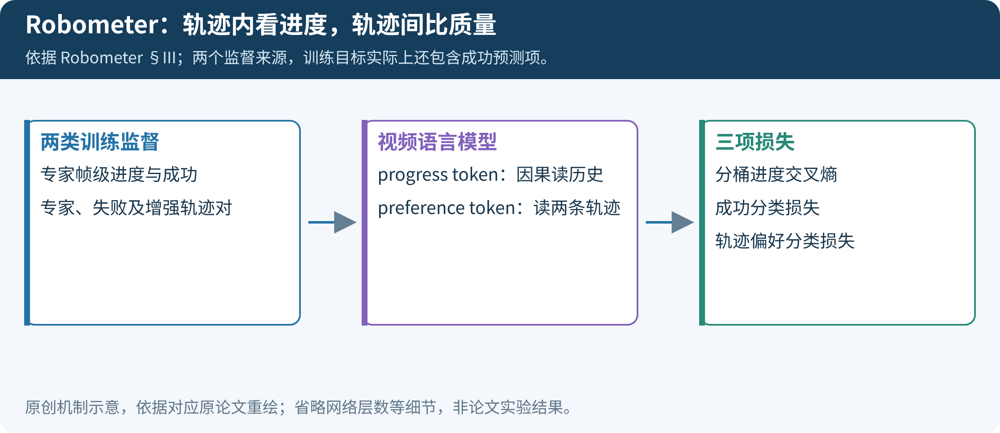
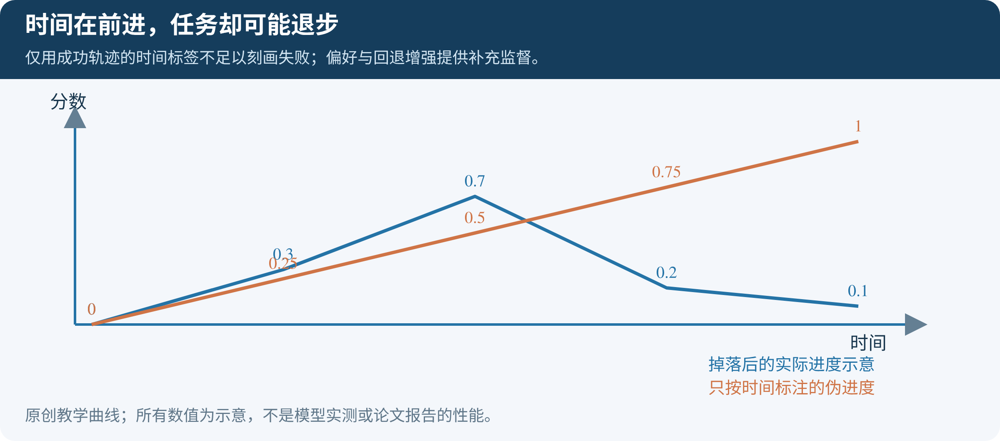

# Robometer：用轨迹比较学习可迁移的机器人奖励

成功示范可以用时间位置近似标注进度，但失败轨迹很难逐帧回答“究竟完成了百分之几”。Robometer 加入轨迹比较：即使不知道失败片段的绝对分数，也可能知道同任务下哪一段更好。**它结合轨迹内进度锚定和轨迹间偏好监督，并额外预测任务成功，不是只靠一种连续回归损失。**

## 1. 输入与 token 的角色

输入包含任务语言 $g$ 和一条或两条视频轨迹。基于 Qwen3-VL 的模型在第一条轨迹帧后插入 progress token，在两条轨迹之后放置 preference token。前者只读取当前及过去的第一轨迹内容，后者可读取两条轨迹作比较。

*据论文 §III 原创重绘。两个监督来源不意味着总损失只有两项；原论文实现还包含成功预测。*

进度推理时不必同时提供一条竞争轨迹；两条轨迹是比较监督的构造方式，不是所有部署调用都必须具备的额外输入。固定帧数采样用于降低“视频更长就更好”的捷径。

## 2. 三项损失分别约束什么

用统一符号写：

$$\mathcal L=\mathcal L_{\mathrm{pref}}+\mathcal L_{\mathrm{prog}}+\mathcal L_{\mathrm{succ}}.$$

偏好分支预测第一条是否优于第二条，使用二元分类损失。专家进度标签先按时间构造，再投影到十个进度区间，用相邻中心插值得到软标签 $q_t$：

$$\mathcal L_{\mathrm{prog}}=-\frac1T\sum_t\sum_{b=1}^{B}q_{t,b}\log\hat p_{t,b},\qquad
\hat P_t=\sum_b c_b\hat p_{t,b}.$$

$c_b$ 是固定区间中心，$\hat p_{t,b}$ 是预测分布。成功分支对是否达到完成条件做类别平衡的二元分类。**进度分数、成功分数和轨迹偏好仍是不同输出**，不能因为来自同一个 backbone 就互换。

标签与 token 因果关系见 [论文 §III-B–C](https://arxiv.org/html/2603.02115v2#S3)，本地归档的后续版本可对照其训练目标章节。

## 3. 没有绝对失败分数，比较标签从哪来

主要构造包括：

1. 同任务不同质量：成功专家与失败／次优执行比较。
2. 错误任务指令：对同一个条件任务，与另一任务的轨迹构造负例。
3. 视频回退：把成功视频的一段反放或拼接回退，模拟撤销进度。

*原创掉落示意。时间在走不代表任务在进步；回退增强不是对所有真实接触失败的完美模拟。*

这类标签利用数据结构降低额外密集标注需求，但依赖“专家相对更好”“错误任务不应得分”等假设。如果数据本来标错任务，或视频反放造成明显不自然伪迹，模型仍可能走捷径。

## 4. 训练与下游使用怎样衔接

训练时混合专家、失败、次优与增强样本，让进度分支学局部尺度，让比较分支学跨轨迹区分。推理时对当前前缀读取进度／成功，或输入轨迹对读取偏好。随后可以筛选 IL 数据、监测失败，或按明确规则供 RL 使用。

具体部署仍要检查推理时延、采样是否包含首帧和当前帧、是否误读未来内容。视频语言评分不是控制器，不能直接把分数塞到电机接口。

## 5. 为什么“通用”不是随便换机器人都可靠

跨本体训练有助于泛化，但相机视角、动作语义、遮挡、物体和任务分布改变时，模型可能误判。原论文的实验区分奖励排序、失败区分与下游策略表现；本页不把不同设置的倍数改善拼成统一成功率。

进度分支仍用专家时间监督，因此与 [SARM](robot-value-2025-09-sarm.md) 的阶段锚定不同；偏好增强也不能证明每个接触时刻的分数都准确。需要在目标机器人上检查错误指令、失败、拖延和回退，尤其关注虚假成功。

## 来源

- Liang 等，[Robometer](https://arxiv.org/abs/2603.02115)，首次公开 2026-03-02；[本地论文](../../../raw/papers/robot-values/robometer.pdf)、[官方项目](https://robometer.github.io/)。
- [TOPReward](robot-value-2026-02-topreward.md) 是冻结模型读出路线；[ARM](robot-value-2026-04-arm.md) 直接监督局部相对变化。
- [时间线综述](../../01-comprehensive/01-embodied-ai/robot-value-reward-overview.md)、[核验记录](../../../raw/entries/2026-11-21-robot-values.md)。
