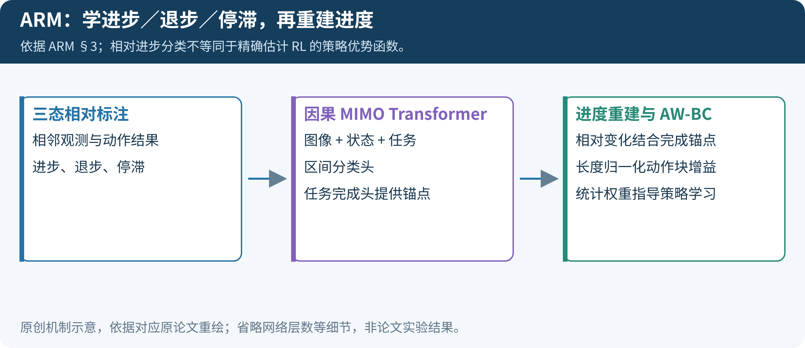
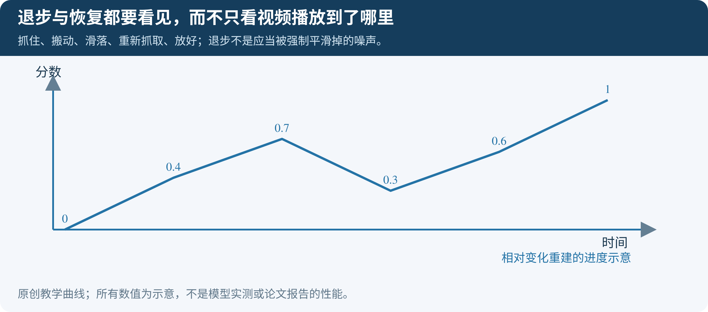

# ARM：从进步、退步与停滞学习操作反馈

机器人抓住毛巾后又滑落，接着重新抓取。按时间给进度会一路增长，直接问“现在完成百分之几”又难以标注。ARM 先问一个更简单的问题：“这一段是在进步、退步，还是停滞？”再利用相对分类与完成锚点重建全局分数。**这里的 advantage 是任务进展意义上的相对好坏，不天然等于某个策略的精确 $Q^\pi-V^\pi$。**

## 1. 先标局部关系，而非每帧绝对百分比

对相邻或一定间隔的观测对，标注：$+1$ 表示推进目标，$-1$ 表示退步或失败，$0$ 表示无明显推进。任务文字提供“什么叫进步”的语义，本体状态与时序图像帮助区分孤立画面里看不出的动作结果。

*据论文 §3 原创重绘。区间头预测类别，不应在介绍输入输出时直接写成无条件连续增益回归器。*

一次标注仍有成本，模型可以从初始人工标签冷启动，再为更多片段生成伪标签；伪标签错误也可能自我放大，不能说这条路线完全不需要人工。

## 2. MIMO 时序模型为什么重要

MIMO 指多时刻输入、多时刻输出。各时刻的图像、本体状态和任务特征投影到共同维度后相加，经过因果 Transformer 获得 $h_t$。区间头读取相邻隐状态，完成头读取当前表示：

$$p_\theta(y_t\mid h_t,h_{t+k}),\qquad
C_t=p_\theta(\text{complete}\mid h_t).$$

这是本文统一接口记号，不代表模型可以在时刻 $t$ 在线看到尚未发生的 $t+k$ 帧；对应区间的判断要等后端点进入观测窗口。因果掩码必须与 token 排列一起检查。

区间头使用三态交叉熵；完成头用 Focal Loss 缓解成功帧稀少，联合目标为加权和。依据 [论文 §3.2，式 (1)–(3)](https://arxiv.org/html/2604.03037v2#S3)。

## 3. 相对变化怎样变成全局进度

*原创轨迹：进步、掉落、恢复。把退步强行平滑为单调线，会抹掉本方法想保留的信号。*

原文把分段区间预测汇总，并用任务完成头提供绝对锚点。长轨迹可以分段批处理，末段不足窗口时补帧，汇总时丢掉 padding 对应输出。

**只有正负号，并不能唯一决定连续进度幅度。** 原文 §3.3 说明累积重建方向，但未把所有概率到连续量的实现选择都写成唯一公式。本页不臆造一个“类别直接相加就必然得到真实百分比”的算法；具体复现还需核对对应代码版本和归一化处理。

全局重建若依赖最终完成锚点，就是整轨迹离线标注步骤；不能因为局部网络因果，就宣称整条重建流水线无需未来信息。

## 4. 长度自适应增益与 AW-BC

对跨度 $H$ 的动作块，原文定义：

$$\Delta G_t=(P_{t+H}-P_t)\frac{L_{\mathrm{seq}}}{\bar L}.$$

$L_{\mathrm{seq}}$ 是当前 episode 长度，$\bar L$ 是数据集平均长度，用于减轻不同长短示范的分数斜率差异。它不是区间分类训练标签，而是重建进度之后供策略学习使用的增益。

再以一批增益的均值、标准差构造权重：

$$\tilde w_i=\operatorname{clip}\!\left(\frac{\Delta G_i-(\mu-2\sigma)}{4\sigma+\epsilon},0,1\right),$$

$$\mathcal L_{\mathrm{AW\mbox{-}BC}}=\mathbb E[-\tilde w(s,a)\log\pi_\theta(a\mid s)].$$

负增益不一定数学上严格对应零权重，还取决于批统计与裁剪边界；不能把“压低退步片段”写成无条件删除。恢复行为也可能先降低表面进度，应检查权重是否保留真正有用的重新对齐动作。

## 5. 如何判断这套方法有没有帮到策略

先验证相对分类能否识别真实错误，再检查完成锚是否误触发、重建是否漂移，最后比较相同数据与基础策略上的加权学习效果。标注一致性、推理速度和策略成功率各自需要定义测试条件，不能互相替代。

本文按首次公开日期归档，不将不同任务、数据与论文版本中的性能摘要拼成普遍排名。

## 来源

- Mao 等，[ARM: Advantage Reward Modeling for Long-Horizon Manipulation](https://arxiv.org/abs/2604.03037)，首次公开 2026-04-03，本文方法核验 v2；[本地论文](../../../raw/papers/robot-values/arm.pdf)。
- [SARM](robot-value-2025-09-sarm.md)、[机器人价值函数](robot-value-functions.md)、[时间线综述](../../01-comprehensive/01-embodied-ai/robot-value-reward-overview.md)、[核验记录](../../../raw/entries/2026-11-21-robot-values.md)。
