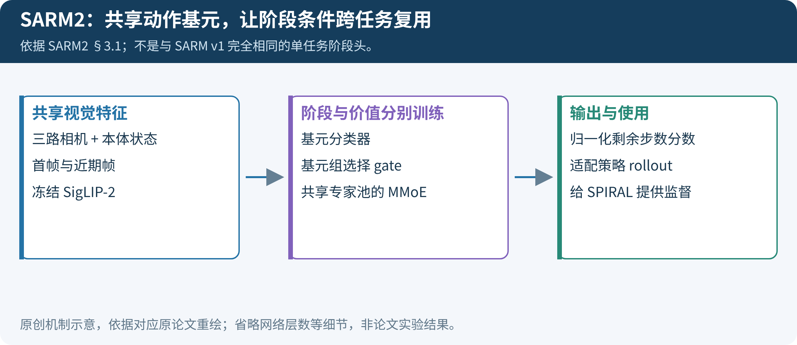
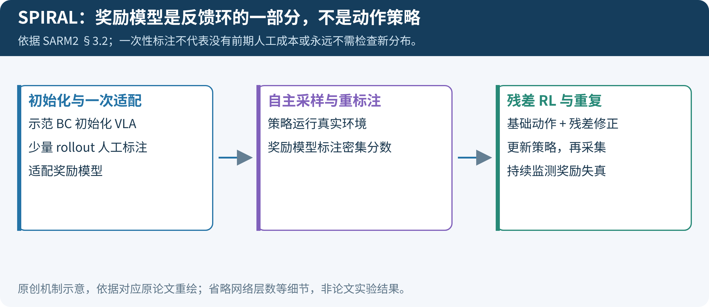

# SARM2：可复用动作阶段与奖励驱动的策略改进

SARM 的“展平、折叠”等阶段很适合一个具体任务，却难以直接迁到插接或擦拭。SARM2 改用跨任务反复出现的动作基元作中间表示，并用分组专家路由降低不同动作模式的干扰。**SARM2 是奖励／价值评估器，SPIRAL 才是使用它进行策略改进的框架；二者不能与低层动作模型混为一谈。**

## 1. 同一组基元怎样帮助不同任务

“拿起”“移动”“放下”能出现在叠衣服、收杯子等任务里。阶段估计器识别当前片段的动作基元，价值解码器再结合任务目标判断这一动作在当前任务中意味着什么。仅识别“拿起”并不知道任务完成了多少，还要结合初始场景与目标。

*据论文 §3.1 原创重绘。两个时序网络分别训练，共享的是冻结的视觉编码及缓存，不等于整个模型共用一个 Transformer。*

## 2. 输入与网络的具体分工

原文模型读取三路相机、本体状态和任务文字。阶段网络使用近期帧预测二十一种动作基元及一个空类。价值网络使用首帧作视觉锚点与近期窗口，并读取预测基元条件；训练输入还按协议构造回退负例，不表示部署必须知道未来倒放帧。

冻结 SigLIP-2 提取图像特征，本体状态经 MLP 投影。阶段估计器是独立的因果 Transformer，价值网络有另一套时序层。旧文若只说“共享 backbone”，容易漏掉这些分别训练的结构边界。

## 3. Multi-gate MoE 怎样路由

将基元按语义和运动模式分组，每组有自己的 gate，但共享专家池。若当前预测基元为 $\tilde y_t$，其组为 $m(\tilde y_t)$，可写：

$$o_t=\sum_e g_{t,e}^{m(\tilde y_t)}\,\mathcal E_e(h_t).$$

$h_t$ 是融合后的隐表示，$\mathcal E_e$ 是专家网络，$g_{t,e}$ 是按原文 top-k 路由协议选出的权重。不同基元组不必竞争同一个 gate，专家又可以跨任务复用。负载与熵辅助损失用于减少路由坍塌，不保证每个专家自动学出可解释技能。[论文 §3.1，式 (1)](https://arxiv.org/html/2606.10305v1#S3)。

## 4. 它预测的分数为何可能是负数

原文将监督定义为归一化剩余步数的负值：

$$r_t^*=-(T-t)/T\in[-1,0].$$

越接近完成越接近零，并不是“越负越好”。虽然原文用 $r$ 记号，它在这里是价值模型的监督分数；如何进入逐步 TD 奖励，仍要看策略学习部分，不能只按字母认定为环境即时奖励。

训练包括分数均方误差，以及 gate 平衡和熵相关辅助项：

$$\mathcal L=\mathbb E[(\hat r_t-r_t^*)^2]+
\lambda_{\mathrm{bal}}\mathcal L_{\mathrm{bal}}+
\lambda_{\mathrm{ent}}\mathcal L_{\mathrm{ent}}.$$

这是原文相应分数约定；与 [SARM](robot-value-2025-09-sarm.md) 的正进度尺度比较之前，要先对齐符号和范围。

## 5. SPIRAL 怎样形成反馈循环

*据论文 Figure 3 与 §3.2 原创重绘。初始化、奖励适配和后续自主循环的人工成本分别统计。*

流程包括示范 BC 初始化基础 VLA、用预训练评估器做初次离线改进，以及一次性对早期策略 rollout 标注、适配奖励模型；随后重复采集、重标注和残差 RL。

残差思想是保持基础动作生成器，学习修正 $\Delta a_\theta$：

$$a=\pi_{\mathrm{pre}}(s,z)+\Delta a_\theta(s,z).$$

策略目标在提高 critic 分数的同时限制修正幅度：

$$\mathcal L_{\mathrm{actor}}=\mathbb E[-Q_\phi(s,a)+\beta\|\Delta a_\theta(s,z)\|^2].$$

原文还用 critic 集成、多潜变量候选、密集 TD 与稀疏 MC 目标，以及部署时 best-of 多候选选择，不能把上述简式称作完整 SPIRAL 实现。这里也要区分：**采集来自当前策略，并不等于 TD3 式更新就被重新定义为标准 PPO 式 on-policy 算法。**

## 6. 什么条件下“自主改进”可能出问题

奖励模型若在 rollout 新分布上过度乐观，策略会利用评分漏洞；一次性适配不能保证后续所有分布都已覆盖。阶段误判会选错 gate，任务名称或首帧不一致也会误导评分。应单独检查 demo 分数误差、失败检测、真实策略成功率和专家路由健康度。

论文在特定长程任务及平台上做实验，不等于任意任务都能完全无人监督持续提高。它是一条跨任务评估与策略改进结合的路线，不是“只换奖励模型就必然超过示范”。

## 来源

- Chen 等，[SARM2: Multi-Task Stage Aware Reward Modeling for Self Improving Robotic Manipulation](https://arxiv.org/abs/2606.10305)，2026-06-09，§3.1–3.2；[本地论文](../../../raw/papers/robot-values/sarm2.pdf)。
- [SARM](robot-value-2025-09-sarm.md)、[机器人价值函数](robot-value-functions.md)、[时间线综述](../../01-comprehensive/01-embodied-ai/robot-value-reward-overview.md)、[核验记录](../../../raw/entries/2026-11-21-robot-values.md)。
