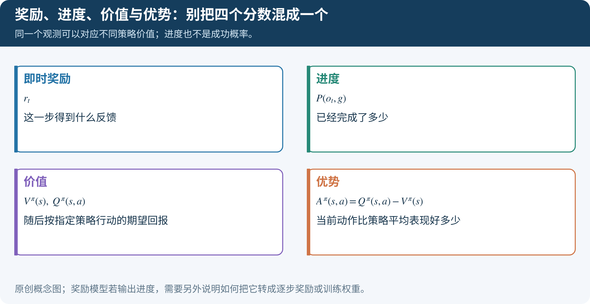
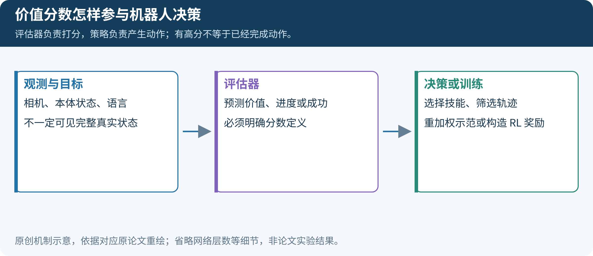

# 机器人价值函数：奖励、进度、成功率与优势

机械臂把杯子移动到盒子边缘，看起来“快完成了”，但如果下一步很容易碰倒，成功概率可能很低。反过来，杯子还在远处，只要策略可靠，最终成功概率仍可能很高。**任务进度回答已经做了多少；价值函数回答从这里继续按某个策略行动，预期能得到多少回报。** 机器人论文有时把两者都称作 value，读公式时必须区分。

## 1. 四种打分，不是四个同义词

*原创概念图。状态、动作、策略和奖励定义共同决定价值；进度模型则可能只按视觉变化估计完成比例。*

| 量 | 问什么 | 是否必然依赖策略 |
|---|---|---|
| 即时奖励 $r_t$ | 这一步给了什么反馈？ | 奖励定义通常固定，但采到的奖励取决于行为 |
| 进度 $P(o_t,g)$ | 朝给定目标已经走了多少？ | 通常不显式条件化某个待执行策略 |
| 价值 $V^\pi,Q^\pi$ | 继续按指定策略行动，预期回报多少？ | 是 |
| 优势 $A^\pi$ | 这个动作比该策略的平均选择好多少？ | 是 |

观测 $o_t$ 可以是相机与关节状态，$g$ 是目标；严格状态 $s_t$ 还可能包含当前不可见的信息。若任务部分可观测，需要使用历史或估计的信念状态，不能假设一张图片等于完整状态。

## 2. 从一个抓取例子建立价值定义

考虑一个回合里只有最终成功才奖励一，其他时候奖励零，失败后也结束。策略 $\pi(a\mid s,g)$ 决定动作，折扣为 $\gamma$，则：

$$G_t=\sum_{k=0}^{T-t-1}\gamma^k r_{t+k},\qquad
V^\pi(s,g)=\mathbb E[G_t\mid s_t=s,g,\pi].$$

本文约定 $r_t$ 是从时刻 $t$ 执行动作后得到的转移奖励，$T$ 为终止时刻。若 $\gamma=1$，成功奖励只给一次，且 episode 正常终止，$G_t$ 就是成功指示量，所以：

$$V^\pi(s,g)=\Pr(\text{最终成功}\mid s,g,\pi).$$

这里才有“价值等于成功概率”的精确含义。若成功后每步继续奖励，价值就不再是这个概率；若有折扣，快成功和慢成功的价值也不同。

原创例子：两个状态视觉进度都为八成，策略 A 在第一个状态后续成功率为 $0.9$，在第二个为 $0.2$；价值应当不同，不能直接把进度八成当作价值 $0.8$。同一状态换策略，成功率也可能变化。

## 3. 为什么还要动作价值和优势

动作价值先固定一次动作，再按策略继续：

$$Q^\pi(s,a,g)=\mathbb E[G_t\mid s_t=s,a_t=a,g,\pi],$$

$$V^\pi(s,g)=\mathbb E_{a\sim\pi}[Q^\pi(s,a,g)],\qquad
A^\pi(s,a,g)=Q^\pi(s,a,g)-V^\pi(s,g).$$

例如平均策略价值为 $0.6$，“先调整夹爪”动作的价值为 $0.85$，优势就是 $0.25$。它不是“进度增长了四分之一”：一个临时后退、重新对齐的动作，可能降低视觉进度，却提高最终成功概率。

## 4. 价值怎样从数据里学出来

数据包含 $(s_t,a_t,r_t,s_{t+1},d_t,g)$，$d_t$ 表示真实终止。对固定目标策略，TD 教学目标可写：

$$y_t=r_t+\gamma(1-d_t)\mathbb E_{a'\sim\pi}[Q_{\bar\phi}(s_{t+1},a',g)],$$

$$\mathcal L_Q(\phi)=\mathbb E[(Q_\phi(s_t,a_t,g)-y_t)^2].$$

$\bar\phi$ 是计算目标时使用的参数，例如滞后目标网络。输入是历史经验和奖励定义，输出是价值网络，不是直接输出控制指令。最大化动作、熵正则、离线约束等会改变具体目标，不能把这一个式子当作所有机器人的实现。

网络用图像而非完整状态时，还要解决遮挡、历史缺失和分布偏移。进度监督有时比成功终点更稠密，但那是另一种标签设计，不代表得到了与上述 TD 价值严格相同的量。

*原创接口图。评估器与动作策略分工不同；“给出高分”不是“执行动作”。*

## 5. 从进度分数到奖励，要多想一步

有了 $P_t$，常见做法是取差分 $P_{t+1}-P_t$，或者把进度增量变成行为克隆权重。它们有实用价值，但不能自动继承精确优势或策略不变性结论。

若原奖励为 $r_t$，符合条件的势函数塑造是：

$$r'_t=r_t+\gamma\Phi(s_{t+1})-\Phi(s_t).$$

有限时域的折扣塑造和为：

$$\sum_{t=0}^{T-1}\gamma^t[\gamma\Phi(s_{t+1})-\Phi(s_t)]
=-\Phi(s_0)+\gamma^T\Phi(s_T).$$

这显示终止边界不能省略。无限时域、有界势函数且折扣小于一时末项消失；有限回合则需匹配终止势和奖励处理。理论针对原奖励目标，**如果原成功检测本身错了，塑造定理不会把它变成真实成功**。原始结论见 [Ng、Harada、Russell（1999）](https://people.eecs.berkeley.edu/~russell/papers/icml99-shaping.pdf)。

## 6. 使用前先做哪些检查

- 如果用于选技能，核对分数是否与技能、状态和当前机器人能力对应。
- 如果用于筛选数据，检查失败轨迹和错误任务是否也被打高分。
- 如果用于逐步 RL，确认不能读取未来帧、全轨迹终点或依赖未来归一化。
- 如果用于加权 BC，说明权重来自进度代理还是精确优势，并验证是否压制必要的恢复动作。
- 相关系数高不表示概率校准好；成功检测、排序和策略成功率应分别评估。

## 从具体方法理解这些差别

[SayCan](robot-value-2022-saycan.md) 用技能可行性选动作；[GVL](robot-value-2024-gvl.md)、[TOPReward](robot-value-2026-02-topreward.md) 从 VLM 得到进度代理；[SARM](robot-value-2025-09-sarm.md)、[Robometer](robot-value-2026-03-robometer.md)、[ARM](robot-value-2026-04-arm.md) 学习任务进度或相对变化；[Robo-Dopamine](robot-value-2025-12-robo-dopamine.md) 明确讨论进度势到 RL 奖励的转换；[SARM2](robot-value-2026-06-sarm2.md) 把多任务评分接到策略改进循环。

定义与策略关系也可对照 [强化学习基础](../../01-comprehensive/03-ai-foundations/reinforcement-learning-basics.md)、[Online Learning 与 Off-policy 等概念](../03-ai-foundations/online-offline-learning.md)。按时间的关系见 [机器人价值与奖励模型综述](../../01-comprehensive/01-embodied-ai/robot-value-reward-overview.md)。
