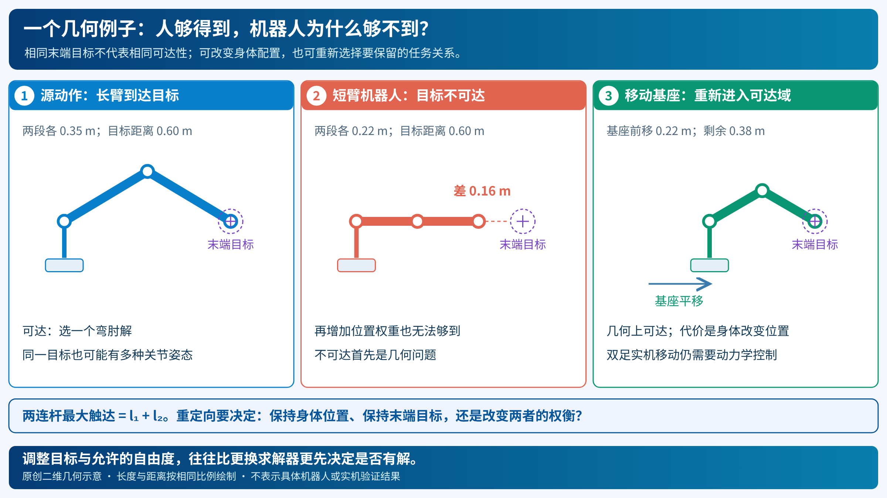
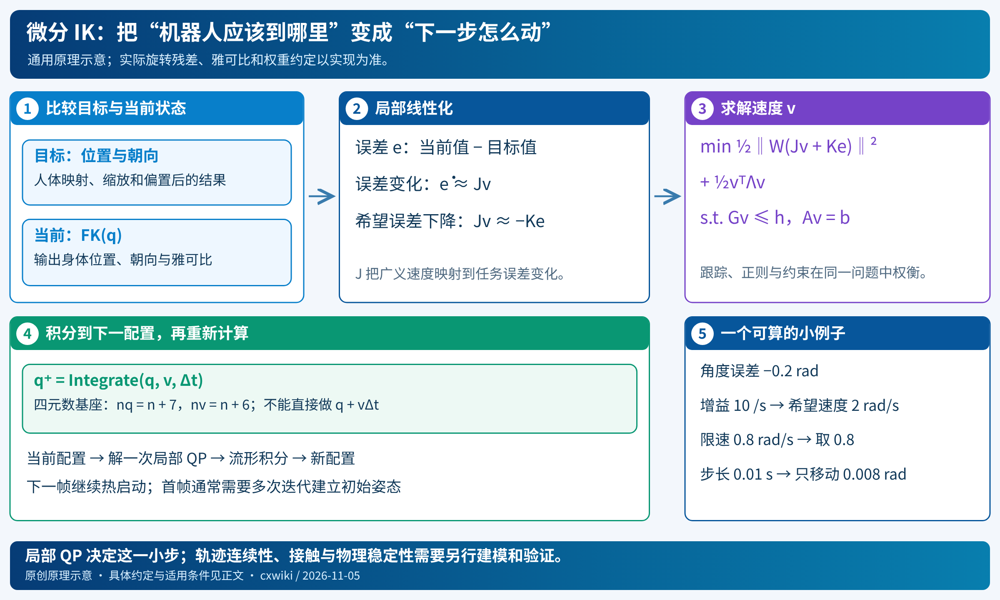
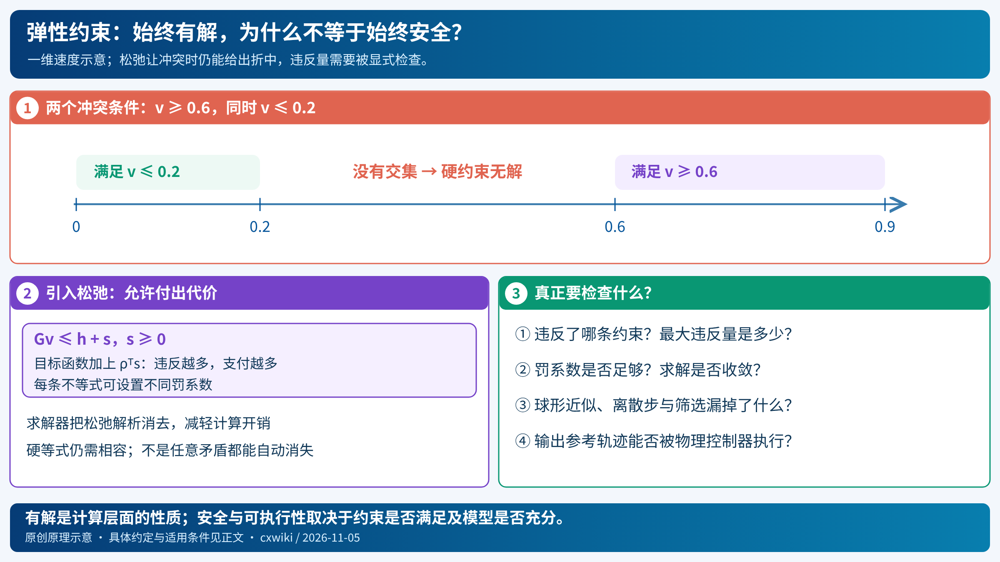
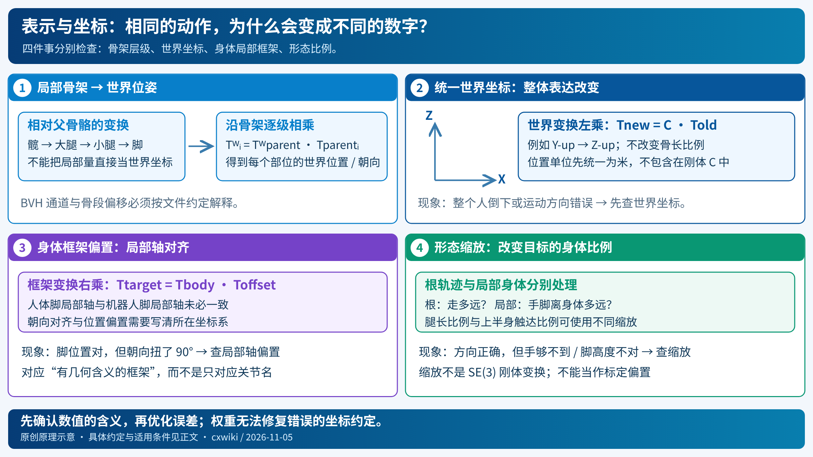
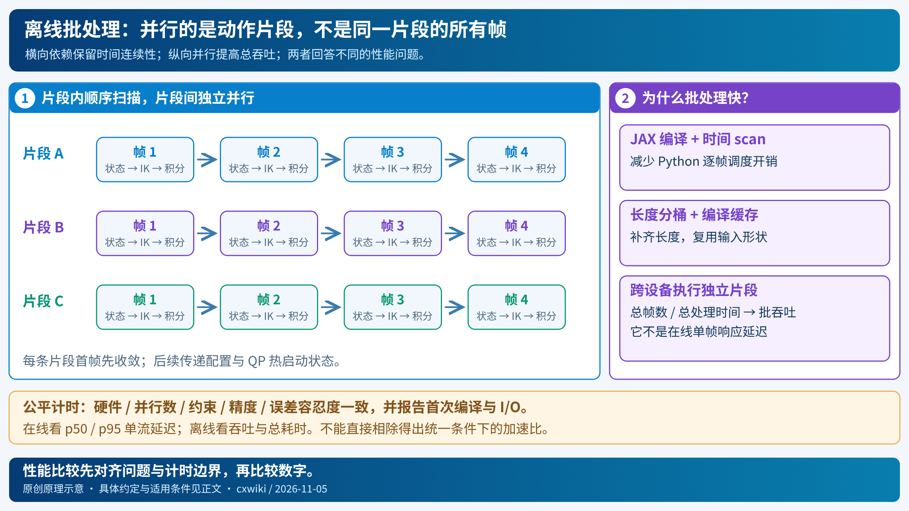

# FRAX 与微分 IK：从移动一个末端到全身动作重定向

假设你想让机械臂的手向右移动两厘米。你知道手应该去哪里，但机器人的接口通常要求各关节转到哪里，或者以多快的速度转动。**如何把“手的目标”转换成“各个关节的运动”，就是逆运动学要回答的问题。**

FRAX 为这条转换链提供机器人模型、运动学计算和微分 IK 求解工具。它最容易理解的用法，是先在当前位置计算“每个关节动一点，手会怎么动”，再求出一小步合适的关节速度，更新姿态后继续。多任务、限位、避碰和人体动作重定向，都可以在这个基础上逐步建立。

本文的学习顺序是：

> 移动一个点 → 用雅可比求速度 → 处理奇异与冗余 → 加入约束 → 跟踪朝向与多个身体部位 → 正确表示浮动基座 → 重定向完整动作 → 阅读实际实现。

前半部分先用固定基座、单自由度转动关节的机械臂推导，后半部分再引入人形机器人。你不需要先读综述；想横向比较 GMR、PyRoki 等方法时，再看[动作重定向综述](../../01-comprehensive/02-classical-robotics/motion-retargeting-overview.md)。

**核验范围**：实现说明固定在 FRAX commit `f5e87ab59a0b82ba43095e882c1b88c9b0dacf07`，关键文件有[本地快照](../../../raw/entries/2026-11-05-motion-retargeting.md)。通用推导会说明与实现的差别。本次没有运行 FRAX 重定向 benchmark 或真机实验。

## 1. 从最简单的目标开始：让手移动到一个点

### 1.1 已知关节角，怎样知道手在哪里？

先考虑一个平面两连杆机械臂。两段长度为 $l_1,l_2$，关节角为 $\theta_1,\theta_2$，第二个角相对于第一段连杆定义。末端位置为

$$
p=f(q)=
\begin{bmatrix}
l_1\cos\theta_1+l_2\cos(\theta_1+\theta_2)\\
l_1\sin\theta_1+l_2\sin(\theta_1+\theta_2)
\end{bmatrix},\qquad
q=\begin{bmatrix}\theta_1\\\theta_2\end{bmatrix}.
\tag{1}
$$

这里 $q$ 是关节角向量，$p=(x,y)$ 是末端位置。**正运动学（FK）**就是这个从关节角到身体几何的计算。FRAX 对一般机器人做的事情类似：从 URDF 读取关节连接、轴、连杆变换等信息，沿运动学树计算各框架位姿，不需要你手写每个机器人的式 (1)。[实现入口：Robot](https://github.com/StanfordASL/frax/blob/f5e87ab59a0b82ba43095e882c1b88c9b0dacf07/frax/core/robot.py)

如果目标位置为 $p^\star$，当前误差就是

$$
e(q)=f(q)-p^\star.
\tag{2}
$$

本文统一使用“当前减目标”的符号。因此当前手在目标左侧时，水平误差为负；要减小误差，应该产生正向水平运动。

### 1.2 为什么不直接把位置误差变成关节角？

因为 $f$ 一般不是一个可以直接求逆的函数。同一个末端位置可能有肘上、肘下两种姿态；关节更多时，还可能有无穷多个解；目标超出可达范围时，则没有解。



*图 1｜几何可达性先于求解器。前两格目标相同，但手臂长度不同；第三格允许基座移动，才改变了可达条件。[SVG 源图](../../imgs/retargeting-geometry.svg)。*

不过，我们未必需要立即找到远处目标的完整关节解。**先回答当前位置附近的一小步怎么走，会容易得多。** 这就是微分 IK 的出发点。

## 2. 把大问题变小：求这一瞬间应该怎样运动

### 2.1 雅可比是关节运动与末端运动之间的局部换算表

对式 (1) 求时间导数，得到

$$
\dot p=J(q)\dot q,
\tag{3}
$$

其中

$$
J(q)=
\begin{bmatrix}
-l_1\sin\theta_1-l_2\sin(\theta_1+\theta_2)&-l_2\sin(\theta_1+\theta_2)\\
l_1\cos\theta_1+l_2\cos(\theta_1+\theta_2)&l_2\cos(\theta_1+\theta_2)
\end{bmatrix}.
\tag{4}
$$

$J$ 就是雅可比矩阵。第一列回答“只让第一个关节以单位速度转动，末端会沿什么方向、多快移动”；第二列回答第二个关节的同一个问题。多个关节一起动，末端速度就是各列贡献的叠加。

对于有 $n$ 个单自由度关节、只跟踪三维位置的固定基座机械臂，$J\in\mathbb R^{3\times n}$、$\dot q\in\mathbb R^n$、$\dot p\in\mathbb R^3$。若关节为转动关节，其速度用 rad/s，末端线速度用 m/s。雅可比建立的是这两类量之间的几何关系。

**这是局部关系。** $J$ 随配置变化；肘弯起来后，同一关节速度对末端的作用方向也会改变。因此不能在初始姿态算一次 $J$，然后用它控制整段运动。

### 2.2 已经知道误差，末端应该以多快的速度接近目标？

对静止目标，一个简单选择是

$$
\dot p_{\mathrm{des}}=-k e(q),\qquad k>0.
\tag{5}
$$

误差越大，希望移动越快；接近目标时，速度自然减小。$k$ 的单位为 $\mathrm{s}^{-1}$。若能精确实现这个速度，误差满足 $\dot e=-ke$，从而指数衰减。

例如，手在目标左侧 0.02 m，$e_x=-0.02$ m，取 $k=10\ \mathrm{s}^{-1}$，则希望水平速度为 0.2 m/s。这个“0.2”是**速度**，不是本次要移动 0.2 m。

接下来只需要寻找一组关节速度，让

$$
J(q)\dot q\approx\dot p_{\mathrm{des}}.
\tag{6}
$$

这就是微分 IK 最核心的一步：已知当前位置和目标，求能减小误差的关节速度。[对应实现：任务的 `linearize`](../../../raw/codes/frax-f5e87ab/frax/ik/tasks.py)

如果目标本身在移动，式 (5) 仍可用作跟踪反馈，但会产生跟随滞后；若有可靠的目标速度，可在一致坐标系下另加参考速度前馈。这里先理解静止目标，FRAX 内置位置任务的基本反馈也由当前位置误差构造。

### 2.3 求出速度后，怎样更新姿态？

对这里的普通转动关节，可以用

$$
q_{k+1}=q_k+\dot q_k\Delta t.
\tag{7}
$$

更新后重新算 FK、误差和雅可比，再求下一步：

```text
给定初始关节角 q 和目标位置 p*
重复：
    当前位置 p = FK(q)
    误差 e = p - p*
    希望末端速度 = -k e
    计算当前位置的雅可比 J
    求关节速度，使 J qdot 尽量接近希望末端速度
    用时间步长 Δt 更新 q
```

若没有约束与数值误差，且速度被精确实现，一维离散误差近似为 $e_{k+1}=(1-k\Delta t)e_k$。$0<k\Delta t\le1$ 对应这个简化模型中的单调衰减；$1<k\Delta t<2$ 会交替接近；再大就可能发散。真实非线性机器人还有线性化误差和约束，所以这个计算只是调参起点。

**微分 IK 反复求局部速度，静态 IK 则希望得到一个满足目标的配置。** 可以反复调用微分步，直到静止目标收敛；也可以在连续目标到来时，每个周期只走一步。

## 3. 当逆矩阵不好用：奇异、冗余与阻尼

### 3.1 一个能手算的雅可比例子

取 $l_1=l_2=1$ m，$\theta_1=0$、$\theta_2=\pi/2$。此时

$$
p=\begin{bmatrix}1\\1\end{bmatrix},\qquad
J=\begin{bmatrix}-1&-1\\1&0\end{bmatrix}.
$$

希望末端向右以 0.1 m/s 移动，且竖直速度为零，解

$$
\begin{bmatrix}-1&-1\\1&0\end{bmatrix}
\begin{bmatrix}\dot\theta_1\\\dot\theta_2\end{bmatrix}
=\begin{bmatrix}0.1\\0\end{bmatrix}
\quad\Rightarrow\quad
\dot\theta_1=0,\quad\dot\theta_2=-0.1\ \mathrm{rad/s}.
$$

取 $\Delta t=0.01$ s，第二关节只改变 −0.001 rad。用新的关节角重新算 FK，得到 $p^+\approx(1.001,0.9999995)$ m：向右约一毫米，竖直误差是一阶近似以外的高阶项。雅可比求的是局部速度映射，不承诺有限步长后的位置变化完全等于线性预测。

### 3.2 手臂完全伸直时，为什么会出问题？

若两个角都为零，雅可比变成

$$
J=\begin{bmatrix}0&0\\l_1+l_2&l_2\end{bmatrix}.
$$

此时一阶运动只能改变竖直位置，无法产生水平速度。不是算法算得慢，而是这个配置下，关节转动没有提供所需的一阶运动方向。这样的位形叫**奇异位形**。

接近奇异时，某个方向的运动能力很弱。若强求精确实现该方向的末端速度，可能算出很大的关节速度。离散更新后，机器人反而跳得很远，破坏了局部近似。

### 3.3 把精确解方程改成找一个稳妥的折中

一种做法是最小化末端速度误差，同时惩罚过大的关节速度：

$$
\min_v\ \frac12\|Jv-\dot p_{\mathrm{des}}\|^2
+\frac{\mu}{2}\|v\|^2,\qquad\mu>0.
\tag{8}
$$

这里先写 $v=\dot q$；后面引入浮动基座后，$v$ 有更一般的含义。令目标函数对 $v$ 的导数为零，得到

$$
(J^\top J+\mu I)v=J^\top\dot p_{\mathrm{des}}.
\tag{9}
$$

$\mu I$ 让求解不再执着于用巨大速度弥补几乎无法实现的方向。代价是允许跟踪误差。阻尼越大，运动越保守；太大时又会跟不上目标。

若文献在相同的整体 $\tfrac12$ 约定下，把正则写成 $\tfrac{\lambda^2}{2}\|v\|^2$，则对应这里的 $\mu=\lambda^2$。比较参数前，要核对整体与各项的系数。FRAX 的 `regularization` 直接进入速度二次项的对角线；其 `damping` 还会乘当前任务项的大小，具体见第 9 节。[实现：`DiffIKSolver._qp`](../../../raw/codes/frax-f5e87ab/frax/ik/solver.py)

### 3.4 关节比目标维度多时，剩余自由度用来干什么？

七关节机械臂只跟踪一个三维点时，通常还有多个关节运动组合能完成相同的末端运动。最小速度范数是一个选择，也可以让手臂在完成目标的同时尽量保持某个自然姿态。

FRAX 的 `JointTask` 可以加入弱关节姿态目标，例如希望手臂不要远离初始舒适姿态。它和末端任务一起优化，所以是**加权折中**；末端任务权重大，不代表姿态任务绝对不会影响末端误差。严格优先级需要另外的层级设计，普通加权和不能自动提供。[实现：`JointTask`](../../../raw/codes/frax-f5e87ab/frax/ik/tasks.py)

## 4. 加入现实条件：关节不能无限转，也不能无限快

### 4.1 为什么只在求解后截断关节角不够？

假设算出的速度要求两个关节协调运动，才能让手水平移动；若事后把其中一个关节截断，另一个照常执行，原来的末端速度关系就被破坏了。

更合理的做法，是求速度时就告诉优化器哪些速度允许使用，让它在可用的运动方向中寻找折中。限位和避碰因此成为求解问题的一部分。

### 4.2 从关节角边界构造速度边界

假设关节角必须位于 $[\theta_{\min},\theta_{\max}]$，允许速度范围为 $[v_{\min},v_{\max}]$。FRAX 的 `JointLimits` 构造

$$
\max\{v_{\min},\alpha(\theta_{\min}-\theta)\}
\le v\le
\min\{v_{\max},\alpha(\theta_{\max}-\theta)\}.
\tag{10}
$$

越接近上限，允许继续向上运动的速度越小。例如当前角度 0.95 rad、上限 1.00 rad，$\alpha=10\ \mathrm{s}^{-1}$，位置边界给出的向上速度上限是 0.5 rad/s；若电机允许的上限只有 0.3 rad/s，最终取 0.3 rad/s。

式 (10) 作用于驱动关节；核验版本的 `JointLimits` 不负责浮动基座限位。它通过 $Gv\le h$ 的线性不等式进入求解器。[实现：`JointLimits.rows`](../../../raw/codes/frax-f5e87ab/frax/ik/constraints.py)

### 4.3 一个完整的一维求解例子

当前角度比目标少 0.2 rad，$k=10\ \mathrm{s}^{-1}$，于是希望关节速度为 2 rad/s。取 $J=1$、正则系数 $\mu=0.1$：

$$
\min_v\ \tfrac12(v-2)^2+\tfrac{0.1}{2}v^2.
$$

不加约束时，最优速度为 $v_0=2/1.1\approx1.818$ rad/s。若有效速度区间为 $[-0.8,0.8]$，这个一维凸问题的硬约束解就是 $v^\star=0.8$ rad/s。以 0.01 s 更新，角度增加 0.008 rad。

这里区分三件事：**目标希望怎么动、正则后愿意怎么动、约束允许怎么动。** 本例按硬约束计算；FRAX 使用的弹性不等式还有罚系数条件，见下一节。

## 5. 把任务和约束交给同一个 QP

### 5.1 QP 到底在优化什么？

二次规划（QP）是目标为二次函数、约束为线性关系的一类优化问题。前面的想法可以统一为

$$
\begin{aligned}
\min_v\quad &\frac12\|W(Jv-d)\|^2+\frac12v^\top Dv\\
\text{s.t.}\quad &Gv\le h,\quad Av=b.
\end{aligned}
\tag{11}
$$

| 符号 | 含义 | 维度 |
|---|---|---|
| $v$ | 待求的机器人广义速度 | $n_v$ |
| $J$ | 所有任务堆叠后的雅可比 | $m\times n_v$ |
| $d$ | 希望实现的任务速度，如 $-Ke$ | $m$ |
| $W$ | 残差的逐行权重对角矩阵 | $m\times m$ |
| $D$ | 速度正则矩阵 | $n_v\times n_v$ |
| $G,h$ | 不等式约束 | $r\times n_v$、$r$ |
| $A,b$ | 等式约束 | $s\times n_v$、$s$ |

机器人位姿本来是非线性的，为什么这里可以使用线性关系？因为每次都把问题放在**当前配置附近的速度层**：几何量和雅可比在当前配置求值，本次只优化 $v$。更新后再建立下一次 QP。局部 QP 的最优解，不等于原始非线性问题的全局最优解。



*图 2｜每一步只求当前附近的运动。该图展示通用结构；FRAX 的朝向误差、权重和阻尼实现见第 6、9 节。[SVG 源图](../../imgs/retargeting-diffik.svg)。*

### 5.2 避碰与地板约束，怎样进入速度问题？

设两个几何体间距为 $d_{\mathrm{sep}}(q)$，希望至少保留距离 $d_{\min}$。定义安全余量 $g(q)=d_{\mathrm{sep}}(q)-d_{\min}$，再要求

$$
\dot g=J_g(q)v\ge-\alpha g(q).
\tag{12}
$$

余量大时，可以较快接近；接近边界时，允许的接近速度降低；已经穿透时，右边变成正数，要求往恢复方向运动。写成标准形式就是 $-J_gv\le\alpha g$。

FRAX 的地板约束以碰撞球为例：球心高度为 $z_i$、半径为 $r_i$、额外余量为 $m$，则 $g_i=z_i-r_i-m$。使用球心高度雅可比，就能构造式 (12)。自碰撞则用机器人碰撞球对之间的间距。[实现：`FloorConstraint` / `SelfCollisionConstraint`](../../../raw/codes/frax-f5e87ab/frax/ik/constraints.py)

球形近似、被检查的碰撞对、最近约束筛选和离散步长都会影响结果。更重要的是：**不穿地只限制几何间距，不会自动把支撑脚的水平速度锁为零。** 不滑脚需要接触状态和额外目标/约束；不摔倒还涉及力、摩擦与动力学。

### 5.3 ElastiQP 为什么需要允许约束松弛？

约束可能冲突。例如已发生穿透时，避碰要求快速退出，限速却不允许那么快；或者两条恢复条件分别要求 $v\ge0.6$ 与 $v\le0.2$。硬约束 QP 此时没有可行解。

FRAX 使用 ElastiQP，把不等式变成带 $L_1$ 罚项的弹性约束。用显式松弛变量解释，相当于

$$
\begin{aligned}
\min_{v,s\ge0}\quad &\tfrac12v^\top Pv+c^\top v+\rho^\top s\\
\text{s.t.}\quad &Gv\le h+s,\quad Av=b.
\end{aligned}
\tag{13}
$$

$s_i$ 表示第 $i$ 条不等式允许违反多少，$\rho_i$ 决定违反的代价。求解器用解析消元处理这些松弛，避免把它们全部作为新增变量扩大核心系统。[来源：ElastiQP 论文 §II–III](https://arxiv.org/html/2609.19080v1)



*图 3｜“找到一个折中速度”与“原始约束全部满足”是两个判断。[SVG 源图](../../imgs/retargeting-elastic.svg)。*

当原硬约束问题可行、满足有关正则条件，并且罚系数大于相应最优乘子时，精确罚可以保持原硬约束解。罚系数不足时，即使原问题可行也可能出现违反。硬等式 $Av=b$ 仍需相容。FRAX 中 `ElasticEquality` 可把等式转为相反的两条弹性不等式，但普通等式不会自动这样处理。[实现：约束类型与罚系数](../../../raw/codes/frax-f5e87ab/frax/ik/constraints.py)

所以需要分别检查：QP 是否数值收敛、线性约束违反多少、积分后真实几何是否越界。这是三个不同问题。

## 6. 从一个点扩展到位置、朝向和多个身体部位

### 6.1 为什么位置相同，姿态仍可能不对？

把手移动到杯子旁边，还没有规定掌心朝向。拿杯子时需要掌心对着杯身；拿螺丝刀时可能需要工具轴对齐。所以目标不再只是 $p^\star$，还需要 $R^\star\in SO(3)$ 表示朝向。这里 $R$ 是一个 $3\times3$ 旋转矩阵，三列分别表示身体局部三根坐标轴在世界系中的方向；$SO(3)$ 是所有合法三维旋转矩阵构成的集合。

朝向不能随便用欧拉角相减：179° 与 −179° 可能只差 2°，普通减法却得到 358°。一种常见思路是先取相对旋转，再转为三维旋转误差向量，表达“当前朝向与目标之间还差怎样的一次旋转”。

### 6.2 FRAX 的朝向反馈具体怎么计算？

核验版本把相对旋转 $R_{\mathrm{cur}}R_{\mathrm{des}}^\top$ 转为 WXYZ 四元数 $(u_w,u_v)$。单位四元数用一个标量 $u_w$ 与一个三维向量 $u_v$ 存储旋转：绕单位轴 $a$ 转角 $\phi$ 时，可写成 $u_w=\cos(\phi/2)$、$u_v=\sin(\phi/2)a$；整体取反仍表示同一个旋转。FRAX 据此取

$$
e_R=2\sigma(u_w)u_v,\qquad
\sigma(u_w)=\begin{cases}1,&u_w\ge0\\-1,&u_w<0.\end{cases}
\tag{14}
$$

若相对旋转角为 $\phi$、旋转轴为 $a$，在选定的短旋转分支上，该量为 $2\sin(\phi/2)a$，小角度时近似 $\phi a$。所以它与旋转对数误差在小角度下接近，大角度时不是同一个量；180° 附近的旋转方向仍有分支问题。[实现：`orientation_error_quat`](../../../raw/codes/frax-f5e87ab/frax/utils/rotation_utils.py)

`FrameTask` / `EETask` 把位置反馈 $-k_p(p-p^\star)$ 和朝向反馈 $-k_Re_R$，与世界系几何线速度/角速度雅可比组合。这里的角速度雅可比不应被称为式 (14) 在所有角度下的精确误差导数：实现是在用朝向误差构造角速度反馈。[实现：`_PoseTask._pose_rows`](../../../raw/codes/frax-f5e87ab/frax/ik/tasks.py)

### 6.3 双手、双脚和躯干怎样一起求？

对于每个任务 $i$，FRAX 生成 $(J_i,d_i,w_i)$：雅可比、期望任务速度与逐行权重。把它们纵向堆叠，就成为式 (11) 的 $J,d,W$。

双手目标争夺同一个腰部关节时，它们在对**同一个速度向量**提出要求。若不能同时精确完成，优化器根据权重、正则和约束折中。权重不是“这个任务必须完成”的逻辑开关。

FRAX 的权重乘在残差上，所以一行权重从 1 改成 10，该行平方项系数增加到 100。位置以米计、朝向反馈量近似角度含义，选权重前要先理解尺度；不能只比较参数数值而忽略残差数量级。

| 任务类型 | 希望消除的误差 | 何时使用 |
|---|---|---|
| `EETask` | 机械臂末端位置/朝向误差 | 单臂手部跟踪、交互 IK |
| `FrameTask` | 多个关节框架及其偏置框架的位置/朝向误差 | 全身身体部位跟踪 |
| `JointTask` | 选中普通关节与参考关节值的误差 | 姿态偏好、冗余自由度分配 |
| `ResidualTask` | 用户提供的可微残差 | 手与膝盖距离、任务相关几何关系等 |

`FrameTask` 的 `offsets` 定义跟踪框架相对关节框架的变换。机器人“腕关节原点”与“手掌抓取点”不同，框架偏置会同时影响位置和雅可比。**目标和 FK 必须比较同一个物理点、同一个朝向定义。**[实现：任务与偏置](../../../raw/codes/frax-f5e87ab/frax/ik/tasks.py)

### 6.4 自动微分替你做什么？

假设要让机器人手到膝盖的距离接近 $d_0$，可定义

$$
r(q)=\|p_{\mathrm{hand}}(q)-p_{\mathrm{knee}}(q)\|-d_0.
$$

你负责决定残差是否准确表达任务，FRAX 的 `ResidualTask` 对它求导，生成局部任务雅可比，再要求它以 $\dot r\approx-kr$ 的方式减小。两点重合时距离范数的可微性需要额外注意；相对坐标、碰撞几何也要先定义清楚。

自动微分减少的是手工求导工作，不会替你决定“手应当碰到哪个部位”，也不会替你证明一个距离残差足以表达接触或抓取。

## 7. 人形机器人多出的难点：基座姿态不是普通关节角

### 7.1 为什么配置有 36 个数，速度却只有 35 个？

前面的固定基座机械臂中，可以把 $v$ 理解成 $\dot q$。人形机器人还需要描述整个身体在空间中的位置与朝向。FRAX 的四元数浮动基座配置为

$$
q=(p_b,u_b,\theta),\quad n_q=3+4+n;\qquad
v=(v_b,\omega_b,\dot\theta),\quad n_v=3+3+n.
\tag{15}
$$

四元数 $u_b$ 用 4 个数存储，但单位长度约束使其只表达 3 个旋转自由度；角速度只需要 3 个数。对于 29 个驱动关节，$n_q=36$、$n_v=35$。

核验版本的配置顺序为位置、WXYZ 四元数、关节值；基座线速度在世界系表达，角速度在本体系表达。坐标混用会让速度指令随着身体朝向变化产生错误运动。[来源：FRAX 状态约定](https://stanfordasl.github.io/frax/#usage-tips)

### 7.2 为什么不能再写 q + vΔt？

首先维度不同，无法直接相加；其次四元数不是普通的三个角度坐标。正确更新需要把角速度积分成一个小旋转，与当前朝向复合，保持单位四元数约束。

FRAX 用 `robot.integrate(q, v, dt)` 统一处理。普通自动微分得到 $\partial f/\partial q\in\mathbb R^{m\times n_q}$，而速度优化需要的是

$$
J_v=\frac{\partial f}{\partial q}E(q),\qquad
\dot q=E(q)v,\quad E(q)\in\mathbb R^{n_q\times n_v}.
\tag{16}
$$

`ResidualTask` 内部的 `_velocity_jacobian` 正是按速度方向进行导数计算。不能把一个有 36 列的配置导数，直接放进求 35 维速度的 QP。[实现：速度空间导数](../../../raw/codes/frax-f5e87ab/frax/ik/tasks.py)

### 7.3 IK 可以移动基座，为什么真机还可能摔倒？

因为 IK 把基座运动作为几何变量，真实双足基座却没有六个可直接控制的电机。基座必须借助脚—地面接触力才能移动。

因此 `state.q` 是几何参考配置，不能直接当作双足机器人的可执行电机命令。下游仍需运动跟踪策略或动力学控制器，在本体状态反馈下产生实际关节命令/力矩。FRAX 能计算动力学量，不意味着 `DiffIKSolver` 自动把动力学、摩擦和力矩限制都写进问题。

## 8. 最后把它用到人体动作重定向

### 8.1 先把人体数据变成机器人可以理解的目标

人体动作输入通常是身体部位随时间变化的位姿，而非可以直接复制给机器人的关节角。LAFAN1 示例用形状 $(B,7)$ 的数组表示每帧身体位姿：每个部位的世界位置与 WXYZ 四元数；整条片段则为 $(T,B,7)$。

从这个数组到 `FrameTask` 目标，要经过：

1. 读取 BVH 骨架并得到全局位姿，统一 Y-up / Z-up 和位置单位。
2. 选择人体与机器人对应的身体框架，补齐固定朝向偏置。
3. 根据身体比例缩放目标位置；用人体脚位置与脚趾朝向组合脚目标。
4. 修正骨盆框架原点与地面高度偏置。
5. 将目标作为 `frame_pos`、`frame_rmat` 传给任务，再求机器人速度。



*图 4｜坐标变换、框架偏置、单位换算与形态缩放分别理解。世界刚体变换本身不包含厘米到米的缩放。[SVG 源图](../../imgs/retargeting-representation.svg)。*

LAFAN1→G1 配置用了 14 个对应框架。腿部缩放约 0.767，上半身触达缩放约 0.701。以上半身关键点为例，人体髋中心为 $c$，目标先写成 $s_\ell c+s_u(p_i-c)$；脚用 $s_\ell p_f$；骨盆单独处理框架偏置；再统一减去地板偏置。这样才分别表达“身体中心到哪里”和“手臂相对身体伸多远”。[实现：LAFAN1 `preprocess`](../../../raw/codes/frax-f5e87ab/examples/ik/lafan1/lafan1_g1.py)

### 8.2 为什么首帧和后续帧采用不同求法？

首帧可能离默认姿态很远，只走一次局部步未必能达到合适姿态。`Retargeter.init` 先生成初值，再用 `converge` 迭代逼近第一帧；也可以配置多初值全局 IK 初始化。

后续帧通常与前一帧接近，可以沿用配置与 QP 热启动信息，每帧做一次速度求解与积分。核验版本用 `jax.lax.scan` 把整条片段的时间循环编译起来。这里的“全局 IK”是多样本初值求解与选择，不是全局最优性的保证。[实现：`Retargeter`](../../../raw/codes/frax-f5e87ab/frax/ik/retargeter.py)

热启动包含两类信息：上次机器人配置帮助维持姿态连续；上次 QP 原始/对偶解帮助求解器继续计算。它们不是加速度正则，也不保证突变目标不会引发跳动。

### 8.3 离线跑得快，为什么不代表单帧延迟那么低？

同一片段里，下一帧依赖上一帧状态。独立片段之间却可以并行。`OfflineRetargeter` 按长度分桶、填充片段，缓存对应形状的编译结果，再把多条片段分到不同设备。



*图 5｜一条片段内部按时间推进，多条片段可以并行。总吞吐不能反推在线单流响应时间。[SVG 源图](../../imgs/retargeting-batching.svg)。*

官方报告的 LAFAN1 CPU 离线吞吐属于这类批处理口径。在线控制看单流延迟及尾延迟；离线数据处理看吞吐和端到端时间。首次 JIT、预处理、读盘、写出、自碰撞开关需要分别记录。本文未复测作者报告。[来源：FRAX IK 指南](https://stanfordasl.github.io/frax/ik/)

## 9. 回到 FRAX 代码：前面的数学在哪里发生？

### 9.1 四个接口串起一小步

| 接口 | 读入什么 | 产出什么 | 对应理解 |
|---|---|---|---|
| `task.linearize(q, ref)` | 当前配置与动态目标 | $J_i,d_i,w_i$ | 每个任务希望怎样运动 |
| `constraint.rows(q, ref)` | 当前几何与约束参数 | $G_i,h_i$ 或 $A_i,b_i$ | 哪些速度应被限制 |
| `solver.solve(q, ref, warm_start)` | 任务、约束、热启动 | 速度、QP 状态、诊断 | 求当前局部折中 |
| `solver.step(state, ref, dt)` | 当前状态、目标、步长 | 新状态、速度、诊断 | 求解后积分更新配置 |

`SolverState` 由 `q` 与 `qp_warm_start` 组成；`SolverInfo` 包含 `qp_iters`、`qp_converged`、`cost`。`ref` 是每次变化的数据；机器人模型、任务维度、固定框架与正则通常在构造对象时设定。[实现：求解器](../../../raw/codes/frax-f5e87ab/frax/ik/solver.py)

### 9.2 从堆叠残差到 P、c，推导不应该跳过

令 $B=WJ$、$a=Wd$。式 (11) 的目标展开为

$$
\tfrac12\|Bv-a\|^2+\tfrac12v^\top Dv
=\tfrac12v^\top(B^\top B+D)v-(B^\top a)^\top v+\tfrac12a^\top a.
\tag{17}
$$

最后一项与待求变量无关，所以求解器只需要

$$
P=B^\top B+D,\qquad c=-B^\top a.
\tag{18}
$$

这正对应源码的 `WJ.T @ WJ` 与 `-w_v_des @ WJ`。QP 的二次项并不是凭空设计的一块矩阵，而是**加权速度误差平方展开后的结果**。

FRAX 具体使用 $C_0=\|Wd\|^2$，并令

$$
D=\operatorname{diag}(r+\eta C_0).
\tag{19}
$$

$r$ 对应 `regularization`，可以逐速度维设定；$\eta$ 对应 `damping`，随当前加权任务速度目标的大小调整对角正则。在 LAFAN1 示例里，肩、腕分别使用更大的固定正则抑制不稳定运动。不能把所有名字叫 damping 的参数都理解成同一公式。[实现：QP 组装](../../../raw/codes/frax-f5e87ab/frax/ik/solver.py)

### 9.3 QP 求解成功，不代表姿态目标已经达到

`qp_converged=True` 是当前局部 QP 的求解诊断，不表示 $p=p^\star$，也不表示原始几何约束零违反。`cost` 同样要看定义：核验版本由当前任务速度目标平方与在 $v=0$ 下的约束残差罚项构造；`step` 返回的该量对应积分前状态，不是积分后的末端位置误差。

结果检查应另外计算更新后的 FK，报告具有米和角度含义的误差。约束也要同时检查本次速度行残差、更新后的真实关节值和碰撞间距。[实现：`_qp`、`solve`、`step`](../../../raw/codes/frax-f5e87ab/frax/ik/solver.py)

## 10. 用一个小代码例子串起来

下面按核验 API 改写一个固定基座 Panda 示例：给末端当前位置增加 2 cm 水平目标，同时保留较弱的关节姿态偏好。省去可视化，重点展示对象之间如何传数据。代码做了语法检查与 API 对照，**未在本次环境执行 FRAX 求解**；实际误差和收敛结果需要安装相应版本后检查。

```python
import os
os.environ["JAX_PLATFORMS"] = "cpu"
os.environ["JAX_ENABLE_X64"] = "1"

import jax
import numpy as np
from frax import load_panda
from frax.ik import DiffIKSolver, EETask, JointLimits, JointTask

robot = load_panda()
q0 = np.asarray(robot.default_configuration)
home = np.asarray(robot.ee_transform(q0))

tasks = [
    EETask(robot, gain_pos=10.0, gain_rot=5.0),
    JointTask(robot, np.arange(7), "q_home", gain=1.0, weight=0.1),
]
limits = JointLimits(robot)
solver = DiffIKSolver(robot, tasks, [limits], damping=1e-3)
state = solver.init(q0)
step = jax.jit(solver.step)
dt = 0.01

ref = {
    "ee_pos": home[:3, 3] + np.array([0.02, 0.0, 0.0]),
    "ee_rmat": home[:3, :3],
    "q_home": q0,
}

# 首次调用含 JIT 编译，丢弃试调用结果，再从原状态运行。
probe, _, _ = step(state, ref, dt)
jax.block_until_ready(probe.q)

for _ in range(100):
    previous = state
    state, velocity, info = step(previous, ref, dt)

    # 线性速度约束在 previous.q 处建立。
    G, h = limits.rows(previous.q, ref)
    violation = np.maximum(np.asarray(G @ velocity - h), 0.0)

    # 几何误差在积分后的 state.q 上重新计算。
    current = np.asarray(robot.ee_transform(state.q))
    position_error = np.linalg.norm(current[:3, 3] - ref["ee_pos"])
    print(float(position_error), bool(info.qp_converged),
          float(violation.max(initial=0.0)))
```

读代码时，按三个层次看：`tasks` 与 `limits` 定义问题，`ref` 提供本周期目标，`state` 把机器人配置和求解状态传到下一步。这里没有创建仿真环境，循环也不是严格实时调度；`dt` 是用于积分的步长，不会让 Python 自动每 0.01 秒运行一次。

示例只配置关节限制，没有启用自碰撞或外部障碍约束。目标是否可达、最终还剩多少位置与朝向误差，应由实际输出判断。官方可视化入口见 [`panda_interactive.py`](https://github.com/StanfordASL/frax/blob/f5e87ab59a0b82ba43095e882c1b88c9b0dacf07/examples/ik/panda_interactive.py)。

## 11. 遇到异常时，按哪一层排查？

| 现象 | 优先检查 | 为什么 |
|---|---|---|
| 一开始身体整体倒向错误方向 | 世界坐标、Y-up/Z-up、四元数顺序 | 目标表达错了，求解器会追错目标 |
| 位置大致正确，手掌/脚却扭转 | 局部框架偏置、旋转乘法顺序 | 相同位置不代表相同身体框架 |
| 向正确方向运动，但每次跨很大一步 | 速度与位移、$\Delta t$、增益 | 微分 IK 输出的是速度 |
| 奇异附近关节跳动 | 初始配置、速度正则、增益、任务冲突 | 弱运动方向可能需要过大的关节速度 |
| 增大权重后另一部位明显偏移 | 残差尺度、权重平方、共享关节 | 任务在同一个速度向量上折中 |
| QP 收敛，但目标误差不为零 | 可达性、限位、姿态任务与正则 | QP 成功只是局部优化成功 |
| 地板约束存在，脚仍滑动 | 支撑相、脚水平速度、接触标签 | 非穿透没有规定切向不滑 |
| 首次调用慢，后来快 | JIT、输入 shape 是否改变 | 编译开销与执行开销不同 |
| 离线吞吐高，在线响应仍慢 | 批并行、同步、预处理、通信 | 吞吐不等于端到端延迟 |

排查时依次看：**输入目标是否正确 → 当前几何是否正确 → 任务和约束是否合理 → 局部求解是否可靠 → 下游是否能执行。** 这样才能定位应调整哪一层，而不是把所有问题都归结为权重或求解器。

## 参考与实现导航

- [FRAX 文档](https://stanfordasl.github.io/frax/)、[IK 指南](https://stanfordasl.github.io/frax/ik/)：项目定位、安装和官方示例入口。
- [任务源码](../../../raw/codes/frax-f5e87ab/frax/ik/tasks.py)：`linearize`、位置/朝向反馈、自动微分与权重。
- [约束源码](../../../raw/codes/frax-f5e87ab/frax/ik/constraints.py)：关节边界、地板、自碰撞、弹性等式。
- [求解器源码](../../../raw/codes/frax-f5e87ab/frax/ik/solver.py)：QP 矩阵、正则、热启动、积分与首帧收敛。
- [重定向源码](../../../raw/codes/frax-f5e87ab/frax/ik/retargeter.py)：在线状态、片段扫描与离线分桶并行。
- [LAFAN1 配置](../../../raw/codes/frax-f5e87ab/examples/ik/lafan1/lafan1_g1.py)：人体到机器人目标构造。
- [ElastiQP 论文](https://arxiv.org/html/2609.19080v1)：弹性不等式、精确罚条件与松弛消元。
- [主题综述](../../01-comprehensive/02-classical-robotics/motion-retargeting-overview.md)：与 GMR、PyRoki、SONIC 等工作的关系。
- [来源与验证边界](../../../raw/entries/2026-11-05-motion-retargeting.md)：关键版本、代码快照和核验范围。
