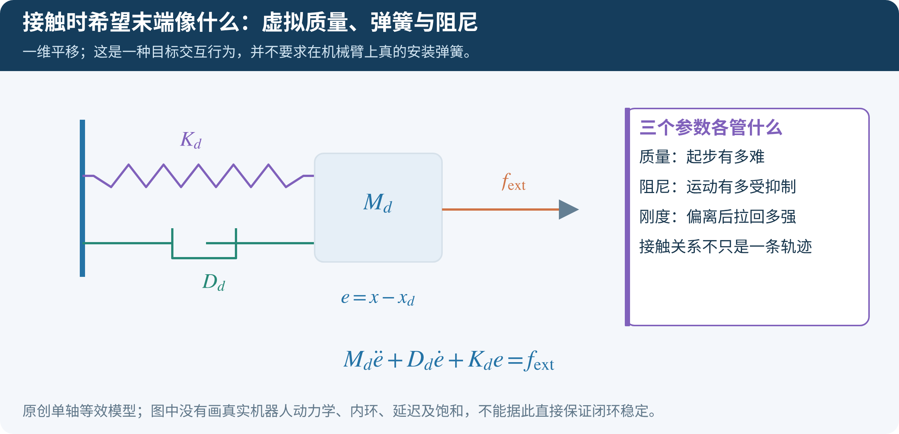
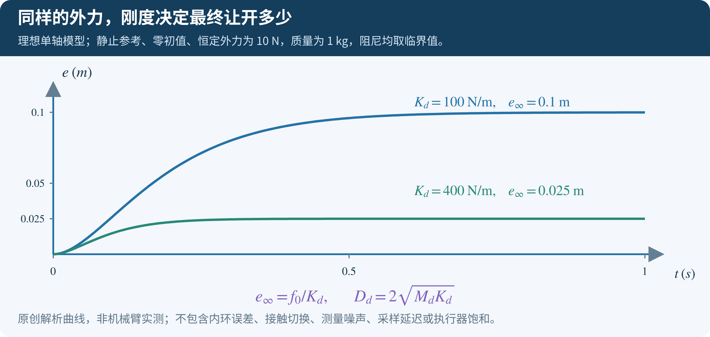
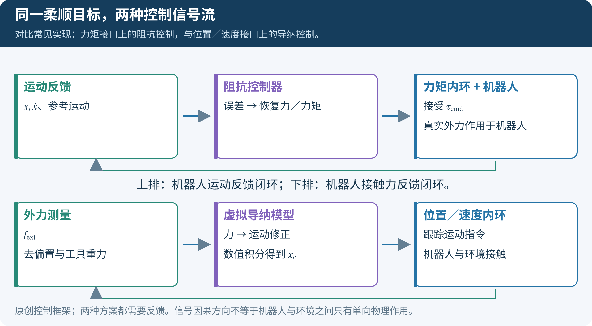

# 阻抗控制与导纳控制：机械臂怎样柔顺地接触

人推机械臂时，希望它可以让开；插接或打磨时，又希望末端保持一定支撑，不能一碰就完全退走。单纯追踪位置可能越顶越用力，单纯要求一个力也不能规定自由空间中的运动。**阻抗与导纳控制的共同目标，是设计外力和运动之间的动态关系。常见实现的区别是：阻抗控制由运动偏差算力／力矩，导纳控制由测得的力算运动修正。**

这不是两套互不相干的“软硬模式”，也不能简单按“用不用力传感器”分类。本文先用一维末端运动建立直觉，再说明怎样接入机械臂接口和真实接触环路。

## 1. 先想象一个虚拟质量—弹簧—阻尼系统

沿机械臂末端的一个平移方向，令 $x$ 是实际位置，$x_d$ 是参考位置，定义偏差 $e=x-x_d$。正外力 $f_{\mathrm{ext}}$ 表示环境或人沿正方向作用于机器人，不是机器人作用于环境的反作用力。

希望交互近似满足：

$$M_d\ddot e+D_d\dot e+K_de=f_{\mathrm{ext}}.$$

*原创等效图。它描述目标行为，不意味着实际要装这三个机械零件；模型未画出内环、延迟、接触切换与饱和。*

| 参数 | 单轴平移单位 | 决定的感觉 |
|---|---|---|
| $M_d>0$ | 千克 | 惯性：多快开始改变速度 |
| $D_d>0$ | 牛顿秒每米 | 阻尼：运动时有多强阻力，怎样抑制振荡 |
| $K_d\geq0$ | 牛顿每米 | 刚度：偏离后有多强恢复趋势 |

这里三个量是**期望等效参数**，不一定等于机器人真实质量或结构弹性。阻抗思想的经典来源是 Hogan 的 [Impedance Control: An Approach to Manipulation，Part I—Theory](https://summerschool.stiff-project.org/fileadmin/pdf/Hog1985.pdf)；下文的信号路径区分和实现背景另以 [Ott 等，Unified Impedance and Admittance Control（2010）](https://fileadmin.cs.lth.se/ai/Proceedings/ICRA2010/MainConference/data/papers/1462.pdf) 核验。公式为统一符号的教学模型，不是直接照抄某一台机械臂控制器。

## 2. 同一根虚拟弹簧，两个方向读它

静态时 $K_de=f_{\mathrm{ext}}$。若 $K_d=100\ \mathrm{N/m}$，外力 $10\ \mathrm N$ 对应稳态位移 $0.1\ \mathrm m$；把刚度提高到 $400\ \mathrm{N/m}$，位移变成 $0.025\ \mathrm m$。

你可以从运动算力：“偏离这么多，要用多大恢复力？”也可以从力算运动：“人推这么多，应该让开多远？”这正是常见阻抗与导纳实现的两种因果方向。

*原创解析曲线。两条曲线质量相同，阻尼分别设为各自的临界阻尼，因此这是刚度及对应阻尼共同改变后的对比；不是保持阻尼不变的实验，也不是机器人实测。*

在零初始条件的一维线性模型中，若拉普拉斯变量为 $s$，速度偏差为 $V(s)=sE(s)$，机械阻抗和导纳分别为：

$$Z(s)=\frac{F(s)}{V(s)}=M_ds+D_d+\frac{K_d}{s},\qquad
Y(s)=\frac{V(s)}{F(s)}=Z(s)^{-1}.$$

严格机械阻抗通常用**力除以速度**定义；力除以位移的 $M_ds^2+D_ds+K_d$ 是另一种动态刚度写法。机器人文章常直接用位移微分方程讨论“阻抗”，需要看清作者定义。

数学上互逆不意味着真实控制系统效果完全一样：机器人本体、传感器、内环和采样延迟都不同。[Ott 等 §I–II](https://fileadmin.cs.lth.se/ai/Proceedings/ICRA2010/MainConference/data/papers/1462.pdf) 正是从实现因果性与动态交互角度比较二者。

## 3. 阻抗控制：从运动偏差产生恢复力矩

*原创框架图。上排使用运动反馈和力矩接口，下排使用外力反馈和运动接口；实际系统两条路径都需要闭环。*

先用一个非常简化的物理系统推导，而不是直接列机械臂大公式。假设末端在一个方向上的真实质量为常数 $m$，其他动力学已补偿：

$$m\ddot x=u+f_{\mathrm{ext}},$$

其中 $u$ 是控制器施加的力。设参考静止，采用弹簧—阻尼反馈：

$$u=-K_d(x-x_d)-D_d\dot x.$$

代回得到：

$$m\ddot e+D_d\dot e+K_de=f_{\mathrm{ext}}.$$

因此简单力反馈就能形成类似弹簧、阻尼的响应，但**此时惯性仍是真实质量 $m$，不是任意指定的 $M_d$**。若要独立整形惯性，通常还要动力学模型、操作空间控制或适当的加速度／外力反馈，不能仅把一个符号换成 $M_d$ 就声称已经实现。

### 3.1. 怎样落到关节力矩接口

只讨论末端位置时，定义 $e_p=p-p_d\in\mathbb R^3$、$\dot p=J_p(q)\dot q$，一种简化笛卡尔阻抗指令是：

$$\begin{aligned}
f_{\mathrm{cmd}}&=-K_p e_p-D_p(\dot p-\dot p_d),\\
\tau_{\mathrm{cmd}}&=J_p(q)^\mathsf T f_{\mathrm{cmd}}+\tau_{\mathrm{comp}}.
\end{aligned}$$

$J_p\in\mathbb R^{3\times n}$，$K_p,D_p\in\mathbb R^{3\times3}$，$\tau_{\mathrm{comp}}$ 表示按机器人模型选择的补偿。重力、摩擦和动态前馈不能无条件视为已消失；这也不是完整任意惯量整形控制律。

**基本弹簧—阻尼式阻抗可以不显式使用外力测量**，因为接触外力通过机器人真实动力学影响位移，控制器再对位移作出反应。更复杂的力矩观测、反馈和安全功能仍可能使用关节力矩或外力估计；“阻抗不要传感器”不是普遍结论。

## 4. 导纳控制：测到外力后，计算应该怎样移动

若机器人只提供可靠的位置或速度指令接口，很难直接命令关节力矩。导纳外环可以把测到的外力送入虚拟动力学，生成让步的参考轨迹。

为区分真实运动和控制器内部状态，记运动修正为 $\delta$，命令位置为 $x_c=x_d+\delta$：

$$M_d\ddot\delta+D_d\dot\delta+K_d\delta=f_{\mathrm{ext}}-f_d.$$

$f_d$ 是按本文方向定义的期望交互外力，最简单的拖动示教可取零。**内部模型满足的是 $\delta$ 的方程；实际偏差 $x-x_d$ 只有在内环跟踪足够好时才近似等于 $\delta$。**

一种单轴离散教学实现为：

$$\begin{aligned}
\ddot\delta_k&=\frac{f_{\mathrm{ext},k}-f_{d,k}-D_d\dot\delta_k-K_d\delta_k}{M_d},\\
\dot\delta_{k+1}&=\dot\delta_k+\Delta t\ddot\delta_k,\\
\delta_{k+1}&=\delta_k+\Delta t\dot\delta_{k+1},\\
x_{c,k+1}&=x_{d,k+1}+\delta_{k+1}.
\end{aligned}$$

这是半隐式积分示意，并非对所有参数与采样率都稳定的算法。真实软件还要处理状态初始化、力滤波、速度和位移限幅、约束、接触切换及饱和后的状态一致性。

导纳方案的常见输入输出是：

1. 传感器或观测器提供外力，并转换到控制坐标系。
2. 去除偏置、工具重力等不希望当作人为推力的分量。
3. 虚拟模型更新内部速度、位移修正。
4. 修正叠加参考轨迹，经逆运动学／速度求解送给内环。
5. 实际接触力变化后回到外环。

没有可靠外力信息，导纳模型可能把偏置当持续推力；不是随意在位置轨迹上加一个偏移量就能得到可靠柔顺控制。

## 5. 用同一个接触任务比较两者

### 5.1. 人手推动末端

阻抗实现中，人先让真实机器人产生位移，控制器根据偏差产生反向弹簧／阻尼力；低摩擦、可回驱和良好的力矩内环有助于表现柔顺。

导纳实现中，力传感器先测到推力，外环计算移动命令，位置内环带着机器人移动。它可以让高减速比、较难直接回驱的机械臂表现出让步，但延迟与噪声会影响感觉。

### 5.2. 推到一面硬墙

同一幅框架图在硬接触下是一个完整环路：机器人移动改变接触力，接触力又改变后续动作。导纳外环若移动指令过快，位置内环可能顶出很大的力；力噪声经积分也会变成运动。阻抗方案也可能受高增益、采样和补偿误差影响振荡。**二者都不能只由外环微分方程推出实际接触一定稳定。**

Ott 等论文讨论两种实现的互补性质，但这不是“阻抗遇硬环境必稳、导纳必不稳”的定律；结论依赖机器人动力学、内环、环境和非理想因素。

### 5.3. 沿表面打磨或插接

任务通常不是所有方向一律柔软：沿表面切向跟随轨迹，法向允许一定让步；插接时某些旋转方向需要柔顺。可在明确任务坐标系后选各向异性刚度与阻尼矩阵，并检查坐标变换和力矩单位。

对持续法向力有精确要求时，还需适当力反馈或力／位混合设计。有限刚度阻抗本身不等于精确恒力：静态接触力会受参考穿入量与环境刚度影响。

## 6. 刚度、阻尼和质量怎样一起影响响应

在理想单轴模型中：

$$\omega_n=\sqrt{K_d/M_d},\qquad
\zeta=\frac{D_d}{2\sqrt{M_dK_d}}.$$

$\omega_n$ 是固有频率，$\zeta$ 是阻尼比。提高刚度会减小同一外力的稳态位移，但也提高响应频率；若质量与阻尼不变，阻尼比可能下降。增加阻尼通常抑制振荡，但也改变响应速度与拖动手感。

当 $K_d=0$ 时，不再有回到原位置的弹簧项；恒定外力和正阻尼会导向非零稳态速度，而不是有限稳态位移。拖动示教中可以利用这一行为，但力偏置也会导致持续漂移。

上面的响应曲线使用 $M_d=1\ \mathrm{kg}$、$f_0=10\ \mathrm N$，分别令 $K_d=100,400\ \mathrm{N/m}$，阻尼取 $D_d=2\sqrt{M_dK_d}$。对应稳态偏移为 $0.1$ 与 $0.025\ \mathrm m$。这些只用于解释模型，不是给真实机械臂的推荐参数。

## 7. 六维机械臂还必须明确哪些约定

平移误差可以直接相减，三维旋转误差不能一般性地把欧拉角逐项相减。应选择一致的旋转误差表示，并明确它在哪个坐标系表达。

若采用 $\nu=(v^\mathsf T,\omega^\mathsf T)^\mathsf T$、$w=(f^\mathsf T,\tau^\mathsf T)^\mathsf T$，则刚度平移块与旋转块单位不同，wrench 与 twist 的参考点也必须配对。更换工具参考点时，力矩包含力臂项；见 [刚体的力、力矩与动力学](rigid-body-dynamics.md)。

矩阵耦合、雅可比奇异性、关节限位、工具负载和执行器力矩限制都可能使理想笛卡尔模型无法精确实现。观察到“机器人很软”也不足以证明实现了所写的整套期望阻抗。

## 8. 实际系统选择与验证

| 条件 | 通常先考虑 | 要核对什么 |
|---|---|---|
| 有高质量力矩接口、低摩擦或可靠力矩内环 | 阻抗实现 | 真实惯性、摩擦、补偿误差、闭环频率 |
| 主要有位置／速度接口，外力可可靠测量 | 导纳外环 | 内环跟踪与延迟、力偏置、数值积分与饱和 |
| 需要同时适应自由空间与不同接触环境 | 更完整交互设计，可能混合或切换 | 切换连续性、能量与稳定性、任务条件 |

验证时分别看自由空间跟踪、外力阶跃响应、硬接触振荡和退出接触后的状态；仿真参数和真实机器人参数需区分。不要把“设定正定质量、阻尼、刚度”当作包含采样、传感器、内环与环境的整机稳定证明。

## 来源与前置概念

- Hogan，[Impedance Control: An Approach to Manipulation，Part I—Theory](https://summerschool.stiff-project.org/fileadmin/pdf/Hog1985.pdf)，1985；历史原始工作。
- Ott、Mukherjee、Nakamura，[Unified Impedance and Admittance Control](https://fileadmin.cs.lth.se/ai/Proceedings/ICRA2010/MainConference/data/papers/1462.pdf)，ICRA 2010；[本地论文](../../../raw/papers/ott-unified-impedance-admittance-2010.pdf)。
- [刚体速度与加速度](rigid-body-velocity-acceleration.md)、[刚体的力、力矩与动力学](rigid-body-dynamics.md)、[总览](../../01-comprehensive/02-classical-robotics/rigid-body-kinematics.md)。
- [本次来源与教学推导记录](../../../raw/entries/2026-11-20-rigid-mechanics-control.md)。
