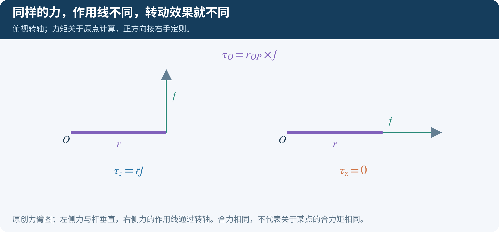
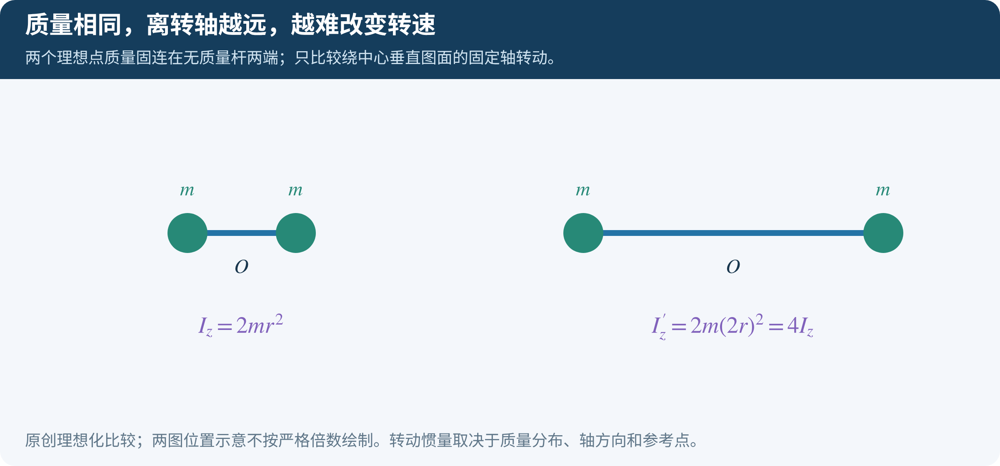

# 刚体的力、力矩与动力学

握住门把手推门，比贴着铰链推更容易把门转起来；把重物放到机械臂末端后，同样的运动轨迹又需要更大力矩。**力矩取决于力的作用线，运动响应还取决于质量与惯量。** 动力学把这些量与加速度连接起来；它在运动学之上增加物理参数，而不是用力去重新定义位置和速度。

## 1. 先把力、力矩和参考点分开

力 $f\in\mathbb R^3$ 的单位是牛顿，力矩 $\tau_O\in\mathbb R^3$ 的单位是牛顿米。关于点 $O$，作用于点 $P$ 的单个力产生：

$$\tau_O=r_{OP}\times f.$$

所有分量必须在同一坐标系表达。力矩不仅依赖方向，还依赖**关于哪个点计算**；它不是把力乘以任意一段杆长。

*原创力臂示意。垂直力的力臂为杆长，沿杆作用的力通过转轴，关于该点的力矩为零。*

取 $r=(0.2,0,0)^\mathsf T$ 米，$f=(0,10,0)^\mathsf T$ 牛顿，得到 $\tau=(0,0,2)^\mathsf T$ 牛顿米；若把力改成 $(10,0,0)^\mathsf T$，则关于原点的力矩为零。

## 2. 换一个点，力矩也要换

若 $r_{OP}$ 表示旧参考点 $O$ 指向新参考点 $P$，同一个力系有：

$$\tau_P=\tau_O-r_{OP}\times f.$$

若从 $B$ 系原点表达变到 $A$ 系原点表达，且 ${}^AT_B=(R,t)$，则：

$$f_A=Rf_B,\qquad \tau_A=R\tau_B+t\times(Rf_B).$$

不能只对力和力矩各乘同一个旋转，漏掉原点偏移项。把它们堆叠成 wrench 时，本文采用 $w=(f^\mathsf T,\tau^\mathsf T)^\mathsf T$；Modern Robotics 常用力矩在前，阅读代码或教材必须先确认排序。[Modern Robotics §3.4](https://modernrobotics.northwestern.edu/nu-gm-book-resource/3-4-wrenches/) 解释了力系与坐标变换。

## 3. 平移：合外力决定质心加速度

在固定惯性系中，质量恒定的刚体满足：

$$\sum f_{\mathrm{ext}}=m a_C.$$

$C$ 是质心，不一定是模型原点或工具尖端。合外力包括重力、接触力、驱动力等；刚体内部相互作用力不会改变整体质心运动。

例如质量 $2\ \mathrm{kg}$ 的物体，在水平方向合力为 $4\ \mathrm N$ 时，该方向质心加速度为 $2\ \mathrm{m/s^2}$。如果竖直静止，重力与支撑力仍可以都非零，只是合力为零。

## 4. 转动：为什么不总能写成一个标量惯量乘角加速度

绕一个给定固定轴的简单问题常写 $\tau=I\alpha$；一般三维转动还需要角动量和惯量矩阵。

*原创理想点质量例子。相同总质量并不意味着相同惯量；参考点与轴改变时也要重新表达惯量。*

关于质心，惯量可写成：

$$I_C=\int\left(\|r\|^2I_3-rr^\mathsf T\right)dm,$$

其中 $r$ 是从质心到质量微元的位置，单位米，$I_C$ 单位千克米平方。它把角速度映到角动量：$L_C=I_C\omega$。

在固连质心系 $B$ 中，惯量矩阵 $I_C^B$ 为常数。外力矩的欧拉方程是：

$$\tau_C^B=I_C^B\dot\omega^B+\omega^B\times(I_C^B\omega^B).$$

这里 $\dot\omega^B$ 是角速度在该刚体系中分量的时间导数；角速度自身的运输附加叉乘为零。第二项体现三维旋转耦合，一般不能忽略。[Modern Robotics §8.2](https://modernrobotics.northwestern.edu/nu-gm-book-resource/8-2-dynamics-of-a-single-rigid-body-part-1-of-2/) 从质量分布推导这些关系。

例如 $I_C^B=\operatorname{diag}(1,2,3)$，$\omega^B=(1,1,0)^\mathsf T$，即使该时刻 $\dot\omega^B=0$，也有 $\omega^B\times I_C^B\omega^B=(0,0,1)^\mathsf T$ 的力矩需求。这里的数值是理想教学示例，不是机器人实测参数。

## 5. 力与运动如何通过功率配对

在同一参考点、同一坐标系，末端点速度 $v$ 和角速度 $\omega$ 对应功率：

$$P=f^\mathsf T v+\tau^\mathsf T\omega=w^\mathsf T\nu,\qquad
\nu=\begin{bmatrix}v\\\omega\end{bmatrix}.$$

若该点的几何雅可比满足 $\nu=J(q)\dot q$，由功率等价可得外力系的广义关节力：

$$\tau_{\mathrm{ext}}=J(q)^\mathsf T w_{\mathrm{ext}}.$$

$J\in\mathbb R^{6\times n}$，$w_{\mathrm{ext}}$ 是**环境作用于机器人**的 wrench。若表示机器人作用于环境的力，符号相反。这个式子将末端负载映射到关节，不会自动包含连杆自身重力或惯性。

## 6. 多连杆机械臂的统一动力学

对固定基座、选定广义坐标的机械臂，一种常见记号是：

$$M(q)\ddot q+c(q,\dot q)+g(q)+\tau_f
=\tau_{\mathrm{act}}+J(q)^\mathsf T w_{\mathrm{ext}}.$$

| 量 | 作用 |
|---|---|
| $M(q)\in\mathbb R^{n\times n}$ | 质量矩阵，描述关节耦合惯性 |
| $c(q,\dot q)\in\mathbb R^n$ | 科里奥利和离心等速度乘积项，常写 $C(q,\dot q)\dot q$ |
| $g(q)\in\mathbb R^n$ | 该符号约定下抵消重力所需的广义力 |
| $\tau_f\in\mathbb R^n$ | 移到左边的摩擦／阻力模型 |
| $\tau_{\mathrm{act}}\in\mathbb R^n$ | 执行器产生的关节力或力矩 |

全转动关节时广义力单位为牛顿米；有移动关节时不能把每个分量都叫力矩。接触约束、浮动基座和柔性关节还需要相应扩展。

**逆动力学**给定 $q,\dot q,\ddot q$ 和外载，求所需驱动力；**正动力学**给定驱动力和外载，求 $\ddot q$。它们与“由末端位姿求关节角”的逆运动学不是同一个问题。

递归牛顿—欧拉算法先从基座向末端求连杆运动，再反向传递力系、求关节驱动力；见 [Modern Robotics §8.3](https://modernrobotics.northwestern.edu/nu-gm-book-resource/8-3-newton-euler-inverse-dynamics/)。

## 7. 从动力学到控制：还差一层设计目标

知道“这个力会产生什么加速度”，并不等于知道接触时“应该多硬、多软”。接触控制还要设计末端力与运动之间的目标关系，见 [阻抗控制与导纳控制](impedance-admittance-control.md)。实际落地还依赖质量与惯量识别、重力方向、传感器偏置、关节摩擦和模型误差。

运动的导数推导见 [刚体速度与加速度](rigid-body-velocity-acceleration.md)；总览见 [刚体运动学基础](../../01-comprehensive/02-classical-robotics/rigid-body-kinematics.md)。
