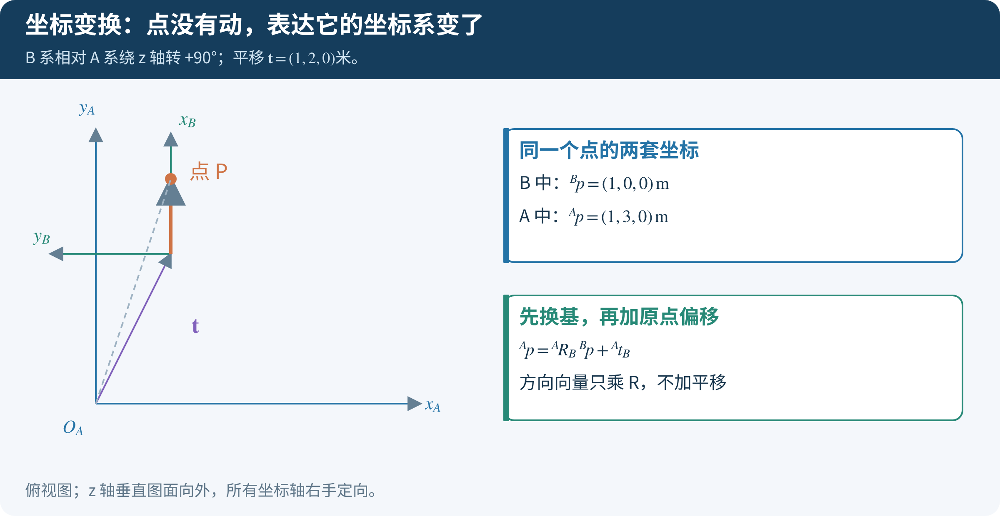
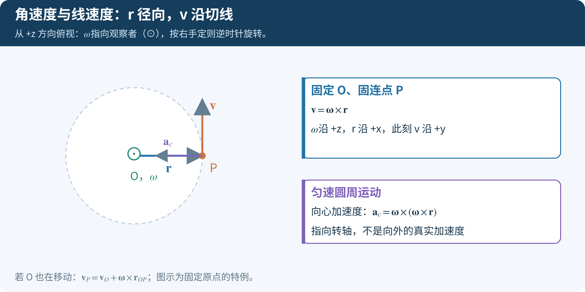

# 刚体运动学基础

## 1. 概述

### 1.1. 背景

1. 机器人学的很多问题归根结底是一个问题：**如何用数学精确描述一个物体在三维空间中的位置和朝向，以及它们如何随时间变化？** 机械臂的每个连杆在哪里、朝哪个方向、下一时刻会转到哪儿，控制、规划、动力学计算都建立在这套描述之上。
2. 这里有一个贯穿全文的简化假设——**刚体**：物体受力不变形，物体上任意两点的距离永远不变。真实的连杆会有微小形变，但在运动学层面一律当作刚体处理。一个刚体在三维空间中有 **6 个自由度**：3 个平移（沿 x/y/z 移动）+ 3 个旋转（绕 x/y/z 转动）。前 3 个描述"在哪"，后 3 个描述"朝哪"。
3. 平移很好办，一个三维向量就够了。真正麻烦的是**旋转**：旋转有 3 个自由度，但用 3 个数（比如欧拉角）直接表示会踩坑（万向锁、顺序歧义）；旋转不满足交换律——"先绕 X 转 30°再绕 Y 转 30°"和"先 Y 后 X"结果不同，所以复合旋转要小心顺序；旋转的"变化率"（角速度）也不能简单地对朝向参数求导得到。

### 1.2. 解决思路

1. **给刚体固连一个坐标系**。描述这个固连坐标系相对于一个参考坐标系的关系，就等于描述了刚体的位姿。
2. 位置用一个向量表示，朝向用一个旋转矩阵表示，二者拼成一个齐次变换矩阵统一处理。瞬时运动（速度、加速度）则用角速度和"旋转矢量求导公式"描述。

本文由浅入深：先讲位置与平移，再讲朝向与旋转矩阵，然后把二者统一为齐次变换，接着引入角速度与瞬时运动学，最后介绍欧拉角、轴角、四元数等朝向的其它表示，并落到机器人学应用。

---

## 2. 位置与平移

### 2.1. 位置就是向量

一个点 $P$ 的位置，就是从某个参考坐标系原点 $O$ 指向它的向量：

$$\vec{OP} = \begin{bmatrix} p_x \\ p_y \\ p_z \end{bmatrix}$$

三个数 $p_x, p_y, p_z$，对应三个平移自由度。注意位置永远要**相对于某个坐标系**才有意义，离开参考系谈位置没有意义。

### 2.2. 平移与坐标系原点的移动

本节先限定两坐标系的轴方向完全一致，即旋转矩阵为单位阵。此时平移就是坐标系原点的移动。如果坐标系 $\{B\}$ 的原点在参考系 $\{A\}$ 中的位置是 $\vec{{}^AO_B}$，那么同一个点在两个坐标系中的坐标 ${}^AP$ 与 ${}^BP$ 满足：

$${}^AP = {}^BP + \vec{{}^AO_B}$$

这个相加式只对轴方向相同的纯平移成立；一般情况必须先用旋转矩阵把分量变到同一坐标系，不能直接加两个参考系中的坐标。全文使用右手系、列向量、长度单位米和角度单位弧度；角速度为 rad/s。

---

## 3. 朝向与旋转矩阵

### 3.1. 朝向为什么难

朝向也有 3 个自由度，但与平移不同，你不能随便拿 3 个数凑一个"朝向向量"。原因在于旋转的本质性质：

- **旋转不可交换**：旋转操作是矩阵乘法，而矩阵乘法 $R_1 R_2 \neq R_2 R_1$。这意味着"先转 A 再转 B"和"先转 B 再转 A"结果不同，复合旋转必须关心顺序。
- **3 个角度的表示有奇异点**：欧拉角在某些姿态下会出现参数化奇异，两个角度的瞬时作用重合（万向锁，见第 6.1 节）；刚体本身仍有三个旋转自由度。

所以工程上最稳妥的做法是先用 **9 个数**（一个 $3\times3$ 矩阵）来表示 3 个自由度的旋转，虽然冗余，但处处无奇异、复合就是矩阵乘法。这就是旋转矩阵。

### 3.2. 旋转矩阵的构造

在刚体上固连一个坐标系 $\{B\}$，它的三个坐标轴在参考系 $\{A\}$ 中各是一个单位向量 $\hat{x}_B, \hat{y}_B, \hat{z}_B$。把这三个列向量并排放在一起，就得到旋转矩阵：

$${}^A_B R = \begin{bmatrix} | & | & | \\ \hat{x}_B & \hat{y}_B & \hat{z}_B \\ | & | & | \end{bmatrix}$$

读法是 ${}^A_B R$：**把 $\{B\}$ 的东西表示到 $\{A\}$ 中**。它的每一列是 $\{B\}$ 某个轴在 $\{A\}$ 中的方向。这个矩阵同时就是 $\{B\}$ 相对 $\{A\}$ 的朝向。

### 3.3. 旋转矩阵的三个作用

同一个 $R$ 在不同语境下扮演三种角色，理解这一点能消解很多困惑：

1. **描述朝向**：${}^A_B R$ 就是 $\{B\}$ 相对 $\{A\}$ 的姿态。
2. **坐标变换**：把一个在 $\{B\}$ 中表示的向量变到 $\{A\}$ 中表示：

   $${}^Ap = {}^A_B R \, {}^Bp$$

   因为 ${}^Bp$ 是 $p$ 沿 $\{B\}$ 三轴的分量，而 $\{B\}$ 三轴在 $\{A\}$ 中的表示正是 $R$ 的三列，加权求和就得到 ${}^Ap$。

3. **旋转操作**：把一个向量在同一个坐标系内绕某轴转一个角度。此时 $R$ 是一个"算子"，${}^Ap' = R\,{}^Ap$ 表示把 $p$ 转到 $p'$。

角色 2 和 3 数学上都是 $p' = Rp$，区别只是"换了参考系描述同一个向量"还是"在同一个参考系里转动了向量"。一个是坐标系的视角（被动），一个是向量的视角（主动）。

### 3.4. 旋转矩阵的性质

因为 $\{B\}$ 的三个轴是两两正交的单位向量，$R$ 的三列构成一组标准正交基，由此推出几个关键性质：

- **正交**：$R^T R = I$，即转置等于求逆：

  $$R^{-1} = R^T$$

  这是旋转矩阵最实用的性质——求逆只需转置，不需要解方程。${}^A_B R$ 的逆 ${}^B_A R = {}^A_B R^T$，物理意义是"反过来表示"。
- **行列式为 1**：$\det(R) = 1$。排除了镜面反射（行列式为 $-1$ 的情况），保证是"纯旋转"不含翻转。
- 满足这两个条件的矩阵构成 **$\mathrm{SO}(3)$**（特殊正交群，Special Orthogonal group）。9 个矩阵元素受到 6 个独立正交约束，因此连续自由度为 9−6=3。行列式为 +1 是从正交矩阵的两个分支中选取保持定向的分支，不能再当作额外独立连续约束扣减一次。参见 [Modern Robotics §3.2.1](https://modernrobotics.northwestern.edu/nu-gm-book-resource/3-2-1-rotation-matrices-part-1-of-2/)。

### 3.5. 旋转的复合与顺序

连续两个旋转就是矩阵相乘。设先做旋转 $R_1$、再做 $R_2$，总旋转：

$$R = R_2 R_1$$

注意顺序：**后做的写在左边**，因为 $p' = R_2(R_1 p) = (R_2 R_1)p$。由于矩阵乘法一般不可交换，$R_2 R_1 \neq R_1 R_2$，所以"先转谁后转谁"会得到不同结果。

复合顺序还分两种约定，容易混淆：

- **固定轴（外蕴，extrinsic）**：每次都绕**参考系**的固定轴转。多次旋转时，矩阵按时间顺序**从右往左**乘：$R = R_n \cdots R_2 R_1$。
- **自体轴（内蕴，intrinsic）**：每次都绕**物体自己当前**的轴转。矩阵按时间顺序**从左往右**乘：$R = R_1 R_2 \cdots R_n$。

一个有用的等价关系：**绕固定轴 X-Y-Z 转 $\alpha,\beta,\gamma$，等价于绕自体轴 Z-Y-X 转 $\gamma,\beta,\alpha$**。即同一组姿态既可写成外蕴顺序，也可写成内蕴的逆序，二者等价。这就解释了为什么不同教材对"同一旋转"会写出看似不同的角度序列——它们只是用了不同约定。

---

## 4. 平移与旋转的统一：齐次变换矩阵

### 4.1. 为什么要统一

把第 1、2 节合起来，一个点在两坐标系间的完整变换是：

$${}^Ap = {}^A_B R \, {}^Bp + \vec{{}^AO_B}$$

先乘 $R$ 再加平移。单看一步还好，但串联多个坐标系时会很繁琐：

$${}^Ap = R_2\bigl(R_1\,{}^Cp + t_1\bigr) + t_2$$

括号套括号、乘加交替。能不能把它压成纯矩阵乘法？能——这就是齐次变换。

### 4.2. 齐次坐标与变换矩阵

给向量末尾补一个 1，升成 4 维：

$$\tilde{p} = \begin{bmatrix} p \\ 1 \end{bmatrix}$$

然后把 $R$ 和平移 $t = \vec{{}^AO_B}$ 塞进一个 $4\times4$ 矩阵：

$${}^A_B T = \begin{bmatrix} {}^A_B R & \vec{{}^AO_B} \\ 0\ 0\ 0 & 1 \end{bmatrix}$$

于是变换变成纯乘法：

$$\begin{bmatrix} {}^Ap \\ 1 \end{bmatrix} = {}^A_B T \begin{bmatrix} {}^Bp \\ 1 \end{bmatrix}$$

展开后正好还原成 ${}^Ap = R\,{}^Bp + t$。底部的 $[0\ 0\ 0\ 1]$ 是为了让矩阵乘法闭合——乘完末位仍是 1。

### 4.3. 复合与链式相乘

多个坐标系串联时，齐次变换的优势彻底显现。设 $\{C\}$ 相对 $\{B\}$ 是 ${}^B_C T$，$\{B\}$ 相对 $\{A\}$ 是 ${}^A_B T$，则 $\{C\}$ 相对 $\{A\}$ 直接是：

$${}^A_C T = {}^A_B T \, {}^B_C T$$

一串相乘即可，无需再写括号。这正是机械臂正运动学的基础（见第 7 节）：从基座到末端，把每两个相邻连杆间的变换逐个连乘。

### 4.4. 求逆

齐次变换的逆**不是**简单转置：转置不会给出正确的逆平移 $-R^Tt$。直接套用分块矩阵求逆：

$${}^A_B T^{-1} = {}^B_A T = \begin{bmatrix} {}^A_B R^T & -{}^A_B R^T \vec{{}^AO_B} \\ 0\ 0\ 0 & 1 \end{bmatrix}$$

物理含义清楚：旋转部分反过来（$R^T$），平移部分也要先转回 $\{B\}$ 表示再取反（$-R^T t$）。所有满足 $R\in\mathrm{SO}(3)$ 且末行为 $[0,0,0,1]$ 的刚体齐次变换矩阵构成 **$\mathrm{SE}(3)$**（特殊欧几里得群），6 个自由度 = 3 平移 + 3 旋转。

---

### 4.5. 一个可检查的坐标例子

令 B 相对 A 绕 z 轴转 90°，B 原点在 A 中为 $(1,2,0)$ 米。B 中点坐标为 $(1,0,0)$，则：

$${}^Ap=R_z(\pi/2)(1,0,0)^T+(1,2,0)^T=(1,3,0)^T.$$

如果变换的不是点而是方向向量，则只乘 $R$，不加平移；齐次坐标的最后一维分别是点的 1 和向量的 0。见 [Modern Robotics §3.3.1](https://modernrobotics.northwestern.edu/nu-gm-book-resource/3-3-1-homogeneous-transformation-matrices/)。

## 5. 旋转的瞬时描述：角速度

前面讲的是"静止的位姿"。运动学还要回答"它在怎么动"。平移的变化率是线速度 $\vec v$，直白；旋转的变化率是角速度 $\vec\omega$，需要一点铺垫。

角速度 $\vec\omega$ 是一个**矢量**，并不只是"转得多快"的标量。它同时携带两份信息：**大小** $|\vec\omega|$ 表示瞬时转速（单位 rad/s）；定轴情况下可写 $\vec\omega=\dot\theta\hat n$，其模长为 $|\dot\theta|$，一般运动不能直接用有限轴角参数的角度导数代替；**方向**则由**右手定则**确定——让右手四指顺着刚体的旋转方向卷曲，伸直的拇指所指即 $\vec\omega$ 的方向，它沿转轴指向。这样一根带方向的箭头就同时回答了"绕哪根轴转"和"朝哪头转"：转轴即 $\vec\omega$ 所在的直线，旋转方向由 $\vec\omega$ 的指向按右手定则反推得到。做定轴转动的刚体上每一点都共享同一个 $\vec\omega$——各点的线速度各不相同，但角速度相同。

先考虑固定点 $O$，令 $\vec r$ 为从 $O$ 到刚体上固连点 $P$ 的矢量，并在固定参考系中求导。若刚体只绕 $O$ 转动，点的线速度可写为：

$$\vec v = \dot{\vec r} = \vec\omega \times \vec r$$

$\vec\omega$ 的方向定出转轴与转向，与位置矢量 $\vec r$ 作叉乘，自动得到既垂直于 $\vec\omega$（落在旋转平面内）又垂直于 $\vec r$（沿圆周切线）的速度，大小为 $\omega\,|\vec r_\perp|$（$\vec r_\perp$ 为 $\vec r$ 中垂直于转轴的分量）。后面的原创示意图展示这一关系：$\vec\omega$ 沿竖直转轴向上，$\vec r$ 在水平旋转平面内，$\vec v=\vec\omega\times\vec r$ 沿圆周切线、垂直于 $\vec r$（见 §5.1、§5.4）。

### 5.1. 反对称矩阵：把叉乘写成矩阵乘

刚体转动时，其上每一点的线速度各不相同，但都共享同一个角速度 $\vec\omega$。点和角速度的关系靠叉乘：

$$\vec v = \vec\omega \times \vec r$$

其中 $\vec r$ 是该点相对转轴上某固定点的位置。为了让"叉乘"能融进矩阵运算，定义角速度的**反对称矩阵**（skew-symmetric matrix）：

$$[\vec\omega]_\times = \begin{bmatrix} 0 & -\omega_z & \omega_y \\ \omega_z & 0 & -\omega_x \\ -\omega_y & \omega_x & 0 \end{bmatrix}$$

它满足 $[\vec\omega]_\times^T = -[\vec\omega]_\times$（故名"反对称"），并且把叉乘变成了矩阵乘：

$$\vec\omega \times \vec r = [\vec\omega]_\times \vec r$$

这一步看似只是记号变换，却是连接"旋转矩阵"和"角速度"的桥梁。

### 5.2. 旋转矩阵的导数就是角速度

旋转矩阵 $R$ 的三列是固连在刚体上的三个坐标轴，刚体以角速度 $\vec\omega$ 转动时，这三根轴也在转。对"固定在旋转刚体上的矢量"用一次 §5.4 的旋转矢量求导公式 $\dot{\vec r} = \vec\omega \times \vec r$，对 $R$ 的每一列都这么做，就得到旋转矩阵的导数：

$$\dot R=[{}^A\omega]_\times R.$$

或等价地用刚体系角速度表示：

$$\dot R=R[{}^B\omega]_\times,\qquad {}^A\omega=R\,{}^B\omega.$$

这里 $R={}^A_BR$；两式的角速度是同一个物理量在不同坐标系中的分量，不能把同一组三个数随意放到 $R$ 的左右两边。参见 [Modern Robotics §3.2.2](https://modernrobotics.northwestern.edu/nu-gm-book-resource/3-2-2-angular-velocities/)。

含义：**旋转矩阵的时间导数 = 角速度的反对称矩阵 × 旋转矩阵**。给定了 $R(t)$，理论上就能反解出角速度 $\vec\omega$；反过来，$\dot{R} = [\vec\omega]_\times R$ 也是数值积分更新姿态的依据。

### 5.3. 角速度的叠加

串联结构里角速度可加。子坐标系 $\{B\}$ 相对 $\{A\}$ 的角速度为 $\vec\omega_{BA}$，$\{C\}$ 相对 $\{B\}$ 为 $\vec\omega_{CB}$，则 $\{C\}$ 相对 $\{A\}$：

$$\vec\omega_{CA} = \vec\omega_{BA} + \vec\omega_{CB}$$

（注意各项要统一到同一个参考系表示后再相加。）这正是 机械臂重力补偿与摩擦力补偿（关联文章尚未迁移） 里 $\omega_i = \omega_{i-1} + \dot{q}_i z_i$ 的来源：每一关节给上游连杆的角速度叠加上 $\dot{q}_i$ 倍的关节轴 $z_i$。

### 5.4. 旋转矢量求导公式

这是刚体运动学最实用的一条公式，也是上面一切的基础。**对固连于刚体的相对位置矢量 $\vec r$，在固定参考系下求导，有：**

$$v=\dot{\vec r} = \vec\omega \times \vec r$$

再求一次导（对右边用乘积法则，并把 $\dot{\vec r}$ 代回去）：

$$\ddot{\vec r} = \dot{\vec\omega} \times \vec r + \vec\omega \times (\vec\omega \times \vec r)$$

两项的物理意义十分清楚：

- $\dot{\vec\omega} \times \vec r$：**切向加速度**，由角加速度 $\dot{\vec\omega}$ 引起，方向沿转动切线；
- $\vec\omega \times (\vec\omega \times \vec r)$：**向心加速度**，方向指向转轴，大小正比于 $\omega^2$。这是真实加速度指向轴线的运动学项，不是直接把离心惯性力加进固定系动力学。

如图是从旋转轴正方向观察的俯视图，$\vec\omega$ 垂直图面向外（圆点符号）。刚体绕固定点 $O$ 转动。过 $O$ 且垂直于转轴的平面即**旋转平面**，固连在刚体上的点 $P$ 在该平面内绕轴画出一个圆（虚线轨迹）。$\vec r$ 是从 $O$ 指向 $P$ 的位置矢量，位于旋转平面内、与转轴垂直；点 $P$ 的瞬时线速度 $\vec v = \vec\omega \times \vec r$ 沿圆周切线方向，垂直于 $\vec r$ 与 $\vec\omega$，指向由右手定则确定——$\vec\omega$ 沿 $+z$ 指向观察者时，俯视下 $P$ 绕轴逆时针运动。

一般刚体还会平移。若 $O$ 也随刚体移动，固连点 $P$ 满足：

$$v_P=v_O+\omega\times r_{OP},\qquad a_P=a_O+\alpha\times r_{OP}+\omega\times(\omega\times r_{OP}).$$

以上各向量必须在同一参考系表达，$\alpha=\dot\omega$；若点还相对刚体滑动，需加入相对加速度与科里奥利项，不能继续直接套用固连点公式。

机械臂重力补偿与摩擦力补偿（关联文章尚未迁移） 的递归牛顿-欧拉算法里那三式正向递推（角速度叠加、角加速度含耦合项、线加速度含切向+向心两项），完全就是这三条公式逐关节累加的结果。理解了本节，那篇文章里"凭空甩出"的公式就有了来由。

---

## 6. 朝向的其它表示

旋转矩阵好用但冗余（9 个数表示 3 个自由度）。实际工程中还要存姿态、做插值、给人看角度，于是发展出几种紧凑表示。

### 6.1. 欧拉角

用三个角度描述朝向，最直观。约定一组转轴顺序（如内蕴 Z-Y-X：先绕当前 Z 轴 yaw，再绕更新后的 Y 轴 pitch，最后绕更新后的 X 轴 roll；对应 $R=R_z(\psi)R_y(\theta)R_x(\phi)$），三个角度就能定一个姿态。

问题在**万向锁（gimbal lock）**：当中间那个角（pitch）转到 $\pm 90°$ 时，第一个和第三个旋转轴会重合，角度到姿态的局部映射退化（并非刚体本身少了物理自由度）——此时改变偏航和改变横滚产生相同效果，姿态不再能被三个角度唯一、连续地表示。这会导致控制发散、插值跳变。

此外欧拉角还**依赖顺序约定**且存在**多义性**（同一姿态可由多组角度表示），不同软件默认顺序不同，极易出错。适合给人看、做 UI，不适合做内部计算和插值。

### 6.2. 轴角与罗德里格斯公式

**欧拉定理**：三维空间中任意旋转都等价于"绕某一固定轴 $\hat n$ 转一个角度 $\theta$"。于是可用一个单位轴 $\hat n$（2 个自由度，因 $|\hat n|=1$）加一个角度 $\theta$（1 个自由度）共 3 个自由度表示旋转，紧凑且无顺序歧义。

从轴角回到旋转矩阵用**罗德里格斯公式（Rodrigues' rotation formula）**：

$$R = \cos\theta\, I + (1-\cos\theta)\,\hat n \hat n^T + \sin\theta\, [\hat n]_\times$$

更清楚的分量形式是 $Rv=v_\parallel+\cos\theta\,v_\perp+\sin\theta(\hat n\times v_\perp)$：轴向不变，垂直于轴的分量在平面内转动。轴角紧凑，但当 $\theta \to 0$ 时 $\hat n$ 退化（转 0 度绕任何轴都一样，轴无法定义），且不便做复合。

### 6.3. 四元数

四元数是把轴角再包一层、专门为计算优化的表示。一个单位四元数：

$$q = \cos\frac{\theta}{2} + \sin\frac{\theta}{2}\,(\hat n_x\,\mathbf{i} + \hat n_y\,\mathbf{j} + \hat n_z\,\mathbf{k})$$

本文采用标量在前的 Hamilton 乘法约定，写成 4 个分量 $q = [w, x, y, z]$，满足 $|q|=1$（4 个数 + 1 个约束 = 3 自由度）。注意它用的是**半角** $\theta/2$，这是它能稳定表示旋转的关键。

四元数的优点：

- **无欧拉角式万向锁**：单位四元数适合连续姿态计算，但 $q$ 和 $-q$ 表示同一旋转，是双覆盖而不是唯一编码；
- **复合方便**：两次旋转的复合是四元数乘法 $q = q_2 \otimes q_1$（注意它也不可交换）；
- **插值平滑**：球面线性插值（SLERP）在归一化并处理符号后可选择较短圆弧（通常当点积为负时取反一个四元数），是动画和机器人姿态平滑的标准做法；
- **数值稳定**：相比欧拉角无奇异、相比旋转矩阵更紧凑，是实时姿态积分（如 IMU 姿态解算）的首选。

代价是不直观（4 个数看不出朝向），且用完常常还要转回旋转矩阵去做坐标变换。工程实践里典型分工：**内部存算用四元数，给人看用欧拉角，做坐标变换时临时转成旋转矩阵**。

### 6.4. 四种表示对比

| 表示 | 参数个数 | 自由度 | 优点 | 缺点 | 典型用途 |
|------|---------|--------|------|------|---------|
| 旋转矩阵 | 9 | 3 | 无奇异、复合=矩阵乘、直接做坐标变换 | 冗余、占内存 | 坐标变换、正运动学 |
| 欧拉角 | 3 | 3 | 直观、紧凑 | 万向锁、顺序依赖、多义 | UI 显示、人工读数 |
| 轴角 | 4 | 3 | 紧凑、直观物理意义 | $\theta\to0$ 时轴退化、复合不便 | 旋转的几何描述 |
| 四元数 | 4 | 3 | 无奇异、复合与插值稳定、紧凑 | 不直观 | 姿态积分、SLERP 插值 |

没有"最好"的表示，只有"最适合当前任务"的表示，实践中常常在几种之间来回转换。

---

## 7. 在机器人学中的应用

### 7.1. 连杆坐标系与正运动学

把本文的齐次变换用到机械臂上：每个连杆固连一个坐标系，相邻两坐标系之间的关系用一个齐次变换 ${}^{i-1}_i T$ 描述。从基座 $\{0\}$ 一路乘到末端 $\{n\}$，就得到末端位姿：

$${}^0_n T = {}^0_1 T \, {}^1_2 T \cdots {}^{n-1}_n T$$

这就是**正运动学**：已知各关节角，求末端位姿。每个 ${}^{i-1}_i T$ 由关节角和连杆几何决定，工程上常用 **DH 参数**（Denavit-Hartenberg）把它标准化为 4 个参数（连杆长度 $a$、扭角 $\alpha$、偏距 $d$、关节角 $\theta$）的组合。

### 7.2. 与逆运动学、动力学的联系

- **正运动学**（关节角 $\to$ 末端位姿）：用本节的变换链，是本文的直接应用。
- **逆运动学**（末端位姿 $\to$ 关节角）：反过来求那串变换里的关节角，是非线性方程求解，详见 逆运动学求解方法与开源库（关联文章尚未迁移）。
- **动力学**（力/力矩 $\to$ 运动）：要用到角速度、角加速度的逐关节递推，也就是第 5 节那几条公式在串联链上的累加，详见 机械臂重力补偿与摩擦力补偿（关联文章尚未迁移） 中的递归牛顿-欧拉算法。

运动学（本文）回答"在哪、朝哪、怎么动"，不涉及力；动力学再叠上力与质量回答"为什么这么动"。两者在机器人学中互为表里。

---

## 8. 总结

| 主题 | 核心结论 |
|------|---------|
| 位姿 | 位置用向量，朝向用旋转矩阵，统一为齐次变换矩阵 ${}^A_B T \in \mathrm{SE}(3)$ |
| 旋转矩阵 | 三列=固连系三轴；$R^{-1}=R^T$；属 $\mathrm{SO}(3)$；复合=矩阵乘（注意顺序） |
| 齐次变换 | 4×4 矩阵把"乘 R 加 t"压成纯乘法；串联直接连乘；逆需用分块公式 |
| 角速度 | $\dot R = [\vec\omega]_\times R$；叉乘经反对称矩阵融入矩阵运算 |
| 旋转矢量求导 | $\dot{\vec r}=\vec\omega\times\vec r$，$\ddot{\vec r}=\dot{\vec\omega}\times\vec r+\vec\omega\times(\vec\omega\times\vec r)$（切向+向心） |
| 朝向表示 | 旋转矩阵无奇异但冗余；欧拉角直观但有万向锁；四元数无奇异适合积分与插值 |

一句话：**用坐标系描述位姿，用旋转矩阵/齐次变换做复合与变换，用角速度和旋转矢量求导公式描述瞬时运动**——这三件套就是刚体运动学的全部地基。

---

## 9. 参考

- [Modern Robotics §3.2.1：旋转矩阵](https://modernrobotics.northwestern.edu/nu-gm-book-resource/3-2-1-rotation-matrices-part-1-of-2/)
- [Modern Robotics §3.2.2：角速度](https://modernrobotics.northwestern.edu/nu-gm-book-resource/3-2-2-angular-velocities/)
- [Modern Robotics §3.3.1：齐次变换](https://modernrobotics.northwestern.edu/nu-gm-book-resource/3-3-1-homogeneous-transformation-matrices/)
- [本次迁移与修订记录](../../../raw/entries/2026-11-09-rigid-body-kinematics.md)

- John J. Craig,《Introduction to Robotics: Mechanics and Control》——旋转矩阵与齐次变换的经典教材讲解
- Spong, Hutchinson, Vidyasagar,《Robot Modeling and Control》——DH 参数与正运动学
- Roy Featherstone,《Rigid Body Dynamics Algorithms》—— $\mathrm{SO}(3)$/$\mathrm{SE}(3)$ 与空间算子
- J. B. Kuipers,《Quaternions and Rotation Sequences》——四元数与 SLERP

<!-- 反向链接 -->
## 10. 反向链接

- 机械臂重力补偿与摩擦力补偿（关联文章尚未迁移） - 递归牛顿-欧拉算法的角速度/加速度递推即本文第 5 节公式的应用
- 逆运动学求解方法与开源库（关联文章尚未迁移） - 基于本文正运动学变换链的反解
- 机器人传感器与执行器（关联文章尚未迁移） - IMU 姿态解算用到四元数与角速度
