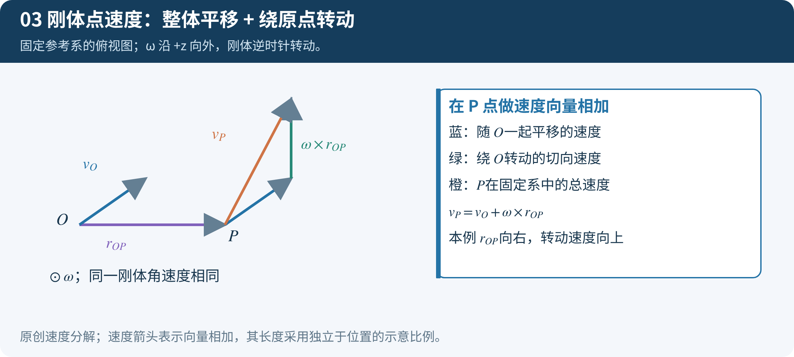
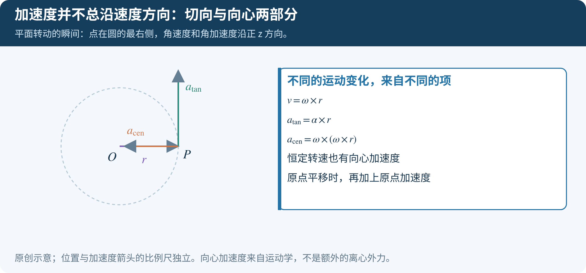

# 刚体速度与加速度

一根机械臂连杆绕关节转动，靠近关节的点移动慢，远离关节的点移动快；即使转速恒定，各点的速度方向仍在变化，因此仍有加速度。**刚体共享同一个角速度，但不同点的线速度和线加速度一般不同。** 本文从这个现象建立速度与加速度公式，暂时不讨论需要施加多少力。

## 1. 先统一参考系、参考点与单位

以下所有向量均用同一个固定惯性系 $A$ 的坐标表示。$O$、$P$ 是刚体上的固连点，$r_{OP}=p_P-p_O\in\mathbb R^3$ 是从 $O$ 到 $P$ 的向量，单位米；$v$ 单位米每秒，$a$ 单位米每平方秒；角速度 $\omega$ 单位弧度每秒，角加速度 $\alpha$ 单位弧度每平方秒。

位置、旋转与坐标系的基本含义见 [刚体位姿与坐标变换](rigid-body-pose.md)。这里即使刚体自身坐标不变，也不能说它在固定参考系里的速度为零。

## 2. 角速度为什么是一根向量

绕固定轴转动时，可写 $\omega=\dot\theta\hat n$；$\hat n$ 是按右手定则选定的单位轴。大小给出转速，方向给出转轴和转向。一般三维运动中，角速度是瞬时量，不能随意把欧拉角三个分量的导数当成角速度。

若 $R={}^A_BR$ 描述刚体系到固定系的旋转，则：

$$\dot R=[{}^A\omega]_\times R=R[{}^B\omega]_\times,\qquad {}^A\omega=R\,{}^B\omega.$$

同一物理角速度的两个坐标表示不能随意交换左右位置。反对称矩阵定义为：

$$[\omega]_\times=\begin{bmatrix}0&-\omega_z&\omega_y\\\omega_z&0&-\omega_x\\-\omega_y&\omega_x&0\end{bmatrix},\qquad [\omega]_\times r=\omega\times r.$$

这连接了旋转变化率与叉乘。定义和矩阵关系可核对 [Modern Robotics §3.2.2](https://modernrobotics.northwestern.edu/nu-gm-book-resource/3-2-2-angular-velocities/)。

## 3. 点速度：原点平移加相对转动

刚体上 $r_{OP}$ 的长度不变，但在固定系中的方向随旋转变化：

$$\frac{d r_{OP}}{dt}=\omega\times r_{OP}.$$

从 $p_P=p_O+r_{OP}$ 求导，即得：

$$v_P=v_O+\omega\times r_{OP}.$$

*原创速度分解图。蓝色平移速度可以平移到 P 点与绿色转动速度首尾相加，得到橙色总速度。位置箭头与速度箭头不使用同一比例尺。*

一个原创数值例子：$r_{OP}=(0.5,0,0)^\mathsf T$ 米，$\omega=(0,0,2)^\mathsf T$ 弧度每秒，$v_O=(0.1,0,0)^\mathsf T$ 米每秒，则 $v_P=(0.1,1,0)^\mathsf T$ 米每秒。原点的平移与旋转贡献需要向量相加，不能只加速率大小。

## 4. 加速度：切向与向心各从哪里来

对速度再求导，在固定系里使用乘积法则：

$$\begin{aligned}
a_P&=a_O+\dot\omega\times r_{OP}+\omega\times\dot r_{OP}\\
&=a_O+\alpha\times r_{OP}+\omega\times(\omega\times r_{OP}).
\end{aligned}$$

三项分别是原点加速度、转速变化导致的切向项，以及转动方向变化带来的向心项。

*原创俯视图，点在转轴右侧。正角加速度的切向项向上，向心项向左；恒定转速下前者可为零，后者仍存在。*

沿用上例，若 $a_O=0$，$\alpha=(0,0,1)^\mathsf T$，则切向项为 $(0,0.5,0)^\mathsf T$，向心项为 $(-2,0,0)^\mathsf T$，所以 $a_P=(-2,0.5,0)^\mathsf T$ 米每平方秒。

向心项并非额外加入的外力；它只描述运动变化。要让实际物体产生这项加速度，需要由动力学计算相应合力。速度非零也不表示每个方向上都要有同方向合力。

## 5. 点会相对连杆滑动时，多出什么

上面的简式要求 $P$ 固连在刚体上。若小球在旋转连杆上滑动，令 $v_{\mathrm{rel}}$、$a_{\mathrm{rel}}$ 为相对运动速度与加速度，并都旋转表达在 $A$ 系中，则运输公式为：

$$a_P=a_O+\alpha\times r+\omega\times(\omega\times r)
+2\omega\times v_{\mathrm{rel}}+a_{\mathrm{rel}}.$$

新增的 $2\omega\times v_{\mathrm{rel}}$ 是科里奥利项。它不是普通固连连杆点公式里缺掉的一项，而是相对运动条件改变后才出现。这里给出运动学展开，不将它当成对所有控制器都必须显式计算的配方。

## 6. 从关节速度到末端速度与加速度

令关节位置为 $q\in\mathbb R^n$，末端某一点的固定系位置为 $p=f(q)$。对时间求导：

$$\dot p=J_p(q)\dot q,\qquad
\ddot p=J_p(q)\ddot q+\dot J_p(q,\dot q)\dot q,$$

其中 $J_p\in\mathbb R^{3\times n}$。即使关节角加速度为零，末端仍可能因雅可比变化而具有加速度。

例如长度 $l$ 的单转动杆，$p=(l\cos q,l\sin q)^\mathsf T$：

$$\dot p=\begin{bmatrix}-l\sin q\\l\cos q\end{bmatrix}\dot q,\qquad
\ddot p=\begin{bmatrix}-l\sin q\\l\cos q\end{bmatrix}\ddot q-
\begin{bmatrix}l\cos q\\l\sin q\end{bmatrix}\dot q^2.$$

第一项切向，第二项向心，正好与叉乘推导一致。若使用六维 twist 与空间雅可比，必须额外明确参考点、坐标系以及角／线分量顺序；空间 twist 的线分量不应未经转换就当作末端点线速度。[Modern Robotics §5.1.1](https://modernrobotics.northwestern.edu/nu-gm-book-resource/5-1-1-space-jacobian/) 使用其书中的空间 twist 约定。

## 7. 实际测量与控制中怎样用

从关节编码器求速度、再求加速度会放大噪声；采样延迟、滤波、差分步长影响结果。解析模型能给出运动映射，却不能代替可靠时间戳与状态估计。进行加速度控制时应考虑 $\dot J_p\dot q$，而需要多少电机力矩则还要引入质量、惯量、重力和摩擦，见 [刚体的力、力矩与动力学](rigid-body-dynamics.md)。

总览与阅读顺序见 [刚体运动学基础](../../01-comprehensive/02-classical-robotics/rigid-body-kinematics.md)，接触响应见 [阻抗控制与导纳控制](impedance-admittance-control.md)。
