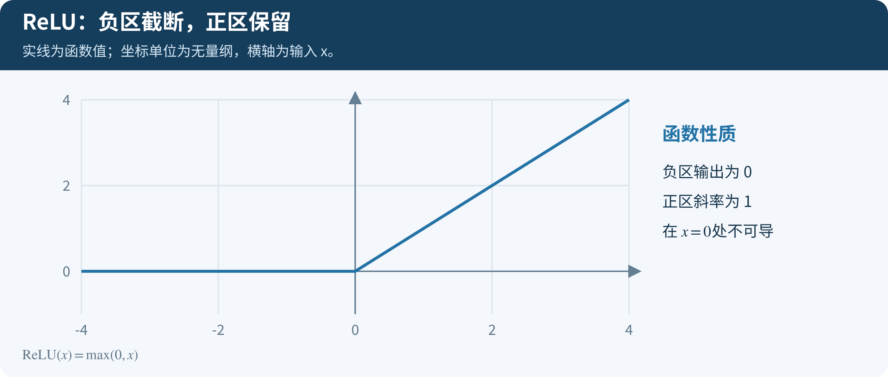
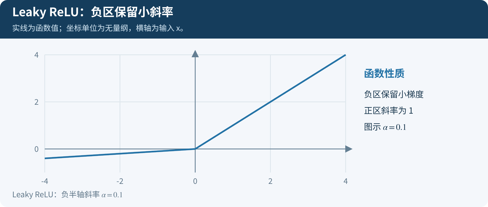
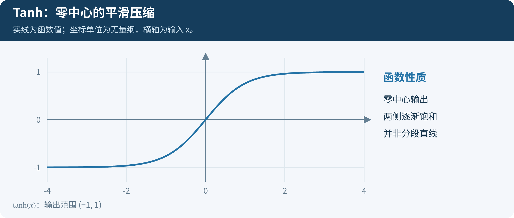
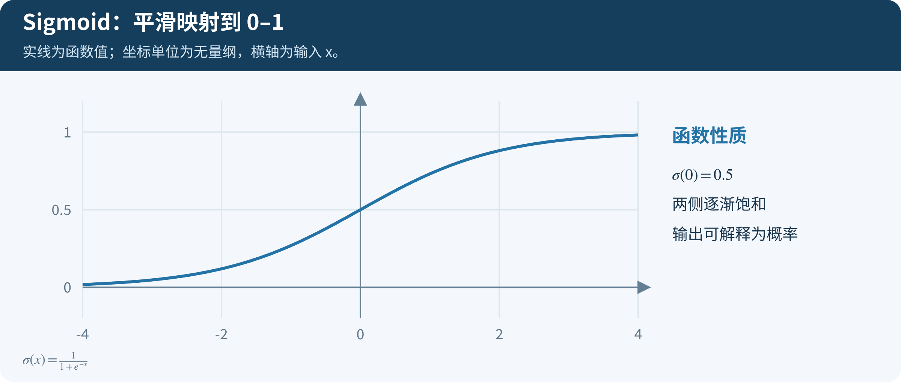

# ActivateFunction激活函数

## 概述

### 背景

1. 激活函数是神经网络中每个神经元在计算加权求和 $z = wx + b$ 之后施加的一个非线性变换 $a = f(z)$，决定该神经元的输出值。
2. 如果所有神经元都不使用激活函数（即使用线性函数 $f(z) = z$），无论网络有多少层，最终的输出仍然是输入的线性组合：多层线性变换叠加的结果等价于一个单层线性变换。这意味着网络无法学习任何非线性模式——无论多深的网络都退化为线性回归。
3. 非线性激活函数使网络能够形成**弯曲的决策边界**，从而处理现实世界中非线性可分的数据（例如在变化的光照和角度下区分猫和狗）。

### 解决思路

1. 在隐藏层（[卷积层](cnn.md) 或全连接层）的加权求和之后施加激活函数，引入非线性使网络能学习复杂模式；现代网络几乎都用 ReLU 及其变体。
2. 在输出层根据任务性质选择不同函数，将网络输出转化为所需格式（概率、类别等）。

---

## 1 隐藏层激活函数

### 1.1 ReLU（Rectified Linear Unit）

ReLU 是目前最常用的隐藏层激活函数，定义简单：正数原样输出，负数归零。

$$
f(x) = \max(0, x)
$$

*原创重绘；可编辑 [SVG](../../imgs/foundations-relu.svg)。*

**优点**：
- 计算极快（只需一次比较和乘法），训练效率远高于 Sigmoid/Tanh
- 稀疏激活：负输入全部输出 0，只有部分神经元被激活，减少了参数间的相互依赖
- 梯度在正区域恒为 1，缓解了梯度消失问题（不像 Sigmoid 的梯度最大才 0.25）

**缺点**：
- **死亡 ReLU 问题**：当输入持续为负时，梯度始终为 0，该神经元永远不会被更新，相当于"死掉"。一旦进入这种状态就无法恢复
- 输出非零中心：所有输出 ≥ 0，导致后续层的权重更新只有正方向或负方向的梯度信号，收敛变慢

**常用场景**：[CNN](cnn.md) 的卷积层后、Transformer 的前馈网络中、绝大多数现代深度网络的隐藏层

### 1.2 Leaky ReLU

Leaky ReLU 在负区域给一个小的斜率 $\alpha$（通常 0.01），避免神经元"死亡"。

$$
f(x) = \begin{cases} x, & x > 0 \\ \alpha x, & x \leq 0 \end{cases}
$$

其中 $\alpha$ 通常取 0.01。

*原创重绘；可编辑 [SVG](../../imgs/foundations-leaky.svg)。*

**优点**：
- 解决了死亡 ReLU 问题：负输入仍有小梯度，神经元不会完全停止学习
- 计算仍然简单，几乎不增加开销

**缺点**：
- $\alpha$ 需要手动设定，不同任务可能需要不同值
- 输出仍然非零中心

**常用场景**：当训练中出现大量"死亡神经元"时替换 ReLU；某些对抗生成网络（GAN）中偏好使用

### 1.3 PReLU（Parametric ReLU）

PReLU 将 Leaky ReLU 中的 $\alpha$ 从固定值改为**可学习参数**，让网络自己决定负区域的斜率。

$$
f(x) = \begin{cases} x, & x > 0 \\ \alpha_i x, & x \leq 0 \end{cases}
$$

$\alpha_i$ 在训练中通过反向传播更新。每个通道可以有独立的 $\alpha_i$。

**优点**：自适应调节负区域斜率，比手动设 $\alpha$ 更灵活
**缺点**：增加了少量参数
**常用场景**：大型模型中（如 ResNet 的某些变体）

### 1.4 ELU（Exponential Linear Unit）

ELU 在负区域使用指数函数，输出平滑过渡到负值，使激活值的均值更接近 0。

$$
f(x) = \begin{cases} x, & x > 0 \\ \alpha(e^x - 1), & x \leq 0 \end{cases}
$$

**优点**：
- 输出均值接近 0，梯度流向更健康
- 负区域平滑可导，不像 ReLU/Leaky ReLU 在 $x=0$ 处有硬转折
- 缓解梯度消失

**缺点**：计算包含指数运算，比 ReLU 慢
**常用场景**：需要更稳定训练的场景，较少用于主流架构

### 1.5 SELU（Scaled ELU）

SELU 是 ELU 的缩放版本，$\lambda \approx 1.05$，$\alpha \approx 1.67$，专门为**自归一化网络**设计。

$$
f(x) = \lambda \begin{cases} x, & x > 0 \\ \alpha(e^x - 1), & x \leq 0 \end{cases}
$$

**优点**：自动将各层激活值维持在均值≈0、方差≈1，无需 Batch Normalization 即可训练很深的网络
**缺点**：必须配合特定的权重初始化（LeCun Normal）和特殊的 Dropout（Alpha Dropout）才能生效
**常用场景**：SNN（Self-Normalizing Neural Networks）架构

### 1.6 Tanh

Tanh（双曲正切）将输入映射到 $[-1, 1]$，是零中心的。

$$
f(x) = \tanh(x) = \frac{e^x - e^{-x}}{e^x + e^{-x}} = 2\sigma(2x) - 1
$$

*原创重绘；可编辑 [SVG](../../imgs/foundations-tanh.svg)。*

**优点**：
- 输出零中心（$[-1, 1]$），后续层的梯度信号更均衡
- 在输入接近 0 时梯度较大，学习效率高

**缺点**：
- **梯度消失**：当输入远离 0 时，梯度趋近 0（饱和区），深层网络中梯度信号逐层衰减至消失
- 计算涉及指数运算，比 ReLU 慢

**常用场景**：[RNN](rnn.md) 的隐藏状态计算（LSTM/GRU 的门控中用 Sigmoid，状态计算中用 Tanh）；早期神经网络的隐藏层

### 1.7 Sigmoid

Sigmoid 将输入映射到 $(0, 1)$，呈 S 形曲线。

$$
\sigma(x) = \frac{1}{1 + e^{-x}}
$$

*原创重绘；可编辑 [SVG](../../imgs/foundations-sigmoid.svg)。*

**优点**：
- 输出范围 $(0, 1)$，可直接解释为概率
- 平滑可导，适合梯度优化

**缺点**：
- **梯度消失**严重：梯度最大值仅 0.25（在 $x=0$ 处），远离 0 时梯度几乎为 0，深层网络几乎无法训练
- 输出非零中心（全部 > 0），导致后续层权重更新方向偏斜
- 计算包含指数运算

**常用场景**：**几乎不再用于隐藏层**。主要用于 [RNN](rnn.md) 的门控机制（LSTM 的遗忘门/输入门/输出门都使用 Sigmoid，因为需要输出 0-1 值做选择性保留）；二分类的输出层

### 1.8 SoftPlus

SoftPlus 是 ReLU 的平滑版本，处处可导。

$$
f(x) = \log(1 + e^x)
$$

**优点**：平滑连续，没有 ReLU 在 $x=0$ 的硬转折，优化更稳定
**缺点**：计算比 ReLU 慢（涉及指数和 log）；输出非零中心且无上界；没有 ReLU 的稀疏激活优势
**常用场景**：极少单独使用，更多出现在概率模型中（如 [VAE](vae-cvae.md) 可用 SoftPlus 参数化正标准差，也常预测对数方差后取指数；这与重参数化采样本身是两个步骤）

---

## 2 输出层激活函数

输出层激活函数的选择取决于任务类型：

### 2.1 Sigmoid（二分类）

$$
\sigma(x) = \frac{1}{1 + e^{-x}}
$$

输出 $(0, 1)$，可解释为"属于正类的概率"。与 [交叉熵损失函数](cross-entropy.md) 配合使用。

### 2.2 Softmax（多分类）

$$
P(y=k) = \frac{e^{z_k}}{\sum_{j=1}^{K} e^{z_j}}
$$

将多个输出值转化为概率分布：所有类别的概率之和为 1，每个概率 $P_i$∈ $(0, 1)$。与多类交叉熵损失配合使用。

### 2.3 线性函数（回归）

$$
f(x) = x
$$

输出无界，直接输出预测值。用于回归任务（预测房价、温度等连续值）。

---

## 3 激活函数对比总结

### 3.1 隐藏层激活函数对比

| 函数             | 公式                              | 输出范围                        | 零中心 | 梯度消失 | 计算速度 | 稀疏激活 | 主要用途     |
| -------------- | ------------------------------- | --------------------------- | --- | ---- | ---- | ---- | -------- |
| **ReLU**       | $\max(0, x)$                    | $[0, +\infty)$              | 否   | 正区无  | 极快   | 有    | 隐藏层首选    |
| **Leaky ReLU** | $\max(\alpha x, x)$             | $(-\infty, +\infty)$        | 否   | 正区无  | 快    | 弱    | 避免死亡ReLU |
| **PReLU**      | 可学 $\alpha$                     | $(-\infty, +\infty)$        | 否   | 正区无  | 快    | 弱    | 大型模型     |
| **ELU**        | $\alpha(e^x-1)$ 负区              | $(-\alpha, +\infty)$        | 近似  | 正区无  | 中    | 弱    | 稳定训练     |
| **SELU**       | 缩放ELU                           | $(-\lambda\alpha, +\infty)$ | 近似  | 正区无  | 中    | 弱    | 自归一化网络   |
| **Tanh**       | $\frac{e^x-e^{-x}}{e^x+e^{-x}}$ | $[-1, 1]$                   | 是   | 严重   | 中    | 无    | RNN隐藏状态  |
| **Sigmoid**    | $\frac{1}{1+e^{-x}}$            | $(0, 1)$                    | 否   | 严重   | 中    | 无    | RNN门控    |

### 3.2 输出层激活函数对比

| 函数 | 输出范围 | 适用任务 | 配合损失 |
|------|---------|---------|---------|
| **Sigmoid** | $(0, 1)$ | 二分类 | 二元交叉熵 |
| **Softmax** | $(0, 1)$ 且和为1 | 多分类 | 多类交叉熵 |
| **线性** | $(-\infty, +\infty)$ | 回归 | MSE |

### 3.3 选择指南

| 层 | 推荐激活函数 | 原因 |
|----|------------|------|
| **隐藏层（通用）** | ReLU | 计算快、稀疏激活、缓解梯度消失 |
| **隐藏层（ReLU死亡严重）** | Leaky ReLU / PReLU | 保留负区梯度 |
| **隐藏层（RNN）** | Tanh（状态） + Sigmoid（门控） | 零中心输出 + 0-1门控 |
| **隐藏层（自归一化）** | SELU | 自动维持均值≈0方差≈1 |
| **输出层（二分类）** | Sigmoid | 输出概率 0-1 |
| **输出层（多分类）** | Softmax | 输出概率分布 |
| **输出层（回归）** | 线性 | 输出无界连续值 |

---

## 4 激活函数对模型性能的影响

### 4.1 收敛速度

ReLU 及其变体在正区域梯度恒为 1，避免了 Sigmoid/Tanh 的梯度瓶颈，训练收敛速度显著更快。在深层网络中，Sigmoid/Tanh 的梯度在每层至少衰减 75%（Sigmoid 最大梯度 0.25），10 层后有效梯度只剩 $0.25^{10} \approx 10^{-6}$，几乎无法学习。

### 4.2 梯度流

激活函数的导数决定了反向传播中梯度信号能走多远。ReLU 在正区域梯度=1，梯度无损传递；Sigmoid/Tanh 在饱和区梯度≈0，梯度信号逐层衰减至消失——这就是 梯度消失问题 的核心原因。

### 4.3 稀疏性

ReLU 将所有负输入置零，使网络中大部分神经元处于未激活状态。这种稀疏激活减少了参数间的相互依赖，降低了过拟合风险，也减少了计算量。Sigmoid/Tanh 几乎总是产生非零输出，没有这种稀疏优势。

---

## 5 关联

- 前向与反向传播 — 激活函数的导数是反向传播计算梯度的关键环节
- [CNN 卷积神经网络](cnn.md) — ReLU 是 CNN 卷积层后最常用的激活函数
- [RNN 循环神经网络](rnn.md) — LSTM/GRU 使用 Sigmoid 做门控、Tanh 做状态计算
- Transformer 架构 — Transformer 前馈网络使用 ReLU 或 GELU
- [交叉熵损失函数](cross-entropy.md) — Sigmoid/Softmax 输出层与交叉熵损失配合使用
- [VAE 与 CVAE](vae-cvae.md) — SoftPlus 是正尺度参数化的一种选择

<!-- 反向链接 -->