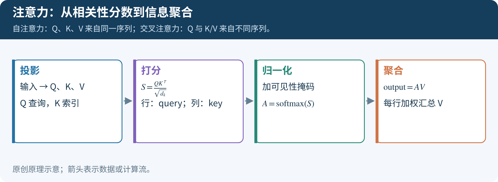
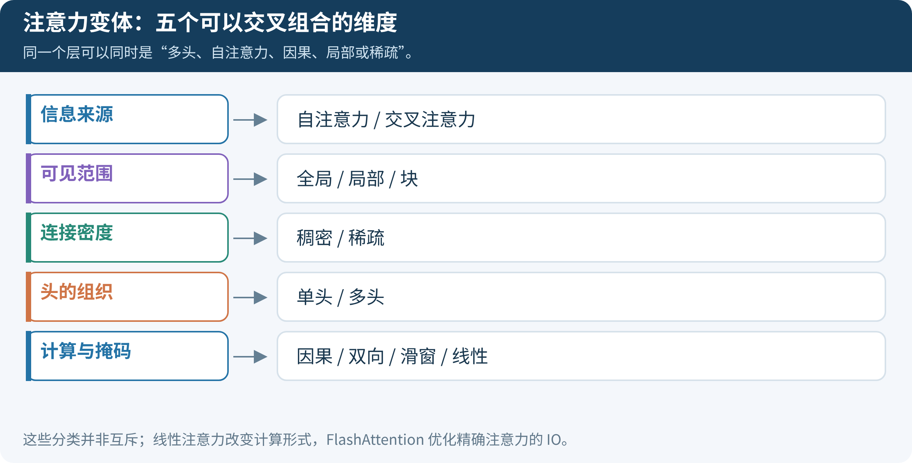

# 注意力机制

## 概述

### 背景

1. 序列处理（翻译、长文本建模）面临长距离依赖与信息筛选的核心问题：模型需要**动态地关注输入序列中最相关的部分**，而不是将所有输入同等对待。
2. 注意力机制本质上是**一个可微分的软性信息检索系统**，其核心操作是 Query-Key-Value (QKV) 模式。

### 解决思路

1. 让模型通过 QKV 模式计算 Query 对每个 Key 的相关性得分，用 softmax 归一化为注意力权重，再对 Value 加权求和——以此实现"根据相关性提取信息"的动态关注。
2. 先从第一性原理重建 QKV 设计（为什么 Q/K/V 分离、为什么用点积、为什么除以 $\sqrt{d_k}$、为什么用 softmax、为什么乘 V），再按注意力方向、范围、稀疏程度、多头机制、特殊模式五类梳理注意力变体。

---

## 1 QKV 核心思想与设计原理



### 1.1 核心思想

**Query-Key-Value (QKV) 模式**：

$$
\text{Attention}(Q, K, V) = \text{softmax}\left(\frac{QK^T}{\sqrt{d_k}}\right) \cdot V
$$

其中：
- **Query ($Q$)**：当前需要查询的内容，表示"我在找什么"
- **Key ($K$)**：被查询的索引，表示"我包含什么信息"
- **Value ($V$)**：实际要获取的信息，表示"我真正的内容是什么"

### 1.2 QKV 设计的第一性原理

注意力机制本质上是**一个可微分的软性信息检索系统**。从第一性原理出发，可以推导出为什么 QKV 公式要设计成这样。

#### 1.2.1 为什么需要 Q、K、V 三个向量？

这来自**检索系统的经典分离**：

| 角色            | 职责       | 数据库类比 |
| ------------- | -------- | ----- |
| **Query (Q)** | 我要查找什么   | 搜索词   |
| **Key (K)**   | 我包含什么特征  | 索引    |
| **Value (V)** | 我存储的真正信息 | 内容    |

**为什么要分开，而不是 Q=K=V？**

1. **K 和 V 分离**：索引不一定等于内容。比如一本书的目录（K）只是索引，真正的内容（V）是正文。
2. **Q 独立**：同一个内容可以被不同角度查询。同一篇文章，"作者是谁"（Q₁）和"发表时间"（Q₂）查询得到不同的 V。
3. **表达能力**：如果 Q=K=V，所有向量既要充当索引又要充当内容，限制了模型表达能力。

#### 1.2.2 为什么是 $QK^T$ 计算相似度？

**点积作为相似度度量**：

- 当向量模长固定时，$q \cdot k = \|q\|\|k\|\cos\theta$ 等价于余弦相似度
- 高效：矩阵乘法有高度优化的 GPU 实现
- 可微分：适合端到端学习

**其他替代方案及其缺点**：
- 欧氏距离 $\|q - k\|^2$：梯度在距离大时变小，优化困难
- 双线性 $q^T W k$：表达能力更强但多了 $d^2$ 参数

#### 1.2.3 为什么要除以 $\sqrt{d_k}$？

**防止 softmax 进入饱和区**。

设 $q$ 和 $k$ 的各分量是均值为0、方差为1的独立随机变量，则点积 $q \cdot k$ 的方差为 $d_k$。

**问题**：当 $d_k$ 大时，点积值范围可能达到几十甚至上百，导致 $\exp(\text{large})$ 趋近无穷，softmax 输出趋近 **one-hot**，梯度消失。

**解决**：除以 $\sqrt{d_k}$，使点积方差恢复到 1，保证 softmax 有足够的梯度。

#### 1.2.4 为什么要用 softmax？

**软性检索 vs 硬性检索**：

| 方式 | 特点 | 问题 |
|------|------|------|
| 硬性（max） | 只返回最相关的 1 个 | 丢失其他有用信息，梯度稀疏 |
| 软性（softmax） | 返回所有位置的加权平均 | 信息保留，可梯度反传 |

**softmax 的优势**：
- **概率解释**：$\text{softmax}(x)_i = \frac{e^{x_i}}{\sum_j e^{x_j}}$ 可以解释为"给定 Query，Key 各位置的条件概率分布"
- **对比性**：$e^{x_i}$ 的指数运算让较大值更突出，符合"选择性注意"的直觉

#### 1.2.5 为什么要乘以 V？

加权平均的信息聚合：

$$
\text{output}_i = \sum_j \alpha_{ij} \cdot v_j
$$

- 如果直接返回 $K$ 或 $K^T$，只是换了基底，没有真正提取信息
- 乘以 $V$ 意味着**用注意力权重对 Value 序列做加权平均**，这才是"根据相关性提取信息"的含义

#### 1.2.6 设计决策总结

| 设计选择 | 替代方案 | 为什么更好 |
|----------|----------|------------|
| Q, K, V 分离 | Q=K=V | 更灵活，允许索引和内容独立 |
| 点积相似度 | 欧氏距离 | 高效、可微分、等同余弦相似度 |
| $\div \sqrt{d_k}$ | 不归一化 | 防止 softmax 饱和，梯度稳定 |
| softmax 归一化 | sigmoid | 多位置概率解释，可做加权平均 |

**本质上，QKV 就是把「在数据库中查找」这件事，变成了一个可微分的、端到端学习的神经网络操作。**

| 操作 | 本质 |
|------|------|
| $QK^T$ | 计算 Query 对每个 Key 的相关性得分 |
| $\div \sqrt{d_k}$ | 归一化，防止数值过大 |
| softmax | 将得分转化为概率分布（注意力权重） |
| $\cdot V$ | 用权重对 Value 加权求和，提取信息 |

## 2 注意力分类



*原创重绘；可编辑 [SVG](../../imgs/foundations-attention-map.svg)。*

---

## 3 按注意力方向

### 3.1 自注意力 (Self-Attention)

**定义**：Query、Key、Value 来自**同一序列**。

$$
\text{Self-Attention}(X) = \text{softmax}\left(\frac{XW_Q (XW_K)^T}{\sqrt{d_k}}\right) XW_V
$$

**优点**：
- 任意位置之间可以直接交互，无视距离
- 表达能力强，参数可学习
- 适合并行计算

**缺点**：
- 复杂度 $O(n^2)$，长序列计算量大
- 对位置信息不敏感，需要额外添加位置编码
- 容易过拟合，需要较多数据

**典型应用**：BERT、GPT 编码器、ViT

### 3.2 交叉注意力 (Cross-Attention)

**定义**：Query 来自序列 A，Key/Value 来自序列 B。

$$
\text{Cross-Attention}(Q_A, K_B, V_B) = \text{softmax}\left(\frac{Q_A K_B^T}{\sqrt{d_k}}\right) V_B
$$

**优点**：
- 天然支持多模态融合
- 解耦了 Query 和 Key/Value 的来源
- 可以处理变长序列的对齐问题

**缺点**：
- 需要额外的模态对齐信息
- 两序列长度不同时计算需特殊处理
- 无法捕捉目标序列内部的依赖关系

**典型应用**：
- 机器翻译（编码器 → 解码器）
- 图像描述生成（图像 → 文本）
- VLA 多模态融合（视觉/语言 → 动作）

---

## 4 按注意力范围

### 4.1 全局注意力 (Global Attention)

**定义**：每个位置可以注意序列中的**所有位置**。

$$
\forall i,j: \quad \text{score}(i, j) \text{ 可以非零}
$$

**优点**：
- 感受野覆盖整个序列，信息传递充分
- 适合需要全局信息的任务
- 实现简单，无需调参

**缺点**：
- 复杂度 $O(n^2)$，内存和计算量大
- 长序列场景几乎不可用
- 可能引入过多无关信息

**典型应用**：标准 Transformer 编码器、BERT

### 4.2 局部注意力 (Local Attention)

**定义**：每个位置只注意**局部窗口**内的位置。

设窗口大小为 $w$，位置 $i$ 只注意 $[i-w, i+w]$ 范围内的位置：

$$
\text{score}(i, j) = 0 \quad \text{if} \quad |i - j| > w
$$

**优点**：
- 计算效率高，复杂度与序列长度线性相关
- 局部信息提取能力强
- 超参数 $w$ 可调节，灵活控制

**缺点**：
- 长距离依赖需要多层堆叠才能建立
- 固定窗口大小可能不适合所有任务
- 边界处理需要特殊考虑

**典型应用**：Swin Transformer、Longformer（局部窗口 + 全局）

### 4.3 块注意力 (Block Attention)

**定义**：将序列划分为多个块（block），块内全连接，块间有约束。

**优点**：
- 可设计块间信息流动模式
- 支持多模态建模（如 $\pi_0$ 的模态隔离）
- 计算效率高于全局注意力

**缺点**：
- 块划分需要先验知识
- 块间约束设计复杂
- 可能限制必要的信息传递

**典型应用**：$\pi_0$ VLA、多模态模型

---

## 5 按稀疏程度

### 5.1 稠密注意力 (Dense Attention)

**定义**：所有位置两两之间都有注意力连接。

$$
\forall (i, j) \in [1,n] \times [1,n]: \quad \alpha_{ij} = \text{softmax}\left(\frac{q_i k_j^T}{\sqrt{d}}\right)
$$

**计算量**：

$$
\text{Flops} = 2 \cdot n^2 \cdot d
$$

**优点**：
- 信息传递最充分，无信息损失
- 模型表达能力最强
- 适合短序列任务

**缺点**：
- 复杂度 $O(n^2)$，长序列不可行
- 内存占用大，训练困难
- 推理速度慢

### 5.2 稀疏注意力 (Sparse Attention)

**定义**：只计算部分位置对的注意力，采用结构化稀疏模式。

#### 5.2.1 BigBird

稀疏模式由三部分组成：
1. **局部窗口**：每个位置注意相邻 $w$ 个位置
2. **随机连接**：随机连接 $r$ 个远距离位置
3. **全局 token**：少数全局注意位置（如 [CLS]）

$$
\text{Attention}(i) = \text{softmax}\left(\frac{q_i \cdot [k_{i-w:i+r}, k_{\text{random}}, k_{\text{global}}]^T}{\sqrt{d}}\right)
$$

**优点**：
- 复杂度降至 $O(n \cdot w + n \cdot r)$
- 兼顾局部和全局信息
- 理论保证可以近似全注意力

**缺点**：
- 随机连接不稳定，训练方差大
- 全局 token 数量需人工设定
- 稀疏模式固定，不够灵活

#### 5.2.2 Longformer

组合多种注意力模式：
1. **滑动窗口注意力**：窗口大小 $w$
2. **扩张窗口注意力**：跳跃式窗口
3. **全局注意力**：指定少数位置

**优点**：
- $O(n \cdot w)$ 复杂度，适合长文档
- 可处理长达 4096+ 的序列
- 窗口 + 全局组合灵活

**缺点**：
- 窗口外信息需要多层传播
- 全局位置选择影响性能
- 与标准 Transformer 不兼容

#### 5.2.3 A3

固定稀疏模式：
- **局部**：固定大小局部窗口
- **全局随机**：随机采样的远距离位置

**优点**：
- 固定模式，适合硬件优化
- 训练推理效率高
- 可预测的计算量和内存

**缺点**：
- 随机采样不稳定
- 固定模式不一定是最佳的
- 长距离依赖建模能力有限

**复杂度对比**：

| 类型 | 时间复杂度 | 空间复杂度 |
|------|-----------|-----------|
| 稠密 | $O(n^2)$ | $O(n^2)$ |
| BigBird | $O(n \cdot w + n \cdot r)$ | $O(n \cdot w + n \cdot r)$ |
| Longformer | $O(n \cdot w)$ | $O(n \cdot w)$ |
| A3 | $O(n \cdot (w + r))$ | $O(n \cdot (w + r))$ |

---

## 6 按多头机制

### 6.1 单头注意力 (Single-Head Attention)

**定义**：只有一组 Q/K/V 变换。

$$
\text{Attention}(Q, K, V) = \text{softmax}\left(\frac{QK^T}{\sqrt{d}}\right)V
$$

**优点**：
- 参数量少，计算高效
- 适合资源受限场景
- 简单易调试

**缺点**：
- 表示能力有限，只能捕捉一种相关性模式
- 多样性不足
- 复杂任务表现差

### 6.2 多头注意力 (Multi-Head Attention)

**定义**：多组 Q/K/V 并行计算，各自捕捉不同子空间特征。

$$
\text{MultiHead}(Q, K, V) = \text{Concat}(\text{head}_1, \ldots, \text{head}_h) W^O
$$

其中每个头的计算：

$$
\text{head}_i = \text{Attention}(QW_i^Q, KW_i^K, VW_i^V)
$$

**参数矩阵**：
- $W_i^Q \in \mathbb{R}^{d \times d_k}$
- $W_i^K \in \mathbb{R}^{d \times d_k}$
- $W_i^V \in \mathbb{R}^{d \times d_v}$
- $W^O \in \mathbb{R}^{hd_v \times d}$

**优点**：
- 不同头可学习不同的相关性模式
- 表示能力更强，表达更丰富
- 已被验证为深度学习最佳实践

**缺点**：
- 参数量与头数成正比
- 计算量增加
- 头数需要调参

**多头注意力的头部分布**：

| 头类型 | 典型功能 |
|--------|----------|
| **位置头** | 关注相对位置关系 |
| **语法头** | 关注语法依存关系 |
| **语义头** | 关注语义相似性 |
| **查询头** | 关注特定查询模式 |
| **反义头** | 关注否定、对比关系 |

**SAE 研究发现**（斯坦福 2026）：
- VLA 中大多数特征对应特定训练演示的**记忆序列**
- 部分特征对应可解释的运动原语和语义属性，可**跨任务/场景泛化**
- **Feature Steering**：操控单个 SAE 特征可预测性地调节机器人行为

---

## 7 特殊注意力模式

### 7.1 因果注意力 (Causal Attention)

**定义**：只能注意**当前位置之前**的内容，保证自回归生成时的因果性。

对于位置 $i$，只能注意 $[0, i]$ 范围：

$$
\alpha_{ij} = 0, \quad \forall j > i
$$

**掩码矩阵**：

$$
M_{ij} =
\begin{cases}
1 & \text{if } j \leq i \\
0 & \text{if } j > i
\end{cases}
$$

**注意分数计算**：

$$
\text{score}_{\text{causal}}(q_i, k_j) =
\begin{cases}
\frac{q_i k_j^T}{\sqrt{d}} & \text{if } j \leq i \\
-\infty & \text{if } j > i
\end{cases}
$$

**优点**：
- 保证自回归生成的因果性
- 避免信息泄露
- 推理时可以利用 KV Cache 加速

**缺点**：
- 无法并行训练（推理时可以）
- 训练效率低
- 无法看到未来信息

**典型应用**：GPT、LLaMA 等自回归语言模型

### 7.2 双向注意力 (Bidirectional Attention)

**定义**：可以看到**完整序列**，无位置限制。

$$
\forall i,j \in [1,n]: \quad \alpha_{ij} \text{ 可以非零}
$$

**优点**：
- 训练时可以并行
- 充分利用上下文信息
- 编码能力强

**缺点**：
- 无法用于自回归生成（会泄露未来信息）
- 推理时必须逐个生成
- 不适合实时应用

**典型应用**：BERT、编码器结构

### 7.3 滑动窗口注意力 (Sliding Window Attention)

**定义**：每个位置只注意固定大小的局部窗口。

设窗口大小为 $w$，位置 $i$ 只注意 $[i-\lfloor w/2 \rfloor, i+\lfloor w/2 \rfloor]$：

$$
\text{score}(i, j) = 0 \quad \text{if} \quad |i - j| > \lfloor w/2 \rfloor
$$

**多层堆叠效果**：

单层窗口 $w=3$ 只能捕捉局部依赖，但多层堆叠可以指数级扩大感受野：

| 层数 | 有效感受野 |
|------|-----------|
| 1 | $w = 3$ |
| 2 | $2w-1 = 5$ |
| 3 | $3w-2 = 7$ |
| L | $L \cdot w - (L-1)$ |

**优点**：
- 复杂度 $O(n \cdot w)$，高效
- 局部建模能力强
- 可通过多层堆叠扩大感受野

**缺点**：
- 初始感受野小，收敛慢
- 长距离依赖需要很多层
- 超参数 $w$ 需要设计

**典型应用**：Swin Transformer

### 7.4 大核注意力 (Large Kernel Attention)

**定义**：用大卷积核近似全局注意力。

核心思想：用深度可分离卷积代替全局注意力：

$$
\text{Attention}_{\text{large kernel}}(X) = \text{DepthwiseConv}(X, k \times k) \cdot \sigma(X)
$$

其中 $k \times k$ 是大核尺寸（如 $7 \times 7$、$13 \times 13$）。

**复杂度对比**：

| 方法 | 复杂度 |
|------|--------|
| 全局注意力 | $O(n^2)$ |
| 大核注意力 | $O(n \cdot k^2)$ |

**优点**：
- 当 $k \ll n$ 时，比全局注意力高效
- 可用卷积优化，硬件友好
- 适合图像等二维数据

**缺点**：
- 核大小有限，无法真正达到全局
- 卷积核参数量大
- 不如全局注意力灵活

**典型应用**：ConvNeXt

### 7.5 线性注意力 (Linear Attention)

**定义**：通过核函数近似，将复杂度降至 $O(n)$。

标准注意力重写为：

$$
\text{Attention}(Q, K, V)_i = \frac{\sum_{j=1}^n \exp(q_i^T k_j) v_j}{\sum_{j=1}^n \exp(q_i^T k_j)}
$$

引入核函数 $\phi(\cdot)$：

$$
\text{LinearAttention}(Q, K, V)_i = \frac{\phi(q_i)^T (\phi(k_j) v_j^T)}{\phi(q_i)^T \phi(k_j)^T}
$$

**复杂度**：

$$
\text{Flops} = O(n \cdot d^2) \quad \text{vs} \quad O(n^2 \cdot d) \text{ (标准)}
$$

**优点**：
- 复杂度 $O(n)$，适合超长序列
- 可以用 [RNN](rnn.md) 方式推理
- 内存占用小

**缺点**：
- 核近似有误差，表达能力下降
- 某些任务（如检索）效果差
- 需要选择合适的核函数

**主要方法**：

| 方法 | 近似方式 |
|------|---------|
| **Performer** | 正交随机特征 (ORF) |
| **Mamba** | 状态空间模型 (SSM) |
| **RetNet** | 指数衰减注意力 |

**典型应用**：Performer、Mamba、长序列模型

---

## 8 复杂度与优化

### 8.1 标准注意力的复杂度

$$
\text{时间复杂度}: O(n^2 \cdot d) \quad \text{空间复杂度}: O(n^2)
$$

其中 $n$ 是序列长度，$d$ 是维度。

### 8.2 长序列优化方法

| 方法 | 复杂度 | 原理 |
|------|--------|------|
| **Flash Attention** | $O(n^2)$ 但实际更快 | IO-aware 分块计算，减少 HBM 访问 |
| **Sparse Attention** | $O(n \cdot k)$ | 只计算 Top-k 注意力位置 |
| **Linear Attention** | $O(n)$ | 核函数近似 |
| **Performer** | $O(n)$ | 正交随机特征 |
| **Mamba (SSM)** | $O(n)$ | 状态空间模型 |

---

## 9 代码实现

### 9.1 标准注意力

```python
import torch
import torch.nn.functional as F
import math

def standard_attention(Q, K, V, mask=None):
    """
    Q, K, V: [batch, heads, seq_len, d_k]
    返回: [batch, heads, seq_len, d_v]
    """
    d_k = Q.size(-1)

    # 1. 计算注意力分数
    scores = torch.matmul(Q, K.transpose(-2, -1)) / math.sqrt(d_k)

    # 2. 应用掩码（如果有）
    if mask is not None:
        scores = scores.masked_fill(mask == 0, -1e9)

    # 3. Softmax 归一化
    attention_weights = F.softmax(scores, dim=-1)

    # 4. 加权求和
    output = torch.matmul(attention_weights, V)

    return output, attention_weights
```

### 9.2 因果掩码

```python
def create_causal_mask(seq_len, device):
    """创建下三角因果掩码"""
    mask = torch.tril(torch.ones(seq_len, seq_len, device=device))
    return mask.unsqueeze(0).unsqueeze(0)  # [1, 1, seq_len, seq_len]
```

### 9.3 多头注意力

```python
class MultiHeadAttention(nn.Module):
    def __init__(self, d_model, num_heads):
        super().__init__()
        self.num_heads = num_heads
        self.d_k = d_model // num_heads

        self.W_q = nn.Linear(d_model, d_model)
        self.W_k = nn.Linear(d_model, d_model)
        self.W_v = nn.Linear(d_model, d_model)
        self.W_o = nn.Linear(d_model, d_model)

    def forward(self, x, mask=None):
        B, T, C = x.size()

        # 线性投影并分头
        Q = self.W_q(x).view(B, T, self.num_heads, self.d_k).transpose(1, 2)
        K = self.W_k(x).view(B, T, self.num_heads, self.d_k).transpose(1, 2)
        V = self.W_v(x).view(B, T, self.num_heads, self.d_k).transpose(1, 2)

        # 注意力计算
        output, weights = standard_attention(Q, K, K, mask)

        # 合并头并输出
        output = output.transpose(1, 2).contiguous().view(B, T, C)
        return self.W_o(output)
```

---

## 10 关联

- Flow Matching 流匹配原理 — $\pi_0$ 使用流匹配生成动作
- VLA 视觉语言动作模型 — VLA 中的注意力机制设计
- Performer-MPC 注意力 MPC 控制器 — 线性注意力的应用

<!-- 反向链接 -->
