# CNN 卷积神经网络

## 概述

### 背景

1. 卷积神经网络（Convolutional Neural Networks, CNNs）是一类受人类视觉系统启发的深度神经网络架构，旨在**处理具有网格状拓扑结构的数据**（例如图像），是大多数现代计算机视觉应用的基础，用于检测视觉数据中的特征。
2. 1989 年 Yann LeCun 等人首次提出了卷积神经网络的现代形式，用于手写数字识别。CNN 的核心设计理念是通过局部感受野和权重共享来有效地处理图像等结构化网格数据。

### 解决思路

1. CNN 通过**卷积操作**自动学习从简单边缘纹理到复杂形状物体的**层次化特征**，无需人工特征工程。
2. 核心特点：**局部连接**（每个神经元只连接输入的局部区域）、**权重共享**（同一卷积核在输入上滑动时使用相同权重）、**平移不变性**（对图像中物体的位置变化具有鲁棒性）、**多核并行**（多个卷积核同时滑动，每个核提取不同的局部模式，核的权重就是网络要学习的参数）。

---

## 1 卷积操作

### 1.1 连续卷积

连续卷积起源于信号处理领域，描述的是**一个信号经过某个系统（滤波器）后的输出**。

设 $f(t)$ 为输入信号，$g(t)$ 为系统响应（冲激响应），连续卷积定义为：

$$
(f * g)(t) = \int_{-\infty}^{\infty} f(\tau) \cdot g(t - \tau) \, d\tau
$$

**直觉理解**：$g(t - \tau)$ 是将系统响应 $g$ 翻转后平移 $t$ 个单位。积分就是将翻转平移后的 $g$ 与 $f$ 在每个位置 $\tau$ 上相乘、再求和（连续情况下是积分），得到时刻 $t$ 的输出值。

可以这样理解这个过程：在时刻 $t$，输出信号不是只看当前输入 $f(t)$，而是把**过去所有时刻的输入 $f(\tau)$ 都拿来**，每一段过去的输入 $\tau$ 对当前时刻 $t$ 的影响程度由 $g(t - \tau)$ 决定——距离当前越远的输入，$g$ 赋予的权重越小（如果 $g$ 是衰减函数的话）。所有历史输入加权求和，就是当前时刻的输出。

**连续卷积的性质**：

| 性质 | 说明 |
|------|------|
| **交换律** | $f * g = g * f$ |
| **结合律** | $(f * g) * h = f * (g * h)$ |
| **分配律** | $f * (g + h) = f * g + f * h$ |
| **与微分的关系** | $\frac{d}{dt}(f * g) = f' * g = f * g'$ |

这些性质使得卷积在信号处理中非常实用：一个复杂系统的响应可以分解为多个简单子系统响应的卷积组合。

### 1.2 离散卷积

当信号是离散序列时，连续卷积中的积分变为求和。

**一维离散卷积**：设 $f[n]$ 和 $g[n]$ 为两个离散序列，一维离散卷积定义为：

$$
(f * g)[n] = \sum_{m=-\infty}^{\infty} f[m] \cdot g[n - m]
$$

一维离散卷积的计算过程：

1. 将 $g[m]$ **翻转**得到 $g[-m]$（沿纵轴镜像）
2. 将翻转后的序列**平移** $n$ 个单位得到 $g[n - m]$
3. 将 $f[m]$ 与 $g[n - m]$ **逐点相乘**，然后**求和**

```
示例：f = [1, 2, 3], g = [0, 1, 0.5]

翻转 g: g[-m] = [0.5, 1, 0]

n=0:  f[m] × g[0-m] = [1,2,3] × [0.5,1,0] = 0.5+2+0 = 2.5
n=1:  f[m] × g[1-m] = [1,2,3] × [0,0.5,1] = 0+1+3 = 4
n=2:  f[m] × g[2-m] = [1,2,3] × [0,0,0.5] = 0+0+1.5 = 1.5

结果：(f * g) = [2.5, 4, 1.5]
```

**二维离散卷积**：对于二维矩阵（图像），卷积在两个维度上同时进行：

$$
(f * g)[i, j] = \sum_{a=-\infty}^{\infty} \sum_{b=-\infty}^{\infty} f[a, b] \cdot g[i - a, j - b]
$$

二维离散卷积的计算过程与一维类似：

1. 将卷积核 $g$ **沿两个维度翻转**（上下翻转 + 左右翻转）
2. 将翻转后的卷积核**平移**到位置 $(i, j)$
3. 与输入矩阵在该位置的局部区域**逐点相乘**，然后**求和**

### 1.3 CNN 中的卷积：互相关 vs 卷积

严格来说，**CNN 中使用的操作是互相关（cross-correlation），而非数学上的卷积**。两者的区别在于是否翻转卷积核：

| 操作 | 公式 | 卷积核处理 |
|------|------|-----------|
| **卷积** | $(f * g)[i,j] = \sum f[a,b] \cdot g[i-a, j-b]$ | **翻转**后滑动 |
| **互相关** | $(f \star g)[i,j] = \sum f[a,b] \cdot g[a-i, b-j]$ | **不翻转**直接滑动 |

数学上的卷积要求先翻转卷积核再滑动求和；CNN 的操作是直接拿卷积核滑过输入做点积，不做翻转。不过，因为卷积核的权重是**学习出来的**，翻转与否只是索引顺序的区别——一个翻转后的可学习卷积核 $g'$ 与不翻转的 $g$ 完全等价（只需将 $g'$ 的权重重新排列即可得到 $g$）。因此在 CNN 中，翻转与否不影响学习结果，大家约定俗成地将 CNN 的操作也称为"卷积"。

CNN 互相关的具体计算过程（3×3 卷积核）：

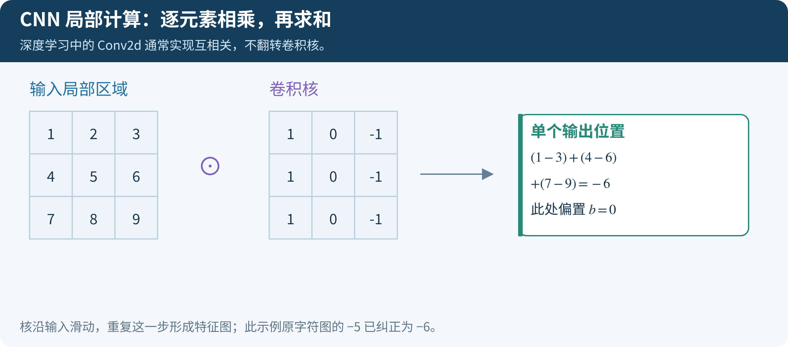

*原创重绘；可编辑 [SVG](../../imgs/foundations-cnn-patch.svg)。*

卷积核从左上角开始，每次向右/向下移动一个像素（步长=1），在每个位置都做一次这样的点积计算，最终把所有位置的值拼成一张新的"特征图"。

**CNN 互相关的数学表示**：

$$
y_{i,j,k} = \sum_{a=0}^{K-1} \sum_{b=0}^{K-1} \sum_{c=0}^{D-1} x_{i+a,j+b,c} \cdot w_{a,b,c,k} + b_k
$$

其中：
- $x$：输入特征图
- $w$：卷积核权重
- $b$：偏置
- $K$：卷积核大小（通常为 3×3、5×5）
- $D$：输入通道数（RGB 图像 $D=3$，上一层输出 64 张特征图则 $D=64$）
- $y$：输出特征图

注意公式中 $x_{i+a}$ 而非 $x_{i-a}$——这正是互相关的特征（不翻转）。

### 1.4 卷积到底干了什么

卷积的本质是**模式匹配**：**卷积核的权重定义了一种"什么样的局部模式是我要找的"，点积的大小反映了输入的局部区域与这个模式的相似程度**。

常见的边缘检测卷积核：

$$
K_{\text{vertical}} = \begin{bmatrix} 1 & 0 & -1 \\ 1 & 0 & -1 \\ 1 & 0 & -1 \end{bmatrix}, \quad K_{\text{horizontal}} = \begin{bmatrix} 1 & 1 & 1 \\ 0 & 0 & 0 \\ -1 & -1 & -1 \end{bmatrix}
$$

- $K_{\text{vertical}}$（垂直边缘检测器）：当输入局部区域左边亮右边暗时，点积值大；左右亮度相近时，点积值接近 0。所以它"找"的是垂直方向的颜色跳变——即垂直边缘
- $K_{\text{horizontal}}$（水平边缘检测器）：找的是上下方向的颜色跳变——即水平边缘
- 一个随机初始化的 3×3 卷积核在训练过程中会自动学习到对当前任务最有用的局部模式——可能是某个角度的边缘、某种纹理、甚至是某个特定形状的一部分

多个卷积核（如 32 个）同时滑动，每个核找不同的模式，输出 32 张特征图叠加在一起，这就是"输出通道数=滤波器数量"的含义。浅层卷积核学到的是简单模式（边缘、纹理），深层卷积核组合浅层的特征，学到复杂模式（形状、物体部件、甚至完整物体）——这就是 CNN 的**层次化特征学习**。

### 1.5 关键参数

| 参数               | 说明       | 常见值           |
| ---------------- | -------- | ------------- |
| **卷积核大小**        | 滤波器的空间尺寸 | 2×2, 3×3, 5×5 |
| **步长 (Stride)**  | 滤波器滑动的步进 | 1, 2          |
| **填充 (Padding)** | 边缘补零策略   | same, valid   |
| **滤波器数量**        | 输出通道数    | 32, 64, 128   |

**各参数的影响**：

- **卷积核大小 $K$**：决定了感受野和参数量。核越大，单次卷积覆盖的输入区域越广（3×3 只看 3×3 邻域，5×5 看 5×5），能直接捕获更大的空间模式；但参数量成平方增长（3×3=9 参数，5×5=25，7×7=49）。VGGNet 证明了**两个 3×3 堆叠等价于一个 5×5**（感受野相同，参数 18 vs 25，多了 1 次 ReLU），三个 3×3 堆叠等价于一个 7×7（27 vs 49 参数）。因此现代 CNN 几乎都用 3×3，通过堆叠逐步扩展感受野。1×1 核不改变空间尺寸，只跨通道混合信息，常用于通道降维/升维
- **步长 $S$**：控制卷积核滑动的步进大小。步长=1 时逐像素滑动，输出尺寸几乎不变；步长=2 时每隔一个像素滑动一次，输出尺寸约为输入的一半。步长越大，输出越小，计算量越低，但丢失的空间细节越多。步长>1 的卷积可以替代池化层做下采样
- **填充 $P$**：决定边缘像素的参与程度。"valid" 不填充，边缘像素只被卷积核部分覆盖，输出尺寸会缩小（5×5 输入 + 3×3 核 → 3×3 输出）；"same" 在边缘补零使输出尺寸等于输入尺寸（步长=1 时），保证边缘信息不被丢弃。填充越多，输出越大，但补零区域不含真实信息，过多填充会引入噪声
- **滤波器数量**：决定输出通道数，即同时寻找多少种不同的局部模式。数量越多，能捕获的特征种类越丰富，但参数量和计算量也线性增长（每个滤波器需要一套独立的 $K \times K \times D$ 权重）。常见做法是浅层用较少滤波器（32-64），深层逐步增加（128-512），因为深层组合的特征更复杂、需要更多通道来表示

**输出尺寸计算**：

$$
\text{Output}_{size} = \left\lfloor \frac{W - K + 2P}{S} \right\rfloor + 1
$$

其中 $W$ 为输入宽度/高度，$P$ 为 padding，$S$ 为 stride。

---

## 2 CNN 的基本结构

### 2.1 核心模式：卷积块的重复

CNN 不是固定 7 层，而是遵循一个核心模式：**"卷积→激活→池化"组成一个卷积块，重复多次后再扁平化、全连接、输出**。

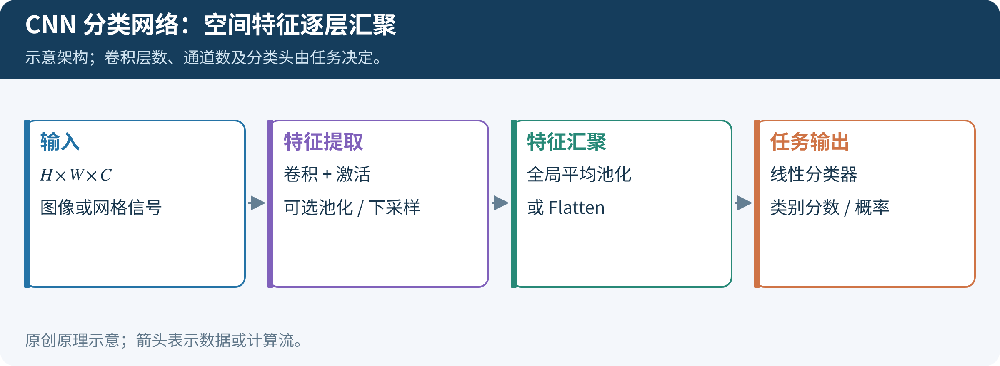

*原创重绘；可编辑 [SVG](../../imgs/foundations-cnn-architecture.svg)。*

- **卷积块重复 N 次**：这是 CNN 的主体，每次重复都让空间尺寸缩小、特征层次加深。N 可以是 1（最简 CNN）、3（典型 CNN）、甚至几十个（ResNet-152）
- **全连接层 1-2 个（M=1 或 2）**：只在网络末端出现，负责把特征汇总成分类结果。传统 CNN（如 AlexNet）用 2-3 个全连接层；现代 CNN 趋向只用 1 个甚至完全去掉（用全局平均池化替代），因为全连接层参数量太大
- **扁平化和输出层只出现一次**

下面以最简单的 N=1（只有 1 个卷积块）为例，展示 CNN 的完整数据流：

### 2.2 最简示例（N=1）

| 层        | 功能                | 数据变化                     | 可学习参数                                                   |
| -------- | ----------------- | ------------------------ | ------------------------------------------------------- |
| **输入层**  | 接收原始图像            | 32×32×3 RGB 图像           | 无                                                       |
| **卷积层**  | 3×3 核×12 + same填充 | 32×32×12（空间尺寸不变，通道 3→12） | 权重 $W$（$3^2 \times 3 \times 12 = 108$）+ 偏置 $b$（12）= 120 |
| **激活层**  | 引入非线性             | 32×32×12（ReLU 不改变维度）     | 无                                                       |
| **池化层**  | 2×2 最大池化          | 16×16×12（空间尺寸减半）         | 无                                                       |
| **扁平化**  | 转换为向量             | 3072 维向量                 | 无                                                       |
| **全连接层** | 分类推理              | 64 个神经元                  | 权重 $W$（$3072 \times 64 = 196,608$）+ 偏置 $b$（64）= 196,672 |
| **输出层**  | 概率输出              | Softmax (10 类)           | 权重 $W$（$64 \times 10 = 640$）+ 偏置 $b$（10）= 650           |

### 2.3 多块示例（N=2）

实际的 CNN 通常有多个卷积块。以 N=2 为例，数据流如下：

| 层         | 数据变化     | 说明               |
| --------- | -------- | ---------------- |
| 输入        | 32×32×3  | RGB 图像           |
| **卷积块 1** |          |                  |
| 卷积层       | 32×32×32 | 3→32 通道，same 填充  |
| 激活层       | 32×32×32 | ReLU             |
| 池化层       | 16×16×32 | 空间尺寸减半           |
| **卷积块 2** |          |                  |
| 卷积层       | 16×16×64 | 32→64 通道，same 填充 |
| 激活层       | 16×16×64 | ReLU             |
| 池化层       | 8×8×64   | 空间尺寸再次减半         |
| **尾部**    |          |                  |
| 扁平化       | 4096 维向量 | 8×8×64=4096      |
| 全连接层      | 128 个神经元 | 综合判断             |
| 输出层       | 10 类     | Softmax 分类       |

可以看到两个关键趋势：
- **空间尺寸逐步缩小**：32→16→8（每经过一个池化层就减半）
- **通道数逐步增多**：3→32→64（浅层提取简单模式只需少量通道，深层组合复杂模式需要更多通道）

---

## 3 各层详解

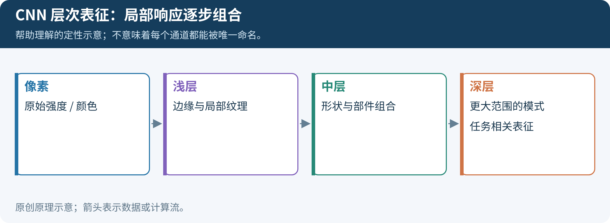

### 3.1 输入层 (Input Layer)

输入层接收原始图像数据，通常表示为 3D 体积：

$$
\text{Input} \in \mathbb{R}^{W \times H \times D}
$$

其中：
- $W$：宽度（像素数）
- $H$：高度（像素数）
- $D$：深度（通道数，如 RGB 为 3）

**可学习参数**：无。输入层只接收数据，不参与学习。

**特点**：
- 存储图像的像素值
- 保留图像的空间结构
- 直接输入网络进行特征提取

### 3.2 卷积层 (Convolutional Layer)

卷积层是 CNN 的核心，**使用可学习的滤波器在输入上滑动进行卷积运算，提取局部特征**。卷积的数学定义（连续、离散）以及 CNN 中互相关与卷积的区别详见 §1。

**输入通道与输出通道**：输入和输出都是 3D 张量，但深度维度的含义不同——输入的深度是"每张图有几个通道"，输出的深度是"有几张单通道特征图叠在一起"。

看公式中的 $\sum_{c=0}^{D-1}$：这一步将所有输入通道（R/G/B 共 3 个）的加权值**加在一起**，变成一个数。3 个通道的求和让它们消失了，所以一个滤波器只输出**一张单通道特征图**。64 个滤波器就输出 64 张单通道特征图，叠在一起形成 $32 \times 32 \times 64$ 的 3D 张量——这里的 64 是"有多少张图"，不是"每张图有多少通道"。

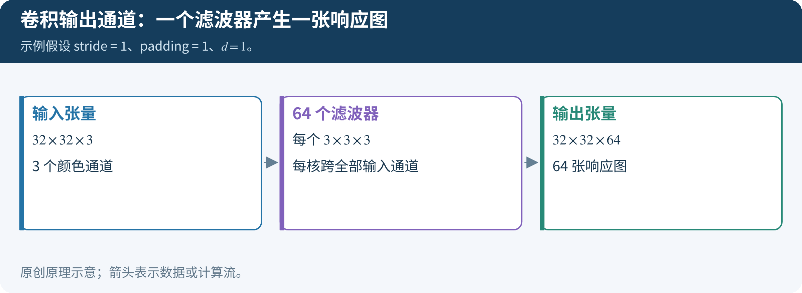

*原创重绘；可编辑 [SVG](../../imgs/foundations-cnn-channels.svg)。*

输入通道数 $D_{\text{in}}$ 不是随意设的：第一层由数据决定（RGB 图像=3），后续层由上一层的输出通道数决定。输出通道数 $D_{\text{out}}$ 就是滤波器数量，可以自由设置。

**关键参数**：

| 参数               | 说明       | 常见值           |
| ---------------- | -------- | ------------- |
| **卷积核大小**        | 滤波器的空间尺寸 | 2×2, 3×3, 5×5 |
| **步长 (Stride)**  | 滤波器滑动的步进 | 1, 2          |
| **填充 (Padding)** | 边缘补零策略   | same, valid   |
| **滤波器数量**        | 输出通道数    | 32, 64, 128   |

**输出尺寸计算**：

$$
\text{Output}_{size} = \left\lfloor \frac{W - K + 2P}{S} \right\rfloor + 1
$$

其中 $W$ 为输入宽度/高度，$P$ 为 padding，$S$ 为 stride。

**卷积层的参数量**：

$$
\text{Params} = K^2 \times D_{\text{in}} \times D_{\text{out}} + D_{\text{out}}
$$

其中 $D_{\text{in}}$ 为输入通道数（不是随意设的——第一层由数据决定，RGB 图像就是 3；后续层由上一层的输出通道数决定），$D_{\text{out}}$ 为输出通道数（滤波器数量），最后一项为偏置。

以一个两层卷积网络为例：

| 层     | $K$ | $D_{\text{in}}$ | $D_{\text{out}}$ | 参数量                                     |
| ----- | --- | --------------- | ---------------- | --------------------------------------- |
| 第1层卷积 | 3×3 | 3（RGB图像）        | 64               | $9 \times 3 \times 64 + 64 = 1,744$     |
| 第2层卷积 | 3×3 | 64（上一层输出）       | 128              | $9 \times 64 \times 128 + 128 = 73,856$ |

第2层的输入通道=64，不是因为数据有64个通道，而是因为**上一层输出了64张特征图**。通道数逐层增长，深层卷积的参数量也随之增大。

相比之下，如果用全连接层连接 $32 \times 32 \times 64 = 65,536$ 个输入到 128 个输出，需要 $65,536 \times 128 + 128 = 8,388,736$ 参数——比第2层卷积的 73,856 多了超过 100 倍，这就是权重共享带来的参数效率。

### 3.3 激活层 (Activation Layer)

在卷积层之后应用[激活函数](activation-functions.md)对每卷积的每个输出通道的所有元素进行激活，引入非线性：

$$
f(x) = \max(0, x) \quad \text{(ReLU)}
$$

**可学习参数**：无。ReLU、Tanh、Sigmoid 等激活函数都是固定公式，没有需要学习的权重。（PReLU 除外，它的负区域斜率 $\alpha$ 是可学习的，但一般 CNN 默认用 ReLU）

**常用激活函数**（详见 [激活函数](activation-functions.md)）：

| 激活函数 | 公式 | 特点 |
|----------|------|------|
| **ReLU** | $\max(0, x)$ | 计算快，稀疏激活 |
| **Leaky ReLU** | $\max(0.01x, x)$ | 避免死神经元 |
| **Tanh** | $\frac{e^x - e^{-x}}{e^x + e^{-x}}$ | 输出 [-1, 1] |
| **Sigmoid** | $\frac{1}{1 + e^{-x}}$ | 输出 [0, 1] |

**特点**：
- **逐元素操作**，不改变维度
- 引入非线性，使网络能学习复杂模式

### 3.4 池化层 (Pooling Layer)

池化层通过下采样**缩小图片的长宽尺寸**，降低计算量和过拟合风险。常用的池化有最大池化和平均池化。

**可学习参数**：无。最大池化和平均池化都是固定的下采样操作，没有权重。

以 2×2 最大池化、步长 2 为例：将输入按 2×2 的窗口不重叠地划分，每个窗口取最大值作为输出，空间尺寸减半。

$$
y_{i,j,k} = \max \{ x_{2i, 2j, k},\; x_{2i+1, 2j, k},\; x_{2i, 2j+1, k},\; x_{2i+1, 2j+1, k} \}
$$

即输出位置 $(i,j)$ 的值 = 输入中以 $(2i, 2j)$ 为左上角的 2×2 区域内的最大值。

平均池化的计算方式相同，只是把 max 替换为求平均：

$$
y_{i,j,k} = \frac{1}{4}(x_{2i, 2j, k} + x_{2i+1, 2j, k} + x_{2i, 2j+1, k} + x_{2i+1, 2j+1, k})
$$

**池化方法**：
- 2×2 池化 + 步长 2 就是把输入按 2×2 不重叠地切块，每块取一个值（最大或平均），长宽各缩小一半。只要步长等于窗口大小，窗口就不重叠；如果步长小于窗口大小（如 3×3 窗口 + 步长 2），相邻窗口会重叠共享一部分像素。实践中最常用的就是 2×2 + 步长 2。
- 如果用 2×2 + 步长 1（窗口每次只移动 1 像素），窗口高度重叠，32×32 的输入只变成 31×31——几乎不缩小，失去了池化降维的意义，所以实践中没人用步长 1 的池化。

**2×2 最大池化示例**：

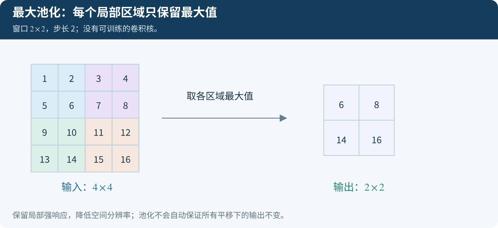

*原创重绘；可编辑 [SVG](../../imgs/foundations-cnn-pooling.svg)。*

**每个通道独立做池化，通道数不变**。输入 $32 \times 32 \times 12$ → 输出 $16 \times 16 \times 12$（空间减半，通道不变）。

### 3.5 扁平化 (Flattening)

将多维特征图转换为一维向量，以便输入全连接层：

$$
\mathbb{R}^{W \times H \times C} \rightarrow \mathbb{R}^{W \cdot H \cdot C}
$$

**可学习参数**：无。扁平化只是数据重排，不涉及任何权重。

**示例**：16×16×12 → 3072 维向量

### 3.6 全连接层 (Fully Connected Layer)

#### 3.6.1 输入与输出

扁平化输出的向量就是全连接层的输入。向量中的**每个元素对应全连接层的一个输入神经元**。

以本例为例，扁平化将 16×16×12 的特征图展平为 3072 维向量，这个向量有 3072 个元素，全连接层就有 3072 个输入神经元：

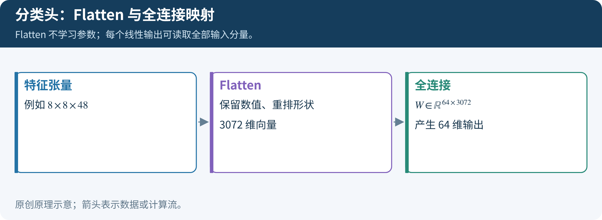

*原创重绘；可编辑 [SVG](../../imgs/foundations-cnn-head.svg)。*

每个输入神经元和每个输出神经元之间都有一个权重，所以总共有 $3072 \times 64 = 196,608$ 条连线（权重）。

#### 3.6.2 计算方式

每个输出神经元是所有输入的加权求和：

$$
y_j = \sum_{i=1}^{n_{\text{in}}} W_{ij} \cdot x_i + b_j, \quad \text{后接激活函数}
$$

其中：
- $x_i$：第 $i$ 个输入（即扁平化向量的第 $i$ 个元素）
- $W_{ij}$：输入 $i$ 到输出 $j$ 的权重
- $b_j$：输出 $j$ 的偏置
- $n_{\text{in}} = 3072$：输入神经元数
- $n_{\text{out}} = 64$：输出神经元数

写成矩阵形式：$y = Wx + b$

#### 3.6.3 为什么叫"全连接"

"全连接"的意思是**每个输出都和所有输入相连**。相比卷积层的局部连接（每个输出只看输入的一小块区域），全连接层让每个输出都能看到整张图的全部特征，用于综合判断。

#### 3.6.4 可学习参数

权重矩阵 $W$（形状 $(n_{\text{in}}, n_{\text{out}})$）+ 偏置向量 $b$（形状 $(n_{\text{out}})$）。以本例为例：$3072 \times 64 = 196,608$ 个权重 + 64 个偏置 = 196,672 个参数。全连接层的参数量远大于卷积层，是 CNN 中参数最密集的部分。

### 3.7 输出层 (Output Layer)

输出层本质上就是**一个全连接层 + 一个特殊的激活函数**，结构上和 §3.6 的全连接层完全一样：

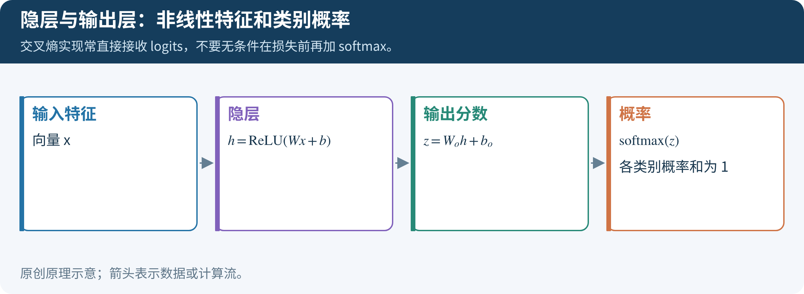

*原创重绘；可编辑 [SVG](../../imgs/foundations-cnn-logits.svg)。*

区别只有两点：
1. **激活函数不同**：中间的全连接层用 [ReLU](activation-functions.md) 等函数提取特征，输出层用 Softmax/Sigmoid 把结果变成概率
2. **输出维度等于类别数**：中间层的神经元数是自由设计的（如 64、128），输出层的神经元数必须等于分类任务的类别数（如 10 类 → 10 个输出）

**可学习参数**：权重矩阵 $W$（形状 $(64, 10)$）+ 偏置向量 $b$（形状 $(10)$）= 640 + 10 = 650 个参数。Softmax/Sigmoid 函数本身没有可学习参数。

**二分类 (Sigmoid)**：

$$
P(y=1) = \frac{1}{1 + e^{-z}}
$$

**多分类 (Softmax)**：

$$
P(y=k) = \frac{e^{z_k}}{\sum_{j=1}^{K} e^{z_j}}
$$

---

## 4 CNN 各层参数总结

| 层 | 可学习参数 | 参数形状 | 参数量（本例） | 说明 |
|---|-----------|---------|-------------|------|
| **输入层** | 无 | — | 0 | 只接收数据 |
| **卷积层** | 权重 $W$ + 偏置 $b$ | $W$: $(K, K, D_{\text{in}}, D_{\text{out}})$, $b$: $(D_{\text{out}})$ | $108 + 12 = 120$ | 权重共享使参数量远小于全连接层 |
| **激活层** | 无 | — | 0 | 固定公式（PReLU 除外） |
| **池化层** | 无 | — | 0 | 固定下采样操作 |
| **扁平化** | 无 | — | 0 | 数据重排 |
| **全连接层** | 权重 $W$ + 偏置 $b$ | $W$: $(n_{\text{in}}, n_{\text{out}})$, $b$: $(n_{\text{out}})$ | $196,608 + 64 = 196,672$ | 每个输入连接每个输出，参数量最大 |
| **输出层** | 权重 $W$ + 偏置 $b$ | $W$: $(n_{\text{in}}, n_{\text{out}})$, $b$: $(n_{\text{out}})$ | $640 + 10 = 650$ | 结构与全连接层相同 |
| **合计** | | | **197,442** | 全连接层+输出层占了总参数的 99.8% |

**核心结论**：CNN 中**只有卷积层、全连接层和输出层有可学习参数**，其余层（输入、激活、池化、扁平化）都是固定的数学操作。在典型 CNN 中，全连接层的参数量远超卷积层——这正是现代网络倾向于减少全连接层（用全局平均池化替代）的原因。

---

## 5 特殊卷积变体

### 5.1 1×1 卷积

1×1 卷积核看似不涉及空间邻域，但它在 CNN 中扮演关键角色——**跨通道信息混合与维度控制**：

$$
y_{i,j,k} = \sum_{c=0}^{D_{\text{in}}-1} x_{i,j,c} \cdot w_{c,k} + b_k
$$

注意 $i, j$ 不变——1×1 卷积不改变空间尺寸，只在通道维度上做线性组合。

**作用**：

| 功能 | 说明 | 示例 |
|------|------|------|
| **通道降维** | 减少特征图通道数，降低计算量 | 256→64 通道，后续计算量降为 1/4 |
| **通道升维** | 增加通道数，丰富特征表示 | 64→256 通道 |
| **跨通道交互** | 每个输出像素融合所有输入通道的信息 | 等价于逐像素的全连接层 |
| **增加非线性** | 1×1 卷积后接 ReLU，在不改变空间尺寸的前提下增加非线性表达能力 | ResNet 中的瓶颈块 |

**参数效率**：1×1 卷积的参数量仅 $D_{\text{in}} \times D_{\text{out}} + D_{\text{out}}$，比 3×3 卷积少 9 倍的空间维度参数。ResNet 的瓶颈块（Bottleneck Block）正是利用 1×1 卷积先降维再做 3×3 卷积再升维，将参数量从 $256 \times 3 \times 3 \times 256 = 589,824$ 降至 $256 \times 1 \times 1 \times 64 + 64 \times 3 \times 3 \times 64 + 64 \times 1 \times 1 \times 256 = 16,384 + 3,6864 + 16,384 = 66,912$。

### 5.2 空洞卷积 (Dilated/Atrous Convolution)

空洞卷积在卷积核元素之间插入"空洞"（跳过某些位置），**在不增加参数量的前提下扩大感受野**：

$$
y_{i,j,k} = \sum_{a=0}^{K-1} \sum_{b=0}^{K-1} \sum_{c=0}^{D-1} x_{i+r \cdot a, j+r \cdot b, c} \cdot w_{a,b,c,k} + b_k
$$

其中 $r$ 为空洞率（dilation rate）。$r=1$ 时就是普通卷积；$r=2$ 时 3×3 核的实际覆盖范围变为 5×5。

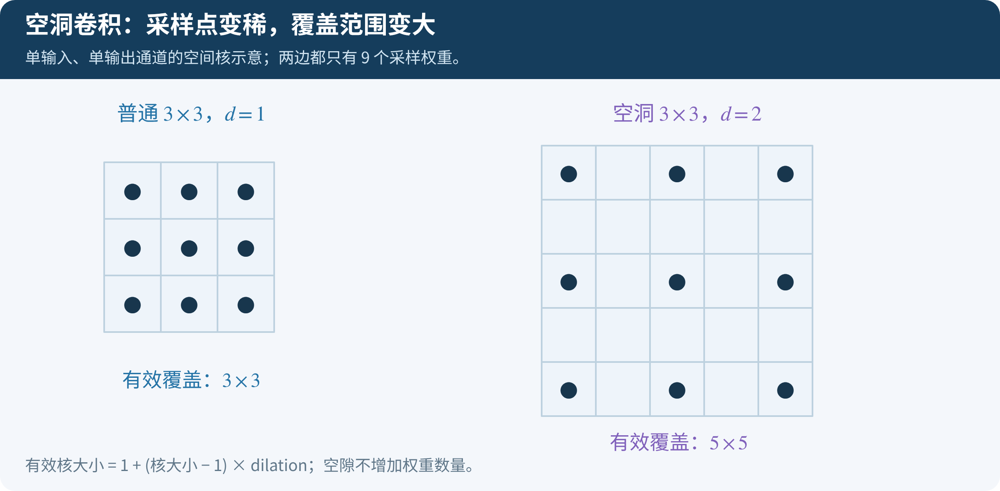

*原创重绘；可编辑 [SVG](../../imgs/foundations-cnn-dilation.svg)。*

空洞卷积的意义在于**解耦感受野大小与参数量**：想要更大感受野，不必用更大的卷积核（参数暴增），只需增大空洞率（参数不变）。这在语义分割等需要同时保持空间分辨率和大感受野的任务中至关重要——DeepLab 系列就是以空洞卷积为核心。

**感受野计算**：堆叠多层空洞卷积的感受野为：

$$
RF_n = RF_{n-1} + (K_n - 1) \times r_n \times \prod_{i=1}^{n-1} s_i
$$

### 5.3 深度可分离卷积 (Depthwise Separable Convolution)

深度可分离卷积将标准卷积拆分为两步，**大幅减少参数量和计算量**：

**第一步：深度卷积 (Depthwise Conv)**——每个输入通道独立使用一个卷积核：

$$
y_{i,j,c} = \sum_{a} \sum_{b} x_{i+a,j+b,c} \cdot w_{a,b,c} + b_c
$$

参数量：$K^2 \times D_{\text{in}}$（每个通道一个核）

**第二步：逐点卷积 (Pointwise Conv)**——1×1 卷积混合通道信息：

$$
y_{i,j,k} = \sum_{c=0}^{D_{\text{in}}-1} y_{i,j,c}^{\text{dw}} \cdot w_{c,k} + b_k
$$

参数量：$D_{\text{in}} \times D_{\text{out}}$

**总参数量对比**：

| 类型 | 参数量 | 计算量 |
|------|--------|--------|
| **标准卷积** | $K^2 \times D_{\text{in}} \times D_{\text{out}}$ | $K^2 \times D_{\text{in}} \times D_{\text{out}} \times W \times H$ |
| **深度可分离卷积** | $K^2 \times D_{\text{in}} + D_{\text{in}} \times D_{\text{out}}$ | $(K^2 + D_{\text{out}}) \times D_{\text{in}} \times W \times H$ |
| **压缩比** | $\frac{1}{D_{\text{out}}} + \frac{1}{K^2}$ | $\frac{1}{D_{\text{out}}} + \frac{1}{K^2}$ |

以 3×3 卷积、64→128 通道为例：标准卷积 73,856 参数，深度可分离卷积仅 $9 \times 64 + 64 \times 128 = 576 + 8,192 = 8,768$ 参数，压缩比约 $\frac{1}{128} + \frac{1}{9} \approx 0.118$，即不到 1/8 的参数。MobileNet 系列正是基于此设计，在移动端实现了高效推理。

### 5.4 分组卷积 (Group Convolution)

分组卷积将输入通道分成 $G$ 组，每组独立做卷积后拼接：

$$
y_{i,j,k} = \sum_{a} \sum_{b} \sum_{c \in \text{group}_k} x_{i+a,j+b,c} \cdot w_{a,b,c,k} + b_k
$$

参数量从 $K^2 \times D_{\text{in}} \times D_{\text{out}}$ 降至 $K^2 \times \frac{D_{\text{in}}}{G} \times \frac{D_{\text{out}}}{G} \times G = K^2 \times \frac{D_{\text{in}} \times D_{\text{out}}}{G}$。

- $G = 1$：就是标准卷积
- $G = D_{\text{in}} = D_{\text{out}}$：就是深度卷积
- $G$ 介于两者之间：兼顾通道交互与参数效率

AlexNet 首次使用分组卷积（$G=2$），原因是当时 GPU 内存不够，将网络拆成两半分别放在两个 GPU 上训练。ResNeXt 进一步验证了分组卷积的价值——在参数量不变的情况下增加分组数 $G$ 可以提升准确率，因为更多的分组意味着更多的"子网络"并行学习不同的特征表示。

---

## 6 感受野与层次化特征

### 6.1 感受野 (Receptive Field)

感受野是指**输出特征图中一个像素对应的输入图像上的区域大小**。它决定了该像素"能看到"多少原始输入信息。

**单层感受野**：对于卷积核大小 $K$、步长 $S$、空洞率 $r$ 的卷积层，感受野为 $r \times (K - 1) + 1$。

**多层堆叠的感受野**递推公式：

$$
RF_n = RF_{n-1} + (r_n \cdot (K_n - 1)) \times \prod_{i=1}^{n-1} s_i
$$

其中 $\prod_{i=1}^{n-1} s_i$ 是前面所有层的步长累积（即每个输出像素在输入上跳过了多少位置）。

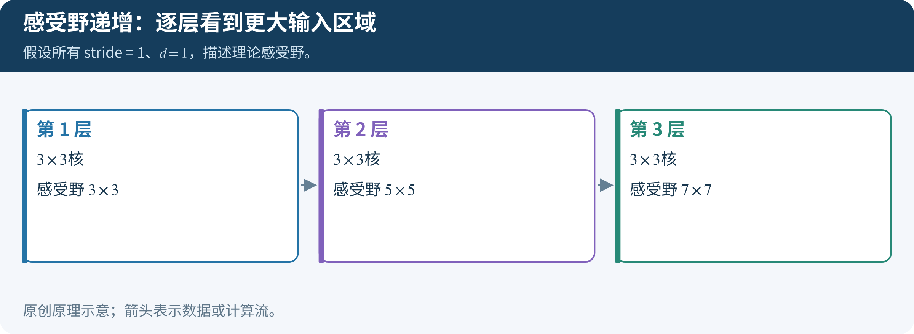

*原创重绘；可编辑 [SVG](../../imgs/foundations-cnn-receptive.svg)。*

**有效感受野**：理论上感受野随层数线性增长，但实际中感受野中心的像素对输出的影响远大于边缘像素——呈高斯分布。研究表明有效感受野（真正对输出有显著贡献的区域）通常只有理论感受野的 $\frac{1}{4}$ 到 $\frac{1}{2}$。

### 6.2 层次化特征演化

CNN 的核心优势在于**从浅层到深层，自动学习从简单到复杂的层次化特征**：

| 层级 | 学习的特征 | 类比 |
|------|-----------|------|
| **浅层 (1-2)** | 边缘、纹理、颜色梯度 | 类似 Gabor 滤波器 |
| **中层 (3-5)** | 简单形状、部件模式（眼睛、车轮） | 类似局部特征描述子 |
| **深层 (6+)** | 复杂物体、语义概念（人脸、汽车） | 类似高级语义识别 |


*原创重绘；可编辑 [SVG](../../imgs/foundations-cnn-features.svg)。*

这个层次化过程有两个关键机制：
1. **逐层堆叠卷积**逐步扩大感受野，每层看到更大范围的模式
2. **非线性激活**允许每层做非线性组合，不仅仅是线性叠加浅层特征

Zeiler & Fergus (2013) 通过反卷积可视化首次实证验证了这一特征演化过程——浅层确实学到了类似 Gabor 滤波器的边缘检测器，深层确实组合出了语义级别的特征。

---

## 7 训练过程

### 7.1 前向传播

CNN 前向传播从输入图像逐层计算到输出概率：

$$
\text{Image} \xrightarrow{\text{Conv+ReLU}} \xrightarrow{\text{Pool}} \xrightarrow{\text{Conv+ReLU}} \xrightarrow{\text{Pool}} \xrightarrow{\text{FC+ReLU}} \xrightarrow{\text{FC}} \xrightarrow{\text{Softmax}} \text{Probabilities}
$$

每一步：
- 卷积层：$y = \text{ReLU}(W * x + b)$
- 池化层：空间下采样
- 全连接层：$y = \text{ReLU}(Wx + b)$
- 输出层：$p = \text{Softmax}(z)$

### 7.2 损失函数

损失函数衡量预测与真实标签的差距，是训练的优化目标。

**交叉熵损失 (Cross-Entropy Loss)**——分类任务最常用：

$$
L_{\text{CE}} = -\sum_{k=1}^{K} y_k \log(p_k)
$$

其中 $y_k$ 是真实标签（one-hot），$p_k$ 是 Softmax 输出概率。对于单标签分类简化为 $L = -\log(p_{\text{true}})$——正确类别的概率越低，损失越大。

**均方误差损失 (MSE Loss)**——回归任务常用：

$$
L_{\text{MSE}} = \frac{1}{N} \sum_{i=1}^{N} (y_i - \hat{y}_i)^2
$$

**Focal Loss**——解决类别不平衡（如目标检测中正负样本悬殊）：

$$
L_{\text{Focal}} = -(1 - p_t)^{\gamma} \log(p_t)
$$

$\gamma > 0$ 时，对容易分类的样本（$p_t$ 大）降低损失权重，使网络聚焦于难分类样本。

### 7.3 反向传播

反向传播通过链式法则计算损失对每个参数的梯度，指导参数更新方向。

**卷积层的梯度**：损失对卷积核权重 $W$ 的梯度：

$$
\frac{\partial L}{\partial W_{a,b,c,k}} = \sum_{i,j} \frac{\partial L}{\partial y_{i,j,k}} \cdot x_{i+a,j+b,c}
$$

即**将输出特征图的梯度作为卷积核，与输入特征图做卷积**——本质上还是卷积操作。

损失对输入 $x$ 的梯度（传递给前一层）：

$$
\frac{\partial L}{\partial x_{i,j,c}} = \sum_{k} \sum_{a,b} \frac{\partial L}{\partial y_{i-a,j-b,k}} \cdot W_{a,b,c,k}
$$

即**将输出梯度与卷积核做完整卷积（翻转+滑动）**——这就是标准数学卷积（有翻转）。

**池化层的梯度**：最大池化中梯度只传递给产生最大值的位置，其余位置梯度为 0——这是最大池化的"路由"特性。平均池化中梯度均分给邻域内所有位置。

**全连接层的梯度**：与普通神经网络相同，$\frac{\partial L}{\partial W} = \frac{\partial L}{\partial y} \cdot x^T$。

### 7.4 优化算法

优化算法决定如何根据梯度更新参数。

**SGD（随机梯度下降）**：

$$
W_{t+1} = W_t - \eta \cdot \nabla L(W_t)
$$

简单但收敛慢，容易卡在鞍点。学习率 $\eta$ 的选择至关重要——太大则震荡不收敛，太小则收敛极慢。

**SGD + Momentum**：

$$
v_{t+1} = \mu v_t + \nabla L(W_t), \quad W_{t+1} = W_t - \eta \cdot v_{t+1}
$$

动量 $\mu$（通常 0.9）积累历史梯度方向，帮助越过局部极小值和鞍点，加速在一致方向上的收敛。

**Adam**：

$$
m_t = \beta_1 m_{t-1} + (1-\beta_1) g_t, \quad v_t = \beta_2 v_{t-1} + (1-\beta_2) g_t^2
$$

$$
W_{t+1} = W_t - \eta \cdot \frac{m_t / (1-\beta_1^t)}{v_t / (1-\beta_2^t) + \epsilon}
$$

Adam 对每个参数自适应调整学习率（基于梯度的一阶矩和二阶矩），是最常用的优化器。默认 $\beta_1=0.9, \beta_2=0.999, \epsilon=10^{-8}$。

| 优化器 | 优点 | 缺点 | 适用场景 |
|--------|------|------|----------|
| **SGD** | 简单，泛化好 | 收敛慢，需手动调 lr | 大数据集 + 精细调 lr |
| **SGD+Momentum** | 收敛更快 | 仍需调 lr | 大多数场景 |
| **Adam** | 自适应 lr，收敛快 | 泛化可能不如 SGD | 小数据集、快速实验 |
| **AdamW** | Adam + 解耦权重衰减 | 略复杂 | Transformer、大模型 |

**学习率调度**：固定学习率往往不是最优策略，常用调度策略：

| 策略 | 说明 | 何时使用 |
|------|------|----------|
| **Step Decay** | 每 $N$ 个 epoch 降低 lr（如 ×0.1） | 经典 CNN 训练 |
| **Cosine Annealing** | lr 沿余弦曲线从 $\eta_0$ 降至 $\eta_{\min}$ | 现代训练标准做法 |
| **Warmup + Decay** | 前 $N$ 步线性增大 lr，之后衰减 | 大模型、大 batch |
| **One-Cycle** | lr 先升后降的单周期策略 | 快速训练 |

### 7.5 训练流程

完整的 CNN 训练流程：

1. **数据准备**：加载数据集，划分为训练集/验证集/测试集（典型比例 80/10/10）
2. **数据预处理**：归一化像素值到 [0,1] 或标准化到均值 0 方差 1；应用数据增强（§8.3）
3. **模型构建**：定义网络结构、选择损失函数和优化器
4. **训练循环**：
   - 前向传播计算损失
   - 反向传播计算梯度
   - 优化器更新参数
   - 定期在验证集上评估
5. **早停 (Early Stopping)**：当验证集损失连续 $N$ 个 epoch 不下降时停止训练，防止过拟合
6. **模型选择**：保存验证集上表现最好的模型（而非训练损失最低的模型）

**关键超参数**：

| 超参数 | 说明 | 常见值 | 影响 |
|--------|------|--------|------|
| **Batch Size** | 一次前向/反向的样本数 | 32, 64, 128 | 太小→梯度噪声大；太大→泛化差、显存不够 |
| **学习率** | 参数更新步长 | 0.001 (Adam), 0.1 (SGD) | 最关键的超参数 |
| **Epoch** | 训练遍历整个数据集的次数 | 10-200 | 过少→欠拟合；过多→过拟合 |
| **权重衰减** | L2 正则化系数 | 1e-4 ~ 5e-4 | 防止参数过大 |

---

## 8 正则化与训练技巧

### 8.1 Dropout

Dropout 在训练时**随机将一部分神经元的输出置为零**，迫使网络不依赖任何单个神经元：

$$
\tilde{y}_i = \frac{y_i}{1-p} \cdot \mathbb{1}[z_i > p]
$$

其中 $p$ 为丢弃概率，$z_i \sim \text{Uniform}(0,1)$，$\mathbb{1}$ 为指示函数。训练时随机丢弃，推理时不丢弃但需要将输出乘以 $(1-p)$（或训练时做 inverted dropout 即乘 $\frac{1}{1-p}$，推理时不需调整）。

**直觉理解**：Dropout 等价于训练了大量子网络（每个丢弃组合是一个不同的子网络），推理时近似于这些子网络的集成预测——集成通常比单个模型更稳健。

**在 CNN 中的使用**：Dropout 主要用于全连接层（丢弃率 $p=0.5$ 最常见），较少用于卷积层——因为卷积层本身有权重共享带来的隐式正则化，且特征图的空间相关性使得随机丢弃不如在全连接层中有效。但 Spatial Dropout（整个通道一起丢弃而非单个像素）在卷积层中有效。

### 8.2 批归一化 (Batch Normalization)

批归一化对每个 mini-batch 的特征做标准化，**稳定训练过程、加速收敛、提供轻微正则化**：

$$
\hat{y}_{i,j,k} = \frac{y_{i,j,k} - \mu_k}{\sqrt{\sigma_k^2 + \epsilon}}, \quad z_{i,j,k} = \gamma_k \hat{y}_{i,j,k} + \beta_k
$$

其中 $\mu_k, \sigma_k^2$ 是当前 batch 在通道 $k$ 上所有空间位置的均值和方差，$\gamma_k, \beta_k$ 是可学习的缩放和偏移参数，$\epsilon$ 是防止除零的小常数。

**在 CNN 中的 BN**：与全连接层不同，CNN 的 BN 在每个通道上计算均值/方差——统计的是整个 batch 中该通道所有空间位置的值（即 $B \times W \times H$ 个值），而非仅 $B$ 个值。

**BN 的作用**：

| 作用 | 说明 |
|------|------|
| **稳定训练** | 防止内部协变量偏移（每层输入分布随前面层参数更新而变化） |
| **加速收敛** | 使每层输入分布更稳定，可以使用更大学习率 |
| **轻微正则化** | batch 统计量有噪声（随 batch 变化），提供类似 Dropout 的正则效果 |
| **缓解梯度问题** | 使激活值分布在合理范围，缓解梯度消失/爆炸 |

**BN 的位置**：通常放在卷积之后、激活之前：`Conv → BN → ReLU`。也有实验放在激活之后 (`Conv → ReLU → BN`)，但前者更常见且效果通常更好。

**推理时的 BN**：推理时使用训练期间累积的全局均值/方差（running mean/variance），而非当前 batch 的统计量——确保推理结果不依赖 batch 大小。

### 8.3 数据增强 (Data Augmentation)

数据增强通过对训练图像做变换来**扩充训练数据多样性**，是最直接有效的正则化手段：

| 方法 | 说明 | 适用场景 |
|------|------|----------|
| **随机翻转** | 水平/垂直翻转 | 通用（水平翻转最常用） |
| **随机裁剪** | 从原图中随机裁取子区域 | 通用，需注意裁剪比例 |
| **颜色抖动** | 随机调整亮度、对比度、饱和度 | 通用，增加颜色鲁棒性 |
| **随机旋转** | 旋转 ±15° ~ ±45° | 需注意填充方式 |
| **随机缩放** | 随机放大/缩小 | 通用 |
| **Mixup** | 两张图像线性插值混合：$\tilde{x} = \lambda x_i + (1-\lambda) x_j$ | 分类任务 |
| **CutMix** | 将一张图像的矩形区域替换为另一张图像的区域 | 分类+定位 |
| **Mosaic** | 四张图像拼接为一张训练图 | YOLO 系列目标检测 |
| **随机擦除** | 随机遮挡图像的矩形区域 | 提升遮挡鲁棒性 |

数据增强的核心思想：**变换后的图像语义不变（猫翻转后还是猫），但像素分布变化了**——这迫使网络学到本质特征而非记住特定像素排列。

### 8.4 权重衰减 (Weight Decay / L2 Regularization)

权重衰减在损失函数中添加参数平方惩罚项：

$$
L_{\text{total}} = L_{\text{task}} + \lambda \sum_{i} w_i^2
$$

$\lambda$ 为权重衰减系数（通常 $1\times10^{-4}$）。这惩罚大权重值，迫使网络使用更小、更分散的权重——倾向于依赖更多特征的组合而非少数几个强特征，从而提升泛化性。

**权重衰减 vs L2 正则化的细微区别**：在 SGD 中两者等价，但在 Adam 中不等价——Adam 的自适应学习率使 L2 正则化对不同参数的惩罚力度不一致。AdamW 将权重衰减从梯度中解耦出来，直接在参数更新时衰减（$W_{t+1} = (1-\lambda) W_t - \eta \cdot \nabla L$），效果更好。

### 8.5 早停 (Early Stopping)

早停在验证集损失不再下降时终止训练：

```
Epoch  训练损失  验证损失  操作
  1     2.5      2.6      继续
  5     0.8      0.9      继续
  10    0.3      0.4      继续 ← 最佳验证损失
  15    0.15     0.45     验证损失开始上升 ← 过拟合信号
  20    0.08     0.5      早停! (patience=5已耗尽)
```

早停的 patience 参数指定容忍验证损失不下降的 epoch 数。典型值 $p=5\sim10$。

### 8.6 其他正则化技巧

| 技术 | 说明 |
|------|------|
| **Label Smoothing** | 将硬标签 $y_k=1$ 软化为 $y_k = 1 - \epsilon + \epsilon/K$，防止过度自信 |
| **梯度裁剪** | 将梯度范数限制在阈值内，防止梯度爆炸 |
| **Stochastic Depth** | 训练时随机跳过某些残差块，推理时全部保留 |
| **权重初始化** | He 初始化（ReLU）：$w \sim \mathcal{N}(0, \sqrt{2/n})$；Xavier 初始化（Tanh/Sigmoid）：$w \sim \mathcal{N}(0, \sqrt{1/n})$ |

---

## 9 应用领域

CNN 在多个领域取得了突破性成果：

### 9.1 计算机视觉

| 任务 | 说明 | 代表方法 |
|------|------|----------|
| **图像分类** | 将图像归入预定义类别 | ResNet, EfficientNet |
| **目标检测** | 定位并识别图像中的多个物体 | YOLO, Faster R-CNN |
| **语义分割** | 对每个像素做分类 | DeepLab, U-Net |
| **实例分割** | 同时检测和分割每个物体实例 | Mask R-CNN |
| **图像生成** | 生成新图像 | 扩散模型 的 U-Net 部分 |
| **人脸识别** | 识别人脸身份 | FaceNet, ArcFace |
| **光学字符识别 (OCR)** | 从图像中识别文字 | CRNN + CTC |

### 9.2 其他领域

| 领域 | 应用 | 说明 |
|------|------|------|
| **医学影像** | 病变检测、组织分割 | X光/CT/MRI 中的异常识别 |
| **自动驾驶** | 车道线检测、障碍物识别 | 实时感知环境 |
| **遥感影像** | 地物分类、变化检测 | 卫星图像分析 |
| **自然语言处理** | 文本分类 | 1D-CNN 处理文本序列 |
| **音频处理** | 语音识别、音乐分类 | 将音频转为时频图后用 2D-CNN |
| **推荐系统** | 特征提取 | 提取图像/视频内容特征 |

---

## 10 迁移学习

迁移学习利用在大型数据集（如 ImageNet）上预训练的模型，**在新任务上只需少量数据即可获得良好效果**：

### 10.1 策略

| 策略 | 做法 | 适用场景 |
|------|------|----------|
| **特征提取** | 固定卷积层权重，只训练新的全连接层 | 新任务数据少，与预训练任务相似 |
| **微调 (Fine-tuning)** | 用预训练权重初始化，全部层一起训练（浅层用小 lr） | 新任务数据较多 |
| **渐进式解冻** | 先只训练顶层，逐步解冻浅层 | 精细微调，防止浅层特征被破坏 |

### 10.2 为什么迁移学习有效

ImageNet 预训练模型的浅层学到的是通用的边缘/纹理特征——这些特征在几乎所有视觉任务中都是有用的。只有深层特征是任务特定的（如"这是猫还是狗"的判别特征）。因此：

- 浅层特征是**可迁移的**（几乎任何视觉任务都需要边缘检测）
- 深层特征是**任务特定的**（需要根据新任务重新学习）

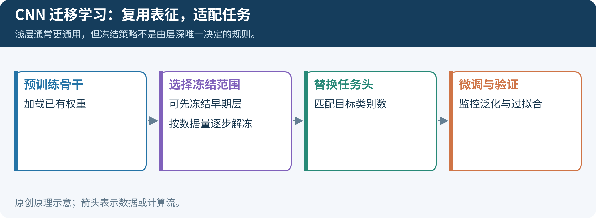

*原创重绘；可编辑 [SVG](../../imgs/foundations-cnn-transfer.svg)。*

### 10.3 [PEFT](peft.md) 与迁移学习

参数高效微调（PEFT）方法将迁移学习的思想进一步推进——只训练极少量的新增参数，保持预训练模型主体不变：

- **LoRA**：在卷积/全连接层旁添加低秩矩阵，只训练低秩参数
- **Adapter**：在网络层间插入小型适配器模块
- **Bias-tuning**：只训练偏置参数

这在[大模型微调](peft.md)中已成为主流做法。

---

## 11 卷积操作可视化

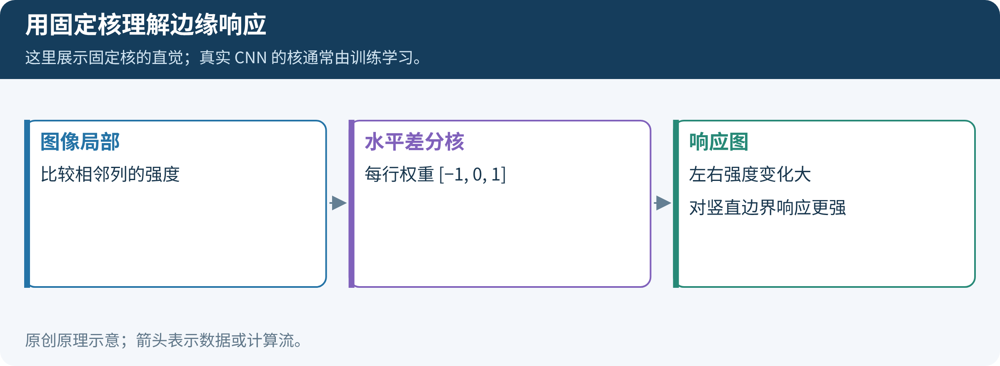

*原创重绘；可编辑 [SVG](../../imgs/foundations-cnn-edge.svg)。*

---

## 12 CNN 的优势

| 优势 | 说明 |
|------|------|
| **自动特征学习** | 无需人工设计特征，端到端学习从边缘到语义的层次化表示 |
| **空间模式检测** | 有效检测边缘、纹理、形状及更复杂的空间模式 |
| **平移不变性** | 卷积+池化使网络对物体位置变化鲁棒 |
| **参数共享** | 同一卷积核在所有位置使用相同权重，大幅减少参数量 |
| **层次化表示** | 从低级到高级特征渐进学习，深层组合浅层特征 |
| **局部性** | 卷积核只关注局部邻域，天然适合图像的局部相关性 |
| **高效推理** | 相比全连接网络，参数少、计算量低，适合部署 |

---

## 13 CNN 的局限性

| 局限性            | 说明                                           |
| -------------- | -------------------------------------------- |
| **计算成本**       | 训练需要大量计算资源和内存（尤其深层网络）                        |
| **过拟合风险**      | 数据不足时容易过拟合，需要正则化技巧                           |
| **数据需求**       | 需要大量标注数据，迁移学习可缓解但无法完全消除                      |
| **可解释性**       | 学到的特征难以直观理解（虽可通过可视化辅助）                       |
| **对抗敏感性**      | 对对抗样本极其敏感，微小扰动即可导致错误分类                       |
| **旋转/尺度不变性有限** | 平移不变性来自卷积+池化，但对旋转和尺度变化需要数据增强补偿               |
| **全局建模能力弱**    | 卷积的局部性使 CNN 在捕获长距离依赖时受限（需堆叠多层扩大感受野，或借助注意力机制） |
| **固定拓扑假设**     | CNN 假设数据具有网格拓扑结构，对非结构化数据（图、点云）不如 GNN 等专用架构   |

---

## 14 与其他网络对比

| 特性       | CNN          | [RNN](rnn.md) | Transformer |
| -------- | ------------ | ------------------- | ------------------------------- |
| **设计初衷** | 图像/视频        | 序列数据                | 序列/多模态                          |
| **核心操作** | 卷积           | 循环                  | 注意力                             |
| **感受野**  | 局部→全局（需堆叠）   | 全局（理论，但受梯度消失限制）     | 全局（一步到位）                        |
| **并行化**  | 高效（空间维度可并行）  | 受限（时序依赖）            | 高效（序列位置可并行）                     |
| **参数效率** | 高（权重共享）      | 中                   | 低（全连接注意力）                       |
| **位置信息** | 隐式（卷积保留空间位置） | 隐式（时序顺序）            | 需显式位置编码                         |
| **典型应用** | 图像分类、目标检测    | NLP、时间序列            | 机器翻译、LLM、ViT                    |
| **趋势**   | 视觉领域仍主流      | 被Transformer取代      | 多模态统一架构                         |

CNN 与 Transformer 在视觉领域的融合趋势值得关注：ConvNeXt (2022) 纪念性地证明了纯 CNN 架构通过借鉴 Transformer 的设计选择（大卷积核 7×7、GELU 激活、LayerNorm 替代 BN、减少激活和归一化层频率），可以达到与 Swin Transformer 相当甚至更好的性能——这表明 CNN 的设计空间远未被充分探索。

---

## 15 经典架构

| 架构 | 年份 | 创新点 | Top-5 错误率 |
|------|------|--------|-------------|
| **LeNet-5** | 1998 | 首个成功 CNN，手写数字识别，定义了卷积-池化交替范式 | - |
| **AlexNet** | 2012 | ReLU 替代 Sigmoid、Dropout、GPU 并行训练、数据增强，引爆深度学习热潮 | 15.3% |
| **VGG** | 2014 | 证明"更深更好"（16-19 层），只用 3×3 小卷积核堆叠 | 7.3% |
| **ResNet** | 2015 | 残差连接解决深层网络退化问题，152 层训练成功 | 3.6% |
| **Inception (GoogLeNet)** | 2015 | 多尺度并行卷积（1×1 + 3×3 + 5×5），参数效率极高 | 6.7% |
| **DenseNet** | 2017 | 密集连接（每层接收所有前层输出），特征复用 | 3.5% |
| **MobileNet** | 2017 | 深度可分离卷积，移动端高效推理 | - |
| **EfficientNet** | 2019 | 复合缩放（深度/宽度/分辨率均衡增加）、AutoML 搜索 | 2.6% |
| **ConvNeXt** | 2022 | 纯 CNN 借鉴 Transformer 设计（7×7 大核、LayerNorm、GELU），达到 Swin Transformer 性能 | - |

---

## 16 关联

- Transformer 架构 — CNN 与 Transformer 在视觉任务中的竞争与融合
- ResNet 深度残差网络 — CNN 架构演进的关键里程碑
- 扩散模型 — 扩散模型中的 U-Net 本质上是 CNN 架构
- [PEFT 参数高效微调](peft.md) — CNN 迁移学习的参数高效版本
- [ActivateFunction激活函数](activation-functions.md) — CNN 中各层使用的激活函数详解
- 前向与反向传播 — CNN 训练的核心算法详解

<!-- 反向链接 -->
