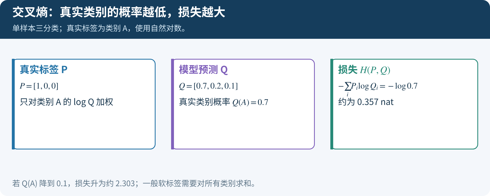

# 交叉熵损失函数

## 1. 概述

### 1.1. 背景

1. 分类问题中，模型需要预测每个类别的概率分布：真实标签是确定的（正确类概率为 1，其余为 0），而模型输出的是概率分布，需要一个损失函数来衡量预测分布与真实分布之间的差距。
2. 核心问题：如何量化模型预测概率与真实标签的差异，同时对置信但错误的预测给予强惩罚？

### 1.2. 解决思路

1. 交叉熵损失通过信息论概念衡量两个分布的差异——当真实分布固定时，最小化交叉熵等价于最小化 [KL散度](kl-divergence.md)，从而对自信但错误的预测给予强惩罚。

## 2. 交叉熵的定义

交叉熵是信息论概念，衡量用分布 q 编码来自分布 p 的数据所需的平均比特数：

$$H(p, q) = -\sum_x p(x) \log q(x)$$

交叉熵可以分解为真实分布的熵加上 [KL散度](kl-divergence.md)：

$$H(p, q) = H(p) + D_{KL}(p || q)$$

在分类任务中，真实分布 p 是固定的（标签确定），因此 $H(p)$ 是常数，最小化交叉熵等价于最小化 [KL散度](kl-divergence.md)。

## 3. 二元交叉熵

用于二分类问题，标签为 0 或 1，配合 sigmoid 输出层：

$$BCE = -\frac{1}{N}\sum_{i=1}^{N}(y_i \log(p_i) + (1-y_i)\log(1-p_i))$$

其中 $y_i$ 为真实标签（0或1），$p_i$ 为模型预测的类别 1 的概率。

**直觉**：当 $y_i=1$ 时，损失为 $-\log(p_i)$——预测越接近 1，损失越小（$-\log(0.99) \approx 0.01$）；预测越远离 1，损失越大（$-\log(0.01) \approx 4.6$）。对自信但错误的预测给予重罚。

## 4. 多类交叉熵

用于多分类问题，配合 softmax 输出层，也称为 categorical cross-entropy 或 softmax loss：

$$CE = -\frac{1}{N}\sum_{i=1}^{N}\sum_{j=1}^{C}y_{ij}\log(p_{ij})$$

由于 $y_{ij}$ 只有正确类为 1（其余为 0），实际简化为：

$$CE = -\frac{1}{N}\sum_{i=1}^{N}\log(p_{i, \text{correct}})$$

只有正确类的预测概率影响损失——模型应给正确类分配尽可能高的概率。

## 5. 关键特性

| 特性 | 说明 |
|------|------|
| 概率解释 | 引导模型输出接近真实标签的概率分布 |
| 可微性 | 处处可微，支持梯度下降优化 |
| 强惩罚 | 对自信但错误的预测给予指数级惩罚 |
| 标准性 | 神经网络分类任务的标准损失函数 |

## 6. 与 Hinge Loss 对比

| 特性 | Hinge Loss | 交叉熵损失 |
|------|-----------|-----------|
| 用途 | SVM | 神经网络分类 |
| 标签格式 | -1/+1 | 概率 0/1 |
| 公式 | $\max(0, 1 - y \cdot f(x))$ | $-y\log(p) - (1-y)\log(1-p)$ |
| 惩罚方式 | 基于边际 | 基于概率差异 |
| 可微性 | 边际处不可微 | 完全可微 |
| 损失值 | 超过边际时为 0 | 完美预测时才为 0 |

## 7. 与 VAE/CVAE 的关系

在 VAE与CVAE变分自编码器 的训练目标中，ELBO 的重建项本质上就是交叉熵。VAE 用交叉熵衡量解码器重建数据的质量，配合 [KL散度](kl-divergence.md) 正则项约束潜在空间。

## 8. 参考

- [KL散度](kl-divergence.md) - 交叉熵 = 熵 + KL散度
- VAE与CVAE变分自编码器 - ELBO 中的重建项即交叉熵
- GeeksforGeeks, "What Is CrossEntropy Loss Function?"

<!-- 反向链接 -->
## 9. 反向链接

- [KL散度](kl-divergence.md) - KL散度页面中包含交叉熵与KL散度的关系
- VAE与CVAE变分自编码器 - ELBO 重建项即交叉熵