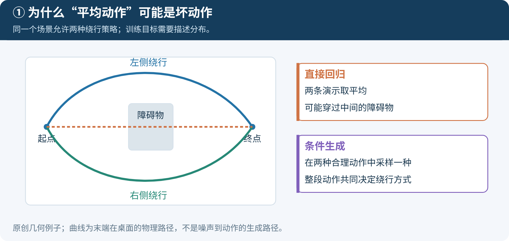
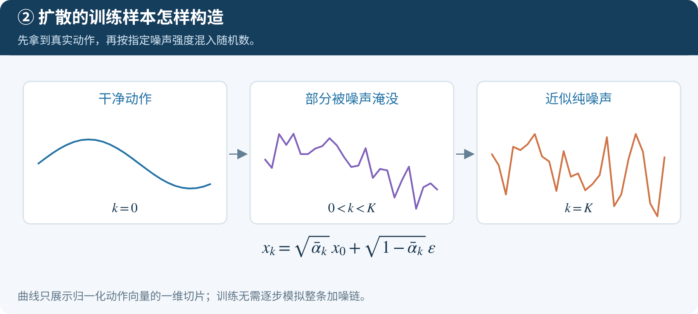
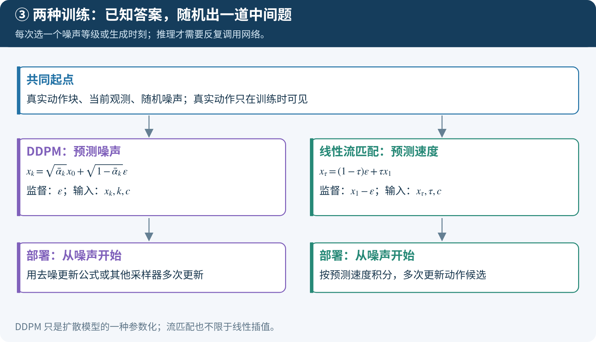
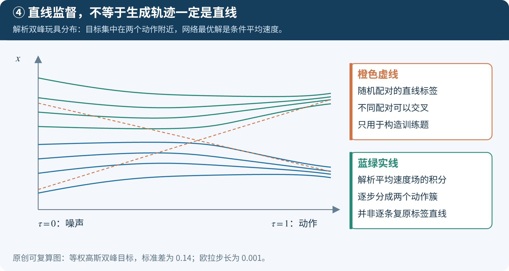
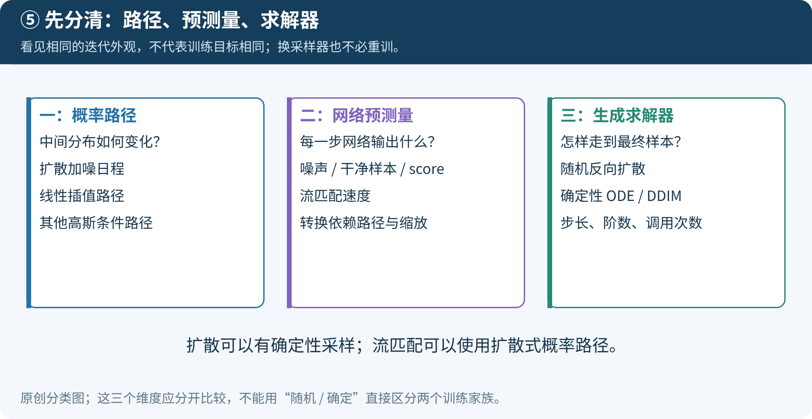
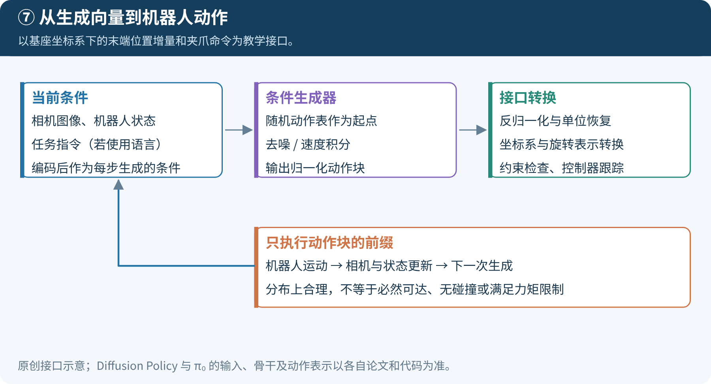
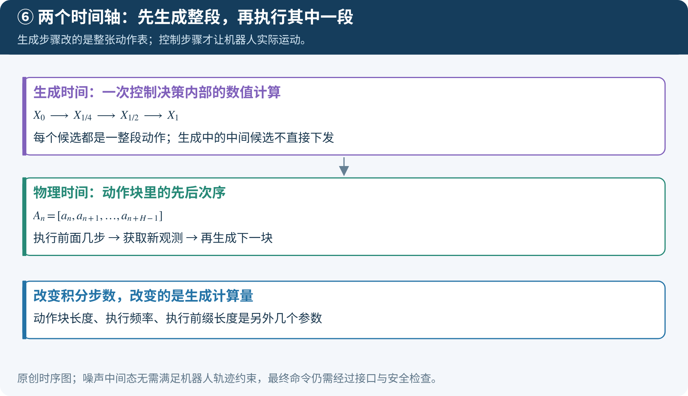

# 从扩散模型到流匹配：从噪声到机器人动作

机器人绕过杯子伸手拿物体，可以从左边绕，也可以从右边绕。如果直接把两种演示取平均，得到的动作可能恰好撞向杯子。我们需要的不是“唯一标准动作”，而是**在当前场景下，生成一段可能的、内部协调的动作**。

扩散模型和流匹配都能做这件事：先采样一张随机动作表，再用网络多次修改它，最后得到动作。这解释了为什么它们看起来像同一种东西。区别要从三层看：**中间分布怎样设计、网络预测什么、推理怎样更新样本**。扩散也可以确定性采样；流匹配也可以使用扩散的概率路径。“扩散逐步去噪，流匹配一步走直线”会把这些层次混在一起。

本文先用绕行和一维数字建立直觉，再推导 DDPM、score 与线性流匹配，最后把它们接到机器人动作块与闭环执行。例子和图中的数字是教学设置，不是机器人实验结果。主要原始来源为 [DDPM](https://arxiv.org/abs/2006.11239)、[Score SDE](https://arxiv.org/abs/2011.13456)、[Flow Matching](https://arxiv.org/abs/2210.02747)、[Rectified Flow](https://arxiv.org/abs/2209.03003)、[Diffusion Policy](https://diffusion-policy.cs.columbia.edu/) 与 [π₀](https://arxiv.org/html/2410.24164v4)。

## 1. 为什么先学“生成”，而不直接预测答案

### 两条好路线的平均，可能是一条坏路线

设相机、机械臂状态和任务描述组成条件 $c$，未来动作块为 $A$。我们希望学习条件分布

$$
p_{\mathrm{data}}(A\mid c).
$$

这里的“分布”可以理解为一本带权重的动作方案册：哪些动作常见、哪些少见、哪些在当前场景不合理。模型不是把这本册子逐页存起来，而是学习一个能采样动作的机制。

假设在一个高度简化的绕行任务中，动作的关键标量 $a$ 表示横向偏移；演示一半取 $a=-1$，一半取 $a=+1$，条件完全相同。若训练一个直接回归动作的网络，用均方误差

$$
\mathcal L_{\mathrm{reg}}=\mathbb E[(f_\theta(c)-a)^2],
$$

其最优输出是条件平均 $\mathbb E[a\mid c]=0$。而这个例子中，零偏移正对着障碍。问题不是网络不够大，而是**这个单点输出与损失把两种选择压成了一个平均值**。

真实轨迹的平均未必一定碰撞，回归策略也并非在所有任务上都失败；这个构造只是说明：当多个合理动作彼此分离时，一个平均值未必代表任何合理行为。生成策略则希望分别产生两侧的动作，而非固定输出中间值。



*原创教学示意：图中曲线是末端在桌面上的物理路线。它与后面的噪声生成路径属于不同空间。[SVG](../../imgs/df-two-routes.svg)。Diffusion Policy 对多模态动作及滚动执行的讨论见[论文 §III–IV](../../../raw/papers/diffusion-flow/diffusion-policy.pdf)。*

### 随机数怎样表达“这一次选哪条路线”

让模型额外接收随机变量 $\epsilon\sim\mathcal N(0,I)$，有机会把不同随机输入变成不同动作。固定场景条件后，多次采样可能得到左绕和右绕；固定条件、随机种子与确定性求解器后，也可以重复得到相同结果。

随机数不等于“给机器人命令随便加点抖动”。它在**生成过程内部**表示这次选择的可能性。控制器收到的是生成完成、经过接口转换的动作；不应该收到尚未生成完成的纯噪声。

扩散和流匹配都不是唯一解。混合密度网络、离散动作模型、CVAE 等也能表达多种选择。可对照阅读 [VAE 与 CVAE](vae-cvae.md)。这里选择扩散与流匹配，是为了理解它们如何用很多小修正完成条件生成。

## 2. 先分清两个时间，避免后面所有概念串线

设机器人当前物理控制时刻为 $n$，模型生成

$$
A_n=[a_n,a_{n+1},\ldots,a_{n+H-1}]\in\mathbb R^{H\times d_a}.
$$

$H$ 是预测的动作步数，$d_a$ 是每步动作维度。把整个动作表展平成向量后，记其维度为 $D=Hd_a$；扩散和流匹配在这个 $D$ 维空间里生成样本。

文章使用三个独立符号：

| 符号 | 意义 | 怎样变化 |
|---|---|---|
| $n$ | 机器人的物理控制时刻 | 执行动作、取得新观测后前进 |
| $k$ | DDPM 的离散噪声等级 | 加噪时增大；生成时减小 |
| $\tau$ | 流匹配的生成时间 | 本文约定从噪声端的零增至数据端的一 |

在 DDPM 部分，$x_0$ 表示干净样本；在线性流匹配部分，$x_1$ 表示干净样本。下标不同来自两套时间约定，并不是换了要生成的对象。正文每次转换都会明确说明。

**一次生成迭代，会同时修改整个动作块；它不是让机器人执行一个动作。** 一个含有许多物理动作的块，可以经过几次或几十次生成迭代得到。反过来，生成迭代很多次，也不表示模型规划了很长的物理时间。

## 3. 扩散模型：先把容易的“破坏”变成训练题

### 类比：把清晰路线逐渐盖上雪花

一条演示轨迹是训练时已知的答案。我们人为把它缩小，再混入高斯随机数，形成难度不同的题目：有的还能看出轨迹轮廓，有的几乎只剩噪声。网络学习在不同噪声等级下，怎样向更像真实动作的方向修正。

这个类比中，“噪声”通常是对动作数值逐元素加入的高斯扰动，**不是**真的让机器人乱走一遍、也不是向相机画面撒雪花。若生成对象是动作，主要被扰动的就是动作向量；条件图像可以保持清晰。



*原创加噪切片，最后一列只示意近似噪声端；真实终点取决于日程。[SVG](../../imgs/df-noising.svg)。*

### 正向链：每一步少保留一点信号，多加一点噪声

DDPM 定义一条固定的正向马尔可夫链：

$$
q(x_k\mid x_{k-1})
=\mathcal N\!\left(\sqrt{1-\beta_k}\,x_{k-1},\beta_k I\right),
\qquad k=1,\ldots,K.
$$

$x_k\in\mathbb R^D$；$\beta_k\in(0,1)$ 是第 $k$ 步的噪声方差；$I$ 是 $D$ 维单位矩阵。信号前乘平方根，噪声的标准差也要取平方根。这套缩放是常见的 variance-preserving 构造，不能随意省掉信号衰减。

令

$$
\alpha_k=1-\beta_k,\qquad
\bar\alpha_k=\prod_{j=1}^{k}\alpha_j,
$$

可以直接采样任意噪声等级：

$$
x_k=\sqrt{\bar\alpha_k}\,x_0
+\sqrt{1-\bar\alpha_k}\,\epsilon,
\qquad \epsilon\sim\mathcal N(0,I).
$$

这来自高斯线性组合：多次独立高斯扰动的累积仍是高斯。**训练不需要从干净样本逐步加噪到第几百步，直接套这条公式就能出题。** 当日程使 $\bar\alpha_K$ 足够接近零时，末端分布接近标准高斯；有限日程一般只是近似，不是自动严格相等。[DDPM §2、式 (2)、(4)](../../../raw/papers/diffusion-flow/ddpm.pdf)。

### 一个可以口算的训练样本

只看归一化后的单个动作值，取 $x_0=0.8$、$\epsilon=-0.6$。如果某级噪声对应 $\sqrt{\bar\alpha_k}=0.8$，则另一个系数是 $\sqrt{1-0.64}=0.6$，所以

$$
x_k=0.8\times0.8+0.6\times(-0.6)=0.28.
$$

网络看到 $0.28$、噪声等级 $k$ 和场景条件 $c$，训练标签可以选这次加入的 $-0.6$。网络看不到干净的 $0.8$，否则会产生部署时没有的答案泄漏。

“标签已知”是人为加噪的价值：不需要雇人逐条标注某个噪声动作应该怎么修正。

## 4. DDPM 到底预测什么，为什么预测噪声也能生成动作

### 训练目标：预测这道题里混入的噪声

常见的噪声预测损失是

$$
\mathcal L_{\epsilon}
=\mathbb E_{x_0,c,k,\epsilon}
\left[\|\epsilon_\theta(x_k,k,c)-\epsilon\|_2^2\right].
$$

$\epsilon_\theta$ 是神经网络，输入与输出的动作部分均为 $D$ 维。它也可以采用 U-Net 或 Transformer 等骨干；**“扩散”说的是生成机制，不是特定网络架构**。这里写的是 DDPM 常用的简化目标；它与变分界的逐项加权形式存在权重差别，不能声称所有扩散训练都只有这一种损失。[DDPM §3、式 (12) 与 Algorithm 1](../../../raw/papers/diffusion-flow/ddpm.pdf)。

已知 $x_k$ 与预测噪声，就能构造干净样本的估计：

$$
\widehat x_0=
\frac{x_k-\sqrt{1-\bar\alpha_k}\,\epsilon_\theta(x_k,k,c)}
{\sqrt{\bar\alpha_k}}.
$$

在上面的数字例子里，如果噪声恰好预测为 $-0.6$，代回就得到 $0.8$。但现实中网络不可能知道每一道高噪声题对应哪次随机采样；均方误差的理想预测是

$$
\epsilon_\theta^*(x_k,k,c)=\mathbb E[\epsilon\mid x_k,k,c].
$$

这点十分关键：它学习的是**给定当前输入后，统计上合理的修正信息**，而不是把每个被破坏的动作都精确找回原件。

### 为什么不一把减完噪声

在噪声很强时，许多不同动作都能产生近似相同的带噪输入。此时推出来的 $\widehat x_0$ 常有条件平均的性质，可能仍处在不同模式之间。扩散采样的思路是先向下一个、稍清晰的分布移动，再让网络根据更新后的输入重新判断，而不是把一开始的猜测当作最终答案。

在常见 DDPM 参数化下，反向一步为

$$
x_{k-1}=
\frac{1}{\sqrt{\alpha_k}}
\left(x_k-
\frac{\beta_k}{\sqrt{1-\bar\alpha_k}}
\epsilon_\theta(x_k,k,c)\right)
+\sigma_k z,
$$

其中 $z\sim\mathcal N(0,I)$；$\sigma_k$ 是所选反向方差的标准差。末步通常不再注入随机噪声。不能随意把更新简化成“当前值减去网络预测噪声”：信号缩放、噪声等级和反向方差都参与了采样。[DDPM Algorithm 2](../../../raw/papers/diffusion-flow/ddpm.pdf)。

部署时先采样 $x_K\sim\mathcal N(0,I)$，按反向日程反复更新，到达数据端。**同一套网络在不同等级被反复调用**，不是每一步各训练一个网络。

## 5. score：为什么“往高密度方向走”不等于都挤到同一个答案

score 是一个数学术语，指对数概率密度相对于样本的梯度：

$$
s_k(x,c)=\nabla_x\log p_k(x\mid c).
$$

它与 $x$ 同维：告诉我们当前位置朝哪个方向移动，附近的对数密度增长最快。想象一张地形图，概率高处是山峰，score 类似局部上坡方向。注意这里的“山”表示数据分布的密度，**不是机器人环境里的真实山坡，也不是任务奖励函数**。

对于高斯加噪，给定干净样本的条件 score 为

$$
\nabla_x\log q(x\mid x_0)
=-\frac{x-\sqrt{\bar\alpha_k}x_0}{1-\bar\alpha_k}
=-\frac{\epsilon}{\sqrt{1-\bar\alpha_k}}.
$$

再对干净样本的后验取平均，得到边缘 score 与理想噪声预测的关系：

$$
s_k(x,c)
=-\frac{\mathbb E[\epsilon\mid x,k,c]}
{\sqrt{1-\bar\alpha_k}}
\approx-\frac{\epsilon_\theta(x,k,c)}{\sqrt{1-\bar\alpha_k}}.
$$

分母必须使用对应路径的噪声标准差。换了路径，转换系数也可能改变。score matching、噪声预测与去噪预测因此相互联系，但不同的参数化和时间权重会影响实际优化。[Score SDE §2–3](../../../raw/papers/diffusion-flow/score-sde.pdf)。

如果固定在同一张密度图上一直做上坡，确实可能只剩几个峰；**生成采样不等于这种固定目标的梯度上升优化**。扩散有随噪声等级变化的分布、特定的漂移与缩放，有的求解器还注入随机量；其目标是恢复整条分布演化，而非把每个样本都送到概率最大的点。因此，“扩散是在寻找奖励最高的动作”并不准确。

## 6. 流匹配：直接教网络“当前位置该朝哪里、以多快的速度走”

### 类比：从一团散开的纸屑，搬运成两堆纸屑

不再先定义一条逐步破坏数据的随机链，而是设计从噪声分布到动作分布的中间路径。训练时拿一个随机起点和一个真实终点，告诉网络：在连接它们的某个中间位置，参考速度是多少。

“速度”是**生成空间里的动作候选变化率**。如果输出维度是归一化关节角，速度也是这些候选角度随生成时间变化的速率；它并不直接等于机器人关节的物理角速度。

以下使用最容易理解的线性路径。令干净样本为 $x_1$，噪声起点为 $\epsilon$，两者独立采样：

$$
x_\tau=(1-\tau)\epsilon+\tau x_1,
\qquad \tau\in[0,1].
$$

约定 $\tau=0$ 是噪声、$\tau=1$ 是数据。对这条直线求导：

$$
u=\frac{dx_\tau}{d\tau}=x_1-\epsilon.
$$

因此训练目标为

$$
\mathcal L_{\mathrm{CFM}}
=\mathbb E_{x_1,c,\epsilon,\tau}
\left[\|v_\theta(x_\tau,\tau,c)-(x_1-\epsilon)\|_2^2\right].
$$

$v_\theta$ 输出 $D$ 维速度。这里选择均匀采样生成时间作教学解释；真实系统可能选择其他时间分布和损失权重。Flow Matching 是更一般的速度场回归框架，路径不限于这一条；原论文还允许数据端保留小的高斯残差，本文采用零残差端点的常见线性形式。[Flow Matching §3–4](../../../raw/papers/diffusion-flow/flow-matching.pdf)；线性插值与整流思想参见 [Rectified Flow §2](../../../raw/papers/diffusion-flow/rectified-flow.pdf)。

### 手算一段“搬运”

取真实动作 $x_1=0.8$，噪声起点 $\epsilon=-0.2$，则

$$
x_\tau=-0.2+\tau,\qquad u=1.0.
$$

当 $\tau=0.3$ 时，网络输入的动作值为 $0.1$，标签是速度 $1.0$。若恰好预测正确，以步长 $\Delta\tau=0.1$ 更新，得到 $0.2$，正好落在 $\tau=0.4$ 的参考位置。

这是**一对端点的监督例子**，不是证明训练后的整个网络总输出常速度。真实网络没有直接看到这对端点，而且同一位置可能由不同配对产生。



*原创训练流程对照。训练只抽一个中间题即可算损失；推理从噪声出发反复更新。[SVG](../../imgs/df-training.svg)。*

## 7. 最容易误解的地方：直线标签为什么会生成弯曲轨迹

### 网络并不知道这次随机配对是谁

训练时我们知道 $x_1$ 和 $\epsilon$，所以能算标签 $x_1-\epsilon$。但网络只看到 $x_\tau,\tau,c$。

假设两条参考线经过同一个中间位置，一条向左，一条向右。网络不能同时输出两个相反的确定值。均方误差使其学习条件平均速度：

$$
v^*(x,\tau,c)
=\mathbb E[x_1-\epsilon\mid x_\tau=x,\tau,c].
$$

这叫**边缘速度场**。这里“边缘”是对不可见端点求和或积分后剩下的场，不是画面的边缘。它让模型无需知道训练配对，也能描述总体概率质量怎样移动。

Flow Matching 的核心结果是：在相应密度与正则性条件下，条件路径速度的这种后验平均，生成相同的中间概率密度；条件回归目标与不可直接计算的边缘场匹配目标，相差与网络参数无关的项。[Flow Matching §3、Theorem 1–2](../../../raw/papers/diffusion-flow/flow-matching.pdf)。本文的端点退化形式应在内部时间理解，并结合端点极限；不把原论文定理的所有密度假设直接套在离散点质量上。

### 它也在做平均，怎么没有退化成中间动作

第一节的回归只看条件 $c$，对所有可能动作一次取平均。这里的平均还条件在**当前位置 $x$ 和生成时间 $\tau$**：不同样本在生成空间的位置不同，之后会得到不同方向。

在完全对称的双峰例子里，正中间的速度可以为零；但连续噪声恰好落在精确对称分界上的概率为零。在分界两侧，速度场通常把样本导向不同模式。由足够多不同起点得到的整体分布，可以分开成两簇，而不是所有样本都走中间。实际网络误差、离散积分和有限精度仍可能破坏这个理想行为。



*原创可复算玩具图：目标是均值为 $-1$ 与 $+1$、标准差均为 $0.14$ 的等权高斯混合；起点是标准高斯。橙色虚线是两条随机配对标签，蓝绿实线是解析条件平均速度场的欧拉积分，不是训练出的机器人模型。[SVG](../../imgs/df-flow-field.svg)。*

图中我们特意让橙色参考线交叉。生成时用的是平均后的单值速度场，求解轨迹不会逐条照搬这些训练直线。在速度场满足局部 Lipschitz 条件、解唯一的内部时间，同一时刻不同 ODE 轨迹不能在同一位置交叉后再分开；训练参考线则没有这种限制。

因此应区分：

- **配对直线**：人为构造监督的工具，可以交叉。
- **概率路径**：所有随机配对在各时刻形成的分布。
- **生成轨迹**：从一个初始噪声出发，沿学到的速度场积分的实际路径。

Rectified Flow 的 reflow 用已有流产生的新端点耦合再次训练，有助于进一步拉直生成轨迹；这和“第一次用了直线监督，所以必然一步生成”是两回事。[Rectified Flow §2–3](../../../raw/papers/diffusion-flow/rectified-flow.pdf)。独立随机配对的直线，也不能自动称为两分布之间已经求好的全局最优传输方案。

## 8. 流匹配的推理：会求导就能写最简单的生成器

训练完成后，把条件 $c$ 固定住，采样 $X_0\sim\mathcal N(0,I)$，求解常微分方程

$$
\frac{dX_\tau}{d\tau}=v_\theta(X_\tau,\tau,c).
$$

最简单的欧拉法是

$$
X_{\tau+\Delta\tau}
=X_\tau+\Delta\tau\,v_\theta(X_\tau,\tau,c).
$$

这个式子和“当前车速乘时间，估计下一刻位置”一样，只是这里的位置是一整张动作表，时间是生成时间。下一次调用网络时，要用**刚更新的候选表和新的时间**重新算速度。

若使用 $N$ 个等间隔，步长为 $1/N$，欧拉法约需 $N$ 次速度网络调用。更高阶求解器可能在一步内调用多次网络，所以比较计算量时要看函数评估次数与条件编码开销，不能只比较“步数”。

理想速度场、足够精确的积分和合适端点分布下，输出服从目标分布；现实里有训练误差、日程选择、数值误差与端点误差。步数少可以快，但不是免费保持质量。路径越平直、速度随时间变化越缓，粗步长通常越容易近似；这也是直线路径与整流受到关注的原因，而不是所有流匹配都天然一步完成。

## 9. 它们为什么像同一个东西：写到同一张公式里

### 共同骨架：数据和噪声的混合

考虑统一的条件高斯路径

$$
x_\tau=a(\tau)x_1+b(\tau)\epsilon,
$$

其中 $a,b$ 是已知标量函数；噪声到数据的约定下，起点系数为 $a(0)=0,b(0)=1$，终点为 $a(1)=1,b(1)=0$。端点在具体方法中也可以作近似处理。

在线性路径里，$a=\tau,b=1-\tau$。DDPM 的带噪边缘在反转并连续化时间后，也有数据系数与噪声系数，只是日程通常不同；例如 variance-preserving 路径满足 $a^2+b^2=1$，而线性插值一般不满足这个关系。

对于可微系数，路径导数的条件平均为

$$
v^*(x,\tau,c)
=a'(\tau)\mathbb E[x_1\mid x,\tau,c]
+b'(\tau)\mathbb E[\epsilon\mid x,\tau,c].
$$

同时，在 $b(\tau)>0$ 的内部时间，有

$$
s(x,\tau,c)
=-\frac{\mathbb E[\epsilon\mid x,\tau,c]}{b(\tau)}.
$$

只要 $a\ne0$，再利用

$$
\mathbb E[x_1\mid x,\tau,c]
=\frac{x-b\mathbb E[\epsilon\mid x,\tau,c]}{a},
$$

就得到

$$
v^*=
\frac{a'}{a}x+
\left(b'-\frac{a'b}{a}\right)\mathbb E[\epsilon\mid x,\tau,c].
$$

这些是本文在高斯混合路径下的统一推导，说明：**固定路径和时间约定后，预测噪声、数据或速度可以互相换算**。端点处不能盲用带除法的式子；系数可能为零，必须采用适当极限或专门端点处理。

但“输出可以换算”不代表训练过程自动完全等价。换算系数随时间变化，会重新缩放误差；时间采样、损失加权、模型容量和数值日程都可能使实际表现不同。[Flow Matching §4 及扩散路径讨论](../../../raw/papers/diffusion-flow/flow-matching.pdf)；[Score SDE §2–4](../../../raw/papers/diffusion-flow/score-sde.pdf)。

### 线性流匹配也能写成“剩余去噪”

在线性路径中，$x=(1-\tau)\epsilon+\tau x_1$。由上式可直接整理出

$$
v^*(x,\tau,c)
=\frac{\mathbb E[x_1\mid x,\tau,c]-x}{1-\tau},
\qquad \tau<1.
$$

它看起来就是“估计干净动作与当前候选的差，再按剩余时间缩放”。这解释了为什么工程交流里，流匹配的动作迭代也经常被称为去噪。这个叫法表达共同外观，却不能替代对训练路径和输出定义的检查。

## 10. 扩散也可以确定性生成：SDE、ODE 与 DDIM

### 随机过程和确定性流，可以有相同的分布演化

为避免与上一节混淆，这一小节使用**数据到噪声**的连续时间 $s$，从零向 $T$ 增长。考虑扩散系数只依赖时间的正向随机微分方程

$$
dx=f(x,s)\,ds+g(s)\,dW_s.
$$

$f$ 是 $D$ 维漂移，$g$ 是标量扩散系数，$W_s$ 是标准布朗运动。它对应的反向 SDE 为

$$
dx=[f(x,s)-g(s)^2s_\theta(x,s,c)]\,ds
+g(s)\,d\overline W_s,
$$

这里反向积分时 $ds<0$，$\overline W_s$ 是反向时间下的布朗运动。负时间步和符号必须一起理解。

同一正向扩散还对应 probability-flow ODE：

$$
\frac{dx}{ds}
=f(x,s)-\frac12 g(s)^2s_\theta(x,s,c).
$$

在 score 精确、起点分布正确且满足相应正则性条件时，这条 ODE 与 SDE 具有相同的各时刻边缘密度；**不意味着从同一随机种子出发的单条轨迹相同**。ODE 可从噪声端向数据端反向积分，初始噪声仍带来多样性，之后不必再加随机量。[Score SDE §3.2、式 (6)，§4.3、式 (13)](../../../raw/papers/diffusion-flow/score-sde.pdf)。

DDIM 也说明，同一类扩散训练目标可以配合确定性采样，并改变推理采样的时间子序列；不应把 DDIM、probability-flow ODE 和任意离散更新直接当作逐步完全相同的算法。[DDIM §3–4](../../../raw/papers/diffusion-flow/ddim.pdf)。



*原创关系图：三列是三个独立的比较维度，不是三个互斥模型家族。[SVG](../../imgs/df-relations.svg)。*

### 一张不容易误导的对照表

| 问题 | 典型 DDPM 噪声预测 | 典型线性条件流匹配 |
|---|---|---|
| 怎样造训练题 | 按扩散日程混入高斯噪声 | 对独立噪声与数据作线性插值 |
| 网络输出 | 噪声估计 | 路径速度估计 |
| 监督为何可得 | 噪声由我们采样 | 端点差由我们计算 |
| 常见部署方法 | 反向扩散，或 DDIM、ODE 等采样 | 速度场 ODE 积分 |
| 每次必须加随机噪声吗 | 取决于采样器 | 标准 ODE 采样通常只在起点随机 |
| 路径必定是直线吗 | 不适用这种概括 | 参考插值是直线，学到的生成轨迹未必 |
| 能否生成动作块 | 能 | 能 |
| 是否保证动作安全 | 不能仅靠生成目标保证 | 同样不能 |

**它们是紧密相连、存在重叠的建模框架，不能简单说完全相同，也不能看成毫无关系的两派。** 最有用的阅读习惯是逐项找出路径、监督量、时间方向和采样更新式。

## 11. 从一个数字变成整段动作：为什么模型能保持协调

假设用一个教学动作接口，每步输出基座坐标系下的末端平移增量与夹爪命令：

$$
a_j=(\Delta p_{x,j},\Delta p_{y,j},\Delta p_{z,j},g_j),
\qquad d_a=4.
$$

平移增量的物理单位是米，$g_j$ 的含义由夹爪接口约定。预测 $H=8$ 步时，动作块是 $8\times4$ 的表，展平后 $D=32$。这些数值只用于解释，不对应特定论文的默认配置。

训练时对这张表加噪；推理时从同样形状的随机表开始。网络可以在时间行之间建立依赖，例如先抬手、再平移、最后闭合夹爪。**噪声起点的各维可以独立，最终动作却不独立**：相关性来自网络学习的联合速度或去噪场。它不是给每一列各自配一个互不沟通的小模型。

动作表示必须先说清楚。关节目标角、关节增量、末端绝对位姿、末端增量和力矩不是同一种接口；参考坐标系、旋转参数化以及夹爪开闭编码也会改变含义。这个例子省略了旋转；实际带姿态的任务不能因此也忽略旋转。直接对未经处理的欧拉角做插值，还可能遇到周期跳变和奇异性。

### 为什么先归一化

若一列是毫米尺度的位置，另一列是弧度，第三列是不同范围的夹爪量，未经缩放的均方误差会被数值较大的维度支配。常见处理为逐维标准化

$$
\widetilde a_j=(a_j-\mu)\oslash\sigma,
\qquad
a_j=\mu+\sigma\odot\widetilde a_j,
$$

其中 $\mu,\sigma\in\mathbb R^{d_a}$ 从训练集统计，$\oslash,\odot$ 表示逐元素除法和乘法；零方差维度需要保护。也有系统采用分位数或范围归一化。训练与部署必须使用同一规则，并对 padding 与无效动作维度作掩码处理。

在归一化动作上使用标准高斯，并不意味着真实机器人会接收到符合标准高斯的关节命令。模型输出后还需要反归一化和接口检查。

## 12. 条件怎样进模型：图像和语言不是最后才补上去

条件 $c$ 可以包括当前或历史相机图像、本体状态、任务标识、语言指令等。生成中的每一步都要根据这些条件修正动作，否则模型只是在生成“看起来像演示的动作”，不知道当前物体在哪里。

一种通用数据流是：

1. 编码图像、状态与任务信息，得到条件特征。
2. 把带噪动作或中间动作、生成时间一起输入动作网络。
3. 用条件调制、交叉注意力或其他连接，使动作预测依赖当前观测。
4. 输出与动作表同形状的噪声或速度。
5. 按所选求解器更新整张动作表，重复直到数据端。

有的系统能缓存条件编码，但是否可缓存取决于注意力结构和条件更新方式，不能把一次完整网络调用的开销直接等同于动作专家调用的开销。



*原创通用接口示意，不是任何论文的逐层复刻。图像与语言的具体融合方式需要看实际模型。[SVG](../../imgs/df-action-pipeline.svg)。*

### Diffusion Policy 和 π₀ 分别放在这里的什么位置

**Diffusion Policy** 将机器人视觉运动策略写成条件动作扩散模型，生成动作序列并采用滚动执行；论文给出 CNN 与 time-series diffusion Transformer 等实现。其条件生成机制、动作序列建模与控制执行是组合起来的设计，不是单把图像扩散模型换个输入名。[论文 §III–IV](../../../raw/papers/diffusion-flow/diffusion-policy.pdf)，[官方项目页](https://diffusion-policy.cs.columbia.edu/)。

**π₀** 在视觉语言主干基础上加入连续动作专家，用流匹配训练动作生成。语言与视觉知识由主干提供，动作专家读取相应条件并生成动作块。流匹配是动作生成的训练机制，不等于整个 VLA 架构；使用流匹配也不会自动获得语言理解能力。[π₀ §IV](https://arxiv.org/html/2410.24164v4#S4)，细节见本库 [π₀：连续动作流模型](../01-embodied-ai/pi-0-flow-vla.md)。

### 代码的时间为什么可能完全反过来

本库已有的 OpenPI 固定快照中，`compute_loss` 使用

$$
X_s=s\epsilon+(1-s)A,\qquad u_s=\epsilon-A.
$$

其 $s=1$ 是噪声，$s=0$ 是动作。`sample_actions` 使用负步长

$$
\Delta s=-1/N,\qquad X_{s+\Delta s}=X_s+\Delta s\,v_\theta(X_s,s,c).
$$

与本文的 $\tau=1-s$ 对照后，速度符号和步长符号一起反转，含义一致。固定代码中还使用非均匀的训练时间采样；这不能直接说成本文教学公式中均匀采样的逐字实现。[固定 commit 的 `pi0.py`：损失与采样](https://github.com/Physical-Intelligence/openpi/blob/215abfb217dbac7d5f1273282331b9b1866c0479/src/openpi/models/pi0.py#L191)，[本地代码快照](../../../raw/codes/openpi-215abfb/src/openpi/models/pi0.py)。

## 13. 生成完为什么不把整段一次执行到底

动作块有连贯性，但生成时只知道旧观测。杯子可能滑动、目标可能被碰开、机械臂也存在跟踪误差。常见做法是只执行前 $h$ 步，其中 $1\le h\le H$，然后取得新条件重新生成：

$$
A_n\sim p_\theta(\cdot\mid c_n)
\;\longrightarrow\;
\text{执行 }a_n,\ldots,a_{n+h-1}
\;\longrightarrow\;
c_{n+h}\;\longrightarrow\;A_{n+h}.
$$

这叫滚动时域执行。较长动作块有利于表达动作内部的配合；较短执行前缀有利于及时反馈，却也会增加重算频率并可能带来块间不连续。预测长度、执行长度与生成迭代次数是三个独立选择。[Diffusion Policy §III-B、§IV-C](../../../raw/papers/diffusion-flow/diffusion-policy.pdf)。



*原创时序图。生成表中的一行对应一个物理动作；生成器的一次迭代会改动很多行。[SVG](../../imgs/df-two-clocks.svg)。*

假设控制频率是 $20\,\mathrm{Hz}$，预测 $H=8$ 步，那么预测窗口为 $0.4\,\mathrm{s}$；若执行 $h=2$ 步，再规划间隔约为 $0.1\,\mathrm{s}$，还要考虑采集、生成、通信与跟踪的延迟。这是教学预算，不能理解为只要生成器用了几步积分就保证跑满该频率。

块间平滑与延迟补偿需要额外设计，例如约束已开始执行的动作前缀；可继续阅读 [RTC 实时动作分块](../01-embodied-ai/pi-rtc-real-time-chunking.md)。

## 14. 把训练和部署各走一遍

下面是用于辨认算法结构的伪代码，忽略批处理、无效维度掩码和具体网络；不是对某个仓库实现的逐行复制。

### DDPM 动作训练

```python
A, condition = sample_demonstration_chunk()
x_clean = normalize(A)
k = sample_noise_level()
eps = standard_normal_like(x_clean)
x_noisy = sqrt(alpha_bar[k]) * x_clean + sqrt(1 - alpha_bar[k]) * eps
pred_eps = model(x_noisy, k, condition)
loss = masked_mean_square(pred_eps - eps)
update_parameters(loss)
```

### 线性流匹配动作训练

```python
A, condition = sample_demonstration_chunk()
x_data = normalize(A)
eps = standard_normal_like(x_data)
tau = sample_generation_time()
x_mid = (1 - tau) * eps + tau * x_data
pred_velocity = model(x_mid, tau, condition)
loss = masked_mean_square(pred_velocity - (x_data - eps))
update_parameters(loss)
```

### 线性流匹配部署

```python
while task_not_finished:
    condition = observe_and_encode()
    X = standard_normal(action_chunk_shape)
    for step in range(num_solver_steps):
        tau = step / num_solver_steps
        velocity = model(X, tau, condition)
        X = X + velocity / num_solver_steps
    A = denormalize(X)
    commands = convert_and_check_action_interface(A)
    execute_prefix(commands)
```

训练中出现真实未来动作，是为了计算监督；部署中只出现观测条件和噪声。两者共享网络参数，但信息来源不同。若在训练时把真实未来动作放进条件编码、部署时却没有它，就是数据泄漏，不是生成模型的能力。

## 15. 再好理解的类比，也有边界

### “把噪声雕刻成动作”并不保证机械臂一定能做

生成目标主要学习演示分布，没有显式证明满足碰撞、关节限位、动力学或接触约束。模型也可能在新场景输出不安全动作；最终接口需要匹配控制器，并结合具体系统的检查和约束。

噪声空间的参考线经过“不像动作”的区域通常不奇怪，因为中间候选本来就不是要执行的物理命令。反过来，即使生成空间路径完全笔直，也不能推出末端在桌面上走直线；展平动作表、末端几何和运动学映射之间还有多层转换。

### “会产生两条路线”不保证每次反馈都选同一边

每次重新采样可能切换动作模式；短期动作块的连贯性不等于整个长任务的一致决策。条件历史、前缀约束、高层任务状态以及执行策略都会影响模式是否稳定。不能把多模态表达能力和长时任务记忆混为一谈。

### “流匹配简单”不保证同等条件下一定更快、更好

比较前要固定数据、骨干、动作表示、条件编码、预测与执行窗口、网络评估次数和硬件。线性路径可能让采样更容易，但模型误差与数据覆盖仍会主导表现。扩散也有加速采样和蒸馏方法，所以不能用某个较早 DDPM 的长链去代表所有扩散系统。

### “学到了演示分布”不等于“直接优化任务奖励”

这里的损失是在拟合噪声或速度监督。若要根据成功率、碰撞或奖励进一步改变策略，需要额外的训练、引导或搜索机制。密度高意味着演示中更典型，不自动意味着回报最大。

## 16. 用六个问题检查自己是不是真的分清了

**为什么它们都从噪声开始？** 因为噪声分布容易采样；网络学习把简单起点分布变成复杂条件动作分布，而随机起点支持不同动作选择。

**扩散模型是不是在恢复某个训练原件？** 训练标签来自已知样本的人工破坏；推理时是在采样数据分布，没有一个事先指定、必须找回的真实动作。

**流匹配是不是知道目标，所以能直接走过去？** 只有训练出题者知道配对终点。推理网络不知道未来演示，只知道当前候选、时间与条件；它要靠学到的边缘速度场积分。

**直线插值是不是说明一步足够？** 参考配对路径是直线，学到的生成轨迹不一定；一步是否足够需要看速度场、训练与蒸馏方式以及允许的误差。

**二者是不是完全一样？** 固定高斯路径后，噪声、score、数据和速度之间有数学联系；但路径、权重和求解器可以不同，实际训练与生成行为不自动相同。

**生成动作是在规划物理运动路径吗？** 生成器是在动作块的数值空间里构造命令。命令如何变成物理运动，要由动作表示、坐标系、运动学与控制器共同决定。

## 来源与下一步阅读

本文的统一推导、手算例子与七幅图为原创教学材料；核验了下列论文与固定代码，未训练机器人策略或复现论文成功率。

- [DDPM：原始论文](https://arxiv.org/abs/2006.11239)，[本地 PDF](../../../raw/papers/diffusion-flow/ddpm.pdf)：正向链、噪声预测目标、反向采样算法。
- [Score-Based Generative Modeling through SDEs](https://arxiv.org/abs/2011.13456)，[本地 PDF](../../../raw/papers/diffusion-flow/score-sde.pdf)：score、反向 SDE 与 probability-flow ODE。
- [DDIM](https://arxiv.org/abs/2010.02502)，[本地 PDF](../../../raw/papers/diffusion-flow/ddim.pdf)：相同扩散训练目标下的其他生成过程与确定性采样。
- [Flow Matching for Generative Modeling](https://arxiv.org/abs/2210.02747)，[本地 PDF](../../../raw/papers/diffusion-flow/flow-matching.pdf)：条件与边缘速度场、概率路径、目标关系。
- [Rectified Flow](https://arxiv.org/abs/2209.03003)，[本地 PDF](../../../raw/papers/diffusion-flow/rectified-flow.pdf)：线性参考路径、整流和 reflow。
- [Diffusion Policy](https://diffusion-policy.cs.columbia.edu/)，[RSS 版本本地 PDF](../../../raw/papers/diffusion-flow/diffusion-policy.pdf)：条件动作扩散与滚动执行。
- [π₀ 原文](https://arxiv.org/html/2410.24164v4)，[本库详解](../01-embodied-ai/pi-0-flow-vla.md)：连续动作专家与真实代码的时间约定。
- [来源核验记录](../../../raw/entries/2026-11-22-diffusion-flow.md)：版本、公式定位与图示复算方法。
