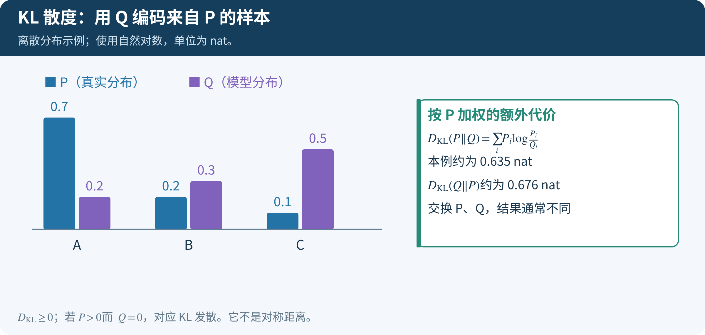

# KL散度 (Kullback-Leibler Divergence) 详解

## 概述

### 背景

1. KL散度（Kullback-Leibler Divergence），又称相对熵（Relative Entropy），是信息论中衡量两个概率分布差异的基本指标。当我们需要用一个简化的分布 $Q$ 来近似真实分布 $P$ 时，KL散度告诉我们损失了多少信息。
2. 核心问题：如何量化两个概率分布之间的差异？

### 解决思路

1. KL散度通过计算用基于 $Q$ 的编码来描述来自 $P$ 的数据时，额外需要的信息量来衡量分布差异。


*KL散度衡量用分布 Q 编码分布 P 的数据时损失的额外信息量*

## 1. 什么是KL散度

### 1.1. 直观理解

想象你有两堆硬币：一堆真实比例是 $P$，另一堆是 $Q$。如果你用 $Q$ 的编码方式来记录 $P$ 的硬币，需要额外多少空间？这额外空间的信息量就是KL散度。

**关键点**：KL散度衡量的是"用错误的分布 $Q$ 去编码真实分布 $P$ 的数据，损失了多少信息"。

### 1.2. 数学定义

#### 离散分布

对于两个离散概率分布 $P = \{p_1, p_2, ..., p_n\}$ 和 $Q = \{q_1, q_2, ..., q_n\}$：

$$D_{\mathrm{KL}}(P \parallel Q) = \sum_{i=1}^{n} p_i \log \frac{p_i}{q_i}$$

其中：
- $p_i$：真实分布 $P$ 中事件 $i$ 的概率
- $q_i$：近似分布 $Q$ 中事件 $i$ 的概率
- 对数底数通常用 $e$（得到 nats）或 $2$（得到 bits）

#### 连续分布

对于连续概率密度函数 $p(x)$ 和 $q(x)$：

$$D_{\mathrm{KL}}(P \parallel Q) = \int p(x) \log \frac{p(x)}{q(x)} \, dx$$

#### 期望形式

KL散度可以写成期望形式：

$$D_{\mathrm{KL}}(P \parallel Q) = \mathbb{E}_{x \sim P} \Big[ \log \frac{P(x)}{Q(x)} \Big]$$

## 2. 基本性质

### 2.1. 非负性

KL散度始终非负，当且仅当 $P = Q$ 时为零：

$$D_{\mathrm{KL}}(P \parallel Q) \ge 0$$

这来源于吉布斯不等式（Gibbs' inequality）。

### 2.2. 非对称性

KL散度**不是**对称的距离度量：

$$D_{\mathrm{KL}}(P \parallel Q) \neq D_{\mathrm{KL}}(Q \parallel P)$$

这意味着从 $P$ 到 $Q$ 的"距离"与从 $Q$ 到 $P$ 的距离不同。

### 2.3. 独立分布的可加性

若 $X$ 和 $Y$ 独立：

$$D_{\mathrm{KL}}(P_{X,Y} \parallel Q_{X,Y}) = D_{\mathrm{KL}}(P_X \parallel Q_X) + D_{\mathrm{KL}}(P_Y \parallel Q_Y)$$

### 2.4. 参数变换的不变性

KL散度在随机变量的双射变换下保持不变。

## 3. 计算示例

### 3.1. 抛硬币例子

假设我们有两个硬币，真实概率分布 $P$ 和近似分布 $Q$：

| 类型 | 正面 ($P$) | 正面 ($Q$) |
|------|----------|----------|
| 硬币A | 0.7 | 0.6 |
| 硬币B | 0.3 | 0.4 |

计算 $D_{\mathrm{KL}}(P \parallel Q)$：

$$D = 0.7 \log \frac{0.7}{0.6} + 0.3 \log \frac{0.3}{0.4} \approx 0.088$$

### 3.2. 颜色球例子

假设两个盒子包含4种颜色的球（绿、蓝、红、黄），概率分布如下：

| 颜色 | 盒子1 ($P$) | 盒子2 ($Q$) |
|------|-------------|-------------|
| 绿 | 0.25 | 0.21 |
| 蓝 | 0.33 | 0.21 |
| 红 | 0.23 | 0.32 |
| 黄 | 0.19 | 0.26 |

```python
import numpy as np

box_1 = [0.25, 0.33, 0.23, 0.19]
box_2 = [0.21, 0.21, 0.32, 0.26]

def kl_divergence(a, b):
    return sum(a[i] * np.log(a[i] / b[i]) for i in range(len(a)))

print(kl_divergence(box_1, box_2))  # 0.057
print(kl_divergence(box_2, box_1))  # 0.056
print(kl_divergence(box_1, box_1))   # 0.000
```

注意 $D_{\mathrm{KL}}(P \parallel Q) \neq D_{\mathrm{KL}}(Q \parallel P)$，体现了非对称性。

## 4. KL散度有什么用

### 4.1. 衡量分布差异

KL散度用于衡量两个概率分布的差异程度，广泛应用于：
- 模型预测与真实分布的比较
- 知识蒸馏中教师模型与学生模型的分布差异
- [强化学习](../../01-comprehensive/03-ai-foundations/reinforcement-learning-basics.md)中策略更新幅度的控制

### 4.2. 机器学习损失函数

交叉熵损失可以分解为熵 + KL散度：

$$H(P, Q) = H(P) + D_{\mathrm{KL}}(P \parallel Q)$$

当真实分布 $P$ 固定时，最小化交叉熵等价于最小化KL散度。

#### 二分类交叉熵损失 (BCE)

$$\text{BCE} = -\frac{1}{N}\sum_{i=1}^{N}[y_i \log(p_i) + (1-y_i)\log(1-p_i)]$$

其中 $y_i$ 为真实标签（0或1），$p_i$ 为模型预测概率。直觉理解：$y_i=1$ 时损失为 $-\log(p_i)$（预测越接近1，损失越小）；$y_i=0$ 时损失为 $-\log(1-p_i)$（预测越接近0，损失越小）。与 sigmoid 输出层配合使用。

#### 多分类交叉熵损失 (Categorical CE)

$$\text{CE} = -\frac{1}{N}\sum_{i=1}^{N}\sum_{j=1}^{C}y_{ij}\log(p_{ij})$$

由于 $y_{ij}$ 只有正确类为 1（其余为 0），实际简化为 $\text{CE} = -\frac{1}{N}\sum_{i=1}^{N}\log(p_{i, \text{correct}})$。与 softmax 输出层配合使用。

#### 与 Hinge Loss 对比

| 特性 | Hinge Loss | Cross-Entropy Loss |
|------|-----------|--------------------|
| 用于 | SVM | 神经网络分类 |
| 标签 | -1/+1 | 概率 (0/1) |
| 惩罚 | 基于边距 | 基于概率差异 |
| 平滑性 | 边距处不可微 | 处处可微 |
| 损失值 | 超边距后为 0 | 永远 > 0 |

**关键特性**：交叉熵对自信但错误的预测给予重罚（$-\log(0.01) \approx 4.6$ vs $-\log(0.99) \approx 0.01$），这使模型倾向于做出准确且自信的预测。

### 4.3. 正则化约束

在变分推断和生成模型中，KL散度作为正则项，限制学习到的分布接近先验分布。

## 5. KL散度在大模型中的应用

### 5.1. 模型蒸馏 (Knowledge Distillation)

大模型压缩的核心技术，用教师模型的输出分布指导学生模型学习。

**过程**：
1. 教师模型 $P_T$ 生成软概率分布
2. 学生模型 $Q_S$ 学习逼近 $P_T$
3. 损失函数：$L = \alpha \cdot D_{\mathrm{KL}}(P_T \parallel Q_S) + (1-\alpha) \cdot H(P, Q_S)$

**温度调温 (Temperature Scaling)**：
$$p_i^\tau = \frac{\exp(z_i / T)}{\sum_j \exp(z_j / T)}$$

其中 $T$ 是温度参数，$T > 1$ 时分布更平滑，$T < 1$ 时更尖锐。

### 5.2. 对比学习 (Contrastive Learning)

在CLIP等模型中，KL散度用于衡量图文匹配程度：

$$L = -\log \frac{\exp(q \cdot k^+ / \tau)}{\sum_{k^-} \exp(q \cdot k^- / \tau)}$$

其中 $\tau$ 是温度参数，控制分布的锐度。

### 5.3. PPO强化学习中的策略约束

在大模型对齐（Alignment）中，PPO算法用KL散度限制新策略不要偏离旧策略太远：

$$L = -\mathbb{E}_{x \sim \pi^{old}} \Big[ \min(r(\theta) \cdot A, \text{clip}(r(\theta), 1-\epsilon, 1+\epsilon) \cdot A \Big]$$

其中 $r(\theta) = \frac{\pi_\theta(a|s)}{\pi_{old}(a|s)}$，本质上是在限制策略的KL散度。

### 5.4. LLM微调中的KL约束

#### LoRA等高效微调方法
在微调时，KL散度用于衡量adapter输出与原模型输出的差异，确保不偏离原模型太远。

#### RLHF (Reinforcement Learning from Human Feedback)
在RLHF中，KL散度作为策略更新的约束：
- 奖励函数：$r(x, y)$
- KL约束：$D_{\mathrm{KL}}(\pi_{new} \parallel \pi_{old}) \le \delta$
- 优化目标：$\max_\theta \mathbb{E}_{x \sim D, y \sim \pi_\theta} [r(x, y)]$ subject to KL constraint

### 5.5. 分布外检测 (Out-of-Distribution Detection)

用KL散度衡量输入分布与训练分布的差异：

$$D_{\mathrm{KL}}(P_{train} \parallel P_{test})$$

当KL散度突然增大时，说明模型可能遇到分布外样本。

## 6. 代码实现

### 6.1. 基本KL散度计算

```python
import numpy as np

def kl_divergence(p, q):
    """计算 KL(p || q)"""
    # 确保概率和为1
    p = np.array(p) / np.sum(p)
    q = np.array(q) / np.sum(q)
    # 避免 log(0)
    epsilon = 1e-10
    q = np.clip(q, epsilon, 1)
    p = np.clip(p, epsilon, 1)
    return np.sum(p * np.log(p / q))

# 示例
p = [0.25, 0.33, 0.23, 0.19]
q = [0.21, 0.21, 0.32, 0.26]
print(f"KL(p||q) = {kl_divergence(p, q):.4f}")  # 0.0568
print(f"KL(q||p) = {kl_divergence(q, p):.4f}")  # 0.0566
```

### 6.2. 带温度的KL散度

```python
def kl_divergence_with_temperature(logits, temperature=1.0):
    """计算带温度的KL散度"""
    probs = softmax(logits / temperature)
    log_probs = np.log(probs + 1e-10)
    return -np.mean(np.sum(probs * log_probs, axis=1))

def softmax(logits):
    exp_logits = np.exp(logits - np.max(logits))
    return exp_logits / np.sum(exp_logits)
```

### 6.3. PyTorch实现

```python
import torch
import torch.nn.functional as F

def kl_divergence(p, q, reduction='batchmean'):
    """PyTorch版本的KL散度计算"""
    # 确保是对数概率输入 KL(p||q) = sum(p * log(p/q)) = sum(p * (log(p) - log(q)))
    return F.kl_div(q, p, reduction=reduction)

# 使用示例
teacher_logits = torch.randn(32, 10)  # batch_size=32, vocab_size=10
student_logits = torch.randn(32, 10)

teacher_probs = F.softmax(teacher_logits, dim=-1)
student_log_probs = F.log_softmax(student_logits, dim=-1)

# 方法1：使用 F.kl_div
loss1 = F.kl_div(student_log_probs, teacher_probs, reduction='batchmean')

# 方法2：手动计算
loss2 = F.kl_div(student_log_probs, teacher_probs, reduction='none').sum(dim=-1).mean()
```

## 7. 与其他距离度量的对比

| 度量 | 对称性 | 取值范围 | 解释 | 典型应用 |
|------|--------|----------|------|----------|
| **KL散度** | 否 | $[0, \infty)$ | 用 $Q$ 编码 $P$ 损失的信息 | VAEs, PPO, NLP |
| Jensen-Shannon散度 | 是 | $[0, 1]$ | KL的平滑对称版本 | GANs, 文本相似度 |
| Hellinger距离 | 是 | $[0, 1]$ | 分布间的几何相似度 | 概率比较, 聚类 |
| Total Variation距离 | 是 | $[0, 1]$ | 所有事件上的最大概率差异 | 稳健统计, 假设检验 |
| Wasserstein距离 | 是 | $[0, \infty)$ | 把一个分布转成另一个的最小"代价" | GANs (WGAN), 图像生成 |

## 8. 局限性

### 8.1. 非对称性

$KL(P \parallel Q) \neq KL(Q \parallel P)$ 使得KL散度不是真正的距离度量，解释时需注意方向性。

### 8.2. 无穷值问题

当 $Q(x) = 0$ 但 $P(x) > 0$ 时，KL散度变为无穷大。在稀疏分布中容易出现。

### 8.3. 支撑集不匹配

KL散度要求 $Q$ 在 $P$ 的支撑集上处处非零，否则结果不稳定或无穷。

### 8.4. 模式寻求行为

最小化 $KL(P \parallel Q)$ 会使 $Q$ 集中于 $P$ 的高概率区域，可能忽略低概率区域，影响生成分布的多样性。

## 9. 核心要点总结

1. **定义**：KL散度衡量用错误分布 $Q$ 编码真实分布 $P$ 的额外信息损失
2. **非负性**：$D_{\mathrm{KL}}(P \parallel Q) \ge 0$，当且仅当 $P=Q$ 时为零
3. **非对称**：方向很重要，$KL(P \parallel Q) \neq KL(Q \parallel P)$
4. **与熵的关系**：$H(P, Q) = H(P) + D_{\mathrm{KL}}(P \parallel Q)$
5. **大模型应用**：知识蒸馏、对比学习、RLHF对齐、LoRA微调、分布检测

## 10. 参考

- [GeeksforGeeks: Kullback Leibler Divergence](https://www.geeksforgeeks.org/machine-learning/kullback-leibler-divergence/)
- [GeeksforGeeks: Cross-Entropy Loss Function](https://www.geeksforgeeks.org/machine-learning/what-is-cross-entropy-loss-function/)
- Cover & Thomas, "Elements of Information Theory"
- Hinton et al., "Distilling the Knowledge in a Neural Network"

<!-- 反向链接 -->
## 11. 反向链接

- GEN-0规模化具身基础模型 - GEN-0 中使用 KL 散度评估策略分布
- [强化学习基础](../../01-comprehensive/03-ai-foundations/reinforcement-learning-basics.md) - PPO 等强化学习算法中的 KL 散度约束
- [VAE 与 CVAE](vae-cvae.md) - VAE/CVAE ELBO 中的 KL 散度正则项
- [交叉熵损失函数](cross-entropy.md) - 交叉熵 = 熵 + KL散度