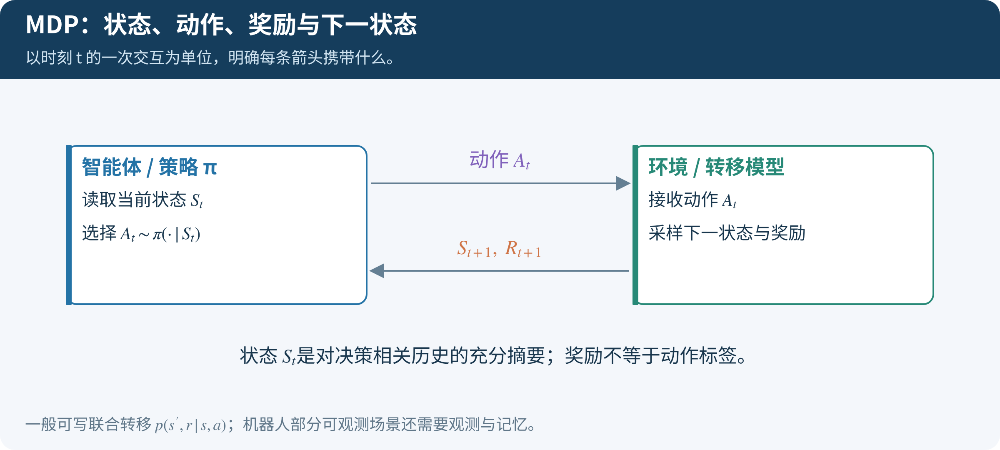

# 马尔可夫决策过程

## 概述

### 背景

1. [强化学习](../../01-comprehensive/03-ai-foundations/reinforcement-learning-basics.md)研究的是智能体（agent）在与环境的交互中如何通过试错最大化长期累积奖励。与监督学习不同，这里没有现成的"输入-标签"样本，反馈又是延迟的、稀疏的、且动作本身会改变未来收到的数据。要在这个设定下讨论"最优行为"，首先需要一个能精确描述"状态、动作、转移、奖励、目标"的语言。
2. 如果缺少一个统一的形式化框架，不同研究者的"序贯决策"设定无法对齐——状态如何表示、转移是确定还是随机、目标如何度量、未来奖励如何折算，都各有各的约定，导致算法无法比较、定理无法陈述。领域需要一个最小但足够强的数学对象，把"序贯决策下的最优控制"问题严格写下来。
3. 核心问题：如何用一个数学结构，既刻画"当前状态只依赖历史的关键摘要"这一简化假设，又把"选择动作→环境反馈→累积奖励"的循环完整表达，从而让"最优策略"成为可定义、可计算、可证明的对象？

### 解决思路

1. **马尔可夫决策过程（Markov Decision Process, MDP）** 用一个五元组 $(S, A, P, R, \gamma)$ 给出答案：它把环境抽象为状态集 $S$ 与转移概率 $P$，把智能体抽象为动作集 $A$ 与策略 $\pi$，把目标抽象为奖励函数 $R$ 与折扣因子 $\gamma$，并用马尔可夫性（下一状态只依赖当前状态与动作）保证问题在数学上可解。
2. 在此之上，最优策略 $\pi^*$ 通过贝尔曼方程递归定义，并由动态规划或采样式 RL 算法求解。MDP 因此成为几乎所有现代强化学习算法的共同底座。

## 历史脉络

MDP 是三条线索在 20 世纪汇流的结果。第一条是俄罗斯数学家安德雷·马尔可夫（Andrey Markov）在 1906 年提出的马尔可夫链：用"下一状态只依赖当前状态"的性质研究相依随机变量，奠定了后续所有"无记忆"随机过程的语言。第二条是理查德·贝尔曼（Richard Bellman）在 1957 年提出的动态规划与贝尔曼方程：把多阶段决策问题拆成"当前一步 + 剩余子问题"的递归结构，给出 $V(s) = \max_a [r + \gamma V(s')]$ 这一最优性原理。第三条是 1960 年代的形式化收口：罗纳德·霍华德（Ronald Howard）在 1960 年出版的 *Dynamic Programming and Markov Processes* 中把马尔可夫链、奖励与决策合并为今天所称的 MDP，并给出策略迭代算法。此后马尔可夫性、贝尔曼方程与策略/值迭代构成"最优控制"的标准工具。到 1980 年代末，Sutton 与 Barto 进一步把"采样式学习"与 MDP 框架结合，将试错学习、贝尔曼方程与时序差分统一为现代强化学习，使 MDP 从纯数学对象变为 AI 学习范式的形式底座。

## Agent-Environment 交互

MDP 在数学上是一个五元组，但它对应的物理图景是智能体与环境的循环交互。在每一个离散时间步 $t$，智能体观测到当前状态 $S_t \in S$，依据策略 $\pi(a|s)$ 选择动作 $A_t \in A$；环境根据转移概率 $P(s'|s,a)$ 采样下一个状态 $S_{t+1}$，并依奖励函数 $R(s,a,s')$ 返回标量奖励 $R_t$。智能体的目标是选择策略 $\pi$ 使得期望折扣回报

$$G_t = \sum_{k=0}^{\infty} \gamma^k R_{t+k+1}$$

的期望最大化。这个"观测—决策—反馈"的循环把五元组的静态符号变成一个随时间展开的轨迹，也是几乎所有 RL 算法训练与评估的运行时结构。

上图展示 MDP 将智能体与环境的交互建模为闭环循环：在每个时间步 $t$，智能体依策略 $\pi(a|s)$ 选择动作 $A_t$，环境按转移概率 $P(s'|s,a)$ 回送新状态 $S_{t+1}$ 与标量奖励 $R_t$，由此不断展开轨迹并累积折扣回报，构成几乎所有强化学习算法训练与评估的运行时结构。

## 核心概念

**马尔可夫决策过程（Markov Decision Process, MDP）** 是[强化学习](../../01-comprehensive/03-ai-foundations/reinforcement-learning-basics.md)问题的数学形式化框架。MDP提供了一种形式化描述智能体与环境交互的方式，是理解和设计强化学习算法的基础。

## 详细解释

### MDP的定义

MDP由五元组定义：

$$\text{MDP} = (S, A, P, R, \gamma)$$

| 符号 | 含义 | 描述 |
|------|------|------|
| $S$ | 状态空间 | 所有可能状态的集合 |
| $A$ | 动作空间 | 智能体可以执行的所有操作 |
| $P$ | 状态转移概率 | $P(s'\|s,a)$ 描述动作如何改变状态 |
| $R$ | 奖励函数 | $R(s,a,s')$ 定义学习目标 |
| $\gamma$ | 折扣因子 | $[0,1]$ 权衡即时与未来奖励 |

### 状态转移概率 $P$

**定义**：描述环境动力学，动作如何改变状态。

$$P(s'|s,a) = P(S_{t+1}=s' | S_t=s, A_t=a)$$

**关键性质 - 马尔可夫性**：
- 下一状态只依赖当前状态和动作
- 与历史无关
- 数学上便于处理

**理解**：
| 场景 | $P$ 是什么 |
|------|-----------|
| 仿真环境 | 物理引擎（MuJoCo、Isaac Gym） |
| 真实世界 | 物理规律本身 |
| Model-based RL | 智能体学习的"世界模型" |

### 奖励函数 $R$

**定义**：环境对智能体动作的即时反馈信号，定义学习目标。

$$R(s,a,s') \quad \text{或} \quad r_t$$

**奖励设计的重要性**：
- *奖励定义了学习目标*
- *奖励设计不当会导致意外行为*

**示例 - 游戏通关**：
- 好设计：胜利+100，失败-100，每步-0.01（鼓励尽快结束）
- 坏设计：胜利+100
- 问题：智能体可能永远不结束游戏

### 折扣因子 $\gamma$

**定义**：权衡即时奖励和未来奖励的权重，取值范围 $[0, 1]$。

**作用**：
- $\gamma \approx 0$：短视，只关心眼前
- $\gamma \approx 1$：远视，重视长远
- 通常取 0.99 或 0.95

**为什么需要折扣**：
1. 数学上保证回报有界（无限求和收敛）
2. 未来的不确定性更大
3. 符合人类时间偏好

### 贝尔曼方程

**核心思想**：当前价值 = 即时奖励 + 下一状态的折扣价值

#### 贝尔曼期望方程

**状态价值**：
$$V^\pi(s) = \sum_a \pi(a|s) \sum_{s'} P(s'|s,a) [R(s,a,s') + \gamma V^\pi(s')]$$

**动作价值**：
$$Q^\pi(s,a) = \sum_{s'} P(s'|s,a) [R(s,a,s') + \gamma \sum_{a'} \pi(a'|s') Q^\pi(s',a')]$$

#### 贝尔曼最优方程

**最优状态价值**：
$$V^*(s) = \max_a \sum_{s'} P(s'|s,a) [R(s,a,s') + \gamma V^*(s')]$$

**最优动作价值**：
$$Q^*(s,a) = \sum_{s'} P(s'|s,a) [R(s,a,s') + \gamma \max_{a'} Q^*(s',a')]$$

**最优策略**：
$$\pi^*(a|s) = \begin{cases} 1 & \text{if } a = \arg\max_a Q^*(s,a) \\ 0 & \text{otherwise} \end{cases}$$

## 对比矩阵

MDP 是序贯决策问题中最常被默认的假设集，但并非唯一设定。下表把它与两个常见变体对照。

| 维度 | MDP | POMDP（部分可观测马尔可夫决策过程） | 多臂老虎机（MAB / Bandit） |
|------|-----|------|------|
| 核心思路 | 在完全可观测的马尔可夫环境下求最优策略 | 状态不可直接观测，只能通过观测推断信念状态 | 无状态转移的单步决策，在每个臂上探索 vs 利用 |
| 状态可观测性 | 完全可观测，$S_t$ 已知 | 部分可观测，仅有观测 $O_t$，需维护信念 $b(s)$ | 退化为单状态（或无状态） |
| 转移动力学 | $P(s'\|s,a)$ 已知或可学 | 额外有观测模型 $O(o\|s',a)$ | 无状态转移，每个臂 $k$ 给出独立分布 $R_k$ |
| 时间结构 | 多步、长期、折扣回报 | 多步、长期、折扣回报 | 单步（或重复的单步） |
| 目标 | $\max_\pi \mathbb{E}[\sum \gamma^k r]$ | 同 MDP，但基于信念状态求解 | $\max \mathbb{E}[r]$，平衡探索与利用 |
| 典型算法 | 值迭代、策略迭代、Q-learning、PPO | 信念状态滤波 + POMDP 求解器、递归 RL | UCB、Thompson 采样、$\epsilon$-greedy |
| 适用场景 | 棋盘游戏、仿真控制、机器人全状态可读 | 真实世界传感有噪声/盲区、对话状态隐含 | A/B 测试、广告推荐、临床试验分配 |

## 批判性思维

MDP 之所以好用，是因为它把复杂的序贯决策压进一个可解的数学壳；但同一组假设也划出了它的边界。

第一，**马尔可夫假设在真实世界常被违反**。MDP 要求"下一状态只依赖当前状态与动作"，意味着当前状态必须包含历史的全部相关信息。在仿真器里状态可以高维且完整，但在真实物理系统中，传感器往往只能看到部分信息，或者真正的状态变量未被观测到。这时用 MDP 建模相当于把不可观测的隐变量当作不存在，策略会系统性偏差。POMDP 通过引入观测模型与信念状态 $b(s)$ 来承认这一点；Model-based RL 则尝试显式学习一个可处理的状态表征或世界模型，把"什么算状态"重新学出来。

第二，**奖励设计困难**。MDP 假定奖励函数 $R$ 已经给定，但在工程中，"我们到底想要什么"很难一次写对。奖励过稀疏（只在终局给信号）会让学习无法收敛；奖励项写错会引发奖励黑客（reward hacking），智能体找到与字面奖励一致但与意图相悖的行为。缓解方向包括奖励建模（reward modeling，从人类偏好反推奖励）、逆向强化学习（IRL，从示范轨迹反推意图），以及近来用大模型作为奖励来源的做法。

第三，**状态与动作空间一大就难解**。当 $S$ 或 $A$ 连续、高维或包含图像时，精确存表 $V^\pi$ 或 $Q^\pi$ 不再可行，贝尔曼方程的精确不动点迭代失效。函数逼近（用神经网络近似 $Q$ 或 $V$）带来表征能力，也带来训练不稳定与"致命三元组"（function approximation + bootstrapping + off-policy）的发散风险；值迭代在表格情况下的收敛保证不再直接成立。深度强化学习的许多工作（DQN 的目标网络、PPO 的裁剪、SAC 的熵正则）本质上是在与这一困难的工程化博弈。

总体上，MDP 是一个"足够简单以至于可证、足够强以至于有用"的折中点：它的局限催生了 POMDP、Model-based RL、奖励建模等一整条研究线，但这些后续工作大多仍以 MDP 为底层数学骨架，只是把"状态""奖励""模型"中某一项换成更复杂的形式。

## 关联

- **强化学习基础**：MDP是强化学习的数学基础
- **动态规划**：基于MDP的已知模型进行规划
- **值迭代与策略迭代**：求解MDP的核心算法
- **Model-based RL**：学习MDP中的状态转移 $P$
- **POMDP**：放松"完全可观测"假设后的 MDP 推广
- **多臂老虎机**：去除状态转移后的 MDP 退化特例，研究探索-利用

## 参考资料

- Sutton, R. S., & Barto, A. G. (2018). *Reinforcement Learning: An Introduction* (2nd ed.). MIT Press.
- Bellman, R. (1957). *Dynamic Programming*. Princeton University Press.
- Howard, R. A. (1960). *Dynamic Programming and Markov Processes*. MIT Press.
- Markov, A. A. (1906). Rasprostranenie zakona bol'shih chisel na velichiny, zavisyaschie drug ot druga. *Izvestiya Fiziko-Matematicheskogo Obschestva pri Kazanskom Universitete*.

## 反向链接

- [强化学习基础](../../01-comprehensive/03-ai-foundations/reinforcement-learning-basics.md) - MDP 是强化学习的数学形式化框架
