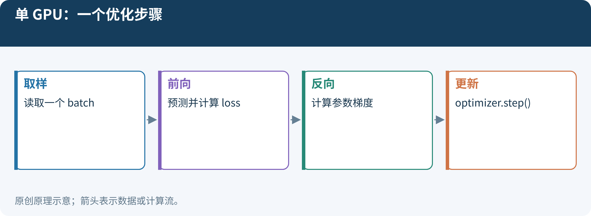
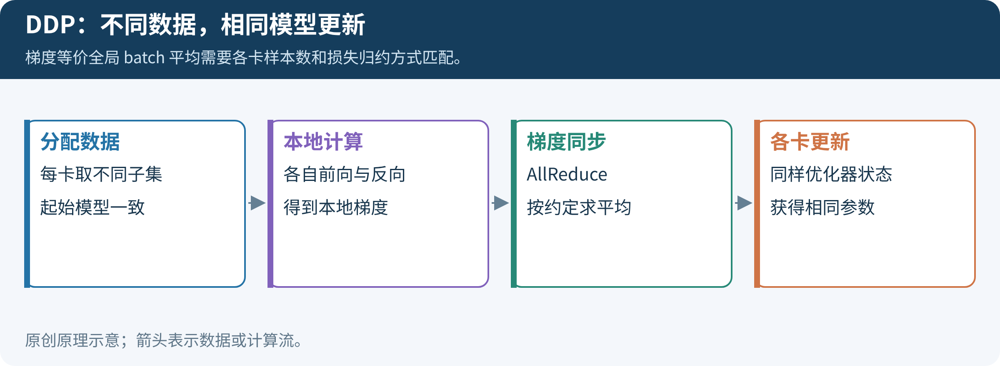
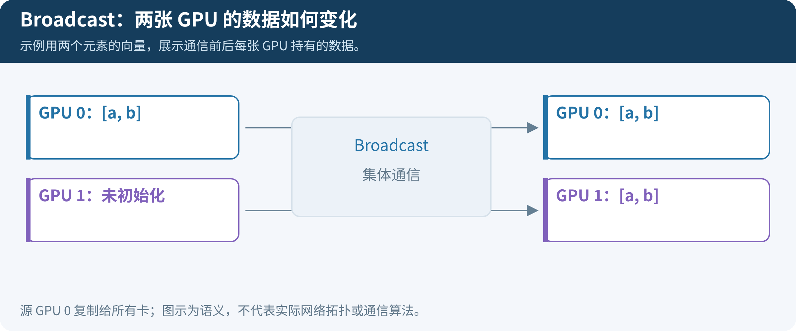
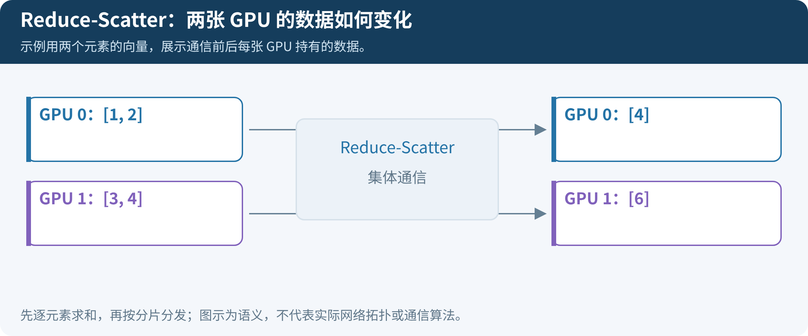
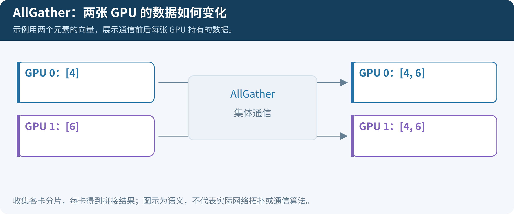
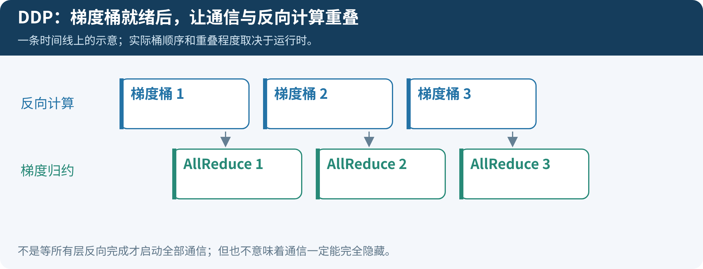
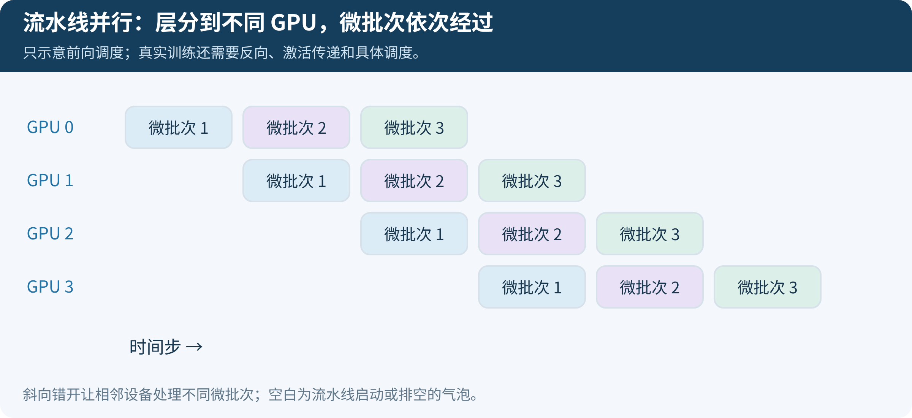
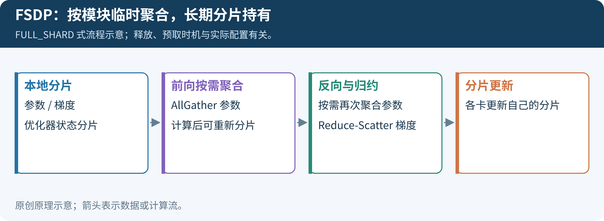
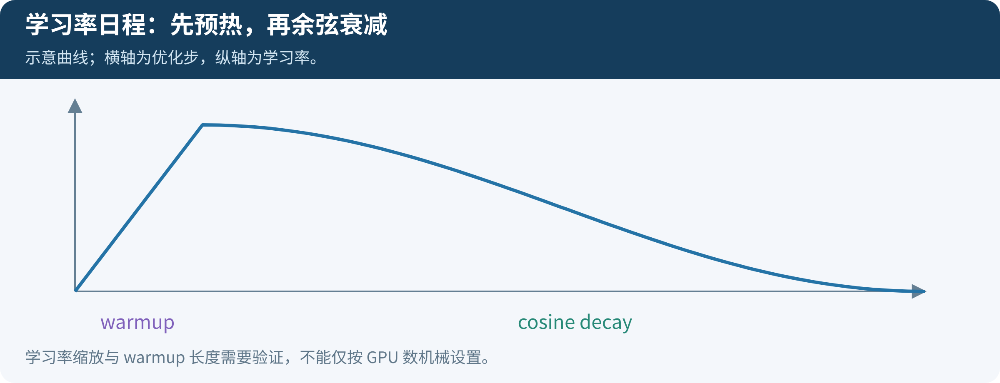

# 多卡训练原理：从数据分片到梯度合并

## 概述

### 背景

1. 大模型训练需要处理海量数据和参数，单 GPU 的显存和算力远远不够——一个 7B 参数模型在 FP16 下仅权重就占 14GB，加上梯度和优化器状态需要 42GB+，远超单卡容量；训练速度也是瓶颈（单卡 8 GPU-hours 的任务，用 8 卡理论上 1 小时完成）。
2. 让多张 GPU 协同完成同一个训练任务有三个核心挑战：**显存**（单卡装不下完整模型）、**通信**（多卡之间如何高效传递数据而不成为瓶颈）、**一致性**（各卡计算的梯度如何合并成统一更新）。
3. 核心问题：多卡训练的本质是什么——数据怎么分、计算怎么排、结果怎么合？

### 解决思路

1. 多卡训练有三种基本范式——数据并行（每卡完整模型，分数据）、模型并行（分模型到多卡）、混合并行（两者结合），分别解决显存装不下模型和算力不足的瓶颈。
2. 它们底层共享通信机制（AllReduce 等），负责把各卡梯度合并成统一更新，保证参数一致性。

---

## 核心概念：Batch、Step、通信的关系

### 单卡训练的循环

在单卡训练中，一个 step 的执行流程：



*原创重绘；可编辑 [SVG](../../imgs/foundations-single-gpu.svg)。*

这里 batch_size=32 是每步处理的样本数。训练总步数 = 总样本数 / batch_size × epochs。

### 多卡训练：batch 变大了，但数据怎么到各卡？

多卡数据并行训练中，有效 batch size 变为 `batch_size × num_gpus`：

| 配置 | 单卡 batch | GPU 数 | 有效 batch | 说明 |
|------|-----------|--------|-----------|------|
| 单卡 | 8 | 1 | 8 | 基础配置 |
| 2卡 | 8 | 2 | 16 | 每卡仍取 8 条，但 2 卡共处理 16 条 |
| 4卡 | 8 | 4 | 32 | 每卡取 8 条，4 卡共处理 32 条 |

**数据分配机制**：DDP 使用 `DistributedSampler` 将数据集均匀分到各 GPU。例如数据集有 1000 条样本、4 卡训练，GPU 0 处理样本 0-249，GPU 1 处理 250-499，依此类推。每个 epoch 内各卡看到不同的数据子集，确保不重复。

```python
# DistributedSampler 的核心逻辑
# rank = 当前 GPU 编号（0, 1, 2, ...）
# world_size = 总 GPU 数
indices = list(range(len(dataset)))  # 全部样本索引
# 每个 epoch 打乱顺序
random.shuffle(indices)
# 分配给当前 rank 的子集
sub_indices = indices[rank : len(indices) : world_size]
```

### Step 的变化

多卡训练的一个 step 执行流程：



*原创重绘；可编辑 [SVG](../../imgs/foundations-ddp.svg)。*

关键点：每卡看到的 loss 值不同（因为数据不同），但最终用于更新的梯度是所有卡梯度的平均值。这是 DDP 的核心保证——所有卡始终持有相同的模型参数。

### 训练总步数

如果数据集大小不变，GPU 数量翻倍意味着每个 step 处理的样本翻倍，因此总步数应减半才能遍历同样多的数据：

| 配置 | 有效 batch | 遍历 10000 样本需要的 step 数 |
|------|-----------|---------------------------|
| 1卡, bs=8 | 8 | 1250 |
| 2卡, bs=8 | 16 | 625 |
| 4卡, bs=8 | 32 | 312.5 |

如果不减少 step 数，多卡训练实际上遍历了 2x/4x 的数据，可能改善也可能过度拟合。

---

## 通信机制：GPU 之间如何传递数据

### NCCL：GPU 通信的基础设施

NVIDIA NCCL（NVIDIA Collective Communications Library）是 GPU 间高速通信的底层库。它针对 NVIDIA GPU 和 NVLink/PCIe 拓扑优化，提供集体通信操作（collective operations）。

通信带宽对比：

| 通道 | 带宽（双向） | 说明 |
|------|------------|------|
| NVLink | 160-300 GB/s | GPU 间直连，最快 |
| PCIe 4.0 x16 | ~32 GB/s | 经 CPU/主板 |
| InfiniBand | ~100 GB/s | 多机集群网络 |

NCCL 自动检测拓扑结构，选择最优通信路径（树形、环形等），最大化带宽利用率。

### 集体通信操作

多卡训练依赖四种核心集体通信操作：

#### 1. Broadcast（广播）

一个 GPU 的数据发送给所有其他 GPU。用于初始化：训练开始时，GPU 0 的模型参数广播到所有卡，确保起点一致。



*原创重绘；可编辑 [SVG](../../imgs/foundations-broadcast.svg)。*

#### 2. AllReduce（全归约）

最核心的操作。每张 GPU 拿出自己的数据，所有数据做归约运算（求和/求平均），结果发回每张 GPU。**AllReduce 是 DDP 梯度同步的基石。**


*原创重绘；可编辑 [SVG](../../imgs/foundations-allreduce.svg)。*

NCCL 实现 AllReduce 有两种主要算法：

| 箯法 | 通信量 | 适用场景 |
|------|-------|---------|
| Ring AllReduce | $2(N-1)\frac{K}{N}$ | 小集群、大消息 |
| Tree AllReduce | $2K$ | 大集群、小消息 |

其中 $N$ 是 GPU 数，$K$ 是数据大小。Ring 算法将数据分成 $N$ 份依次传递，总通信量随 GPU 数增长缓慢；Tree 算法通过二叉树结构归约，适合小消息或大集群。

#### 3. Reduce-Scatter（归约-散射）

AllReduce 可以分解为两步：Reduce-Scatter + AllGather。Reduce-Scatter 只做归约但不广播完整结果，每卡只拿到自己负责的那一份。这是 FSDP 的关键操作。



*原创重绘；可编辑 [SVG](../../imgs/foundations-reduce-scatter.svg)。*

#### 4. AllGather（全收集）

每卡拿出自己的一份数据，汇总后广播完整结果给所有卡。与 Reduce-Scatter 配合实现完整的 AllReduce。



*原创重绘；可编辑 [SVG](../../imgs/foundations-allgather.svg)。*

### DDP 中的通信流程

DDP 在反向传播期间同步梯度，具体时机是**每个参数的梯度计算完成后立即启动通信**，而非等所有梯度都算完再一次性同步。这种流水线化的设计使得计算和通信重叠执行，减少等待时间。



*原创重绘；可编辑 [SVG](../../imgs/foundations-ddp-overlap.svg)。*

PyTorch DDP 的具体实现使用 **bucket 机制**：将参数分成若干 bucket，一个 bucket 内所有参数的梯度都计算完后，对该 bucket 启动 AllReduce。这比逐参数通信更高效（大消息比小消息通信效率高）。

---

## 三种并行范式

### 数据并行（Data Parallelism）

**原理**：每张 GPU 持有完整模型的副本，各自处理不同的数据子集，反向传播后通过 AllReduce 同步梯度。

| 维度 | 说明 |
|------|------|
| 模型分布 | 每卡完整副本 |
| 数据分布 | 不同子集 |
| 通信内容 | 梯度（AllReduce） |
| 通信量 | $O(M)$，$M$ 为模型参数量 |
| 显存占用 | 每卡：模型 + 梯度 + 优化器状态 = $O(M)$ |
| 优势 | 简单、通用、几乎不需要改代码 |
| 限制 | 模型必须能装入单卡显存 |

**DDP（DistributedDataParallel）** 是 PyTorch 的数据并行实现：

```python
import torch.distributed as dist
from torch.nn.parallel import DistributedDataParallel as DDP

dist.init_process_group("nccl")  # 使用 NCCL 通信
model = DDP(model, device_ids=[local_rank])  # 包装模型

# 训练循环中无需手动同步——DDP 在 backward() 时自动 AllReduce 梯度
output = model(input)
loss = criterion(output, target)
loss.backward()  # ← 梯度自动同步
optimizer.step()
```

DDP 的关键保证：`loss.backward()` 结束后，所有卡上每个参数的 `.grad` 都相同（是所有卡梯度的平均值）。

### 模型并行（Model Parallelism）

当模型太大装不进单卡时，需要将模型本身分到多卡上。

#### 张量并行（Tensor Parallelism）

**原理**：将单个矩阵乘法分到多卡上并行计算。例如一个 $Y = XW$ 的矩阵乘法，$W \in \mathbb{R}^{d \times d}$，可以按列切分 $W = [W_1, W_2]$，两卡分别计算 $[XW_1, XW_2]$ 后拼接。

| 维度 | 说明 |
|------|------|
| 切分对象 | 单层权重矩阵 |
| 通信点 | 前向：AllGather（拼接结果）；反向：Reduce-Scatter（分发梯度） |
| 通信量 | $O(B \cdot d / N)$，$B$ 为 batch，$d$ 为维度 |
| 适用 | 单层太大的情况（如 LLM 的注意力层） |

张量并行通常在 Megatron-LM 框架中使用，将 Transformer 的 QKV 投影和输出投影按列/行切分到多卡。

#### 流水线并行（Pipeline Parallelism）

**原理**：将模型的不同层分到不同 GPU 上，数据像流水线一样依次通过各卡。



*原创重绘；可编辑 [SVG](../../imgs/foundations-pipeline-parallel.svg)。*

| 维度 | 说明 |
|------|------|
| 切分对象 | 模型层（按深度） |
| 通信点 | 层间激活值传递 |
| 通信量 | $O(B \cdot d_{hidden})$ |
| 优势 | 通信量小（只传激活值，不传梯度/参数） |
| 限制 | 有 bubble 空闲（各卡不是同时满负荷） |

流水线并行的关键问题是 **bubble**：GPU 0 计算完前向后要等 GPU 3 计算完反向才能开始反向。GPipe 和 1F1B 等微批调度策略可以减少 bubble 比例。

### FSDP（Fully Sharded Data Parallelism）

FSDP 是数据并行和模型并行的混合——每卡不再持有完整模型副本，而是将参数、梯度、优化器状态都切分（shard）到各卡上，只在需要时收集（gather）完整参数。

| 维度 | DDP | FSDP |
|------|-----|------|
| 模型存储 | 每卡完整副本 | 每卡只存 1/N shard |
| 梯度存储 | 每卡完整梯度 | 每卡只存 1/N shard |
| 优化器状态 | 每卡完整 | 每卡只存 1/N shard |
| 前向计算 | 直接计算 | 先 AllGather 拼完整参数→计算→释放 |
| 反向传播 | 直接计算 | 先 AllGather→计算梯度→Reduce-Scatter→释放 |
| 显存占用 | $O(M)$ | $O(M/N)$ |

FSDP 的执行流程：



*原创重绘；可编辑 [SVG](../../imgs/foundations-fsdp.svg)。*

FSDP 的显存优势：4 卡 FSDP 训练 7B 模型，每卡只需约 10.5GB（1/4 的参数+梯度+优化器），而非 DDP 的 42GB。

---

## 学习率与 Batch Size 的关系

### 线性缩放规则

当有效 batch size 翻倍时，学习率也应翻倍。这是 Goyal et al. (2017) 提出的线性缩放规则：

$$lr_{new} = lr_{base} \times \frac{batch_{new}}{batch_{base}}$$

**直觉**：batch 翻倍意味着梯度估计更精确（噪声减半），因此可以用更大的步长。梯度平均值在 batch 翻倍时方差减半，所以步长翻倍不会导致震荡。

### 什么时候需要调整学习率

| 场景 | 是否调整 lr | 原因 |
|------|-----------|------|
| 2 卡 DDP，有效 batch 2x | 线性缩放 | 梯度噪声降低 |
| 梯度累积 4 步（模拟 batch 4x） | 线性缩放 | 等效 batch 增大 |
| FSDP（仅显存优化，batch 不变） | 不调整 | 有效 batch 未变 |

**注意**：线性缩放是经验规则而非定理。batch 过大时（如 >8192），线性缩放可能不再适用，需要用 warmup 等策略。

### Warmup 策略

大 batch 训练初期，梯度估计虽然方差小但可能方向不稳定。warmup 在前几个 step 逐渐将 lr 从 0 增到目标值，避免初始震荡：



*原创重绘；可编辑 [SVG](../../imgs/foundations-lr-schedule.svg)。*

---

## 梯度累积：显存不足时的替代方案

当单卡显存不足以容纳目标 batch size 时，梯度累积是一种不增加显存但等效增大 batch 的方法。

### 原理

将一个大 batch 分成多个小 micro-batch，逐步累积梯度，累积够后才执行一次参数更新：

```python
gradient_accumulation_steps = 4
micro_batch_size = 8  # 每次只处理 8 条

for i, micro_batch in enumerate(dataloader):
    output = model(micro_batch)
    loss = criterion(output, target)
    loss = loss / gradient_accumulation_steps  # ← 关键：归一化
    loss.backward()  # 梯度累积到 .grad 上

    if (i + 1) % gradient_accumulation_steps == 0:
        optimizer.step()   # 用累积的梯度更新
        optimizer.zero_grad()  # 清零，开始新一轮累积
```

**等效效果**：micro_batch=8 × accumulation=4 → 有效 batch=32，但每次前向/反向只用 8 条数据的显存。

### 归一化的必要性

`loss = loss / accumulation_steps` 是关键步骤。因为梯度是 loss 对参数的导数，4 次 micro-batch 的梯度直接相加会得到 4 倍大小的梯度，而非平均梯度。除以累积步数使最终梯度等于 4 个 micro-batch 梯度的平均值，与一次性处理 32 条样本的效果一致。

### 梯度累积 vs 多卡 DDP

| 维度 | 梯度累积 | 多卡 DDP |
|------|---------|---------|
| 显存 | 不增加 | 不增加（每卡仍是小 batch） |
| 速度 | 更慢（串行累积） | 更快（并行计算） |
| 有效 batch | micro_batch × steps | per_gpu_batch × num_gpus |
| 适用 | 单卡显存不够 | 多卡可用、想加速 |

两者可以组合使用：4 卡 DDP + 每卡累积 2 步 → 有效 batch = per_gpu_batch × 4 × 2。

---

## 实践框架对比

| 维度 | PyTorch DDP | Accelerate | DeepSpeed | FSDP |
|------|------------|------------|-----------|------|
| 并行方式 | 数据并行 | 数据并行 | 数据+模型+混合 | 分片数据并行 |
| 模型大小限制 | 单卡显存 | 单卡显存 | 超单卡（ZeRO） | 超单卡 |
| 通信库 | NCCL | NCCL | NCCL | NCCL |
| 使用难度 | 中等 | 低 | 中等 | 中等 |
| 梯度同步 | 自动 AllReduce | 自动 | 自动 | Reduce-Scatter |
| 混合精度 | 手动 AMP | 自动 | 自动 | 自动 |

### HuggingFace Accelerate

Accelerate 是最简单的多卡训练入口，一行代码即可启动 DDP：

```bash
accelerate launch --multi_gpu --num_processes=4 train.py
```

代码改动极小：

```python
from accelerate import Accelerator
accelerator = Accelerator()
model, optimizer, dataloader = accelerator.prepare(model, optimizer, dataloader)

for batch in dataloader:
    output = model(batch)
    loss = criterion(output, target)
    accelerator.backward(loss)  # ← 替换 loss.backward()
    optimizer.step()
```

`accelerator.prepare()` 自动完成：DDP 包装模型、DistributedSampler 包装 DataLoader、分发优化器。`accelerator.backward()` 自动处理梯度同步。

### LeRobot 多卡训练注意事项

LeRobot 使用 Accelerate 实现多卡训练，但有几个关键设计选择：

- **不自动缩放 lr**：用户需手动设置 `optimizer.lr = base_lr × num_gpus`
- **不自动缩减 steps**：用户需手动设置 `steps = original_steps / num_gpus`
- **step_scheduler_with_optimizer=False**：防止 Accelerate 按进程数调整调度器步数
- **保存时解包 DDP wrapper**：`accelerator.unwrap_model(model)` 确保保存的是原始模型而非 DDP 包装版

---

## 第一性原理视角

### 核心假设

1. **梯度可以平均**：AllReduce 取平均的前提是各卡梯度对同一优化目标有等权重贡献。这在数据均匀分配时成立。
2. **参数一致性可以维持**：只要所有卡在同一时刻用相同参数计算、拿到相同梯度更新，参数就始终一致。DDP 通过 Broadcast 初始化 + AllReduce 梯度来保证。
3. **计算和通信可以重叠**：反向传播中梯度是逐层产生的，先产生的梯度可以先通信，与后续层的计算并行。

### 这些假设什么时候不成立？

- **数据不均匀**：如果某些 GPU 上的数据明显不同（如不同任务类型），梯度平均不再合理，需要加权归约。
- **异步更新**：如果 GPU 间不等待 AllReduce 完成就更新参数（异步 SGD），参数一致性被打破。收敛性分析更复杂。
- **梯度累积跨 step**：如果累积步数跨越了 AllReduce 同步点，梯度是多个 step 的叠加而非单 step 的平均，行为会不同。

---

## 参考

- Goyal et al., "Accurate, Large Minibatch SGD: Training ImageNet in 1 Hour" ([arXiv:1706.02677](https://arxiv.org/abs/1706.02677))
- PyTorch DDP: [https://pytorch.org/docs/stable/notes/ddp.html](https://pytorch.org/docs/stable/notes/ddp.html)
- PyTorch FSDP: [https://pytorch.org/docs/stable/fsdp.html](https://pytorch.org/docs/stable/fsdp.html)
- HuggingFace Accelerate: [https://huggingface.co/docs/accelerate](https://huggingface.co/docs/accelerate)
- LeRobot Multi-GPU Training: [https://huggingface.co/docs/lerobot/multi_gpu_training](https://huggingface.co/docs/lerobot/multi_gpu_training)
- Ultrascale Playbook: [https://huggingface.co/spaces/nanotron/ultrascale-playbook](https://huggingface.co/spaces/nanotron/ultrascale-playbook)

## 关联

- 大模型训练基础 - LLM 训练整体流程，包含分布式训练概述
- DistFlow全分布式RL框架 - RL 场景下的分布式框架，多控制器 vs 单控制器
- [PEFT参数高效微调](peft.md) - LoRA 等方法减少训练参数量，间接降低多卡通信量
- Transformer架构 - 张量并行切分 Transformer 层的理论基础

<!-- 反向链接 -->
## 反向链接

- 大模型训练基础
- DistFlow全分布式RL框架