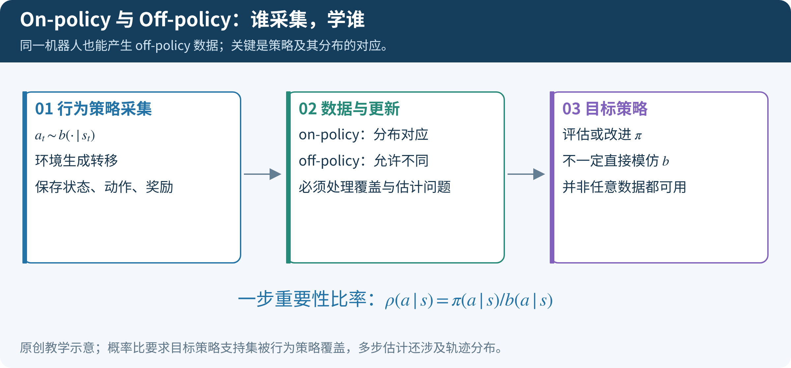
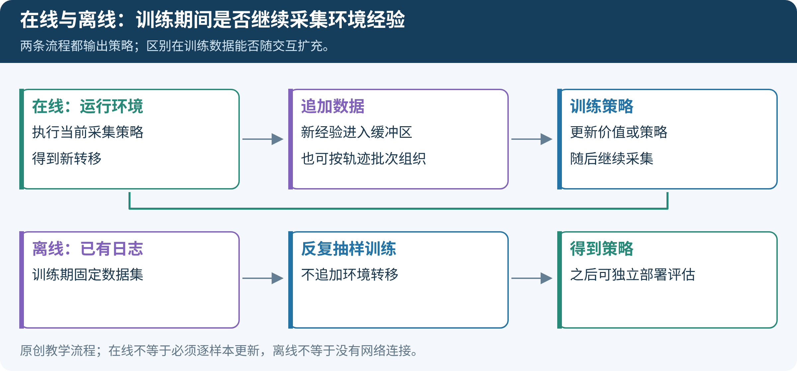

# Online Learning、Offline Learning、On-policy 与 Off-policy：理解两个分类维度

同样是训练机器人抓杯子，有的训练流程会反复交替进行两件事：让机器人按策略执行抓取、采集交互数据，再用这些数据更新策略参数（有些算法还会更新价值函数的参数）；有的训练流程则只使用训练开始前已经采集好的固定数据集，不再运行机器人采集新数据。这里的交互数据记录了机器人看到的图像或状态、执行的动作、获得的奖励，以及执行后的图像或状态等信息；按时间顺序串联起来，就构成一次抓取的轨迹。

即使训练期间都能继续采集新数据，不同算法使用数据的方式也可能不同：有的主要使用当前策略刚采集的一批轨迹来更新参数；有的则会反复利用多个历史版本的策略采集的交互数据，来学习当前的目标策略。**因此要分别判断两个问题：训练期间是否继续与环境交互、采集新数据，以及采集数据的行为策略与被评估或改进的目标策略是什么关系。** 前一个问题区分这里的 Online Learning 与 Offline Learning，后一个问题区分 On-policy 与 Off-policy。

## 1. 先用两个问题理解，而不是背四个标签

| 要问的问题 | 第一种情况 | 第二种情况 |
|---|---|---|
| 训练期间能否继续与环境交互、追加经验？ | online：可以继续采集 | offline：只用固定数据训练 |
| 实际采集策略与被评估或改进的策略如何对应？ | on-policy：使用目标策略自身的交互分布 | off-policy：允许用不同策略的数据学习目标策略 |

第一行看**采样权限和训练流程**，第二行看**策略关系和更新目标**。因此 online 不等于 on-policy，offline 也不等于 off-policy。两个维度的含义不同，但实际可组合方式仍受数据覆盖等条件约束。

这里先讨论强化学习语境。一般机器学习里的 online learning 还包括顺序预测、收到标签后更新，并不一定涉及奖励和环境；后文单独解释这个语境差别。

### 1.1. “谁采集”与“学谁”各是什么

设机器人在状态 $s$ 下选择动作 $a$。例如状态包含杯子位置和夹爪状态，动作是夹爪移动与闭合指令。

- **行为策略** $b(a\mid s)$：采数据时，实际按什么规则选动作。
- **目标策略** $\pi(a\mid s)$：想评估或改进的行动规则。

“学谁”不意味着模仿谁的动作，而是要估计谁执行后的回报，或优化哪一个策略。Off-policy 的关键是允许 $b$ 与 $\pi$ 不同，不是要求数据一定来自别人。昨天的自己也可能与今天的目标策略不同；同一算法当前策略的新数据也能被 off-policy 方法使用。

*原创示意：蓝色策略决定采什么，紫色策略决定评估或改进谁；判断时看二者分布与更新目标。*

### 1.2. 四种场景放在同一个抓杯子任务里

**场景 A：运行一批、更新一批——典型在线 on-policy。** 冻结当前策略去抓杯子，记录新轨迹，用这批数据改进策略，再用新策略收下一批。标准 PPO 通常这样组织。这里 online 指下一轮还能运行环境，on-policy 指更新围绕当前采集批次及对应策略展开。PPO 可以对同批轨迹更新多轮，不能理解成每条样本只能使用一次。

**场景 B：边抓边存，反复读旧记录——典型在线 off-policy。** 每轮仍在运行机器人，但把新旧转移都存进回放池，用不同版本策略的经验更新当前目标策略。SAC 是常见例子。**有旧数据不等于离线：只要训练还在继续采新经验，就仍可以是在线训练。**

**场景 C：只有固定抓取日志，训练中不运行环境——离线学习。** 如果训练目标是利用奖励改进一个不同于采集者的策略，便是通常的离线 RL，并面临 off-policy 的分布差异。如果只是预测专家在图像中采取的动作，则是行为克隆，不因此自动成为 RL。

**场景 D：用固定日志评估原采集策略。** 假设这份日志确实由固定策略 $b$ 采集，现在只想估计同一个策略 $\pi=b$ 的回报。虽然数据已经固定，这仍可构成 on-policy 评估。问题在于一旦持续修改目标策略，日志就不再自动匹配新策略，而离线设定又不能随意补采。

上面的算法流程分别可核对 [PPO 官方说明](https://spinningup.openai.com/en/latest/algorithms/ppo.html)、[SAC 官方说明](https://spinningup.openai.com/en/latest/algorithms/sac.html)；固定数据训练的定义见 [离线 RL 教程 §2](https://arxiv.org/html/2005.01643v3#S2)。

| | On-policy | Off-policy |
|---|---|---|
| 在线交互训练 | 标准 PPO 的新批次更新 | SAC 的新旧经验回放 |
| 固定离线数据 | 可以评估原采集策略；持续改策略会破坏分布对应 | 常规离线策略优化需要处理的情况 |

不要把表格当成四种对称、可任意互换的训练算法。特别是左下角描述的是可成立的评估场景，并不意味着固定数据能无限支持任意 on-policy 策略改进。

## 2. 在线与离线：把数据流程画出来

设状态为 $s_t$，动作为 $a_t$，环境执行动作后给出奖励 $r_{t+1}$、下一状态 $s_{t+1}$。策略 $\pi_\theta(a\mid s)$ 输出动作分布，参数 $\theta$ 是训练对象。训练目标是让策略获得更高的期望折扣回报：

$$J(\pi)=\mathbb E_{\tau\sim\pi}\left[\sum_{t=0}^{\infty}\gamma^t r_{t+1}\right],\qquad 0\leq\gamma<1.$$

$\tau$ 表示完整交互轨迹；期望同时包含策略选动作和环境转移的随机性。有限时域任务也可在规定终止时刻截断求和。这里的目标针对部署后执行策略的表现，**写了 $\tau\sim\pi$ 并不表示训练数据一定由当前策略采集**。

*原创流程示意。紫色表示数据集，绿色表示环境；离线流程在策略训练期间没有返回环境采样的箭头。*

### 2.1. 在线强化学习

一个带经验回放的示意流程是：

1. 用当前采集策略运行环境，得到转移 $(s,a,r,s',d)$；$d$ 是真实终止标记。
2. 将转移放入可增长的数据缓冲区 $\mathcal D$。
3. 从数据中更新价值函数或策略。
4. 用更新后的策略继续交互，获得此前没有的数据。

输入包括可调用的环境、初始策略和训练规则，输出为策略及可能的价值函数。在线不要求一条数据到达后立即更新，也不要求训练与物理控制在同一个进程运行。数据可以分批采集。仿真环境交互同样属于在线强化学习。

PPO 通常交替采集新轨迹与更新；SAC 则通常从不断增长的回放池中采样。两者都能在线训练，但前者通常归为 on-policy，后者归为 off-policy。见 [PPO 算法说明](https://spinningup.openai.com/en/latest/algorithms/ppo.html)、[SAC 算法说明](https://spinningup.openai.com/en/latest/algorithms/sac.html)。

### 2.2. 离线强化学习

训练输入改成固定的数据集：

$$\mathcal D=\{(s_i,a_i,r_i,s_i',d_i)\}_{i=1}^{N}.$$

数据可以来自历史机器人、专家或多种旧策略；不同来源必须具有兼容的状态、动作、单位和任务语义。仅有视频、没有可用动作和奖励定义的数据，不会自动成为这个转移数据集。

离线训练反复读取 $\mathcal D$、更新策略，但不向真实环境请求新转移。学习出来的策略最后可以部署测试；这不改变此前固定数据训练阶段的性质。若测试产生的数据又用于训练，则后续已进入在线微调阶段。

**固定数据限制的是采样权限，而非必须模仿采集者。** 学习器仍可尝试组合数据支持的行为并优化奖励，但无法靠新实验核验训练中猜测的动作效果。该定义与困难见 [Levine 等，Offline Reinforcement Learning，§2.2–2.4](https://arxiv.org/html/2005.01643v3#S2)。

## 3. 先用一步例子看清分布差异

只有一个决策状态，两个动作 L、R；选择 L 得 0，选择 R 得 1，随后立即终止。令：

$$b(L)=0.8,\quad b(R)=0.2;\qquad \pi(L)=0.2,\quad \pi(R)=0.8.$$

行为策略的期望奖励是 0.2，目标策略的期望奖励是 0.8。假设一次示意数据恰好包含 8 次 L 和 2 次 R，直接平均得到 $2/10=0.2$，估计的是行为策略而非目标策略。这里的样本比例是人为选定的教学例子，有限随机采样不会保证恰好如此。

如果知道行为概率，可使用重要性比率：

$$\rho(a)=\frac{\pi(a)}{b(a)},\qquad \rho(L)=0.25,\quad\rho(R)=4.$$

在行为分布下，对加权奖励求期望：

$$\mathbb E_{a\sim b}[\rho(a)r(a)]
=0.8\times0.25\times0+0.2\times4\times1=0.8.$$

上述变换的前提是**支持集覆盖**：$\pi(a)>0$ 时必须有 $b(a)>0$。若行为策略从未尝试 R，而环境奖励也未知，就不能从全是 L 的数据中凭空得知 R 的收益。重要性采样及其 RL 应用参见 [离线 RL 教程 §3](https://arxiv.org/html/2005.01643v3#S3)。

## 4. 多步轨迹为什么更困难

设有限时域轨迹为 $\tau=(s_0,a_0,r_1,\ldots,s_T)$，初始状态分布和环境动力学相同，只改变策略。在支持集条件成立时，完整轨迹的概率比为：

$$W(\tau)=\frac{p_\pi(\tau)}{p_b(\tau)}
=\prod_{t=0}^{T-1}\frac{\pi(a_t\mid s_t)}{b(a_t\mid s_t)}.$$

同样的环境转移概率在分子分母中抵消。于是目标策略的期望回报可写成：

$$J(\pi)=\mathbb E_{\tau\sim b}\left[W(\tau)G(\tau)\right],\qquad
G(\tau)=\sum_{t=0}^{T-1}\gamma^t r_{t+1}.$$

这是解释用的完整轨迹重要性采样等式，不是所有 off-policy 算法实际采用的更新方式。轨迹越长，概率比连乘可能越极端，估计方差也可能很大。对比率截断或归一化可以改变稳定性，但通常需要重新分析偏差；不能把一个动作概率比乘上去，就声称所有多步分布差异都已解决。

## 5. SARSA 与 Q-learning：看更新目标，而不只看数据年龄

为了独立理解公式，定义 $Q(s,a)$ 为从状态 $s$ 执行动作 $a$ 后，按指定策略继续行动的期望折扣回报。样本包含 $s,a,r,s'$，$\alpha$ 是更新步长，$\gamma$ 是折扣；以下先假定转移没有终止。

### 5.1. SARSA：下一动作跟随被学习的策略

实际执行下一动作 $a'\sim\pi(\cdot\mid s')$，使用：

$$Q(s,a)\leftarrow Q(s,a)+\alpha\left[r+\gamma Q(s',a')-Q(s,a)\right].$$

如果采样也遵循这同一策略，学到的是该行为策略包含探索在内的价值。这是标准 on-policy SARSA 的含义。策略可以逐步改进；每次更新不意味着立即得到该策略的精确价值。

### 5.2. Q-learning：目标跟随贪心动作

更新改为：

$$Q(s,a)\leftarrow Q(s,a)+\alpha\left[r+\gamma\max_{\tilde a}Q(s',\tilde a)-Q(s,a)\right].$$

行为策略可能用带探索的 $\epsilon$-greedy 采集动作，但目标使用当前价值下的贪心动作。这就是 off-policy：**采样时实际做的下一动作，不必等于更新目标里的动作**。

例如 $Q(s',L)=2$、$Q(s',R)=5$，实际因探索选择 L。取 $r=0,\gamma=0.9$，SARSA 的目标是 1.8，Q-learning 的目标是 4.5。数据来自同一个转移起点，学习目标却不同。若到达真实终止状态，两者的未来价值项都应为零。

表格 Q-learning 的经典收敛结论依赖充分访问、合适步长等条件；神经网络、离线固定数据不能直接继承这些保证。原始定义与算法见 [Sutton 与 Barto，Reinforcement Learning: An Introduction，第 6 章](http://incompleteideas.net/book/RLbook2020.pdf)。

## 6. PPO 为什么可以用一批数据训练多轮

“on-policy 只允许每条样本用一次”不正确。PPO 的常见训练流程是：

1. 冻结采集策略 $\pi_{\mathrm{old}}$，收集一批轨迹。
2. 保存动作、旧对数概率、奖励与价值估计，计算优势估计 $\hat A_t$。
3. 在这批数据上做多轮小批量更新。
4. 用新策略重新采集下一批轨迹，而非长期无区别地混入任意旧策略轨迹。

PPO-Clip 用概率比及截断目标约束更新：

$$u_t(\theta)=\frac{\pi_\theta(a_t\mid s_t)}{\pi_{\mathrm{old}}(a_t\mid s_t)},$$

$$L^{\mathrm{clip}}(\theta)=\mathbb E_t\!\left[\min\!\left(u_t(\theta)\hat A_t,
\operatorname{clip}(u_t(\theta),1-\varepsilon,1+\varepsilon)\hat A_t\right)\right].$$

$\varepsilon$ 控制截断范围；$\hat A_t$ 表示动作相对状态基准的好坏。这是常见策略目标，实际训练还可能有价值损失、熵项或 KL 提前停止。更新过程中新旧策略已不完全相同，但 PPO 在通常算法分类中仍属 on-policy 家族。多轮更新是原论文明确设计的一部分，不能用“更新一次旧数据立即作废”解释它。[PPO 原论文](https://arxiv.org/abs/1707.06347)、[PPO-Clip 公式及伪代码](https://spinningup.openai.com/en/latest/algorithms/ppo.html)。

## 7. Off-policy、经验回放与离线训练

Replay buffer 存储历史转移，训练时随机抽取小批量，使数据能重复使用。SAC 的典型在线流程就是采集、入池、抽样更新、继续采集；其策略更新与价值更新共同利用回放数据。[SAC 官方算法说明](https://spinningup.openai.com/en/latest/algorithms/sac.html) 给出了具体目标。

但以下推论都不成立：

| 常见说法 | 应怎样理解 |
|---|---|
| off-policy 必须用经验回放 | 回放是常见实现，不是定义；也可处理行为策略实时生成的数据 |
| 所有旧数据都同样有用 | 覆盖、噪声、环境变化和表示兼容性都会影响可用性 |
| off-policy 一定样本效率高 | 允许复用带来机会，但不构成所有任务的性能保证 |
| 能用回放，所以直接固定数据训练就够 | 固定数据没有新交互纠错，分布外动作可能造成严重价值误差 |
| 专家动作训练就是 off-policy RL | 纯 BC 的目标是拟合示范，不一定有奖励优化或目标策略评估 |

行为策略的数据也必须来自兼容的环境。如果另一机器人使用不同动作维度或不同动力学，不能不经处理直接当作同一 MDP 的转移。

## 8. 为什么普通 off-policy 算法不能直接保证离线成功

考虑抓杯子的数据集只有“轻握”和“中等握力”，几乎没有“大握力”。价值网络对大握力的预测可能是错误的高分。在线学习还能实际尝试并得到失败反馈；离线学习没有这样的纠错通道。

用常见的一步价值目标说明：

$$y_i=r_i+\gamma(1-d_i)\max_{a'}Q_{\bar\phi}(s_i',a').$$

$Q_\phi$ 是当前动作价值网络，$Q_{\bar\phi}$ 是计算目标的滞后网络。若最大化选到数据缺少支持的动作，高估会通过目标值传播。这个公式用于说明 Q-learning 式自举问题，不是所有离线算法的统一实现公式。

常见处理思路包括限制策略偏离数据、压低缺乏支持动作的价值，或采用避免显式查询分布外动作的学习目标。它们的有效性仍取决于数据覆盖、函数近似与任务；“算法是 off-policy”本身不够。[离线强化学习教程 §4](https://arxiv.org/html/2005.01643v3#S4) 讨论了相关方法与限制。

## 9. 固定数据训练不等于离线强化学习

**行为克隆（BC）**直接学习数据中的动作。例如离散动作策略可用负对数似然：

$$\mathcal L_{\mathrm{BC}}(\theta)=-\frac1N\sum_{i=1}^{N}\log\pi_\theta(a_i\mid o_i).$$

$o_i$ 是观测输入，$a_i$ 是示范动作。这个目标没有显式优化奖励累计和；连续动作的确定性 BC 也常用均方误差。BC 可以离线训练，但不能因此叫作离线 RL。

VLA 是视觉、语言与动作的模型接口或模型类别，训练目标可能是动作似然、回归、流匹配，也可能在后续加入 RL。判断时看实际损失和数据流程，不能只看模型名字。以 [π₀ 原论文](https://arxiv.org/abs/2410.24164) 的动作流模型为例，可进一步阅读本库的 [π₀ 概念文章](../01-embodied-ai/pi-0-flow-vla.md)。OpenPI、LeRobot 等项目也不能整体贴上一个永远不变的在线／离线标签。

## 10. 一般机器学习中，“在线”还有另一层含义

| 语境 | 在线 | 离线 |
|---|---|---|
| 一般机器学习 | 数据逐步到来，预测与更新交替 | 用预先收集的数据训练，常称批量学习 |
| 强化学习 | 学习期间可以继续与环境交互、补充经验 | 策略学习期间使用固定经验集，不额外采集环境转移 |
| 工程部署 | 有时仅指服务已上线 | 有时仅指后台计算或没有联网 |

最后一行是工程用语，不能据此判断算法类型。离线训练可以在联网服务器上进行；已经部署的模型也可能从不更新。

在在线学习理论中，典型流程是先预测，再观察损失或标签，再更新参数；这不要求机器人环境或奖励函数。参见 [Shalev-Shwartz，Online Learning and Online Convex Optimization，§1–2](https://www.cs.huji.ac.il/~shais/papers/OLsurvey.pdf)。

例如每天预测一套新房的价格，看到成交价后调整模型。令 $x_t$ 是当天房屋特征，$y_t$ 是随后获得的成交价，$w_t\in\mathbb R^d$ 是线性预测器参数：

$$\hat y_t=w_t^\top x_t,\qquad \ell_t(w_t)=\frac12(w_t^\top x_t-y_t)^2.$$

一次在线梯度更新为：

$$w_{t+1}=w_t-\eta_t(w_t^\top x_t-y_t)x_t.$$

这里 $\eta_t>0$ 是步长。输入是本次样本和现有参数，输出是下一次预测使用的参数。小批量更新也可以是在线的；在线不等于每个样本只能看一次。

以上是解释用的平方损失例子。在线优化常分析累计遗憾：

$$\operatorname{Regret}_T=\sum_{t=1}^{T}\ell_t(w_t)-\min_{w\in\mathcal W}\sum_{t=1}^{T}\ell_t(w).$$

它比较实际逐步预测与事后选出的同一个最佳固定参数。低遗憾不自动意味着能跟踪任意快速变化的环境；后者需要额外假设或不同的比较基准。

## 11. 遇到一个新方法，按这个顺序判断

1. 先划定阶段：离线预训练、在线微调，还是只做部署推理？
2. 看这一阶段能否调用环境补数据，而不是看是否联网或数据有多新。
3. 写出行为策略 $b$ 和目标策略 $\pi$，看价值目标或策略更新如何对应它们。
4. 看优化的是示范拟合还是奖励回报，避免把所有动作预测都叫强化学习。
5. 最后检查覆盖与纠偏：没有尝试过的动作，收益凭什么能被可靠估计？

例如一句“使用固定专家数据训练 VLA”，足以判断这段训练是离线的，却不足以判断它在做 RL，更不足以仅凭数据来源给它贴 off-policy RL 标签。反过来，“用 replay buffer 训练 SAC”说明了典型 off-policy 数据复用，但只有继续看是否追加环境经验，才能判断当前阶段是在线还是离线。

## 来源与相关阅读

- [Offline Reinforcement Learning 教程，§2–4](https://arxiv.org/html/2005.01643v3)
- [PPO 原论文](https://arxiv.org/abs/1707.06347)
- [Spinning Up：Q-learning 与经验回放](https://spinningup.openai.com/en/latest/algorithms/ddpg.html)
- [强化学习基础](../../01-comprehensive/03-ai-foundations/reinforcement-learning-basics.md)
- [本次核验与旧文修正记录](../../../raw/entries/2026-11-20-learning-paradigms.md)
