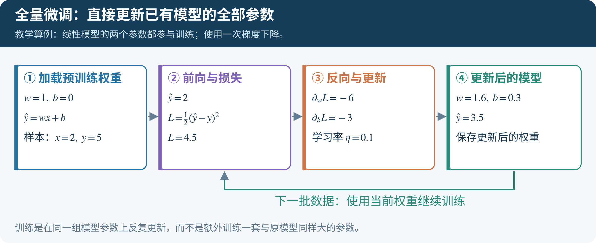
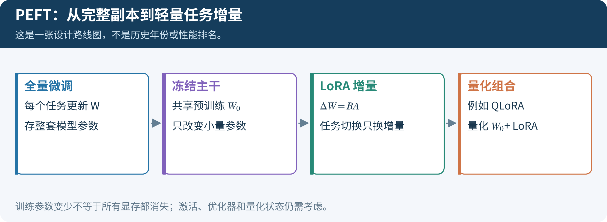
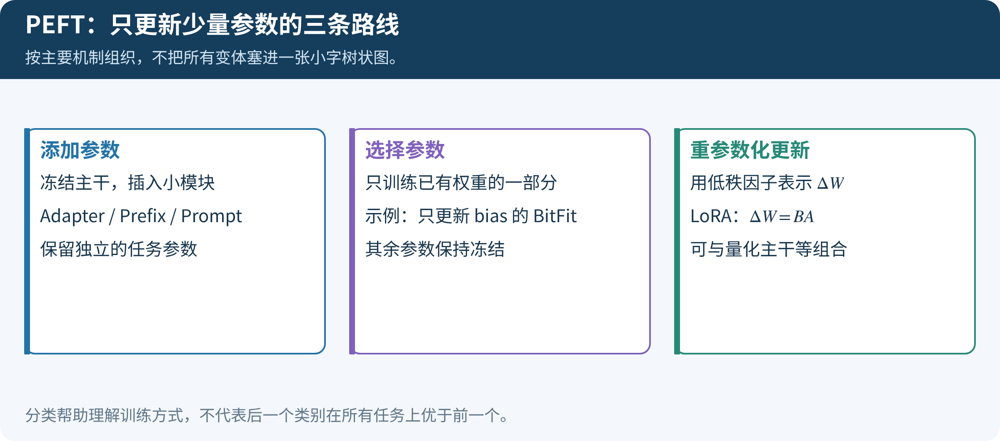
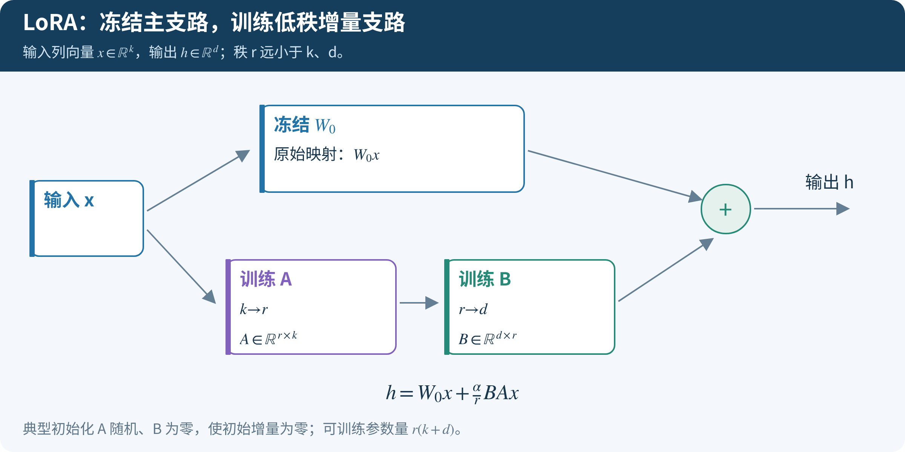

# 1. PEFT 参数高效微调

## 1. 概述

### 1.1. 背景

预训练模型已经学会通用特征，但仍可能需要针对具体任务（如文本分类、领域问答、机器人操作）微调。

**全量微调（Full Fine-Tuning）是怎么做的？**

加载预训练权重作为初始参数，用下游任务的数据计算损失，反向传播求出所有参数的梯度，再由优化器直接更新这些参数。以梯度下降为例：

$$
\theta_{t+1}=\theta_t-\eta\nabla_{\theta_t}L
$$

其中 $\theta_t$ 是当前模型的全部参数，$\eta$ 是学习率，$L$ 是任务损失。全量微调不冻结任何模型参数，也不要求训练时额外保留一份原始预训练权重。



*原创教学示意图：假设预训练模型只有两个参数，预测函数为 $\hat y=wx+b$。初始 $w=1, b=0$，输入 $x=2$ 的目标值为 $y=5$。使用平方误差 $L=\frac12(\hat y-y)^2$ 和学习率 $\eta=0.1$，一次梯度下降同时将两个参数更新为 $w=1.6, b=0.3$，预测值由 2 变为 3.5。真实 Transformer 同样通过任务损失更新权重，只是参数更多、结构更复杂。*

随着模型规模增长，全量微调面临两个主要问题：

1. **训练开销大**：不仅要存储模型权重和中间激活，还要为全部参数计算并保存梯度和优化器状态。模型越大，显存与计算需求通常越高。
2. **多任务存储与部署开销大**：不同任务分别从同一预训练权重出发，全量微调后得到不同的完整模型。每个任务都要保存一套权重，而不是仅保存少量任务相关参数。

例如，以 7B 模型适配十个任务为例，假设模型权重为 FP16，每个 PEFT 任务只需额外训练 100 万个参数：

| 对比项 | 全量微调 | PEFT（以 LoRA 为例） |
|---|---|---|
| 训练时更新的参数量 | 70 亿 | 100 万（假设） |
| 梯度及优化器状态 | 对应全部可训练参数 | 仅对应少量可训练参数 |
| 十个任务的权重存储 | 140 GB（不含原始模型） | 14.02 GB（共享 14 GB 基础模型，十份各 2 MB 的适配器） |

以上为十进制单位的权重存储算例，不是总显存估算。PEFT 可以降低多任务部署的重复权重成本，但单任务推理仍通常需要运行完整基础模型，并不必然降低推理计算量。

**核心问题：能否只更新极少量参数，就实现接近全量微调的性能？** 这就是 PEFT 的出发点。此外，独立切换任务适配器以及限制更新自由度（可能减轻小样本过拟合）也是潜在优势，但泛化改善并非必然。

背景参考：[Adapter（2019）](https://arxiv.org/abs/1902.00751)、[LoRA（2021）](https://arxiv.org/abs/2106.09685)、[内在维度研究（2020）](https://arxiv.org/abs/2012.13255)。

### 1.2. 解决思路

1. PEFT（Parameter-Efficient Fine-Tuning）**通过只训练少量额外参数或少量原始参数，大幅减少训练参数量和显存占用，同时保持与全量微调相近的效果**，直接回应"少量参数接近全量性能"的问题。
2. PEFT 方法按技术思路分为三大类：添加额外参数（Addition-based）、选择性微调原始参数（Partial-based）、重参数化（Reparameterization-based）。
3. 当前最主流的方法是 Reparameterization-based 类别中的 **LoRA**。



---

## 2. PEFT 三大类别


### 2.1. Addition-based：添加额外可训练参数

在冻结的预训练模型上插入新的可训练模块或参数。原始模型权重完全不动，只训练新加的部分。这类方法在实践中已基本被 LoRA 取代——Adapter 增加推理延迟，Prefix/Prompt-Tuning 优化不稳定且占用上下文长度。

| 方法                     | 机制                                           | 可训练参数比例 | 特点                       |
| ---------------------- | -------------------------------------------- | ------- | ------------------------ |
| **Adapter**            | 在 Transformer 层间插入小型 MLP | 5-10%   | 每层加一个 down-up 结构，但增加推理延迟 |
| **Prefix-Tuning**      | 在每层注意力前添加可训练的虚拟 prefix 向量                    | 0.1-1%  | 不增加推理参数，但占用输入序列空间        |
| **Prompt-Tuning**      | 仅在输入层添加可训练的连续 prompt 向量                      | 0.1-1%  | 最轻量，但效果随模型规模有差异          |
| **Side-Tuning**        | 添加旁路小网络，与主网络输出加权融合                           | ~5%     | 不修改主网络结构                 |
| **Ladder-Side-Tuning** | 梯形旁路网络，逐层融合                                  | ~5%     | 比 Side-Tuning 更稳定        |

Adapter 的结构：在每层 Transformer 后插入 `Down → Up` 小 MLP，参数量 $2 \times d \times r$（$r$ 为瓶颈维度）：

```python
# Adapter 结构
hidden = LayerNorm(hidden)
hidden_down = linear_down(hidden)    # d → r
hidden_act = ReLU(hidden_down)
hidden_up = linear_up(hidden_act)    # r → d
output = hidden + hidden_up           # 残差连接
```

Adapter 的关键问题：增加推理延迟。在小 batch 短序列的在线推理场景（Batch=1, Seq=128），Adapter$^\text{L}$ 延迟增加 20.7%，Adapter$^\text{H}$ 增加 30.3%（GPT-2 medium 实测数据）。这是因为 Adapter 层必须顺序处理，无法利用硬件并行性。

Prefix-Tuning 的关键问题：优化困难，性能随可训练参数非单调变化；更重要的是，为适应预留的序列空间减少了可用上下文长度。

### 2.2. Partial-based：选择性微调部分原始参数

不添加新参数，而是从原始模型中选择一部分参数进行微调，其余冻结。这类方法在实际部署中也极少使用——BitFit 效果有限，diff pruning/FishMask 需要额外掩码计算，更多是学术探索而非工程选择。

| 方法               | 选择策略           | 特点                    |
| ---------------- | ---------------- | --------------------- |
| **BitFit**       | 固定规则：只选 bias    | 极轻量（bias 参数占比极小），简单有效 |
| **diff pruning** | 学习稀疏二值掩码        | 动态选择要修改的参数，但需要额外的掩码参数 |
| **FishMask**     | Fisher 信息 top-k% | 用 Fisher 信息衡量参数敏感性     |
| **LLM-Pruner**   | 结构剪枝后微调剩余       | 结合结构剪枝和微调             |
| **LoRADrop**     | 动态丢弃 LoRA 的某些秩     | 结合 LoRA 和动态稀疏         |

各方法的选择机制：

- **BitFit**：最粗暴，硬编码选 bias。bias 参数量极少（<0.1%），但对微调效果的贡献 disproportionate——bias 偏移可以改变激活阈值，相当于对每层特征做轻量校准。
- **diff pruning**：训练一个稀疏二值掩码 $\mathbf{m} \in \{0,1\}^{|\theta|}$，与损失联合优化，动态发现哪些参数重要。代价是额外的掩码参数和优化开销，实际很少使用。
- **FishMask**：先计算每个参数的 Fisher 信息 $\mathcal{I}_i = \mathbb{E}[(\partial \log p / \partial \theta_i)^2]$，Fisher 信息大的参数对损失更敏感→选 top-k% 微调。理论依据最强，但计算 Fisher 信息本身需要一次完整前向/反向遍历，大模型成本不低。

Partial-based 退出主流的根本原因不在选择策略本身，而在于它们都在"选哪些原始参数微调"的框架内做优化——LoRA 换了框架："用低秩旁路学习增量"，比选择参数更灵活（可以表达新方向而非仅偏移），且合入后推理零开销。

### 2.3. Reparameterization-based：重参数化

通过数学变换将原始参数重参数化，使得训练过程中只需更新变换后的低秩参数。这是当前最主流、效果最好的类别。

| 方法             | 机制                         | 可训练参数比例 | 特点                         |
| -------------- | -------------------------- | ------- | -------------------------- |
| **LoRA**       | 权重更新 $\Delta W = BA$（低秩分解） | 1-5%    | 当前最流行的 PEFT 方法，推理零延迟       |
| **QLoRA**      | 量化基础模型 + LoRA              | 1-5%    | 进一步降低显存（4-bit 量化 + LoRA）   |
| **AdaLoRA**    | 自适应分配 LoRA 秩给不同层           | 1-5%    | 重要层分配更高秩                   |
| **Delta-LoRA** | LoRA 更新也影响原始权重             | 1-5%    | 将 $\Delta W$ 的变化量按比例融入 $W$ |
|                |                            |         |                            |

---

## 3. LoRA 核心原理

### 3.1. 全量微调的成本问题

以一个 Transformer 层的线性映射为例，预训练权重 $W_0 \in \mathbb{R}^{d \times k}$（如 $d=4096, k=4096$）。全量微调时前向计算为 $h = W_0 x$，训练时更新 $W_0$。

反向传播时，需要计算 $W_0$ 的梯度 $\frac{\partial \mathcal{L}}{\partial W_0} \in \mathbb{R}^{d \times k}$ 并更新。训练时每个参数需要存储三类数据：

| 类别 | 存储内容 | 数量 | 作用 |
|------|---------|------|------|
| **梯度** | $\frac{\partial \mathcal{L}}{\partial W_0}$ | 1× 参数量 | 告诉优化器参数该往哪个方向改 |
| **优化器 momentum** | 梯度的累积方向 | 1× 参数量 | 记录历史梯度方向，加速收敛 |
| **优化器 variance** | 梯度的平方均值 | 1× 参数量 | 自适应调整每个参数的步长 |

总计 3× 参数量。以 $d=4096, k=4096$ 为例：参数 16M = 64MB（FP16），梯度 64MB，Adam momentum + variance 128MB，合计每层约 192MB。7B 模型全部权重约 10GB+ 仅用于梯度和优化器。
- 每个下游任务需要一份完整模型副本（7B 模型每份约 14GB FP16），多任务存储爆炸

### 3.2. LoRA：低秩适配

LoRA（Low-Rank Adaptation）由 Hu et al. (2021) 提出，**假设预训练模型的权重更新具有"低秩"特性——即微调过程中权重矩阵的变化 $\Delta W$ 可以用低秩矩阵近似**。这一假设基于 Aghajanyan et al. (2020) 的发现：预训练语言模型实际上处于低内在维度上，LoRA 将此假设扩展到权重更新本身。


冻结 $W_0$，引入低秩增量 $\Delta W = BA$（$B \in \mathbb{R}^{d \times r}$, $A \in \mathbb{R}^{r \times k}$，$r \ll \min(d, k)$），前向计算变为：

$$h = W_0 x + \frac{\alpha}{r} BA x$$

公式中各变量的含义：

| 变量 | 维度 | 含义 |
|------|------|------|
| $W_0$ | $\mathbb{R}^{d \times k}$ | 冻结的预训练权重矩阵，不更新 |
| $B$ | $\mathbb{R}^{d \times r}$ | 可训练矩阵，零初始化 |
| $A$ | $\mathbb{R}^{r \times k}$ | 可训练矩阵，Gaussian 初始化 |
| $r$ | — | LoRA 秩（低秩维度，通常 4-64），控制 $\Delta W$ 的表达能力 |
| $\alpha$ | — | 缩放超参数，控制 LoRA 分支相对于原始权重的强度 |

$\frac{\alpha}{r}$ 的作用：$\Delta W = BA$ 的数值范围大约与 $r$ 成正比（$B$ 是 $d \times r$、$A$ 是 $r \times k$，乘积随 $r$ 增长），除以 $r$ 归一化后，无论选择什么秩，LoRA 更新的幅度大致恒定，不需要重新调学习率；$\alpha$ 则独立控制 LoRA 分支对输出的影响强度。当 $\alpha = r$ 时 $\frac{\alpha}{r} = 1$，即默认设定下不做额外缩放。

反向传播时：
- $W_0$ 的梯度不计算、不存储，因为 $W_0$ 不更新
- 只计算 $A$ 和 $B$ 的梯度：$\frac{\partial \mathcal{L}}{\partial A} \in \mathbb{R}^{r \times k}$ 和 $\frac{\partial \mathcal{L}}{\partial B} \in \mathbb{R}^{d \times r}$
- 只存储 $A$ 和 $B$ 的优化器状态：$2 \times (r \times k + d \times r)$ 个浮点数
- 以 $d=4096, k=4096, r=8$ 为例：可训练参数 65K，梯度+优化器约 1.5MB，相比全量微调的 192MB 减少了 **99.2%**

可训练参数总量从 $d \times k$ 降至 $2 \times \hat{L}_{LoRA} \times d_{model} \times r$（论文公式 $|\Theta| = 2 \hat{L}_{LoRA} d_{model} r$，$\hat{L}_{LoRA}$ 为加 LoRA 的层数）。以单层 $d=4096, k=4096, r=8$ 为例：从 16M 参数降至 65K，减少 99.6%。

```python
# LoRA 的前向计算
h = W_0 @ x + (alpha / r) * (B @ A) @ x
# = W_0 @ x + (alpha / r) * B @ (A @ x)
# A @ x 先计算，减少中间矩阵大小

# 初始化（LoRA 原论文的设定）
A = gaussian(r, k, stddev=0.01)  # Gaussian 随机初始化
B = zeros(d, r)                  # 零初始化
# 初始时 ΔW = BA = 0，微调从原始模型状态开始
```

推理时可将 $\frac{\alpha}{r} BA$ 合入 $W_0$（$W = W_0 + \frac{\alpha}{r} BA$），前向计算回到 $h = W_0 x$，与无 LoRA 时形式完全相同，**零推理延迟**。任务切换只需减去 $\frac{\alpha}{r} BA$ 再加上 $\frac{\alpha'}{r'} B'A'$，极低开销。

当 LoRA 的秩 $r$ 设为权重矩阵的原始秩时，LoRA 恢复了全量微调的表达能力——即 LoRA 是全量微调的推广，而非简化。相比之下，Adapter 增加秩时收敛到一个 MLP 结构，Prefix-Tuning 收敛到一个限制上下文长度的模型。

### 3.3. LoRA 实证分析

Hu et al. 在 GPT-3 175B 上系统研究了 LoRA 的设计选择（Section 7）：

**哪些权重矩阵应该加 LoRA**（18M 参数预算下）：

| 权重类型 | $W_q$ | $W_k$ | $W_v$ | $W_o$ | $W_q, W_v$ | 全四种 |
|------|------|------|------|------|------|------|
| WikiSQL | 70.4 | 70.0 | 73.0 | 73.2 | **73.7** | 73.7 |
| MultiNLI | 91.0 | 90.8 | 91.0 | 91.3 | **91.3** | 91.7 |

同时适配 $W_q$ 和 $W_v$ 效果最好，比只适配一种显著提升。只适配 $W_v$ 或 $W_o$ 也优于只适配 $W_q$ 或 $W_k$。

**最优秩 $r$**：

| 权重类型 | $r=1$ | $r=2$ | $r=4$ | $r=8$ | $r=64$ |
|------|------|------|------|------|------|
| $W_q$ WikiSQL | 68.8 | 69.6 | 70.5 | 70.4 | 70.0 |

非常低的秩（$r=1$ 或 $r=2$）就已经足够——即使 $d_{model}=12,288$，增加 $r$ 到 64 并没有显著提升。这验证了"低内在秩"假设：权重更新确实可以用极低秩近似。

**$\Delta W$ 与 $W$ 的关系**：LoRA 学到的更新方向不是 $W$ 的简单缩放，而是新的、与 $W$ 近乎正交的方向。增幅因子 $\|\Delta W\|/\|W\|$ 较大，说明微调将权重推向了新方向而非放大原有特征。

---

## 4. GPU 显存估算

训练和推理的显存需求差异很大——训练需要存储梯度、优化器状态和激活值，推理只需要权重和 KV cache。

### 4.1. 训练显存

训练时每个**可训练参数**需要存储 3 类数据（权重 + 梯度 + Adam 状态），加上前向计算产生的激活值：

| 组成 | 数量 | 说明 |
|------|------|------|
| **模型权重** | 参数量 × 字节数 | FP16 每参数 2 字节，FP32 每参数 4 字节 |
| **梯度** | 1× 参数量 | 反向传播计算，告诉优化器参数该往哪个方向改 |
| **优化器状态** | 2× 参数量（Adam） | momentum（累积方向）+ variance（自适应步长） |
| **激活值** | 取决于 batch/序列长度 | 前向计算每层的中间结果，用于反向传播 |

核心估算公式（下限）：

$$\text{训练显存} \approx \text{参数量} \times \text{字节数} \times (1 + 3) = \text{参数量} \times \text{字节数} \times 4$$

其中 4 = 权重(1) + 梯度(1) + Adam(2)。这是不含激活值的下限，实际显存通常比估算多 50%-100%，因为激活值的大小取决于 batch size 和序列长度。

常见模型在 FP16 精度下的训练显存估算：

| 模型 | 参数量 | 权重 | 梯度+优化器(3×) | 下限合计 | 实际估算（含激活值） |
|------|--------|------|----------------|---------|-----------------|
| 7B | 7B | 14GB | 42GB | ~56GB | ~60-80GB |
| 13B | 13B | 26GB | 78GB | ~104GB | ~120-160GB |
| 70B | 70B | 140GB | 420GB | ~560GB | ~640-800GB |
| GPT-3 175B | 175B | 350GB | 1.05TB | ~1.4TB | ~1.6TB |

**LoRA 训练显存**：冻结的原始权重只占 1×（无梯度、无优化器状态），LoRA 参数占 4×。以 GPT-3 175B 为例：原始权重 350GB + LoRA 参数（18M）× 4 × 2字节 ≈ 0.14GB + 激活值 ≈ **350GB 左右**（比全量微调的 1.2TB 减少 2/3）。

QLoRA 进一步压缩：原始权重 4-bit 量化（每参数 0.5 字节），175B 模型权重仅 ~87.5GB，LoRA 保持 BF16，总显存可降至 ~300GB 级别。7B 模型 QLoRA 训练只需 ~6GB，单 24GB GPU 即可完成。

### 4.2. 推理显存

推理不需要梯度、优化器状态和激活值存储，只需要：

| 组成 | 说明 |
|------|------|
| **模型权重** | 唯一的固定开销 |
| **KV cache** | 自回归生成时缓存每层的 Key/Value，随序列长度和 batch size 增长 |

$$\text{推理显存} \approx \text{参数量} \times \text{字节数} + \text{KV cache}$$

KV cache 的计算：

$$\text{KV cache} = 2 \times n_{\text{layers}} \times d_{\text{model}} \times n_{\text{heads}} \times \text{seq\_len} \times \text{batch} \times \text{bytes}$$

以 LLaMA-7B 为例（32 层，4096 维度，32 heads，FP16）：
- 模型权重：14GB
- KV cache（batch=1, seq=2048）：$2 \times 32 \times 4096 \times 32 \times 2048 \times 2\text{B} \approx 2\text{GB}$ 单条序列
- 总计约 16GB，单 GPU 可运行

推理显存远小于训练显存。LoRA 合入后推理显存与原始模型完全相同（零额外开销），不合入时额外增加 LoRA 权重（约 35MB for GPT-3 175B，可忽略）。

### 4.3. 训练 vs 推理显存对比

| 场景 | 7B 模型 (FP16) | 175B 模型 (FP16) |
|------|---------------|-----------------|
| 全量微调训练 | ~60-80GB | ~1.6TB |
| LoRA 训练 | ~20-30GB | ~350GB |
| QLoRA 训练 | ~6-8GB | ~300GB |
| 推理（单 batch） | ~16GB | ~350GB |

关键差异：训练显存是推理显存的 3-5 倍，因为训练需要梯度(1×) + 优化器(2×) + 激活值。LoRA 将训练显存中的 3× 开销从全部参数缩减到极少量 LoRA 参数，这是 LoRA 的核心实用价值。

---

## 5. LoRA 变体

### 5.1. QLoRA：量化 + LoRA

QLoRA 在 LoRA 的基础上进一步降低显存：

1. 基础模型用 4-bit NormalFloat（NF4）量化存储
2. 计算时反量化到 BF16 进行前向/反向传播
3. LoRA 适配器保持 BF16
4. 使用分页优化器（Paged Optimizers）避免显存峰值

效果：7B 模型全量微调需要 ~60GB 显存，QLoRA 只需 ~6GB（单 24GB GPU 可训练）。

### 5.2. AdaLoRA：自适应秩分配

不同层/不同注意力头对微调的贡献不同。AdaLoRA 动态调整各层的 LoRA 秩 $r$：
- 重要层分配更高秩（更多可训练参数）
- 不重要层分配更低秩（甚至 $r=0$，即不训练）
- 通过正则化项鼓励秩的稀疏分配

---

## 6. LoRA 在机器人学习中的应用

LoRA 在 VLA 和机器人策略微调中广泛使用：

- **π₀ LoRA 微调**：Physical Intelligence 官方推荐的微调方式，冻结 VLM backbone，只在动作头加 LoRA
- **SmolVLA LoRA**：SmolVLA 的单 GPU 训练方案
- **LeRobot PEFT 训练**：`lerobot-train --policy.use_peft=true --policy.peft_method=lora`

参见 OpenPI-LoRA微调实现 的具体实践。

---

## 7. 实验与对比

### 7.1. 参数效率对比

| 方法 | 可训练参数比例 | 显存降低 | 性能（vs Full FT） | 推理延迟 |
|------|---------------|---------|-------------------|---------|
| Full FT | 100% | 0% | baseline | 0 |
| Adapter | 5-10% | ~60% | 接近 | 增加（额外 MLP） |
| Prefix-Tuning | 0.1-1% | ~90% | 略低 | 增加（序列更长） |
| Prompt-Tuning | 0.1-1% | ~90% | 大模型时接近 | 0 |
| BitFit | ~0.1% | ~95% | 略低 | 0 |
| **LoRA** | **1-5%** | **~70%** | **接近/等同** | **0（合入后）** |
| **QLoRA** | **1-5%** | **~90%** | **接近** | **0** |

### 7.2. GPT-3 175B 上的效果

- 可训练参数减少 10,000×（175B → 18M，仅 0.01%）
- GPU 内存从 1.2TB 降至 350GB（减少 2/3）
- 训练速度提升 25%（43.1 vs 32.5 tokens/s per V100 GPU）
- Checkpoint 大小从 350GB 降至 35MB（10,000×）
- 100 个适配模型只需 354GB（350GB + 35MB × 100），而全量微调需要 35TB

### 7.3. 推理延迟对比

GPT-2 medium 推理延迟（在线推理场景 Batch=1, Seq=128）：

| 方法 | 延迟 (ms) | 相对增加 |
|------|----------|---------|
| Full FT / LoRA | 19.8 | 0 |
| Adapter$^\text{L}$ | 23.9 | +20.7% |
| Adapter$^\text{H}$ | 25.8 | +30.3% |

Adapter 在小 batch 短序列的在线推理场景下延迟增加显著。LoRA 合入后零延迟。

### 7.4. 优劣分析

**LoRA 的优势**：
- 参数效率高，显存友好
- 推理零开销（合入机制）
- 多任务部署灵活（基础模型 + 多套 LoRA adapter）
- 实现简单，社区支持成熟

**LoRA 的局限**：
- 低秩假设可能不适用于所有任务（某些任务需要高秩更新）
- 秩 $r$ 的选择需要实验调优
- 多任务同时服务时需要动态加载/切换 LoRA 权重

**Adapter 的局限**：
- 增加推理延迟（每层额外 MLP 计算，无法利用硬件并行性）
- 瓶颈维度 $r$ 过小会损失信息
- 已基本退出主流使用，LoRA 的合入机制完全覆盖其功能优势

**Prefix/Prompt-Tuning 的局限**：
- 效果对小模型不稳定
- Prefix 占用输入序列空间，减少可用上下文长度
- 优化困难，性能随参数量非单调变化
- 已基本退出主流使用

**Partial-based 方法的现状**：
- 主要用作实验基线对照（如 BitFit），而非实际部署方案
- diff pruning / FishMask 理论有趣但实现复杂，极少使用

---

## 8. 参考

- Xu et al., "Parameter-Efficient Fine-Tuning Methods for Pretrained Language Models: A Critical Review and Assessment", arXiv 2312.12148, 2023
- Hu et al., "LoRA: Low-Rank Adaptation of Large Language Models", ICLR 2022
- Dettmers et al., "QLoRA: Efficient Finetuning of Quantized LLMs", NeurIPS 2023
- Aghajanyan et al., "Intrinsic Dimensionality Explains the Effectiveness of Language Model Fine-Tuning", 2020

## 9. 关联

- 大模型与训练 - 大模型训练的整体框架
- Transformer架构 - LoRA 作用于 Transformer 的注意力层
- VLA视觉语言动作模型 - LoRA 用于 VLA 微调
- OpenPI-LoRA微调实现 - π₀ LoRA 微调的实践
- LeRobot机器人学习框架 - LeRobot 的 PEFT 训练

<!-- 反向链接 -->
## 10. 反向链接

- 大模型与训练 - 微调方法章节引用
- OpenPI-LoRA微调实现 - LoRA 微调的具体实践