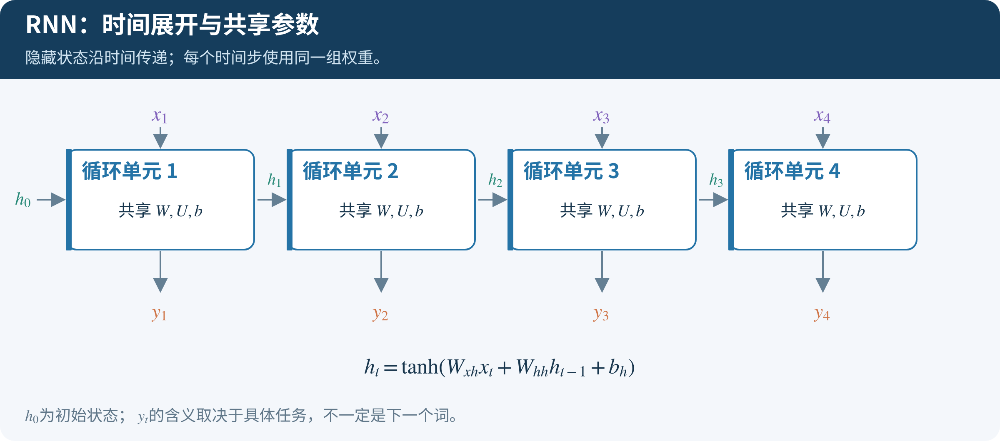
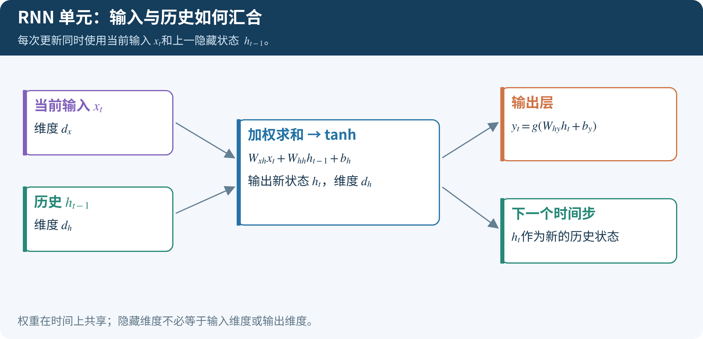
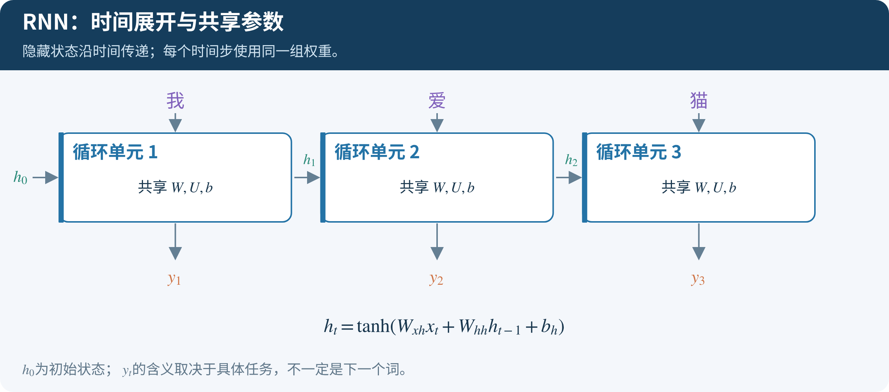
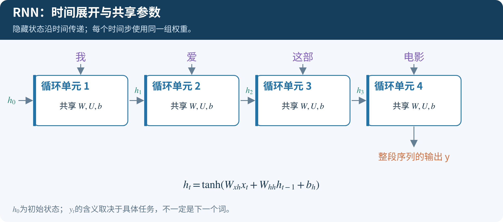
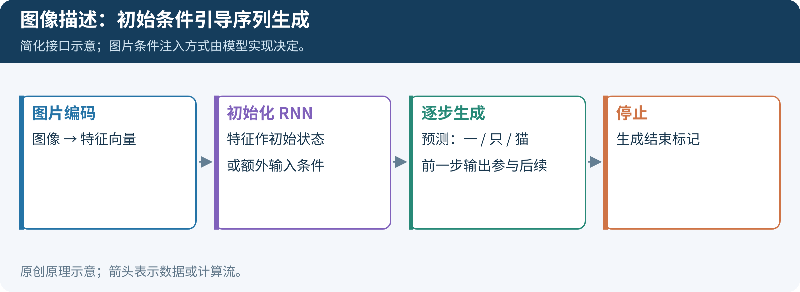
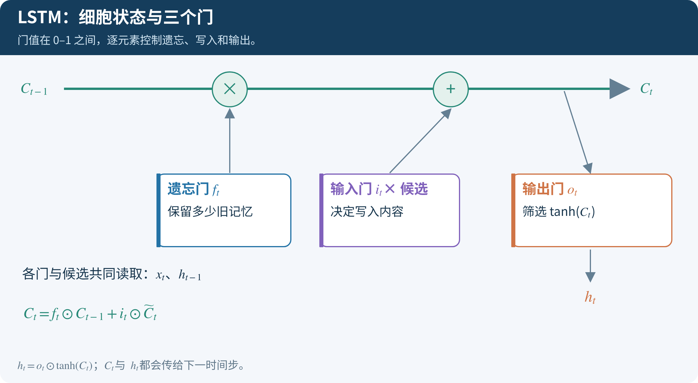

# RNN 循环神经网络

## 概述

### 背景

1. 循环神经网络（Recurrent Neural Networks, RNNs）是一类专门用于处理**序列数据**的神经网络；与 [CNN](cnn.md) 针对空间数据（图像）不同，RNN 针对的是有**时间顺序的数据**——文本、语音、股价走势等。
2. 在这些数据中，**当前时刻的含义取决于之前的上下文**："我爱猫"和"猫爱我"字一样，意思完全不同，顺序至关重要。
3. 传统前馈网络（包括 CNN）每次处理一个输入时，只看当前数据本身，不看历史，无法利用序列中的上下文信息。

### 解决思路

1. **RNN 引入隐藏状态（hidden state）来"记住"之前输入的信息**：每处理一个新的输入，网络不仅看当前输入，还把上一时刻的记忆拿来一起处理，使每个输出都蕴含了整个序列的上下文信息——解决"只看当前输入、忽视历史"的问题。
2. RNN 的核心设计是**权重跨时间步共享**：每个时间步都用同一组权重处理当前输入和上一隐藏状态，使网络能用固定参数量处理任意长度的序列。

---

## 1 循环操作

### 1.1 循环的本质：用隐藏状态记忆过去

RNN 的核心是一个**循环单元**：在每个时间步，它接收两个输入——**当前时刻的数据 $x_t$** 和**上一时刻的隐藏状态 $h_{t-1}$**，将两者融合后输出新的隐藏状态 $h_t$。

*原创重绘；可编辑 [SVG](../../imgs/foundations-rnn-cell.svg)。*

**隐藏状态 $h_t$ 的含义**：它是一个向量，编码了"到目前为止序列中发生了什么"的摘要信息。初始状态 $h_0$ 通常设为全零向量。

**为什么叫"循环"**：因为 $h_t$ 既是当前步的输出，也是下一步的输入——信息沿着时间轴形成回路。这和 [CNN](cnn.md) 的前馈结构不同：CNN 的信息只从输入流向输出，没有回路。

### 1.2 RNN 展开（Unfolding）

循环结构难以直接理解，因此通常将 RNN **按时间步展开**——把循环拆成一条链，每个时间步变成一个"层"：

*原创重绘；可编辑 [SVG](../../imgs/foundations-rnn-unrolled.svg)。*

展开后可以看到：
- 每个时间步的结构完全相同（同一个循环单元）
- 所有时间步**共享同一组权重**（不像 CNN 每层有独立的权重）
- 序列长度 $T$ 可以任意变化，参数量始终不变

### 1.3 前向计算详解

以处理句子"我 爱 猫"为例，每个词先被转换为向量（通过词嵌入），然后依次输入 RNN：

**时间步 1**：输入 $x_1$（"我"的词向量），初始隐藏状态 $h_0 = \mathbf{0}$

$$h_1 = \tanh(W_{xh} \cdot x_1 + W_{hh} \cdot h_0 + b_h) = \tanh(W_{xh} \cdot x_1 + b_h)$$

此时 $h_1$ 编码了"出现了'我'"这个信息。

**时间步 2**：输入 $x_2$（"爱"的词向量），上一隐藏状态 $h_1$

$$h_2 = \tanh(W_{xh} \cdot x_2 + W_{hh} \cdot h_1 + b_h)$$

此时 $h_2$ 编码了"出现了'我'之后出现了'爱'"——融合了前两个词的上下文。

**时间步 3**：输入 $x_3$（"猫"的词向量），上一隐藏状态 $h_2$

$$h_3 = \tanh(W_{xh} \cdot x_3 + W_{hh} \cdot h_2 + b_h)$$

此时 $h_3$ 编码了整个句子"我爱猫"的上下文信息。

**$y_t$ 是什么**：$y_t = W_{hy} \cdot h_t + b_y$，是隐藏状态经过输出投影层后的预测结果。它的含义取决于任务：

| 任务 | $y_t$ 的含义 | 产生时机 |
|------|------------|---------|
| 语言建模 | 词表上的概率分布（预测下一个词） | 每个时间步 |
| 感感分析 | 正面/负面的分类概率 | 只在最后一步（$y_T$） |
| 序列标注 | 每个位置的分类结果（如命名实体识别） | 每个时间步 |

在"我爱猫"的语言建模例子中，$y_1$ 是看完"我"后预测下一个词的概率分布，$y_2$ 是看完"我爱"后预测下一个词的概率分布。

*原创重绘；可编辑 [SVG](../../imgs/foundations-rnn-language.svg)。*

**关键观察**：
- **每个 $h_t$ 都蕴含了从 $x_1$ 到 $x_t$ 所有输入的信息**——这就是 RNN 的"记忆"
- **权重 $W_{xh}$、$W_{hh}$、$b_h$ 在所有时间步完全相同**——序列越长，参数效率越高
- **输出 $y_t$** 在每个时间步都可以产生（也可以只在最后一个时间步产生，取决于任务类型）

### 1.4 关键参数

| 参数 | 说明 | 常见值 |
|------|------|--------|
| **隐藏维度 $d_h$** | 隐藏状态向量的长度，决定"记忆容量" | 64, 128, 256 |
| **输入维度 $d_x$** | 每个时间步输入向量的长度 | 词表大小（10000）、嵌入维度（300） |
| **输出维度 $d_y$** | 每个时间步输出向量的长度 | 词表大小（10000）、类别数（2） |

**各参数的影响**：

- **隐藏维度 $d_h$**：决定 RNN 的记忆容量和表达能力。$d_h$ 越大，隐藏状态向量越长，能编码更丰富的上下文信息；但参数量成平方增长（$W_{hh}$ 是 $d_h \times d_h$），训练也更慢。常见选择 128-256，超过 512 很少使用，因为 LSTM/GRU 更适合处理长序列
- **输入维度 $d_x$**：取决于输入数据的表示方式。在 NLP 中，通常先通过词嵌入将词 ID 映射为低维向量（如 300 维），再输入 RNN——此时 $d_x=300$，远小于词表大小 10000，大大减少 $W_{xh}$ 的参数量
- **输出维度 $d_y$**：取决于任务。语言建模时 $d_y=$ 词表大小（预测下一个词的概率分布），情感分析时 $d_y=2$（正面/负面），此时只在最后一个时间步产生输出

---

## 2 RNN 的基本结构

### 2.1 核心模式：循环单元的重复

和 CNN 的"卷积块 × N"类似，RNN 的核心模式是**循环单元 × T 个时间步**：

*原创重绘；可编辑 [SVG](../../imgs/foundations-rnn-unrolled.svg)。*

- **循环单元重复 T 次**：T 是序列长度，由输入数据决定（不是网络设计参数）。处理 3 个词的句子 T=3，处理 100 个词的句子 T=100
- **所有时间步共享权重**：无论 T 多大，参数量始终不变
- **输出方式取决于任务类型**（见 §2.3）

### 2.2 数据流示例（Many-to-One：情感分析）

以情感分析为例，输入"我 爱 这部电影"，输出一个正面/负面的判断：

*原创重绘；可编辑 [SVG](../../imgs/foundations-rnn-classification.svg)。*

Many-to-One 只在**最后一个时间步**产生输出，因为只有看完整个句子才能判断情感。$h_5$ 编码了整个句子的信息，通过一个全连接层 + [Softmax](activation-functions.md) 输出分类概率。

### 2.3 四种架构变体

RNN 的输入输出方式取决于任务，有四种基本架构：

**1. One-to-One**：单个输入，单个输出。实际上就是普通前馈网络，没有序列处理能力。

**2. One-to-Many**：单个输入，输出一个序列。典型应用：图像字幕生成——输入一张图片（通过 [CNN](cnn.md) 提取特征），输出描述该图片的词序列。

*原创重绘；可编辑 [SVG](../../imgs/foundations-rnn-generation.svg)。*

**3. Many-to-One**：输入序列，输出单个结果。典型应用：情感分析——输入一句话，输出情感类别。

*原创重绘；可编辑 [SVG](../../imgs/foundations-rnn-classification.svg)。*

**4. Many-to-Many**：输入和输出都是序列。典型应用：机器翻译——输入源语言序列，输出目标语言序列。有两种形式：
- **同步**：每个时间步都有输出（如视频帧标注）
- **异步**：先读完输入序列，再逐个生成输出序列（如翻译，先读完整句再翻译）

| 架构 | 输入 | 输出 | 何时产生输出 | 典型应用 |
|------|------|------|------------|----------|
| One-to-One | 单个 | 单个 | 一步 | 简单分类 |
| One-to-Many | 单个 | 序列 | 每步 | 图像字幕 |
| Many-to-One | 序列 | 单个 | 最后一步 | 情感分析 |
| Many-to-Many | 序列 | 序列 | 每步或最后 | 机器翻译 |

---

## 3 RNN 变体详解

### 3.1 Vanilla RNN

最简单的 RNN，使用单个隐藏状态和 $\tanh$ 激活函数。

#### 3.1.1 输入与输出

每个时间步的输入是一个向量 $x_t$（维度 $d_x$）和上一隐藏状态 $h_{t-1}$（维度 $d_h$），输出是新的隐藏状态 $h_t$（维度 $d_h$）和可选的预测 $y_t$（维度 $d_y$）。

#### 3.1.2 计算方式

$$h_t = \tanh(W_{xh} \cdot x_t + W_{hh} \cdot h_{t-1} + b_h)$$

$$y_t = W_{hy} \cdot h_t + b_y$$

其中：
- $W_{xh}$：将当前输入映射到隐藏空间
- $W_{hh}$：将上一隐藏状态映射到当前隐藏空间（**循环权重**——这是 RNN 的核心参数）
- $b_h$：隐藏状态偏置
- $W_{hy}$：将隐藏状态映射到输出空间
- $b_y$：输出偏置

**计算过程拆解**：

*原创重绘；可编辑 [SVG](../../imgs/foundations-rnn-cell.svg)。*

#### 3.1.3 可学习参数

| 参数 | 形状 | 说明 |
|------|------|------|
| $W_{xh}$ | $(d_x, d_h)$ | 输入到隐藏状态的权重 |
| $W_{hh}$ | $(d_h, d_h)$ | 隐藏状态到隐藏状态的循环权重 |
| $b_h$ | $(d_h)$ | 隐藏状态偏置 |
| $W_{hy}$ | $(d_h, d_y)$ | 隐藏状态到输出的权重（可选） |
| $b_y$ | $(d_y)$ | 输出偏置（可选） |

**核心参数量**（不含输出层）：$d_x \times d_h + d_h \times d_h + d_h$

以 $d_h=128$、$d_x=10000$（词表大小）为例：
- $W_{xh}$: $10000 \times 128 = 1,280,000$
- $W_{hh}$: $128 \times 128 = 16,384$
- $b_h$: $128$
- 含输出层：$+ 128 \times 10000 + 10000 = 1,290,000$
- **合计**: $\approx 2.58M$

**关键点**：$W_{hh}$ 是 RNN 最核心的参数——它控制"过去的记忆如何影响现在"。所有时间步共享这组权重，序列长度不影响参数量。

#### 3.1.4 局限性

Vanilla RNN 的致命问题是**梯度消失**：反向传播时梯度随时间步指数递减，导致早期时间步的权重几乎不更新。本质原因是隐藏状态的递推依赖链中反复乘以同一权重矩阵 $W_{hh}$：

$$\frac{\partial h_t}{\partial h_{t-k}} = \prod_{j=k}^{t-1} \frac{\partial h_{j+1}}{\partial h_j} = (W_{hh})^k$$

当 $W_{hh}$ 的最大奇异值 $< 1$ 时，$(W_{hh})^k \to 0$（梯度消失）；$> 1$ 时，$(W_{hh})^k \to \infty$（梯度爆炸）。这使得 Vanilla RNN 只能学习短期依赖（约 10-20 个时间步），难以处理长序列。

### 3.2 LSTM（长短期记忆网络）

LSTM 通过引入**细胞状态（cell state）**和**门控机制**解决 Vanilla RNN 的长期依赖问题。

#### 3.2.1 核心设计思路

Vanilla RNN 的问题在于：隐藏状态 $h_t$ 每一步都要被 $\tanh$ 和 $W_{hh}$ 压缩变换，旧信息不断被"污染"。LSTM 的解决方案是**开辟一条信息高速公路**——细胞状态 $C_t$ 通过加法（而非乘法）传递信息，门控机制决定哪些信息驶入/驶出这条公路。

#### 3.2.2 输入与输出

每个时间步的输入：当前输入 $x_t$（$d_x$ 维）+ 前一隐藏状态 $h_{t-1}$（$d_h$ 维）+ 前一细胞状态 $C_{t-1}$（$d_h$ 维）。

输出：新隐藏状态 $h_t$（$d_h$ 维）+ 新细胞状态 $C_t$（$d_h$ 维）。

#### 3.2.3 门控机制详解

LSTM 有三个门，每个门使用 [sigmoid](activation-functions.md) 函数输出 $0$ 到 $1$ 之间的值，实现对信息的选择性保留与丢弃：

**1. 遗忘门（Forget Gate）**——决定从细胞状态中保留或移除哪些旧信息：

$$f_t = \sigma(W_f \cdot [h_{t-1}, x_t] + b_f)$$

$f_t$ 接近 $0$ 表示丢弃对应信息，接近 $1$ 表示保留。

**2. 输入门（Input Gate）**——控制向细胞状态添加哪些新信息，分两步：

- sigmoid 决定哪些位置需要更新：$i_t = \sigma(W_i \cdot [h_{t-1}, x_t] + b_i)$
- tanh 生成候选值向量：$\tilde{C}_t = \tanh(W_C \cdot [h_{t-1}, x_t] + b_C)$

**3. 输出门（Output Gate）**——决定细胞状态的哪些部分作为隐藏状态输出：

$$o_t = \sigma(W_o \cdot [h_{t-1}, x_t] + b_o)$$

#### 3.2.4 细胞状态与隐藏状态更新

**细胞状态更新**——结合遗忘门和输入门，先丢弃旧信息再添加新信息：

$$C_t = f_t \odot C_{t-1} + i_t \odot \tilde{C}_t$$

其中 $\odot$ 表示逐元素乘法。$f_t \odot C_{t-1}$ 选择性保留旧信息，$i_t \odot \tilde{C}_t$ 选择性添加新信息。

**隐藏状态输出**——细胞状态先通过 $\tanh$ 缩放到 $[-1, +1]$，再与输出门逐元素相乘：

$$h_t = o_t \odot \tanh(C_t)$$

#### 3.2.5 LSTM 数据流总结

*原创重绘；可编辑 [SVG](../../imgs/foundations-lstm.svg)。*

| 步骤 | 公式 | 功能 |
|------|------|------|
| **遗忘门** | $f_t = \sigma(W_f \cdot [h_{t-1}, x_t] + b_f)$ | 决定移除哪些旧信息 |
| **输入门** | $i_t = \sigma(W_i \cdot [h_{t-1}, x_t] + b_i)$ | 控制添加哪些新信息 |
| **候选细胞** | $\tilde{C}_t = \tanh(W_C \cdot [h_{t-1}, x_t] + b_C)$ | 生成新信息的候选值 |
| **细胞更新** | $C_t = f_t \odot C_{t-1} + i_t \odot \tilde{C}_t$ | 更新细胞状态 |
| **输出门** | $o_t = \sigma(W_o \cdot [h_{t-1}, x_t] + b_o)$ | 控制输出哪些信息 |
| **隐藏状态** | $h_t = o_t \odot \tanh(C_t)$ | 计算当前输出 |

#### 3.2.6 可学习参数

LSTM 有 4 组权重矩阵（遗忘门、输入门、候选细胞、输出门各一组），每组都包含对 $h_{t-1}$ 和 $x_t$ 的权重：

| 参数 | 形状 | 说明 |
|------|------|------|
| $W_f$ | $(d_h + d_x, d_h)$ | 遗忘门权重 |
| $b_f$ | $(d_h)$ | 遗忘门偏置 |
| $W_i$ | $(d_h + d_x, d_h)$ | 输入门权重 |
| $b_i$ | $(d_h)$ | 输入门偏置 |
| $W_C$ | $(d_h + d_x, d_h)$ | 候选细胞权重 |
| $b_C$ | $(d_h)$ | 候选细胞偏置 |
| $W_o$ | $(d_h + d_x, d_h)$ | 输出门权重 |
| $b_o$ | $(d_h)$ | 输出门偏置 |

**总参数量**：$4 \times [(d_h + d_x) \times d_h + d_h] = 4 \times (d_h + d_x + 1) \times d_h$

以 $d_h=128$、$d_x=10000$ 为例：
- 4 组权重：$4 \times (128 + 10000) \times 128 = 4 \times 1,012,800 = 4,051,200$
- 4 组偏置：$4 \times 128 = 512$
- **合计**: $\approx 4.05M$（比 Vanilla RNN 多约 2 倍，多出来的正是门控机制的参数）

#### 3.2.7 LSTM 如何解决梯度消失/爆炸

传统 RNN 梯度消失的根本原因是 $h_t$ 对 $h_{t-k}$ 的依赖链中反复乘以 $W_{hh}$。LSTM 通过以下机制缓解：

- **细胞状态的加性更新**：$C_t = f_t \odot C_{t-1} + i_t \odot \tilde{C}_t$ 中，$C_{t-1}$ 通过加法（而非乘法）传递，避免了梯度的连乘效应
- **遗忘门的自调节**：$f_t$ 接近 $1$ 时，$C_{t-1}$ 几乎无损传递，梯度可沿细胞状态路径稳定回传
- **门控 sigmoid 的作用是选择性过滤而非反复乘积**：sigmoid 的导数最大值为 $0.25$，但在门控机制中它决定"放多少信息通过"，不会导致梯度指数衰减

#### 3.2.8 LSTM 应用场景

| 应用 | 描述 |
|------|------|
| 语言建模/翻译 | 机器翻译、文本摘要，学习词间依赖 |
| 语音识别 | 将口语转为文字，学习音频信号的时序模式 |
| 时间序列预测 | 股价、天气、能耗预测 |
| 异常检测 | 检测欺诈或网络入侵 |
| 视频分析 | 与 [CNN](cnn.md) 结合处理序列帧 |

### 3.3 GRU（门控循环单元）

GRU 是 LSTM 的简化变体：将输入门和遗忘门合并为单个**更新门**，将细胞状态和隐藏状态合并为单一隐藏状态，参数量减少约 25%。

#### 3.3.1 输入与输出

每个时间步的输入：当前输入 $x_t$（$d_x$ 维）+ 前一隐藏状态 $h_{t-1}$（$d_h$ 维）。

输出：新隐藏状态 $h_t$（$d_h$ 维）。只有隐藏状态，没有单独的细胞状态。

#### 3.3.2 门控机制

**1. 重置门（Reset Gate）**——决定忽略多少过去信息：

$$r_t = \sigma(W_r \cdot [h_{t-1}, x_t] + b_r)$$

**2. 更新门（Update Gate）**——同时承担 LSTM 遗忘门和输入门的角色，控制新旧信息的混合比例：

$$z_t = \sigma(W_z \cdot [h_{t-1}, x_t] + b_z)$$

**3. 候选隐藏状态**——结合重置门，生成当前时间步的新信息：

$$\tilde{h}_t = \tanh(W \cdot [r_t \odot h_{t-1}, x_t] + b)$$

$r_t \odot h_{t-1}$ 表示重置门对旧隐藏状态的选择性过滤。$r_t$ 接近 $0$ 时，旧信息被忽略，相当于"重新开始"；接近 $1$ 时，保留旧信息。

**4. 隐藏状态更新**——更新门控制新旧信息的混合比例：

$$h_t = (1 - z_t) \odot h_{t-1} + z_t \odot \tilde{h}_t$$

当 $z_t$ 接近 $0$ 时，保留旧信息；接近 $1$ 时，采用新信息。这和 LSTM 细胞状态更新的加性结构类似，同样有助于缓解梯度消失。

#### 3.3.3 可学习参数

GRU 只有 3 组权重矩阵（重置门、更新门、候选隐藏状态）：

| 参数 | 形状 | 说明 |
|------|------|------|
| $W_r$ | $(d_h + d_x, d_h)$ | 重置门权重 |
| $b_r$ | $(d_h)$ | 重置门偏置 |
| $W_z$ | $(d_h + d_x, d_h)$ | 更新门权重 |
| $b_z$ | $(d_h)$ | 更新门偏置 |
| $W$ | $(d_h + d_x, d_h)$ | 候选隐藏状态权重 |
| $b$ | $(d_h)$ | 候选隐藏状态偏置 |

**总参数量**：$3 \times [(d_h + d_x) \times d_h + d_h] = 3 \times (d_h + d_x + 1) \times d_h$

以 $d_h=128$、$d_x=10000$ 为例：**合计** $\approx 3.04M$（约为 LSTM 的 75%）

### 3.4 Bidirectional RNN

双向 RNN 同时处理前向和后向输入，捕获每个时间步的过去和未来上下文。相当于两个独立 RNN 分别从左到右和从右到左处理序列，输出时将两个方向的隐藏状态拼接。

**优势**：
- 能访问完整序列信息（既看过过去也看过未来）
- 适合命名实体识别、问答等需要完整上下文的任务
- 局限：不能用于实时生成（因为需要看到未来的输入）

### 3.5 变体演进脉络：每个变体解决了什么问题

| 问题 | Vanilla RNN | LSTM 如何解决 | GRU 如何解决 |
|------|-------------|--------------|--------------|
| **梯度消失**：$\frac{\partial h_t}{\partial h_{t-k}} = (W_{hh})^k \to 0$，早期时间步梯度趋近零，无法学习 | 致命缺陷，只能处理约 10-20 步 | 细胞状态 $C_t$ 用**加法更新**（$f \odot C_{t-1} + i \odot \tilde{C}_t$），梯度沿加法路径稳定回传，不再连乘衰减 | 隐藏状态用**加法更新**（$(1-z) \odot h_{t-1} + z \odot \tilde{h}_t$），同理避免连乘 |
| **梯度爆炸**：$(W_{hh})^k \to \infty$，权重剧烈更新 | 不稳定 | 门控 sigmoid 限制信息流幅度 + Gradient Clipping | 同 LSTM |
| **信息污染**：每步 $h_t = \tanh(W_{hh} \cdot h_{t-1} + ...)$，旧信息被反复压缩变换，逐步失真 | 所有信息混在一起，无法选择性保留或丢弃 | **遗忘门**选择性丢弃旧信息，**输入门**选择性添加新信息，信息不再无差别混合 | **重置门**选择性忽略旧信息，**更新门**控制新旧混合比例 |
| **长期依赖**：无法记住序列开头的信息 | 差 | 遗忘门 $f_t \approx 1$ 时 $C_t$ 几乎无损传递，信息可跨数百步保留 | 更新门 $z_t \approx 0$ 时 $h_t$ 几乎无损传递 |
| **参数效率** | 2 组权重，参数最少但能力最弱 | 4 组权重，参数多 2 倍换来门控能力 | 3 组权重，合并遗忘门+输入门为更新门，参数约为 LSTM 的 75%，多数任务性能相当 |

**演进逻辑**：Vanilla RNN 的根本问题是**信息通过乘法链传递**（$W_{hh}$ 连乘），导致梯度消失和信息失真。LSTM 和 GRU 的共同解法是引入**门控 + 加法更新**——门控决定"放什么信息通过"，加法确保"信息无损传递"。LSTM 用独立的细胞状态通道和三个门做精细控制；GRU 把细胞状态和隐藏状态合并、把遗忘门+输入门合并为更新门，在保留核心能力的同时减少参数。

### 3.6 三种变体对比

| 特性 | Vanilla RNN | LSTM | GRU |
|------|-------------|------|-----|
| **门数量** | 0 | 3 个门（遗忘、输入、输出） | 2 个门（重置、更新） |
| **状态数量** | 仅隐藏状态 | 细胞状态 + 隐藏状态 | 仅隐藏状态 |
| **权重矩阵组数** | 2 组 ($W_{hh}, W_{xh}$) | 4 组 (遗忘、输入、候选、输出) | 3 组 (重置、更新、候选) |
| **参数量** ($d_h=128, d_x=10000$) | $\approx 2.58M$ | $\approx 4.05M$ | $\approx 3.04M$ |
| **梯度问题** | 严重梯度消失 | 通过加性更新缓解 | 通过加性更新缓解 |
| **长期依赖** | 差（约 10-20 步） | 好 | 好 |
| **训练速度** | 最快 | 最慢 | 中等 |
| **适用场景** | 短序列、简单任务 | 复杂长序列依赖 | 多数任务性能与 LSTM 相当 |

**核心结论**：RNN/LSTM/GRU 的可学习参数就是各门的权重矩阵和偏置，这些参数**跨所有时间步共享**——序列越长，效率越高（不像 [CNN](cnn.md) 的全连接层参数量随输入维度爆炸）。LSTM 比 Vanilla RNN 参数多约 2 倍，多出来的参数正是门控机制所需的权重，这些门控让 LSTM 能选择性保留/丢弃信息，解决梯度消失。

---

## 4 训练：BPTT（通过时间的反向传播）

### 4.1 为什么需要 BPTT

由于 RNN 处理序列数据，标准反向传播不能直接应用。BPTT 将展开后的 RNN 视为一个深度网络（每个时间步是一"层"），沿时间轴反向传播梯度。

### 4.2 梯度计算

损失函数 $L(\theta)$ 依赖于各时间步的输出，而每个隐藏状态都依赖于前一个状态，形成链式依赖：

$$\frac{\partial L(\theta)}{\partial W} = \frac{\partial L(\theta)}{\partial h_T} \cdot \sum_{k=1}^{T} \frac{\partial h_T}{\partial h_k} \cdot \frac{\partial h_k}{\partial W}$$

其中 $\frac{\partial h_T}{\partial h_k} = \prod_{j=k}^{T-1} \frac{\partial h_{j+1}}{\partial h_j}$ 是连乘项——这正是梯度消失/爆炸的根源。

### 4.3 截断 BPTT

实践中常使用**截断 BPTT**：只回传固定步数（如 20 步）的梯度，而不是回传整个序列。这既减少了计算量，也缓解了梯度消失问题。

---

## 5 局限性与解决方案

### 5.1 梯度消失

反向传播时梯度随时间步指数递减，导致早期时间步的权重几乎不更新：

$$\left|\frac{\partial h_t}{\partial h_{t-k}}\right| \to 0 \text{ as } k \to \infty$$

### 5.2 梯度爆炸

某些情况下梯度指数增长，导致权重大幅更新，训练不稳定。

### 5.3 解决方案

| 问题 | 解决方案 |
|------|----------|
| 梯度消失 | LSTM、GRU、Gradient Clipping |
| 梯度爆炸 | Gradient Clipping、正则化 |
| 长期依赖 | LSTM、GRU、Transformer |
| 计算效率 | 截断 BPTT |

---

## 6 与 CNN 和前馈网络对比

| 特性 | 前馈网络 (FNN) | [CNN](cnn.md) | RNN |
|------|---------------|-------------------------|-----|
| **数据类型** | 独立数据 | 空间数据（图像） | 序列数据（文本、语音） |
| **信息流** | 单向（输入→输出） | 单向（输入→输出） | 有回路（隐藏状态反馈） |
| **记忆** | 无 | 无（卷积核不看历史） | 通过隐藏状态记忆过去 |
| **权重** | 每层独立 | 每层独立 | 跨时间步共享 |
| **核心参数** | $W$（全连接权重） | $W$（卷积核权重） | $W_{hh}$（循环权重） |
| **可变输入** | 不支持 | 固定空间尺寸 | 任意长度序列 |
| **训练方式** | 反向传播 | 反向传播 | BPTT |

---

## 7 应用场景

| 领域 | 应用 | RNN 类型 |
|------|------|----------|
| **NLP** | 语言建模、情感分析、机器翻译 | Many-to-One, Many-to-Many |
| **时间序列** | 股票预测、天气预测 | Many-to-One, Many-to-Many |
| **语音处理** | 语音识别、语音合成 | Many-to-One, Many-to-Many |
| **视频分析** | 动作识别、视频字幕 | [CNN](cnn.md) + RNN |

---

## 8 关联

- [CNN 卷积神经网络](cnn.md) — CNN 处理空间数据，RNN 处理时序数据，两者常组合使用
- Transformer 架构 — 用注意力机制替代循环结构，解决 RNN 长期依赖和并行计算问题
- [注意力机制](attention-mechanisms.md) — 注意力机制最初用于增强 RNN 的记忆能力
- [激活函数](activation-functions.md) — RNN/LSTM 中使用的 $\tanh$、$\sigma$ 等激活函数详解
- 前向与反向传播 — BPTT 是反向传播在时间轴上的扩展

<!-- 反向链接 -->
## 9 反向链接

- 深度学习基础 - RNN 作为深度学习的重要架构
- Transformer 架构 - Transformer 如何解决 RNN 的长期依赖问题