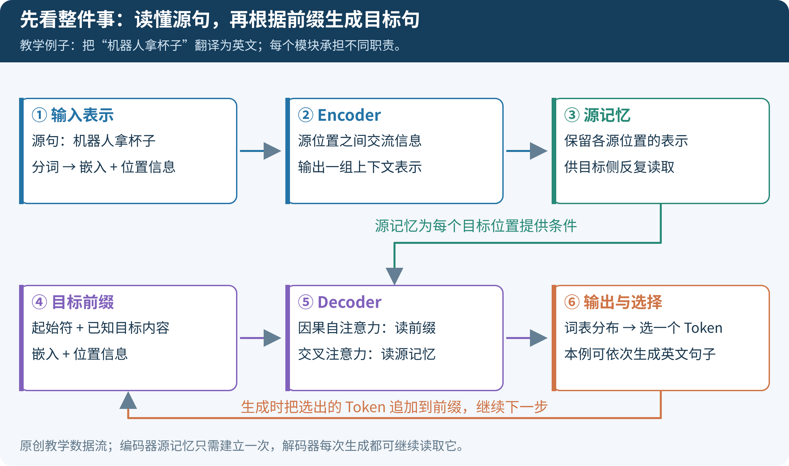
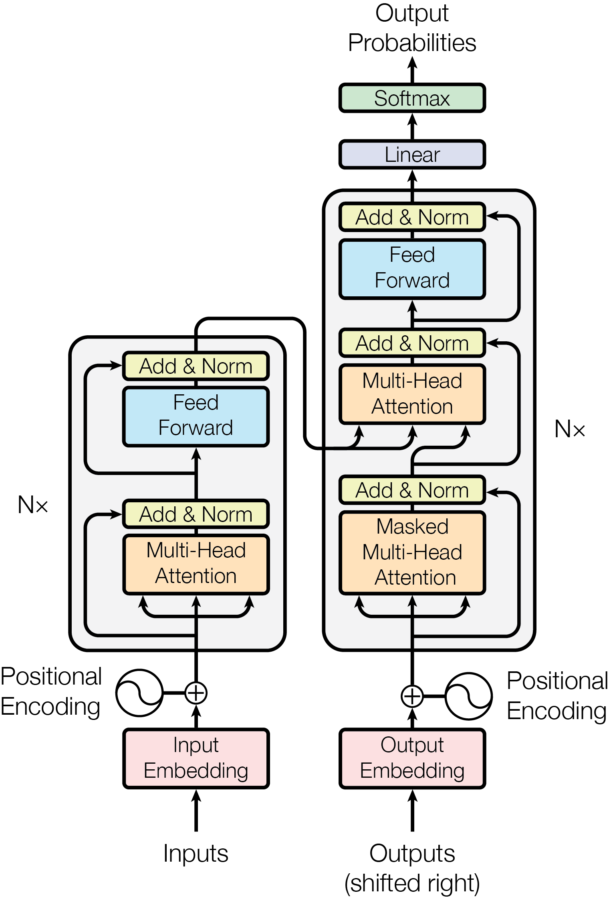
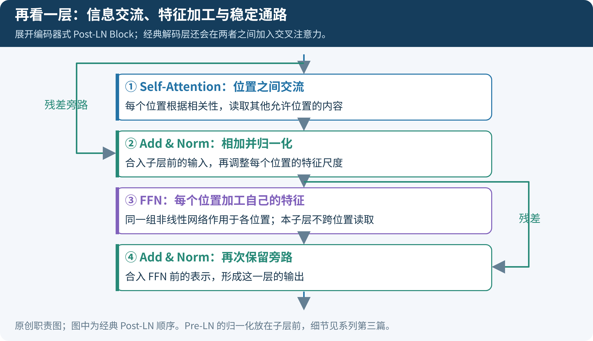

# Transformer 00：整体框架与各模块的作用

假设我们希望把“机器人拿杯子”翻译成英文。模型需要理解源句中谁在做什么，再结合已经生成的英文前缀，决定下一个输出。**Transformer 是把输入变成一组表示、让各位置交换信息，再按任务生成输出的一套神经网络架构。注意力是其中的信息交流机制，完整网络还需要输入表示、位置、特征变换和输出接口。**

这一篇先建立整张地图：每个模块为什么存在，接收什么，输出交给谁。读完再进入 Token、QKV 和矩阵计算，能更容易知道每项细节在全局中的位置。

## 1. 先把完整任务走一遍

*原创教学示意。上排处理源句，下排处理目标前缀；绿色连接携带源句信息，橙色回路表示生成时追加新 Token。示例不是实际模型运行结果。*

沿着这张图读六步：

1. **输入表示**：把源句切成 Token，映射为数值向量，并提供位置信息。网络计算的是这些向量。
2. **Encoder**：让源句各位置相互读取，形成带上下文的表示。“机器人”的表示可以吸收“拿杯子”的信息。
3. **源记忆**：保存编码器输出的一组位置表示，供后续生成读取。这里的“记忆”是本次输入的中间结果，不是修改了模型参数，也不要求压成一个句向量。
4. **目标前缀**：从起始符出发，随后放入已经给出的目标 Token，例如 “The robot”。具体分词和特殊符号由模型配置决定。
5. **Decoder**：一方面读取目标前缀，另一方面读取源记忆，形成用于预测下一个目标 Token 的表示。
6. **输出与选择**：把该表示映射为词表分布，再按解码规则选一个 Token。把它追加到前缀，继续生成，直到终止。

Encoder 解决“源句各位置表示了什么”；Decoder 解决“根据源句和目标前缀，下一步输出什么”。两条路径分工不同，但都反复使用注意力和前馈网络。结构依据 [Attention Is All You Need，§3](https://arxiv.org/html/1706.03762v7#S3)。

## 2. 经典框架图里的左右两边分别是什么

*Vaswani 等，2017，Figure 1 原图，按原论文图表授权声明注明出处使用。[原图及上下文](https://arxiv.org/html/1706.03762v7#S3.F1)。两侧从下往上读，重复标记表示多层堆叠。*

左边从源 Token 开始，经过嵌入、位置、自注意力与前馈网络，最终输出源记忆。右边从**右移的目标序列**开始，依次经过因果自注意力、交叉注意力和前馈网络，最上面预测词表分布。左侧通往右侧中间模块的连接，就是源信息进入目标生成的入口。

原图中的一个重复单元叫作一层或 Block。堆叠多层，是让表示逐层重新组合和加工；通常每层有独立参数。原始基础配置左右各六层，层数是具体配置，不是 Transformer 的定义。

先认清左右分工即可，完整的连接、形状和右移约定在[第 04 篇：经典 Encoder–Decoder](transformer-04-encoder-decoder.md)展开。

## 3. 从底部进入：Embedding 与位置编码

**Tokenization** 决定输入单位。一个 Token 可以是完整词、子词或其他片段，不固定等于一个汉字。它先变成词表 ID，而 ID 是索引，不是有语义大小的数值。

**Embedding** 按 ID 从可训练表中取出向量，让离散符号进入连续数值计算。若序列有 $n$ 个位置、每个向量宽度为 $d$，输入矩阵就有 $n\times d$ 个元素。这里每一行对应一个位置，后续通常仍保留这些位置。

**位置编码** 提供次序线索。“狗咬人”和“人咬狗”词相同，顺序却改变了意思。经典结构把正弦位置向量加到嵌入上；RoPE 等方法在注意力的匹配空间中引入位置。不同机制的作用相近，具体运算并不相同。

所以输入表示要同时回答“是什么”和“在哪里”。详见[第 01 篇：Token 与嵌入](transformer-01-tokens-embeddings.md)、[第 05 篇：位置编码](transformer-05-position-encoding.md)。

## 4. Attention：决定从哪些位置读取哪些内容

注意力可以先理解成一次**按内容加权读取**。当前需要更新的位置提出 Query，其他可读取位置提供 Key 与 Value：Query 与 Keys 匹配形成分数，Softmax 把分数变成权重，再混合相应 Values。

这些向量由网络投影得到，匹配与内容都能在训练中学习，不需要人工写“代词必须读取哪个名词”的规则。但它也不保证每次都读对，更不能只凭一张注意力热图就断言模型的因果推理过程。

经典框架中有三种用途：

|图中的模块|读取谁|承担什么职责|
|---|---|---|
|Encoder Self-Attention|源位置读取有效源位置|建立源句内部的上下文关系|
|Decoder Masked Self-Attention|目标位置读取当前位置及更早的解码输入|使用目标前缀，防止偷看后面的答案|
|Encoder–Decoder Attention|目标侧提问，源记忆提供内容|把源信息引入当前目标预测|

**Multi-Head** 表示使用多套投影并行读取，再拼接和融合输出。不同头可以学习不同匹配方式，但不是预先命名好的“语法头”“指代头”。“多头”也不等于复制多个完整 Transformer。

具体手算在[第 02 篇：Self-Attention](transformer-02-self-attention.md)，拆头与合头在[第 03 篇：多头与 Block](transformer-03-multihead-block.md)。

## 5. FFN、残差和归一化：读取信息之后怎样加工

*原创职责图，采用经典 Post-LN 顺序。旁路从子层之前的主路径引出，在 Add & Norm 处合流；现代 Pre-LN 的归一化位置不同。*

**FFN（逐位置前馈网络）** 对每个位置的特征做非线性加工，经典形式是扩展特征、经过激活函数、再投回模型宽度。同一层各位置使用同一组 FFN 参数。这一子层自己不读取其他位置，但输入表示已经可以带有注意力收集的上下文。

**Residual / Add（残差相加）** 让子层前的输入绕过该子层，直接与子层结果相加。主路径可以学习变换，旁路提供较直接的信息和梯度通路；它不是把两者沿特征轴拼接。

**LayerNorm（层归一化）** 在每个位置的特征维度上调整均值与尺度，再施加可学习的缩放和偏置。它不把不同样本或整句所有位置统一求平均。原始结构在残差相加后做归一化，称作 Post-LN；Pre-LN 把归一化放在子层前。

**Dropout** 在训练中对部分激活作随机失活与缩放，用于正则化；常规推理时关闭。原图没有单独画出所有 dropout 位置，完整实现需要按配方处理。

这几部分组合起来，一层就能完成“跨位置交流 → 每位置加工”，并通过残差与归一化组织计算。详细公式和不同顺序见[第 03 篇](transformer-03-multihead-block.md)。

## 6. 顶部输出头，以及训练时的答案从哪里来

**Linear** 把每个目标位置的隐藏表示映射为词表中各候选 Token 的分数，称为 logits。**Softmax** 把它们转成概率分布；**解码规则**再决定选哪一个，例如取最大项或按分布采样。注意力中的 Softmax 作用于可读取位置，输出头中的 Softmax 作用于词表；二者归一化的对象不同。

训练需要正确目标。例如目标 Token 是“我、爱、机器人、终止符”，解码器输入可以是“起始符、我、爱、机器人”，分别监督预测下一个。右移与因果遮罩配合，防止当前位置直接或间接读回答案。正确前缀已在数据中，因此训练可以并行计算各位置的预测和损失，再通过反向传播更新各模块参数。

生成时未来答案未知，模型只能根据已有前缀选出新 Token，再继续。此时改变的是前缀与中间计算状态，常规推理不会每生成一个词就更新模型权重。

<video controls loop playsinline preload="none" poster="../../imgs/tf-generation-animated.png" aria-label="Transformer 根据前缀逐步生成 Token" style="display:block;width:100%;height:auto;margin:24px 0"><source src="../../imgs/tf-generation-animated.mp4" type="video/mp4">请使用下方链接播放。</video>

[播放或下载逐步生成动画](../../imgs/tf-generation-animated.mp4)。

*沿用系列原创动画。每次选出的 Token 成为下一步前缀，示例词序是教学设定。*

更详细的训练、损失与采样见[第 06 篇](transformer-06-training-generation.md)。**KV cache** 是生成时保存各层历史 Key 与 Value 的办法，避免重复计算这些历史结果；它属于执行效率设计，见[第 07 篇](transformer-07-kv-cache-efficiency.md)。

## 7. GPT、BERT 为什么看起来没有这整张图

上面的原图是完整 Encoder–Decoder，具体任务可以采用不同骨架：

- **BERT 类 Encoder-only**：主要用双向编码器建立文本表示，原始 BERT 用遮盖预测等目标训练。
- **GPT 类 Decoder-only**：主要用因果自注意力预测下一个 Token，通常没有原图里的独立源编码器与交叉注意力层。提示和输出前缀可以放在同一序列。
- **ViT**：把图像块投影成向量序列，再交给编码器处理；不要求先把像素变成离散词表 ID。

共同骨架并不决定输入必须是文字，也不决定输出一定是下一个词。机器人动作可以采用离散预测、回归、扩散或 flow 等接口，需要结合模型的输入和训练目标判断。结构差别在[第 08 篇：模型家族](transformer-08-model-families.md)展开。

## 8. 接下来按什么顺序读

|下一篇|要弄明白的问题|
|---|---|
|[01 · Token、嵌入与上下文表示](transformer-01-tokens-embeddings.md)|文本怎样变成向量，序列长度和特征维度怎样区分？|
|[02 · Self-Attention](transformer-02-self-attention.md)|QKV 怎样算出读取权重和输出？|
|[03 · Multi-Head 与 Block](transformer-03-multihead-block.md)|多头、FFN、残差与归一化怎样组装成一层？|
|[04 · Encoder–Decoder](transformer-04-encoder-decoder.md)|两条序列和三种注意力怎样连接？|
|[05 · 位置编码](transformer-05-position-encoding.md)|正弦位置与 RoPE 怎样提供顺序信息？|
|[06 · 训练与生成](transformer-06-training-generation.md)|为什么训练可并行，生成仍需逐步进行？|
|[07 · KV cache 与效率](transformer-07-kv-cache-efficiency.md)|缓存保存什么，FlashAttention 又优化什么？|
|[08 · BERT、GPT、ViT](transformer-08-model-families.md)|任务变化时，哪些接口和可见范围随之改变？|

## 来源

- [Vaswani 等，Attention Is All You Need，§3、Figure 1–2、§5](https://arxiv.org/html/1706.03762v7#S3)：经典骨架、模块与训练约定。
- [系列来源、原始论文与版本记录](../../../raw/entries/2026-11-21-transformer-series.md)：含 BERT、GPT-2、ViT 及归一化、位置与效率材料。
