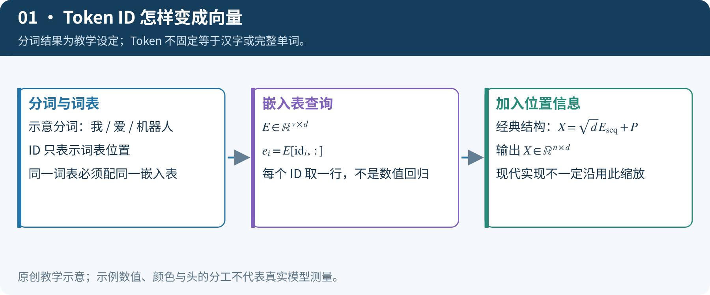
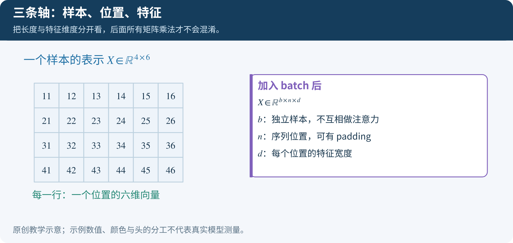
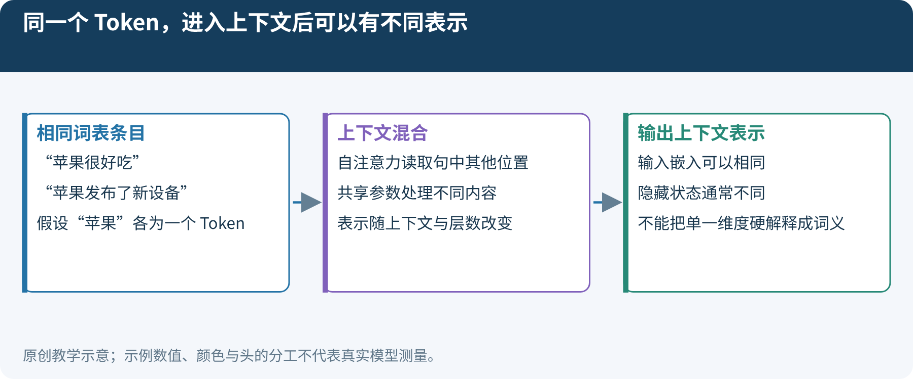

# Transformer 01：Token、嵌入与上下文表示

先读 [整体框架与各模块的作用](transformer-00-overview.md)，了解本篇在完整网络中的位置。

读到“Transformer 把一句话变成向量”时，最容易漏掉两个问题：**它怎样划分一句话，以及它究竟为整句保留一个向量，还是为每个位置保留一个向量？** 以“我爱机器人”为例，本文从输入讲起，建立后面整个系列都沿用的表示约定。

在 [00 · 整体框架](transformer-00-overview.md) 建立全局认识后，继续按以下顺序深入：

1. 本篇：Token、嵌入与上下文表示。
2. [Self-Attention：从 QKV 到加权读取](transformer-02-self-attention.md)。
3. [Multi-Head Attention 与 Transformer Block](transformer-03-multihead-block.md)。
4. [经典 Encoder–Decoder 架构](transformer-04-encoder-decoder.md)。
5. [位置编码：从正弦信号到 RoPE](transformer-05-position-encoding.md)。
6. [训练与自回归生成](transformer-06-training-generation.md)。
7. [KV cache 与注意力计算效率](transformer-07-kv-cache-efficiency.md)。
8. [BERT、GPT、ViT 与多模态接口](transformer-08-model-families.md)。

## 1. Token 是模型的输入单位，不固定等于一个词

人眼看“机器人”是一个词，分词器可能把它编码为一个 Token，也可能拆成多个片段；英文单词也可能按子词或字节拆开。先给出一个**人为设定的教学分词**：

$$\text{“我爱机器人”}\longrightarrow[\text{我},\text{爱},\text{机器人}]\longrightarrow[7,19,42].$$

这里的三个整数是词表 ID，不表示词义大小。ID 差得近，不代表意思相近；不能把它们直接当连续数值回归。真正可学习的数值来自嵌入表。实际运行必须使用与模型匹配的分词器、特殊符号和词表；本例不是某个实际模型的分词输出。原始 Transformer 的机器翻译实验使用子词切分，见[原论文 §5.1](https://arxiv.org/html/1706.03762v7#S5.SS1)。

*原创输入流程图。分词器把文本变成索引；嵌入表才把索引映射为浮点特征。*

## 2. 嵌入表究竟做了什么

设词表大小为 $v$，每个 Token 的特征维度为 $d$。嵌入表是可训练参数：

$$E\in\mathbb R^{v\times d},\qquad e_i=E[\mathrm{id}_i,:]\in\mathbb R^{1\times d}.$$

**本系列统一把单个位置写成行向量。** 把各位置的嵌入按行堆起来，得到 $E_{\mathrm{seq}}\in\mathbb R^{n\times d}$；$n$ 是序列长度，不是词表大小。序列变长时增加的是行数，模型的特征维度仍是 $d$。

换一种等价理解：若 $u_i\in\mathbb R^{1\times v}$ 是该 ID 的 one-hot 行向量，则 $e_i=u_iE$。真实实现通常直接查表，避免创建巨大的 one-hot 张量。查表也能反向传播，训练会更新被使用的嵌入行。

原论文在嵌入处乘以 $\sqrt d$，再加位置编码：

$$X=\sqrt d\,E_{\mathrm{seq}}+P,\qquad P\in\mathbb R^{n\times d}.$$

这个缩放是[经典实现的约定](https://arxiv.org/html/1706.03762v7#S3.SS4)，不能据此声称所有现代模型都必须这样做。为什么还需要 $P$，在[位置编码篇](transformer-05-position-encoding.md)中用交换词序的例子解释。

## 3. Batch、位置、特征是三条不同的轴

加入并行样本后，常用张量形状为：

$$X\in\mathbb R^{b\times n\times d}.$$

$b$ 表示 batch 中的样本数；$n$ 表示位置数；$d$ 表示每个位置的特征数。不同样本不会互相做注意力。为方便批处理，不等长样本可以补齐到同一长度，但补齐项需要 padding 遮罩，计算损失时通常也要排除。

*原创张量示意。格子编号仅用于指认行列，不是实际嵌入值。*

拿一个具体尺寸检查：两个样本，各补齐到六个位置，模型宽度为八，则输入形状是 $2\times6\times8$。每个样本有六个八维向量。经过保持宽度的 Transformer Block 后，形状仍可相同，但向量值已经变化；**形状不变不表示没有计算。**

## 4. 上下文表示与初始嵌入有什么差别

“苹果很好吃”和“苹果发布了新设备”里的“苹果”，若词表切分相同，初始词嵌入可相同；进入网络后，每个位置会读取周围内容，输出的上下文表示通常不同。

*原创示意。“苹果”的 Token 划分也是教学假设，不主张真实模型一定以完整词为单位。*

Transformer 不必先把整句压成单个向量。编码器输出通常仍是 $n\times d$；随后可以按任务取分类位置、池化，或让其他序列通过交叉注意力读取。这也是它适合保留细粒度对齐信息的原因。

## 5. Transformer 在这些向量上反复做什么

先把每层看成两类操作：注意力在**位置之间传递信息**；前馈网络对**每个位置的特征做非线性变换**。残差保留可绕过子层的通路，归一化调整单个位置的特征尺度。它们组成 Block，再重复堆叠。

输入不限于文本。图像 Patch 可以通过线性投影变成向量，机器人状态也可以通过专门接口投影。但输入含义、位置信息与输出目标都需要单独设计，不能因为都变成了向量就认为任务完全相同。

读下一篇时，只需记住三个对象：位置矩阵 $X$、可学习的投影权重，以及根据当前内容计算出来的注意力权重。后两者不是一回事。

## 来源与继续阅读

- [Vaswani 等，Attention Is All You Need，§3–5](https://arxiv.org/html/1706.03762v7#S3)：经典网络、嵌入、位置与分词约定。
- [下一篇：Self-Attention](transformer-02-self-attention.md)；已有的[注意力机制及变体](attention-mechanisms.md)可作拓展索引。
- [系列来源、版本与图示说明](../../../raw/entries/2026-11-21-transformer-series.md)。
