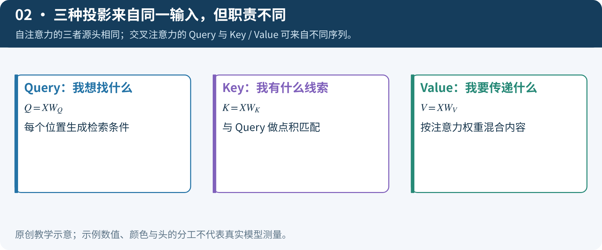
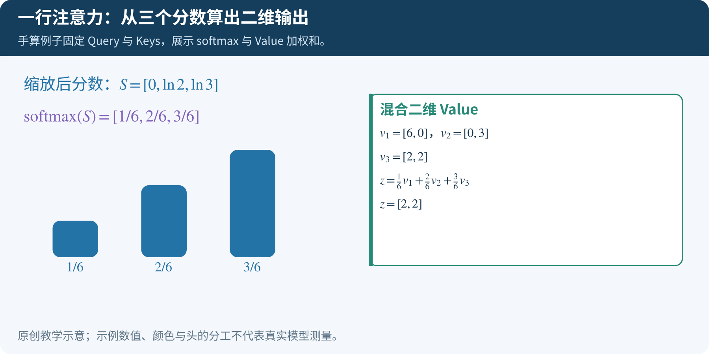
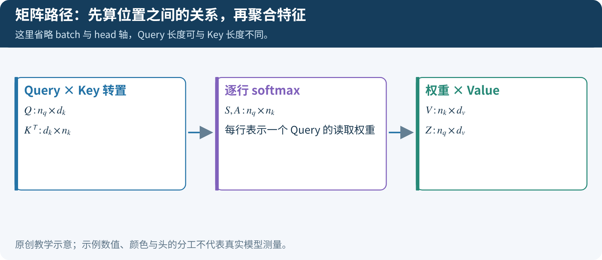

# Transformer 02：Self-Attention：从 QKV 到加权读取

先读 [整体框架与各模块的作用](transformer-00-overview.md)，了解本篇在完整网络中的位置。

“我把杯子放进柜子，因为它已经干了。”读到“它”时，我们需要根据上下文判断它指什么。Self-Attention 为每个位置生成一组读取权重，再从其他位置聚合信息。它是网络中的可微分计算，**不自动保证学会正确指代，也不等于在词表里搜索相似词。**

## 1. Query、Key、Value 为什么分开

设输入为 $X\in\mathbb R^{n\times d}$，行向量表示各位置。一个注意力头先做三种学习到的投影：

$$Q=XW_Q,\quad K=XW_K,\quad V=XW_V.$$

其中 $W_Q,W_K\in\mathbb R^{d\times d_k}$，$W_V\in\mathbb R^{d\times d_v}$；因此 $Q,K$ 的每行宽度是 $d_k$，$V$ 的每行宽度是 $d_v$。

Query 表示“当前需要寻找什么线索”，Key 表示“本位置可供匹配的线索”，Value 表示“真正传出去的内容”。这些是帮助理解职责的比喻，不是人工给向量标注固定含义。三种矩阵允许**匹配规则与传输内容分别学习**；若强制使用同一表示，会施加额外约束。



*原创职责图。Self-Attention 的三者都来自同一序列，但一般不数值相等。*

## 2. 从匹配分数到读取权重

第 $i$ 个 Query 与第 $j$ 个 Key 的分数是 $s_{ij}=q_i k_j^\mathsf T/\sqrt{d_k}$。把所有分数写成矩阵，并加入遮罩：

$$S=\frac{QK^\mathsf T}{\sqrt{d_k}}+M,\quad A_{ij}=\frac{\exp S_{ij}}{\sum_{r=1}^{n}\exp S_{ir}},\quad Z=AV.$$

$M_{ij}=0$ 表示允许读取，$M_{ij}=-\infty$ 表示屏蔽。Softmax 沿每个 Query 的 Key 维度归一化，因此每个有效行的权重非负、总和为一。实际实现会减去行最大值以避免指数溢出；若整行都被屏蔽，需要额外处理，否则可能产生非数。

除以 $\sqrt{d_k}$ 的直觉是控制点积尺度：若分量近似独立、零均值且方差为一，点积方差随 $d_k$ 增大，除后约为一。这是设计动机，**不是声称训练中的分量始终满足这些统计假设**。见[原论文 §3.2.1](https://arxiv.org/html/1706.03762v7#S3.SS2.SSS1)。



*原创数值例子。图中给定缩放后分数，便于把 softmax 和加权和分开核对。*

给定 $S=[0,\ln2,\ln3]$，指数为 $[1,2,3]$，归一化后得到 $[1/6,2/6,3/6]$。若 Values 为 $[6,0]$、$[0,3]$、$[2,2]$，则输出：

$$z=\frac16[6,0]+\frac26[0,3]+\frac36[2,2]=[2,2].$$

它是混合内容，不是选择“第三个 Token”并原样复制。单个头的此步输出是 Values 的凸组合；之后的输出投影、残差和 FFN 不受同样的凸包限制。

## 3. 动画：每个 Query 都有自己的一行权重

<video controls loop playsinline preload="none" poster="../../imgs/tf-attention-animated.png" aria-label="逐个 Query 展示注意力权重的动画" style="display:block;width:100%;height:auto;margin:24px 0"><source src="../../imgs/tf-attention-animated.mp4" type="video/mp4">请使用下方视频链接播放。</video>

[播放或下载注意力动画](../../imgs/tf-attention-animated.mp4)。[查看静态首帧](../../imgs/tf-attention-animated.png)。

*原创动画。依次突出不同 Query；条形高度表示其对各 Key 的权重。逐行播放为了教学，真实矩阵运算可并行。*

特别注意：**注意力权重不是固定模型参数。** 投影矩阵是训练得到的参数；$A$ 是当前输入计算出的中间量，换一句话通常就变了。注意力热图也不能单独证明模型给出答案的因果理由。

## 4. 维度怎样对应，为什么输出长度跟随 Query



*原创维度图。把 Query 长度与 Key 长度分开，可以直接复用到交叉注意力。*

一般情况下，$Q\in\mathbb R^{n_q\times d_k}$、$K\in\mathbb R^{n_k\times d_k}$、$V\in\mathbb R^{n_k\times d_v}$。匹配矩阵为 $n_q\times n_k$，结果为 $n_q\times d_v$。Keys 与 Values 必须逐位置对应；Query 不必与它们等长。

## 5. 一个能重建核心计算的实现

下面省略 batch、多头、dropout、padding，并假设遮罩至少给每行保留一个位置。参数需要由外部网络注册为可训练参数；这里仅展示张量路径。

```python
import math
import torch

def attention(x, wq, wk, wv, mask=None):
    q, k, v = x @ wq, x @ wk, x @ wv
    scores = q @ k.transpose(-2, -1) / math.sqrt(q.shape[-1])
    if mask is not None:
        scores = scores + mask  # 加性遮罩：允许项为 0，屏蔽项为 -inf
    weights = scores.softmax(dim=-1)
    return weights @ v, weights
```

此代码通过自然参数化学习相似性，不需要人工先算词与词的语法关系。全局读取也有代价：完整分数矩阵随序列长度平方增长。后续[计算效率篇](transformer-07-kv-cache-efficiency.md)会区分算术量、显存存取和缓存容量。

## 来源与继续阅读

- [Attention Is All You Need，§3.2 与 Figure 2](https://arxiv.org/html/1706.03762v7#S3.SS2)。本文数值为独立教学构造。
- [上一篇：输入表示](transformer-01-tokens-embeddings.md)；[下一篇：多头与 Block](transformer-03-multihead-block.md)。
- [来源与证据](../../../raw/entries/2026-11-21-transformer-series.md)。
