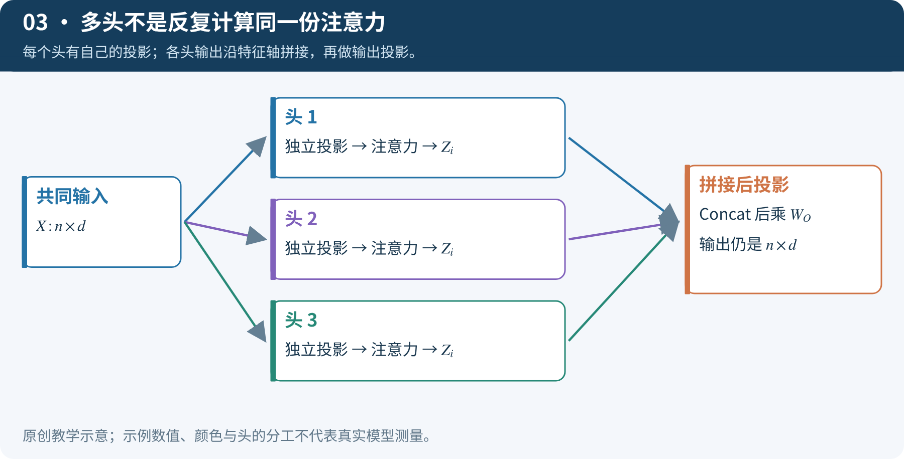
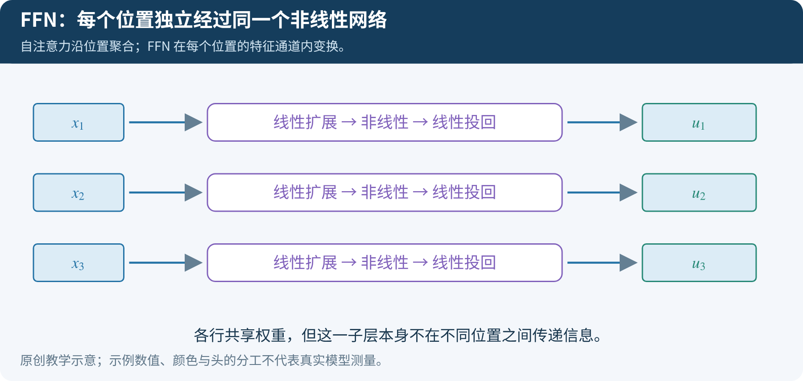
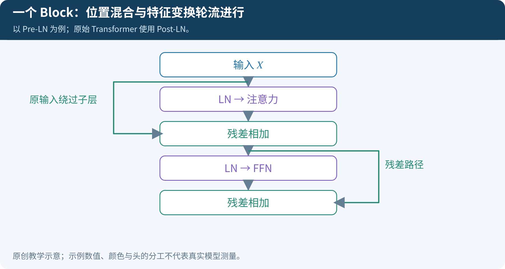

# Transformer 03：Multi-Head Attention 与 Transformer Block

先读 [整体框架与各模块的作用](transformer-00-overview.md)，了解本篇在完整网络中的位置。

一个注意力头用一套匹配规则读取内容；但理解一句话时，我们可能同时需要局部词组、远处指代和不同属性。Multi-Head Attention 让多个学习到的投影并行处理信息，再把结果融合。**头不是预先分配好职责的专家，也不是把完整模型复制多份。**

## 1. 每个头到底独立在哪里

以输入 $X\in\mathbb R^{n\times d}$ 为例，第 $r$ 个头有自己的投影：

$$Z_r=\operatorname{softmax}\left(\frac{(XW_Q^{(r)})(XW_K^{(r)})^\mathsf T}{\sqrt{d_k}}+M\right)XW_V^{(r)}.$$

若共有 $h$ 个头，常见配置为 $d_k=d_v=d/h$，要求 $d$ 能整除 $h$。各 $Z_r$ 的形状为 $n\times d_v$。融合方式不是把权重矩阵取平均，而是沿特征轴拼接输出，再投影：

$$\operatorname{MHA}(X)=\operatorname{Concat}(Z_1,\ldots,Z_h)W_O,\quad W_O\in\mathbb R^{hd_v\times d}.$$



*原创机制图，省略 batch 和遮罩。不同颜色表示参数不同，不保证各头最终学到不同或可命名的语义。*

例如 $d=512,h=8$ 时，每头宽度为 $64$，八头拼接后又是 $512$。这与八个头各自保持完整宽度的计算成本不同。经典配置见[原论文 §3.2.2](https://arxiv.org/html/1706.03762v7#S3.SS2.SSS2)。

## 2. 实现里怎样拆头与合头

实际常用一个大线性层一次产生全部 Query，然后改变张量视图：

$$[b,n,d]\longrightarrow[b,n,h,d_h]\longrightarrow[b,h,n,d_h].$$

中间的 transpose 是交换轴，而不是把元素随意重新排列。各头注意力之后反向交换，再把相邻特征拼回 $[b,n,d]$。这里 $d_h=d/h$。只做 reshape 而漏掉交换轴，会把位置与头混在一起。

```python
# q、k、v 在此之前已经各自完成投影，形状均为 [batch, length, width]
q = q.reshape(batch, length, heads, head_dim).transpose(1, 2)
k = k.reshape(batch, length, heads, head_dim).transpose(1, 2)
v = v.reshape(batch, length, heads, head_dim).transpose(1, 2)
# 对每个 batch、每个 head 独立计算注意力，输出 z: [batch, heads, length, head_dim]
z = z.transpose(1, 2).contiguous().reshape(batch, length, width)
output = z @ wo
```

它是形状路径片段，不是完整可运行模型。真实实现还要决定偏置、dropout、遮罩广播和数值精度。

## 3. 注意力为什么还需要 FFN



*原创局部计算图。三条路径用同一组 FFN 参数，彼此之间没有直接的数据交换。*

注意力负责位置间混合，逐位置前馈网络负责非线性特征变换。经典 FFN 为：

$$\operatorname{FFN}(x)=\max(0,xW_1+b_1)W_2+b_2.$$

$x\in\mathbb R^{1\times d}$；$W_1\in\mathbb R^{d\times d_{ff}}$、$W_2\in\mathbb R^{d_{ff}\times d}$，先扩展特征再投回。原始基础配置为 $d=512,d_{ff}=2048$。同一层中每个位置共享参数，**不同层通常有不同参数**。现代模型可以改用 GELU 或门控 FFN；不能用经典 ReLU 公式概括所有 Transformer。

若只剩两个连续线性映射，它们可合并为一个线性映射；加入非线性后表达能力不同。FFN 自身没有位置间交互，但输入可能已通过注意力吸收上下文。

## 4. 残差是相加通路，归一化沿特征轴做

设一个子层为 $F$，先省略 dropout。原论文使用 Post-LN：

$$Y=\operatorname{LN}(X+F(X)).$$

常见 Pre-LN 把归一化移到子层之前：

$$Y=X+F(\operatorname{LN}(X)).$$



*原创 Block 图，以 Pre-LN 展开；请勿把它误认为原始论文 Figure 1 的归一化顺序。*

单位置 LayerNorm 对 $d$ 个特征计算均值与方差：

$$\mu=\frac1d\sum_jx_j,\quad \sigma^2=\frac1d\sum_j(x_j-\mu)^2,\quad \operatorname{LN}(x)_j=g_j\frac{x_j-\mu}{\sqrt{\sigma^2+\epsilon}}+b_j.$$

$g_j,b_j$ 是可学习缩放与偏置，$\epsilon>0$ 保证数值稳定。它不是对不同样本或不同 Token 求全局平均；残差也不只是“防止信息丢失”的口号，它提供绕过子层的恒等路径并改变梯度传播。

Pre-LN 与 Post-LN 的优化行为不同，见[Xiong 等，2020，§3](https://arxiv.org/html/2002.04745v1)。不把一种初始化分析扩大成“所有 Pre-LN 配方都不需要 warm-up”。现代 RMSNorm 也不同于完整 LayerNorm。

## 5. 把一个 Block 连起来

Pre-LN 的编码器式 Block 可写为：

$$U=X+\operatorname{MHA}(\operatorname{LN}_1(X)),\qquad Y=U+\operatorname{FFN}(\operatorname{LN}_2(U)).$$

两个归一化模块参数各自独立。多层堆叠时每层接收上一层的表示；层数增加不等于同一层循环调用同一权重。解码器的遮罩以及是否加入交叉注意力，需要另行指定，下一篇会把完整结构接起来。

## 来源与继续阅读

- [Attention Is All You Need，§3.1–3.3](https://arxiv.org/html/1706.03762v7#S3)：MHA、FFN、经典残差与归一化。
- [On Layer Normalization in the Transformer Architecture](https://arxiv.org/html/2002.04745v1)：Pre-LN 与 Post-LN 的分析条件。
- [上一篇：Self-Attention](transformer-02-self-attention.md)；[下一篇：Encoder–Decoder](transformer-04-encoder-decoder.md)；[来源记录](../../../raw/entries/2026-11-21-transformer-series.md)。
