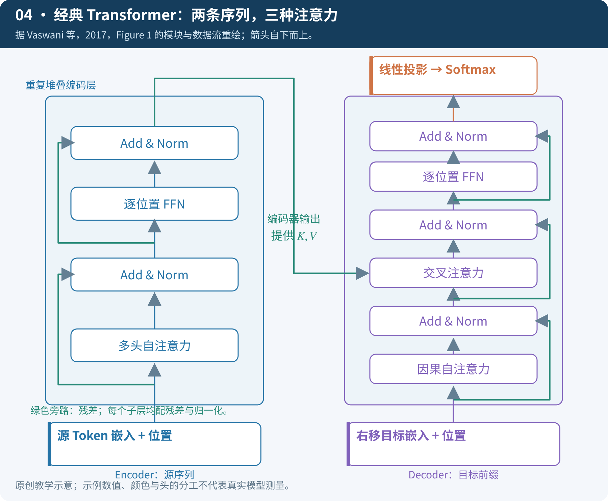
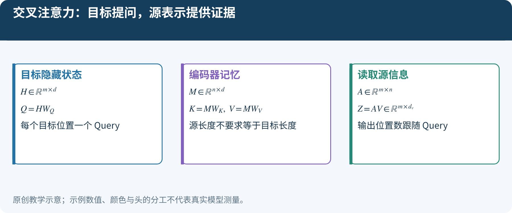
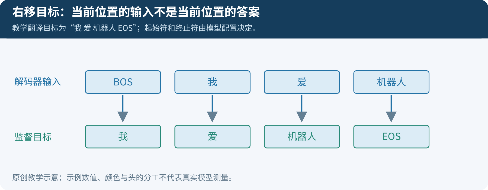

# Transformer 04：经典 Encoder–Decoder 架构

先读 [整体框架与各模块的作用](transformer-00-overview.md)，了解本篇在完整网络中的位置。

原始 Transformer 首先是一种序列到序列的机器翻译模型：读入一个源句，根据它生成目标句。理解经典框架时，关键不是记住一串模块名字，而是追踪**源句信息从哪里来、目标位置允许看到什么，以及最终预测哪个词**。

## 1. 先看经典原图

*Vaswani 等，2017，Figure 1 原图。按论文开头授权声明注明出处使用；[论文及图注](https://arxiv.org/html/1706.03762v7#S3.F1)。左右两路均从下向上读，重复标记表示堆叠多层。*

*据原论文 Figure 1 重绘。为了阅读清晰，重复堆叠只展开一层；绿色线包括残差路径与编码器记忆传递，图中分别标明。*

## 2. Encoder：每个源位置形成上下文表示

源 Token 嵌入与位置编码构成 $X\in\mathbb R^{n\times d}$。每层先进行双向自注意力，再做逐位置 FFN，每个子层外配残差与 Post-LN。双向表示各源位置可读其余有效源位置，仍需要屏蔽 padding。

堆叠后得到 $M\in\mathbb R^{n\times d}$。它是源序列的记忆矩阵，保留 $n$ 个位置；不是必须先挤成一个句向量。原始基础配置堆叠六层，这是配置，不是 Transformer 的定义。

## 3. Decoder：先读目标前缀，再读源记忆

Decoder 每层有三个子层：因果自注意力、编码器—解码器交叉注意力、FFN；每个子层仍有自己的残差与归一化。

第一层注意力中，Query、Key、Value 都来自目标序列当前表示。第二层中，目标侧表示提供 Query，编码器最终输出提供 Key 与 Value：

$$Q=HW_Q,\qquad K=MW_K,\qquad V=MW_V.$$

若 $H\in\mathbb R^{m\times d}$，则交叉注意力权重为 $m\times n$。每个目标位置都能按需要读取不同源位置，输出仍保留 $m$ 个目标位置。每个解码层可以有不同的投影参数，但读取同一份编码器最终记忆。见[原论文 §3.2.3](https://arxiv.org/html/1706.03762v7#S3.SS2.SSS3)。

*原创接口展开。源句与目标句可以不同长度，注意力不要求逐词一一对应。*

## 4. 目标右移与因果遮罩必须配合

假设目标为“我 爱 机器人 EOS”。训练的解码输入为“BOS 我 爱 机器人”，相应位置监督为“我 爱 机器人 EOS”。BOS、EOS 为概念性起止标记，真实模型的特殊符号约定可能不同。

*原创对齐图。右移把待预测目标移到下一位置，因果遮罩防止从更靠后位置间接读回答案。*

设行位置、列位置从一开始编号，因果遮罩：

$$M_{ij}=\begin{cases}0,&j\le i,\\-\infty,&j>i.\end{cases}$$

当前位置可以读取当前解码输入，因为它是右移后的前一目标 Token。**只做右移而不做因果遮罩，仍可能从下一输入位置看到答案。** 只做遮罩而把当前答案放在当前位置，也会泄漏。

<video controls loop playsinline preload="none" poster="../../imgs/tf-mask-animated.png" aria-label="因果遮罩按行展示允许读取范围" style="display:block;width:100%;height:auto;margin:24px 0"><source src="../../imgs/tf-mask-animated.mp4" type="video/mp4">请使用下方动画链接播放。</video>

[播放或下载遮罩动画](../../imgs/tf-mask-animated.mp4)。[查看静态首帧](../../imgs/tf-mask-animated.png)。

*原创动画。依次选中五个 Query，蓝格表示允许读取；动画顺序用于说明规则，训练可并行计算所有行。*

## 5. 最上面的 Linear 与 Softmax 在预测什么

设解码器输出为 $H_{out}\in\mathbb R^{m\times d}$，词表大小为 $v$。按行向量约定：

$$L=H_{out}W_{vocab}+b_{vocab},\quad W_{vocab}\in\mathbb R^{d\times v},\quad p_i=\operatorname{softmax}(L_i).$$

每行给出对应目标 Token 的分布，不是给整句一个总类别。训练时用所有有效行的正确标签算损失；生成时只有已生成前缀，需要一步步选出新 Token。

## 6. 如何检查自己真的读懂了框架

拿任意一条注意力连线，先指出 Query 的位置数，再指出 Keys 和 Values 来自哪里。若输出长度跟 Query 对不上，就说明轴被混淆了。再检查每个解码位置的输入与监督是否相差一位，以及哪些线绕过了子层。

现代 GPT 通常没有独立的源编码器与该交叉注意力子层；BERT 则保留双向编码骨架。不能把原图右半边原封不动叫作所有 GPT 模型，详见[结构家族篇](transformer-08-model-families.md)。

## 来源与继续阅读

- [Attention Is All You Need，§3、Figure 1–2](https://arxiv.org/html/1706.03762v7#S3)；[原图来源存档](../../../raw/entries/2026-11-20-transformer-architecture.md)。
- [上一篇：多头与 Block](transformer-03-multihead-block.md)；[下一篇：位置编码](transformer-05-position-encoding.md)；[本系列来源](../../../raw/entries/2026-11-21-transformer-series.md)。
