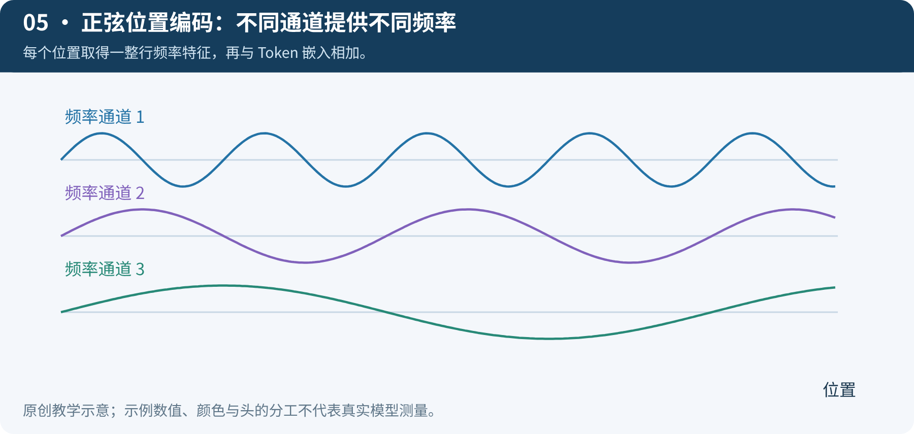
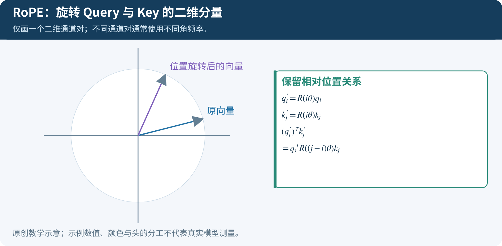

# Transformer 05：位置编码：从正弦信号到 RoPE

先读 [整体框架与各模块的作用](transformer-00-overview.md)，了解本篇在完整网络中的位置。

“狗咬人”和“人咬狗”包含相同词，意思却不同。如果一个双向注意力层只看到相同的内容向量集合，它缺少判断词序的依据。位置编码把“在哪个位置”作为可利用的信息送进网络；**它与 Token 词义嵌入承担不同职责。**

## 1. 没有位置线索时，网络缺少什么

用置换矩阵 $\Pi$ 交换输入行，在没有位置编码、顺序相关遮罩等额外线索的理想自注意力层中：

$$\operatorname{Attn}(\Pi X)=\Pi\operatorname{Attn}(X).$$

这是置换等变，不是“输出完全不变”。每个输出行跟着相应输入位置交换，但网络仅凭内容无法区分这两个排列的顺序关系。此结论的前提必须保留：**因果遮罩本身就引入了顺序约束**，不能对所有无显式位置编码模型一概而论。

*原创对比。位置建模解决序列中的相对或绝对位置线索，而不是替代内容表示。*

## 2. 原始正弦位置编码如何构造

令位置 $p$ 从零开始编号，特征维度 $d$ 为偶数，第 $r$ 对通道为：

$$P_{p,2r}=\sin\left(p/10000^{2r/d}\right),\qquad P_{p,2r+1}=\cos\left(p/10000^{2r/d}\right).$$

$r=0,\ldots,d/2-1$。每一对是一组不同频率的正弦与余弦，同一位置把所有通道拼成一个 $d$ 维向量，随后与嵌入相加。位置无物理单位，正弦里的相位是无量纲值。

*原创频率示意，为便于区分绘制少量通道，并不复刻某一配置的全部频率。*

为什么一对通道同时用正弦和余弦？三角恒等式允许一个固定位置偏移用二维线性变换表示。例如：

$$\sin(p\omega+\Delta\omega)=\sin(p\omega)\cos(\Delta\omega)+\cos(p\omega)\sin(\Delta\omega).$$

这说明相对偏移在表示中有可用结构，不意味着模型必然学会利用它。原论文也比较了可学习的绝对位置嵌入；[§3.5](https://arxiv.org/html/1706.03762v7#S3.SS5)讨论的是其特定实验，不能直接推广到所有长上下文任务。

## 3. 可学习绝对位置与相对位置偏置

可学习绝对位置表直接为每个位置训练一行参数：$X_i=e_i+p_i$。它容易理解，但未训练过的新索引需要明确的扩展策略。即使正弦公式能计算任意位置，也不保证模型能可靠处理任意长度。

相对位置偏置则可在注意力分数中添加与位置差有关的量：

$$S_{ij}=q_i k_j^\mathsf T/\sqrt{d_k}+b(i-j)+M_{ij}.$$

这是机制层面的通用写法，具体模型可以采用分桶、不同头参数或其他距离函数。不要把“加绝对向量”“加相对分数偏置”和 RoPE 当成同一实现。

## 4. RoPE：旋转匹配空间，而不是旋转句子

把一个头的 Query 和 Key 特征按二维分组。对其中一组，改用列向量写旋转的局部几何：

$$R(\alpha)=\begin{bmatrix}\cos\alpha&-\sin\alpha\\\sin\alpha&\cos\alpha\end{bmatrix},\quad q_i'=R(i\theta)q_i,\quad k_j'=R(j\theta)k_j.$$

这里是**局部列向量公式**；在代码与全文的行向量表示中等价为右乘 $R(i\theta)^\mathsf T$。不同通道对使用不同频率 $\theta_r$。旋转后点积：

$$(q_i')^\mathsf T k_j'=q_i^\mathsf T R((j-i)\theta)k_j.$$

可见位置差进入了匹配关系；旋转自身保持向量范数。标准 RoPE 把该变换施加于 Query 和 Key，Value 不因这个定义而必须旋转。具体实现可能采用相邻配对或前后半区配对，必须与模型权重约定一致。见[RoFormer §3](https://arxiv.org/html/2104.09864v5#S3)。

*原创二维几何图。仅展示一个通道对，正文给出与行向量实现的对应关系。*

<video controls loop playsinline preload="none" poster="../../imgs/tf-rope-animated.png" aria-label="RoPE 二维通道向量随位置旋转" style="display:block;width:100%;height:auto;margin:24px 0"><source src="../../imgs/tf-rope-animated.mp4" type="video/mp4">请使用下方链接播放。</video>

[播放或下载 RoPE 动画](../../imgs/tf-rope-animated.mp4)。[查看静态首帧](../../imgs/tf-rope-animated.png)。

*原创慢速动画。角度变化演示位置对相位的影响，不表示 Token 在句子中改变位置。*

## 5. 位置编码不等于无限长上下文能力

能为更大索引生成向量，只说明数学定义可延伸；模型是否学过这样的相位、距离、干扰模式和检索难度是另一回事。需要额外讨论训练长度、位置缩放策略、注意力计算与评估任务。

在缓存生成中，新 Token 的位置编号必须接续前缀；若错误地每步从零编号，其 Query 与历史 Keys 的位置关系就会错。padding 在左还是右、是否打包多个样本，也会影响实际 position ID 的构造。

## 来源与继续阅读

- [Attention Is All You Need，§3.5](https://arxiv.org/html/1706.03762v7#S3.SS5)；[RoFormer，§3](https://arxiv.org/html/2104.09864v5#S3)。
- [上一篇：经典架构](transformer-04-encoder-decoder.md)；[下一篇：训练与生成](transformer-06-training-generation.md)；[来源记录](../../../raw/entries/2026-11-21-transformer-series.md)。
