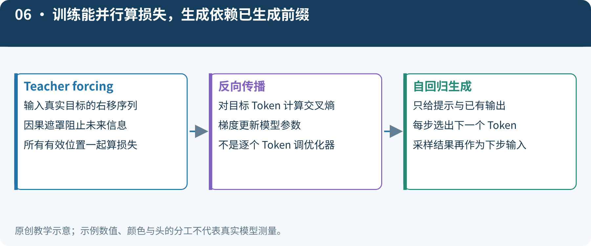
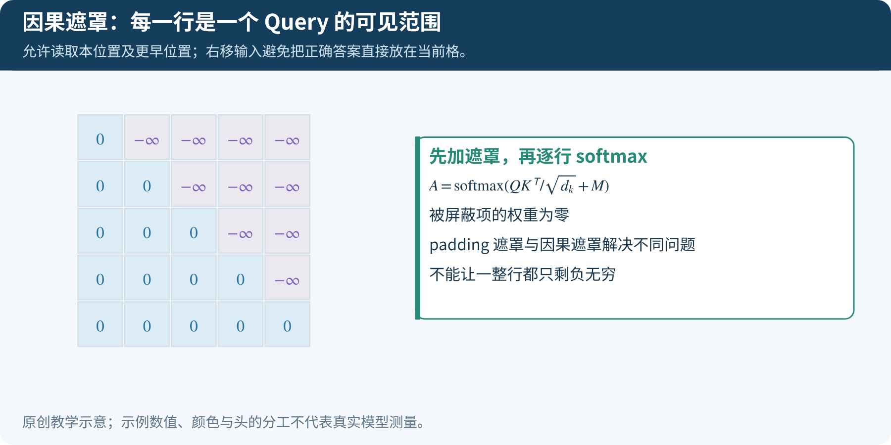
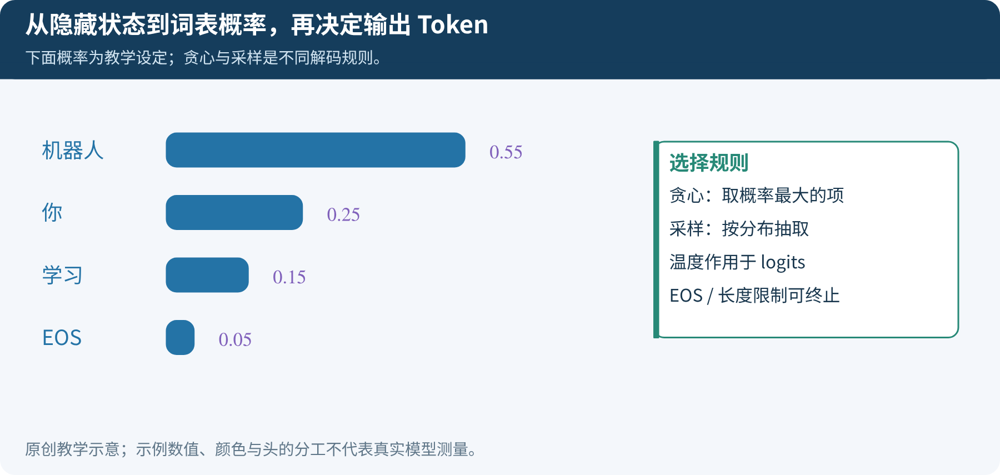

# Transformer 06：训练与自回归生成

先读 [整体框架与各模块的作用](transformer-00-overview.md)，了解本篇在完整网络中的位置。

Transformer 经常被描述为“能够并行”，但聊天模型仍是一段一段输出。这两种现象并不矛盾：**训练时正确的前缀已经在数据里，生成时未来的 Token 还没有被选出来。** 本文用一个右移样本说明两种计算过程。

## 1. 同一份目标，输入与监督错开一位

设目标 Token 为 $y_1,\ldots,y_T$，定义 $y_0$ 为起始符。训练输入是 $y_0,\ldots,y_{T-1}$，第 $t$ 个输出位置监督为 $y_t$。若还有源条件 $x$，自回归模型分解为：

$$p(y_{1:T}\mid x)=\prod_{t=1}^{T}p_\theta(y_t\mid y_{<t},x).$$

纯语言模型可把源条件省略；Encoder–Decoder 则把源句放在独立编码器中。学习目标为有效位置的平均负对数似然：

$$\mathcal L=-\frac1{N_{valid}}\sum_{(b,t)\in\mathcal I_{valid}}\log p_\theta(y_{b,t}\mid y_{b,<t},x_b).$$

$\mathcal I_{valid}$ 排除 padding 或其他被忽略标签，$N_{valid}$ 为其大小。原论文还用了 label smoothing；上式为解释机制的标准未平滑交叉熵，不冒充完整训练配方。

*原创流程对照。一次训练前向可以给所有有效位置计算分布，再反向更新参数。*

## 2. 训练并行为何不会偷看答案

输入里确实有较后目标的真实 Token，但因果遮罩阻止较早位置读取它们。第 $t$ 个预测只能看到已经允许的右移输入前缀；当前位置的输入并不是当前位置的正确答案。

*原创遮罩图。格子是加入分数的加性量；屏蔽后注意力权重为零。*

遮罩不需要按位置循环执行。矩阵运算可以一次产生全部分数，再将未来项屏蔽；层与层之间仍有依赖。并行训练不意味着生成可以提前知道自己下一步会选什么。

## 3. 一步生成到底发生了什么

先对提示前缀前向计算，取末个有效位置的隐藏状态 $h_t\in\mathbb R^{1\times d}$，通过词表投影得到 logits：

$$\ell_t=h_tW_{vocab}+b_{vocab},\qquad p_t=\operatorname{softmax}(\ell_t).$$

解码规则选出一个 ID，把它追加到前缀，再预测下一个。遇到终止符或达到长度限制就停止。在正常推理中，模型权重不因生成一个 Token 而被梯度更新。

<video controls loop playsinline preload="none" poster="../../imgs/tf-generation-animated.png" aria-label="自回归输出逐步追加到前缀" style="display:block;width:100%;height:auto;margin:24px 0"><source src="../../imgs/tf-generation-animated.mp4" type="video/mp4">请使用下方链接播放。</video>

[播放或下载逐 Token 生成动画](../../imgs/tf-generation-animated.mp4)。[查看静态首帧](../../imgs/tf-generation-animated.png)。

*原创动画。词序是人为设定的示例，不是运行语言模型得到的预测结果。*

第一次处理整段提示通常称作 prefill；后续每次追加少量 Token 的阶段称作 decode。实现可以使用[KV cache](transformer-07-kv-cache-efficiency.md)避免重复算历史位置的 Keys 与 Values，但仍需根据当前 Query 读取历史。

## 4. 温度、贪心和采样分别改了什么

*原创词表概率示意，仅画少数候选项。真实模型词表通常更大。*

贪心解码取概率最大项；采样按分布抽取，概率最大的项也不保证每次被选中。温度 $\tau>0$ 作用于 logits：

$$p_\tau(j)=\frac{\exp(\ell_j/\tau)}{\sum_k\exp(\ell_k/\tau)}.$$

减小温度通常令分布更集中；不能把“温度为零”当作直接代入此式，通常是实现中的贪心特例。Top-k 或 top-p 会限制候选集合并重新归一化，改变解码分布，不会重新训练模型。更高随机性不保证答案更有创造力或更正确。

## 5. Teacher forcing 的现实边界

训练大多在真实历史前缀上预测，生成则接收自己的历史输出。一次早期错误可能把后续前缀带到训练中较少见的区域，造成错误累积。更低训练损失也不直接保证事实可靠、任务成功或长输出稳定。

此外，“预测下一个 Token”描述目标形式，不代表模型只学一个词的短程关联。网络可以利用长前缀学习复杂规律；反过来，这种能力也不证明它获得了可靠的世界模型。

## 6. 最小实现中要检查的三件事

首先确认标签只右移一次：有些框架内部会做 shift，外部再做一次会错位。然后确认 padding、样本打包边界与损失忽略项一致。最后确认生成用的是各样本最后一个有效位置，缓存位置编号和注意力遮罩保持连续。

本篇描述自回归目标；BERT 的遮盖预测与非自回归任务有不同信息约束，不能照搬这套标签处理。

## 来源与继续阅读

- [Attention Is All You Need，§3.1、§5](https://arxiv.org/html/1706.03762v7#S3.SS1)：右移输入、因果预测及经典训练约定。
- [GPT-2 原始报告，§2](https://cdn.openai.com/better-language-models/language_models_are_unsupervised_multitask_learners.pdf)：自回归语言建模背景。
- [上一篇：位置编码](transformer-05-position-encoding.md)；[下一篇：缓存与效率](transformer-07-kv-cache-efficiency.md)；[交叉熵](cross-entropy.md)；[来源记录](../../../raw/entries/2026-11-21-transformer-series.md)。
