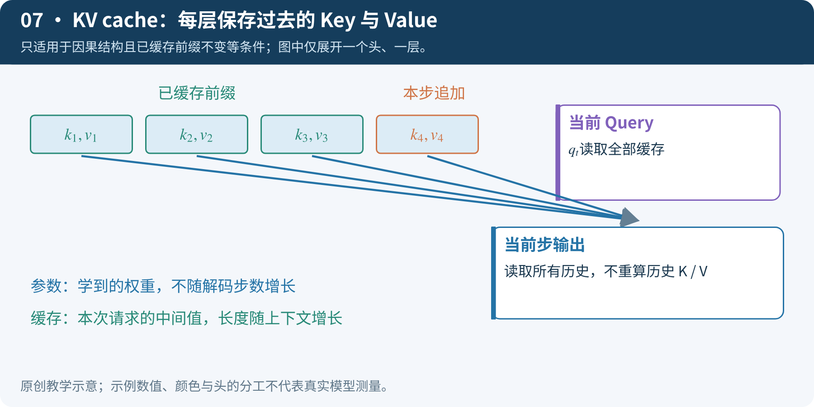
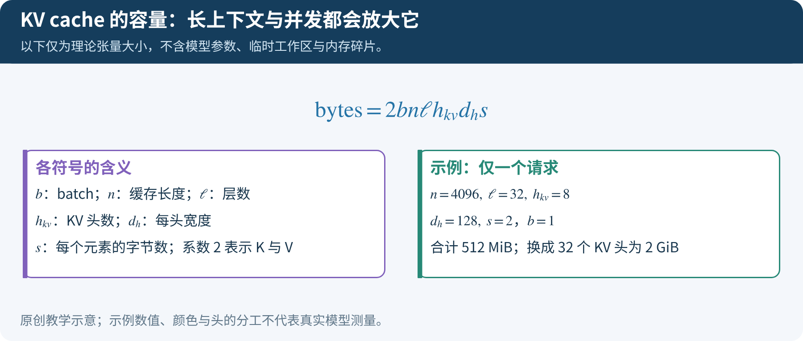
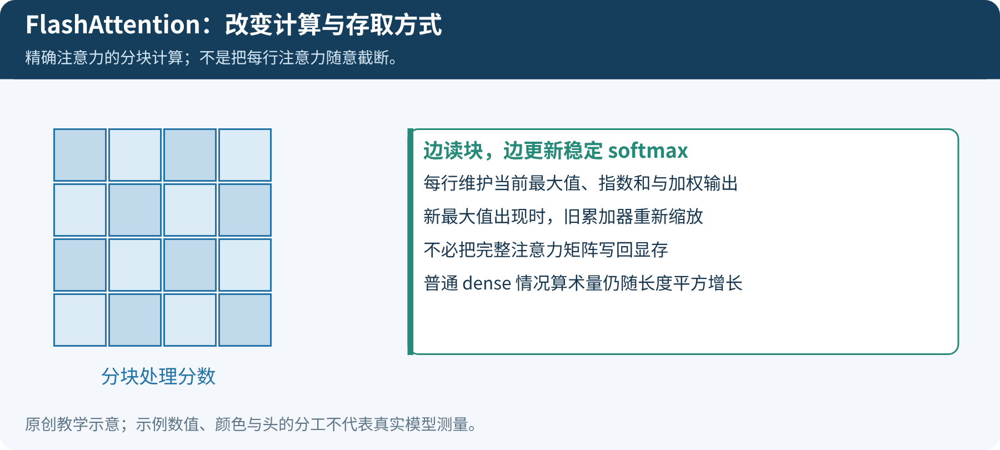

# Transformer 07：KV cache 与注意力计算效率

先读 [整体框架与各模块的作用](transformer-00-overview.md)，了解本篇在完整网络中的位置。

逐 Token 生成时，如果每次都把整个前缀从头计算一遍，会重复生成大量历史中间值。KV cache 保存每层历史位置的 Key 与 Value，避免重复计算这些部分。**它缓存本次请求的状态，不是在模型参数里新增记忆，也不会使长上下文注意力免费。**

## 1. 为什么历史 Keys 与 Values 可以复用

考虑因果自注意力。在模型固定、推理确定性且前缀不变的条件下，历史位置的表示只依赖当时已有的前缀；未来新增 Token 不会改变它们。因此第 $t$ 步可以把新位置投影得到的 $k_t,v_t$ 追加到缓存：

$$K_{1:t}=[K_{1:t-1};k_t],\qquad V_{1:t}=[V_{1:t-1};v_t].$$

这里分号表示沿位置轴追加，不是沿特征拼接。当前 Query 计算：

$$z_t=\operatorname{softmax}\left(q_tK_{1:t}^\mathsf T/\sqrt{d_k}\right)V_{1:t}.$$

这一行已经只包含允许读取的前缀，若还有 padding 等约束，仍需遮罩。每层分别保存自己的缓存，不能把底层缓存当作所有层共用的表示。

*原创单层单头展开。缓存可以避免重算历史投影，但当前 Query 仍要读取历史信息。*

<video controls loop playsinline preload="none" poster="../../imgs/tf-cache-animated.png" aria-label="KV cache 每一步追加当前 Token 的 Key 与 Value" style="display:block;width:100%;height:auto;margin:24px 0"><source src="../../imgs/tf-cache-animated.mp4" type="video/mp4">请使用下方链接播放。</video>

[播放或下载缓存动画](../../imgs/tf-cache-animated.mp4)。[查看静态首帧](../../imgs/tf-cache-animated.png)。

*原创动画。绿色为历史缓存，橙色为当前追加项；实际缓存同时存在于各层、各头、各样本。*

若模型采用双向注意力，新增位置会改变历史位置可读取的信息，不能直接使用上述不变性。修改提示前缀、位置规则或模型权重，也可能使缓存失效。跨请求复用还需要严格匹配缓存所依赖的配置。

## 2. 缓存占多少显存

设 batch 为 $b$，缓存长度为 $n$，层数为 $\ell$，KV 头数为 $h_{kv}$，每头维度为 $d_h$，每个元素占 $s$ 字节，若 Key 与 Value 宽度相同，则：

$$B_{KV}=2bn\ell h_{kv}d_hs.$$

系数二表示同时保存 Key 与 Value。它不包含参数、激活工作区、缓存管理开销和碎片。

*原创容量示例。MiB、GiB 均按二进制单位计算，未测量实际设备内存。*

例如 $b=1,n=4096,\ell=32,h_{kv}=8,d_h=128,s=2$，理论大小为 $536870912$ 字节，即 $512\ \mathrm{MiB}$。若其他条件不变而 KV 头数变为 $32$，则为 $2\ \mathrm{GiB}$。

MHA 常令 Query 与 KV 头数相同；MQA 让多个 Query 头共享一组 KV；GQA 在多个 Query 头间分组共享 KV。它们改变缓存容量与表示结构，需要训练或适配，不能随意删除已有模型的头。见[GQA 原论文 §2](https://arxiv.org/html/2305.13245v3#S2)。

## 3. 缓存减少重复工作，但没有消除长度成本

Dense 全序列注意力的分数计算和加权聚合量级为 $O(n^2d)$；若显式存储每头权重，分数矩阵占用为 $O(bhn^2)$。线性投影约为 $O(nd^2)$，FFN 还依赖中间维度。不能用一个注意力复杂度公式代表整个模型的全部耗时。

缓存后的单步 Query 仍需与已有 $n$ 个 Keys 匹配并聚合 Values，其注意力部分约为 $O(nd)$。连续生成长度增长的序列时，累计注意力成本仍可能平方增长。真实耗时还受带宽、batch、精度、内核与硬件影响，本文不给无条件的倍数提升。

## 4. FlashAttention 优化的是另一个瓶颈

*原创机制图。分块处理仍可得到完整 dense 注意力结果，浮点舍入次序可能带来数值差异。*

普通实现可能把完整分数和权重矩阵写入显存再读回来。FlashAttention 通过分块与稳定的在线 softmax，把更多操作放在较快存储层次里，避免物化完整矩阵。它与 KV cache 可以组合使用：前者改计算和 IO，后者复用生成历史。

用一行分数说明稳定累加。设旧块的最大分数为 $m$、指数和为 $l$、未归一化 Value 加权和为 $u$，新块为 $s_j,v_j$，更新：

$$m'=\max(m,\max_js_j),$$
$$l'=e^{m-m'}l+\sum_je^{s_j-m'},\qquad u'=e^{m-m'}u+\sum_je^{s_j-m'}v_j.$$

最终输出为 $u'/l'$。新最大值出现时，旧累加器也要缩放，不能只把新块的 softmax 单独归一化后相加。这是本文对[FlashAttention §3 与附录算法](https://arxiv.org/html/2205.14135v2#S3)的单行教学重写，不是完整 GPU 内核。

Dense FlashAttention 不把理论算术量变为线性注意力；滑动窗口、稀疏注意力、近似线性方法解决的是不同问题。

## 5. 调实现时先检查语义是否一致

比较速度前，先确认因果遮罩、缓存位置、有效长度、精度与输出容差一致。Prefill 处理一整段已知提示，decode 读取持续增长的缓存，二者瓶颈可不同。不要把大 batch 的吞吐提升当作单请求首 Token 延迟的同等提升。

## 来源与继续阅读

- [FlashAttention，2022](https://arxiv.org/html/2205.14135v2)；[GQA，2023](https://arxiv.org/html/2305.13245v3)。
- [上一篇：训练与生成](transformer-06-training-generation.md)；[下一篇：模型家族](transformer-08-model-families.md)；[系列起点](transformer-01-tokens-embeddings.md)；[来源记录](../../../raw/entries/2026-11-21-transformer-series.md)。
