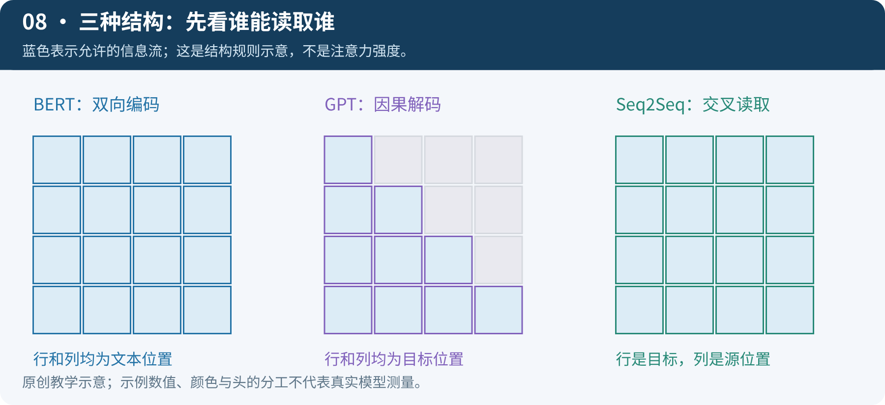
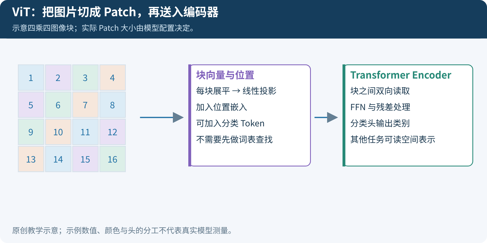
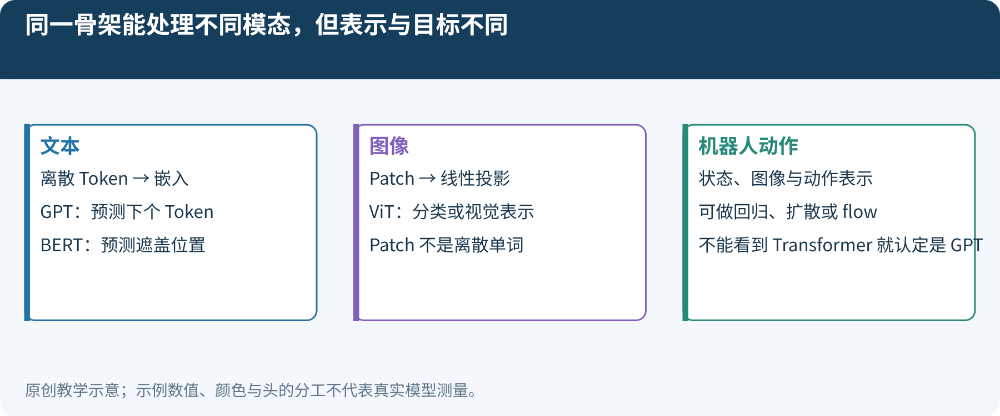

# Transformer 08：BERT、GPT、ViT 与多模态接口

先读 [整体框架与各模块的作用](transformer-00-overview.md)，了解本篇在完整网络中的位置。

BERT、GPT 和 ViT 都使用 Transformer，但输入、可见范围和预测目标不同。拿到一个新模型时，比记住它叫什么更有用的是问：**哪些对象成为 Token，每个位置能看到谁，输出究竟接受什么监督？** 本篇把这三个接口放在同一张结构地图上。

## 1. Encoder-only：以 BERT 为例

BERT 使用双向 Transformer Encoder。各有效文本位置可读取左右上下文，输入还包含特殊 Token、位置嵌入与片段类型嵌入。原始预训练包含 Masked Language Modeling 和 Next Sentence Prediction；不能把后来所有 BERT 类模型都说成保留完全相同的目标。

以“我爱 [MASK]”为例，模型根据左右可见内容预测遮盖处。其核心遮盖目标可写成：

$$\mathcal L_{MLM}=-\sum_{i\in\mathcal M}\log p_\theta(y_i\mid\widetilde x).$$

$\mathcal M$ 为选中监督的位置，$\widetilde x$ 为经过扰动的输入；原始 BERT 的选中位置不全部替换成同一个遮盖符，具体策略见[论文 §3.1 与附录](https://arxiv.org/html/1810.04805v2#S3.SS1)。该目标允许利用右侧上下文，因此不能原样当成从左到右生成下一个 Token 的条件概率。

典型下游接口可以读分类位置、对每个 Token 分类，或预测答案起止位置；输出头需与任务一致。

## 2. Decoder-only：以 GPT 为例

GPT 类自回归结构使用因果自注意力：当前位置读取前缀，预测后一个 Token。它通常没有原始 Encoder–Decoder 的独立源编码器和交叉注意力层；提示文本与输出前缀可在同一序列中。

$$\mathcal L_{AR}=-\sum_t\log p_\theta(y_t\mid y_{<t}).$$

GPT-2 报告中的架构调整包括归一化位置等变化，见[原始报告 §2.3](https://cdn.openai.com/better-language-models/language_models_are_unsupervised_multitask_learners.pdf)。这说明“使用 Transformer”不意味着完整复制 2017 图中的每个模块。现代具体模型是否采用 RoPE、RMSNorm 或 GQA，必须查它自己的结构，不能从 GPT 这个名称推断。

*原创可见性图。Seq2Seq 画的是目标到源的交叉读取子层，并不表示其目标自注意力可以看未来。*

## 3. Encoder–Decoder：把条件与输出放在两条路径

机器翻译是直观例子：源句先双向编码，目标前缀做因果解码，每层可通过交叉注意力读取源记忆。源与目标长度可以不同。文字摘要、条件生成也能采用该结构，但任务名称并不唯一决定骨架。

|骨架|主体读取方式|典型目标与接口|需要防止的误读|
|---|---|---|---|
|Encoder-only|有效位置双向读取|遮盖预测、分类、表征|双向表示不是自然的左到右生成分布|
|Decoder-only|因果读取前缀|自回归预测与条件生成|没有独立编码器不表示无法接受条件|
|Encoder–Decoder|源双向，目标因果，目标交叉读源|条件序列生成|交叉注意力不要求两序列等长|

这些是常见结构约定，不是把所有任务硬分到唯一类别；同一任务可以有不同实现。

## 4. ViT：图像不是先变成一串离散单词

给定图像尺寸 $H\times W\times C$，切成边长 $P$ 的不重叠 Patch；假设 $H,W$ 可整除 $P$，块数为：

$$n=HW/P^2,\qquad x_i^{patch}\in\mathbb R^{1\times(P^2C)}.$$

每块展平并投影到模型宽度：

$$e_i=x_i^{patch}W_{patch}+b,\qquad W_{patch}\in\mathbb R^{(P^2C)\times d}.$$

加入位置嵌入后送入编码器。原始 ViT 分类结构加入可学习的分类 Token，读取其最终表示；其他结构也可采用池化。Patch 是连续像素投影，**没有必须经过离散词表查询的步骤**。见[ViT §3、Figure 1](https://arxiv.org/html/2010.11929v2#S3)。

*据 ViT Figure 1 的接口原创重绘，非论文原图。只画少量示意块，不代表某个模型的实际分辨率。*

<video controls loop playsinline preload="none" poster="../../imgs/tf-patch-animated.png" aria-label="图像块按固定顺序组成 Patch 序列" style="display:block;width:100%;height:auto;margin:24px 0"><source src="../../imgs/tf-patch-animated.mp4" type="video/mp4">请使用下方链接播放。</video>

[播放或下载 Patch 序列动画](../../imgs/tf-patch-animated.mp4)。[查看静态首帧](../../imgs/tf-patch-animated.png)。

*原创动画。依次展开为了说明序列索引；实际 Patch 投影可以批量并行。*

## 5. 多模态和机器人为什么也使用这套骨架

*原创接口图。共同点是向量序列计算，不同点在于输入表示、信息约束与输出目标。*

图像特征可以通过投影连接到语言模型的宽度，采用拼接自注意力或交叉注意力等方式交互；两者需要不同遮罩和连接规则。相同宽度不等于不同模态已经语义对齐，训练数据与目标仍然关键。

机器人动作可以被离散化为 Token 后预测，也可以保持连续，用回归、扩散或 flow 模型输出。Transformer 是处理条件与动作表示的网络骨架，**不自动决定动作分布的建模方式**。例如本库的 [FAST](../01-embodied-ai/pi-fast-action-tokenization.md)和[π₀](../01-embodied-ai/pi-0-flow-vla.md)分别展示了不同动作接口，具体算法应回到各概念文阅读。

## 6. 看新论文时沿这条路径读框架

先确定序列元素是什么，再沿每条注意力路径找 Query、Key、Value 的来源，检查双向、因果及跨模态可见范围。接着追踪位置编码、Block 归一化顺序和输出头，最后确认损失与推理过程是否一致。

如果能在图上逐项指出这些接口，Transformer 就不再只是一个黑箱名字：你可以分清哪些部分是共享骨架，哪些是为当前任务增加的设计。

## 来源与继续阅读

- [BERT 原论文](https://arxiv.org/html/1810.04805v2)；[GPT-2 原始报告](https://cdn.openai.com/better-language-models/language_models_are_unsupervised_multitask_learners.pdf)；[ViT 原论文](https://arxiv.org/html/2010.11929v2)。
- [上一篇：缓存与效率](transformer-07-kv-cache-efficiency.md)；[回到系列起点](transformer-01-tokens-embeddings.md)；[经典框架](transformer-04-encoder-decoder.md)；[来源与证据](../../../raw/entries/2026-11-21-transformer-series.md)。
