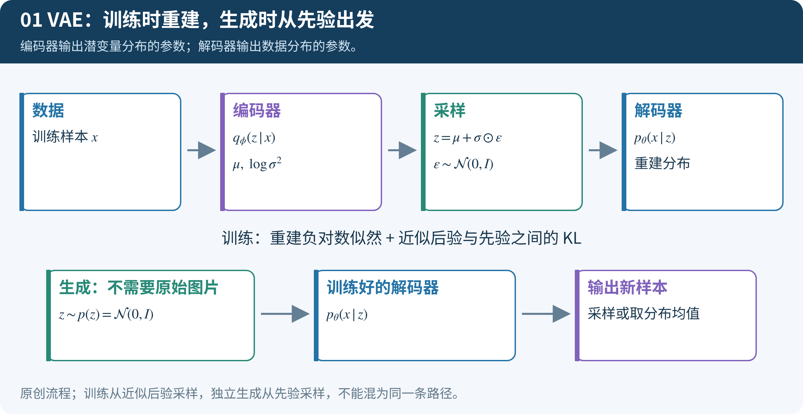
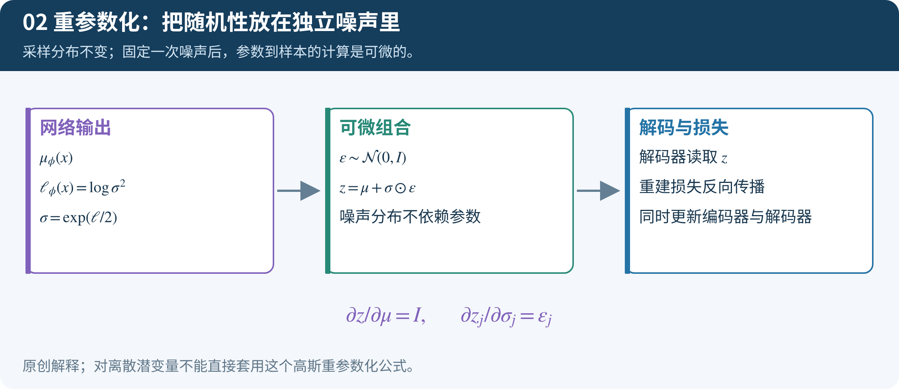
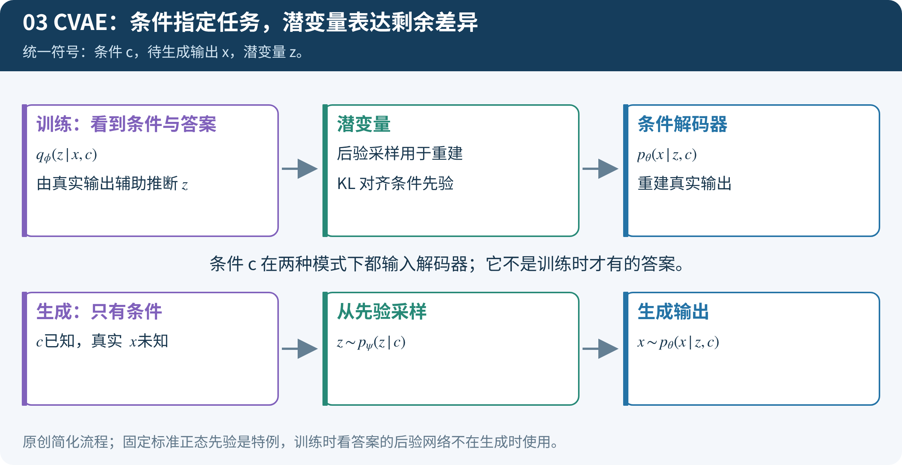
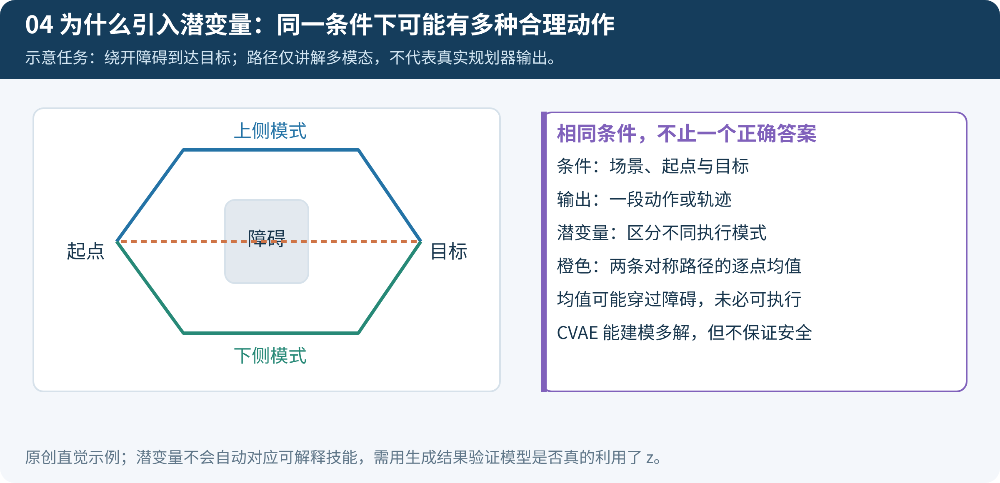

# VAE 与 CVAE：从重建数据到生成多种可能

**VAE（Variational Autoencoder，变分自编码器）是一种生成模型：它学习怎样用一组潜变量描述数据，再从潜变量生成新数据。CVAE 在此基础上加入条件，学习“给定这个条件，可以生成什么”。** 它们既能用于图片，也能用于动作序列；重点不是网络必须长什么样，而是如何定义概率模型并训练它。

假设你有很多手写数字图片。识别模型回答“这张图是几”；普通自编码器回答“怎样把这张图编码后恢复”；VAE 还要回答“怎样不拿现成图片，生成一张新的合理手写数字”；CVAE 则能把问题变成“请生成一个数字 3，但写法可以不同”。这几个问题对应不同的输入输出。

## 1. VAE 与 CVAE 的提出背景

VAE 面对的关键困难是：神经网络可以灵活地描述“给定潜变量如何生成数据”，但观察到一张图片后，反推潜变量通常很难。生成模型的边缘似然也往往无法精确计算。VAE 用可学习的近似后验和变分下界，把这两个问题放到同一个可优化框架中。

CVAE 进一步处理条件生成：给定一张场景图或一个类别，输出可能不止一种。它要学习的是一组合理结果及其变化，而不是仅仅回归一个平均答案。

下面从自编码器和具体例子展开，再引入概率模型、训练目标与实际应用。原始论文及其方法定位列在文末来源区。

## 2. 从普通自编码器开始：为什么“能还原”还不够

设图片展平成 $x\in\mathbb R^D$，潜变量为 $z\in\mathbb R^d$；例如手写数字 $D=28\times28$，教学中可取 $d=2$ 便于画图，实际维数按任务选择。

普通自编码器（AE）的编码器把图片变成一个确定的编码，解码器再恢复图片：

$$z=f_\phi(x),\qquad \hat x=g_\theta(z).$$

$\phi$、$\theta$ 分别是两网络参数。典型目标是降低 $\|x-\hat x\|^2$。问题是：**训练只要求见过的图片经过编码后能恢复，并没有明确规定“随手抽一个 $z$”该抽自什么分布，也没有保证抽到的位置能生成合理图片。**

可以类比地址簿：AE 为每张图学了一个地址，但只认识这些地址，并没有同时学好一套可供随机选址的地图。VAE 把“潜变量从哪里来”也纳入模型：先选一个容易采样的先验，再训练生成器和编码器，使这套概率描述能解释训练数据。

这不是说 AE 绝不能用于生成，而是单纯重建目标没有给出完整的生成概率建模方案。

## 3. VAE 的三个对象：先验、解码器、编码器



*原创流程图。上排训练时用真实样本推断潜变量；下排独立生成时不需要原始样本。两条路径的采样分布不同。*

### 3.1. 先验 $p(z)$：还没看图片，潜变量可能是什么

基础 VAE 通常选：

$$p(z)=\mathcal N(0,I_d).$$

这表示一个 $d$ 维标准正态分布，均值全零、协方差为单位阵。选它的理由是采样和 KL 计算方便，不是认为真实图片的语义天然服从正态分布。

### 3.2. 解码器 $p_\theta(x\mid z)$：给定潜变量，数据如何生成

解码器输入 $z$，输出**数据条件分布的参数**。例如每个二值像素的概率，或连续像素高斯分布的均值。神经网络输出的图片常只是这个分布的均值或概率参数，而不是分布本身。

生成过程是：

$$z\sim p(z),\qquad x\sim p_\theta(x\mid z).$$

如果只想显示平滑的确定结果，也可以显示解码分布的均值。这与从该分布再采样像素不是完全相同的操作。

整个生成模型是：

$$p_\theta(x,z)=p(z)p_\theta(x\mid z),\qquad
p_\theta(x)=\int p_\theta(x\mid z)p(z)\,dz.$$

最后这个积分表示：一张图片可能由许多潜变量解释，把它们的贡献加起来才得到图片的边缘概率密度。非线性神经网络使积分通常难以精确计算。

### 3.3. 编码器 $q_\phi(z\mid x)$：看见图片，倒推潜变量

真正想知道的后验是 $p_\theta(z\mid x)$，但按贝叶斯公式求它会碰到难算的 $p_\theta(x)$。因此引入一个可计算的近似分布：

$$q_\phi(z\mid x)=\mathcal N\!\left(\mu_\phi(x),\operatorname{diag}(\sigma_\phi^2(x))\right).$$

编码器输入图片，输出 $\mu\in\mathbb R^d$ 和各维方差参数，而不是只输出一个编码点。对角协方差是常见简化：给定同一张图，各潜变量维度在该近似后验下独立；这不意味着所有训练样本混合后的潜变量分布必然独立。

先验 $p(z)$ 与近似后验 $q_\phi(z\mid x)$ 的角色不同：前者让模型能独立生成，后者让真实数据能参与高效训练和表示提取。[原论文 §2–3](https://arxiv.org/html/1312.6114v11#S2) 给出了这一推断与生成框架。

## 4. 为什么损失是“重建项 + KL”：逐步看 ELBO

“变分”不是指给输入随便加噪声。它指用一族易计算的分布 $q_\phi$ 近似难求的后验，并通过优化选择其中合适的分布。下面是对前述概率模型的统一推导。

希望训练数据有较高似然，即最大化 $\log p_\theta(x)$。把近似后验乘进去再除掉，得到：

$$\log p_\theta(x)
=\log\mathbb E_{q_\phi(z\mid x)}\left[\frac{p_\theta(x,z)}{q_\phi(z\mid x)}\right]
\geq\mathbb E_{q_\phi(z\mid x)}\left[\log p_\theta(x,z)-\log q_\phi(z\mid x)\right].$$

不等式来自对数函数的凹性，即 Jensen 不等式；需要相应支持集和可积条件。右边就是 **ELBO（Evidence Lower Bound，证据下界）**。将联合分布拆开：

$$\mathcal L_{\mathrm{ELBO}}(x)
=\underbrace{\mathbb E_{q_\phi(z\mid x)}[\log p_\theta(x\mid z)]}_{\text{重建对数似然}}
-\underbrace{D_{\mathrm{KL}}\!\left(q_\phi(z\mid x)\|p(z)\right)}_{\text{近似后验相对先验的偏离}}.$$

训练通常写成最小化负 ELBO：

$$\mathcal J(x)=\underbrace{-\mathbb E_q[\log p_\theta(x\mid z)]}_{\mathcal J_{\mathrm{rec}}}
+\underbrace{D_{\mathrm{KL}}(q_\phi(z\mid x)\|p(z))}_{\mathcal J_{\mathrm{KL}}}.$$

- 重建项要求 $z$ 保留有助于解释当前样本的信息。
- KL 项使每个样本的潜变量分布不能任意偏离先验，使从先验采样成为有约束的生成路径。

更精确的关系是：

$$\log p_\theta(x)-\mathcal L_{\mathrm{ELBO}}(x)
=D_{\mathrm{KL}}\!\left(q_\phi(z\mid x)\|p_\theta(z\mid x)\right)\geq0.$$

**注意两个 KL 的右侧不同：损失里可计算的是与先验的 KL，下界缺口里是真后验。** 后者解释为什么近似推断会影响下界的紧致程度，但一般不能直接算出。

### 4.1. 重建项不是永远都叫“交叉熵”

损失形式来自解码器选择的观测分布。

**二值观测，独立 Bernoulli 解码。** 令第 $j$ 个像素 $x_j\in\{0,1\}$，解码器给出概率 $m_j(z)\in(0,1)$：

$$-\log p_\theta(x\mid z)
=-\sum_{j=1}^{D}\left[x_j\log m_j+(1-x_j)\log(1-m_j)\right].$$

这就是二元交叉熵。若把连续灰度值直接当软标签使用同一损失，要知道它并非严格的二值观测建模。

**连续观测，固定方差高斯解码。** 令 $p_\theta(x\mid z)=\mathcal N(m_\theta(z),\tau^2I_D)$，则：

$$-\log p_\theta(x\mid z)=\frac{\|x-m_\theta(z)\|^2}{2\tau^2}+C.$$

$\tau^2$ 固定时 $C$ 与模型参数无关，于是最小化它等价于按该尺度加权的平方误差。若方差也学习，不能把方差项和对数归一化项省掉。更一般的离散或连续似然会对应其他重建损失。相关背景见 [交叉熵](cross-entropy.md)。

### 4.2. 高斯 KL 可以直接计算

对角高斯后验和标准正态先验给出：

$$\mathcal J_{\mathrm{KL}}=\frac12\sum_{j=1}^{d}
\left(\mu_j^2+\sigma_j^2-1-\log\sigma_j^2\right).$$

工程上常预测 $\ell_j=\log\sigma_j^2$，写成：

$$\mathcal J_{\mathrm{KL}}=\frac12\sum_j\left(\mu_j^2+e^{\ell_j}-1-\ell_j\right).$$

这样不需要额外采样估计 KL，并且指数保证方差为正。数值上仍要防止极端 $\ell$ 导致溢出。

一个原创手算例子：一维 $q=\mathcal N(1,0.25)$，$p=\mathcal N(0,1)$，则 KL 为 $\tfrac12(1+0.25-1-\log0.25)\approx0.818$ nat。它不是图像重建误差，而是这两个分布的差异代价。

## 5. 重参数化：随机采样怎么反向传播

若只把“从 $\mathcal N(\mu,\sigma^2)$ 抽样”当作黑盒，普通计算图不知道抽到的数如何随网络参数改变。对高斯有一个等价采样写法：

$$\epsilon\sim\mathcal N(0,I_d),\qquad
z=\mu_\phi(x)+\sigma_\phi(x)\odot\epsilon.$$

$\odot$ 表示逐元素乘法。随机性来自与网络参数无关的 $\epsilon$；给定这次抽到的 $\epsilon$，剩余是可微函数。



*原创示意。噪声并未消失，而是从“依赖网络的抽样分布”转到独立噪声输入。图中偏导说明固定一次噪声后的局部梯度。*

上面的一维例子若 $\mu=1,\sigma=0.5,\epsilon=-0.4$，得到 $z=0.8$，并且 $\partial z/\partial\mu=1$、$\partial z/\partial\sigma=-0.4$。解码器的重建损失就能沿 $z$ 传回编码器。实际优化的是期望的采样估计，不是把噪声当作要拟合的网络参数。其推导与适用条件可见作者的 [VAE 教程 §2.4–2.5](https://arxiv.org/html/1906.02691v3#S2)。

这并不意味着离散类别抽样也能直接套用同一个式子；离散潜变量需要其他估计方法或松弛。

## 6. 一次训练和一次生成，分别实际做什么

以标准正态先验、对角高斯后验为例，训练输入为小批量 $x\in\mathbb R^{B\times D}$，输出是更新后的 $\phi,\theta$。一种单次后验采样的实现流程是：

```python
# 框架无关的 PyTorch 风格伪代码；不是原论文逐行实现。
mu, logvar = encoder(x)                 # [B, d]
std = exp(0.5 * logvar)
eps = randn_like(std)
z = mu + std * eps
params = decoder(z)                    # 数据似然的参数
rec = -likelihood(params).log_prob(x)   # 先保留每样本维度
rec = sum_over_data_dimensions(rec)     # [B]
kl = 0.5 * sum(mu**2 + exp(logvar) - 1 - logvar, dim=-1)
loss = mean(rec + kl)
optimizer.zero_grad()
loss.backward()
optimizer.step()
```

若使用会自动对事件维求和的分布对象，就不应再重复求和。重建项和 KL 都先按样本求出，再在 batch 上取平均；随意把一个按像素取平均、另一个按潜维度求和，会改变两项的相对权重。

训练后有三种不同操作：

| 操作 | 输入 | 潜变量来源 | 输出 |
|---|---|---|---|
| 重建已有样本 | 已有 $x$ | $q_\phi(z\mid x)$，或取 $\mu_\phi(x)$ | 对该样本的重建 |
| 提取表示 | 已有 $x$ | 常用后验均值作特征 | 编码向量 |
| 生成新样本 | 不需要已有 $x$ | 先验 $p(z)$ | 新数据 |

独立生成通常只用训练好的解码器。**“生成时不需要编码器”不意味着训练时可以不要编码器**：它承担近似后验推断并帮助学习生成器。

## 7. CVAE 是什么：不是随便再加一个字母 C

C 是 Conditional。普通 VAE 学 $p(x)$，CVAE 学 $p(x\mid c)$。本文统一用 $c$ 表示条件、$x$ 表示待生成对象，避免和原 CVAE 论文里“输入 $x$、输出 $y$”的符号混淆。

以生成数字为例：

- $c=3$：要求画数字 3，生成时已知。
- $x$：某一张真实的数字 3 图片，训练时已知、生成时未知。
- $z$：条件之外的变化，例如笔迹差异；它不一定自动对应可解释的“粗细旋钮”。

### 7.1. 条件进入哪些地方

一般条件模型写成：

$$p_{\theta,\psi}(x\mid c)=\int p_\theta(x\mid z,c)p_\psi(z\mid c)\,dz.$$

其三个组成部分是：

| 对象 | 输入 | 输出及用途 |
|---|---|---|
| 近似后验 $q_\phi(z\mid x,c)$ | 条件和真实答案 | 训练时推断潜变量分布 |
| 条件先验 $p_\psi(z\mid c)$ | 只有条件 | 生成时可以采样的潜变量分布 |
| 解码器 $p_\theta(x\mid z,c)$ | 条件和潜变量 | 待生成对象的分布 |

$\psi$ 是先验网络参数。也可以选固定 $p(z)=\mathcal N(0,I)$，此时没有条件先验网络；它是常见特例，不是 CVAE 必须采用的唯一形式。[Sohn 等原论文 §4，式 (4)–(5)](https://papers.nips.cc/paper/2015/file/8d55a249e6baa5c06772297520da2051-Paper.pdf) 明确讨论了条件先验及独立先验的特例。



*原创示意。生成时不能把真实输出送进后验网络，否则是在用答案帮忙推断，而非真正从条件生成。*

### 7.2. CVAE 的损失从哪里来

对上一节推导，在每个分布里补上条件，得到：

$$\log p_{\theta,\psi}(x\mid c)\geq
\mathbb E_{q_\phi(z\mid x,c)}[\log p_\theta(x\mid z,c)]
-D_{\mathrm{KL}}\!\left(q_\phi(z\mid x,c)\|p_\psi(z\mid c)\right).$$

训练时，后验通过真实 $x$ 知道这次示例属于哪种变化模式；生成时不知道 $x$，只能从先验采样。KL 项连接训练时与生成时的潜变量分布。**条件 $c$ 解释已知要求，$z$ 为条件未确定的变化保留自由度。**

用数字类标签作条件时，可将其嵌入后与特征拼接；图像条件可用卷积特征，序列条件可用 Transformer 特征或交叉注意力。条件注入方式是网络设计，CVAE 这个名字不规定必须用 MLP、CNN 或 Transformer。

## 8. 为什么条件生成需要多个可能，而不只是回归一个答案

给机器人同一幅场景图：中间有障碍，杯子在障碍后面。示范者可能从左边绕，也可能从右边绕。这两个动作序列都合理，逐时刻取平均却可能正好撞上障碍。



*原创多模态直觉图。把对称路径逐点平均可能穿过障碍；这里不是声称 CVAE 自带避障约束。*

确定性平方误差回归在理想条件下倾向预测条件均值 $\mathbb E[x\mid c]$。若条件输出分布有多个模式，均值未必是任何一个合理模式。CVAE 用不同 $z$ 生成不同候选，具备建模这种分布的能力。

但“有随机变量”不等于“已学到多模态”：解码器可能忽略 $z$，不同采样仍生成同一类结果；或者生成违反物理约束的结果。需要实际检查条件固定时的多次样本、质量、覆盖与约束，而不是只看损失下降。

## 9. 具体应用：VAE 在系统中承担哪一部分

### 9.1. 新图片生成、潜空间表示与插值

给训练好的基础 VAE 抽几个先验样本 $z$，解码即可得到不同图片；对已有图片编码，可以用 $\mu_\phi(x)$ 做低维表示。两个编码之间插值再解码，有时能看到连续变化，但**不保证插值始终经过数据高密度区域，也不保证某维只表示一个语义属性**。

这里学的是概率潜表示，不是有固定码率、无损重建保证的通用文件压缩格式。真正用于传输压缩还需要量化、熵模型与码流设计。

### 9.2. 给定条件的补全与结构化预测

缺失图像补全可把已知区域和 mask 放入条件 $c$，把缺失内容或完整图像作为输出 $x$，训练条件生成模型。推理时固定可见部分，改变 $z$ 得到多种补全。条件需要明确包含 mask，否则“原本就是黑色”和“缺失后填黑”可能混淆。

同理，图像作为条件、分割结果作为输出，也可以表示有歧义的结构化预测。CVAE 原始工作研究了这种条件结构化输出，不能把其中的潜变量理解成分类标签本身。[原论文任务与实验](https://papers.nips.cc/paper/2015/file/8d55a249e6baa5c06772297520da2051-Paper.pdf)。

### 9.3. 机器人 ACT：训练时解释示范差异，执行时预测动作块

ACT 是一个真实的 CVAE 应用。映射到本文符号，$c$ 是相机图像和当前关节位置，$x$ 是未来动作序列，$z$ 是用于吸收示范差异的潜变量。原论文的后验编码器训练时读取目标动作序列和本体状态，为效率不读图像；解码器策略则读取图像、本体状态和 $z$。

部署时不再有真实未来动作，因而不用后验编码器。ACT 将 $z$ 固定为标准正态先验均值零，生成动作块，而非每次都随机采样风格。因此 $z=0$ 是该方法的执行选择，不是 CVAE 普遍规定；非线性解码下也不等于对所有动作模式求期望。

这些信息见 [ACT 原论文 §IV-B–C、算法 1–2](https://arxiv.org/html/2304.13705v1#S4)。ACT v1 算法框列出 MSE 重建项，不能把这个版本的公式与其他版本或代码的损失选择混写。这里引用的是论文描述，未声称已复现实验或逐行审计实现。

这属于从示范训练动作模型；仅因为用了 CVAE，不代表进行了奖励驱动的强化学习。相关分类见 [在线／离线与 On-policy／Off-policy](online-offline-learning.md)。

### 9.4. 潜空间扩散：VAE 常被用作图像编解码接口

在潜空间扩散系统中，图像先被自编码器压到较小的空间，扩散模型在那里建模，生成的潜表示最后再解码成图像。VAE 类部件在这里主要负责表示与重建，**最终的高质量潜样本来自扩散生成过程，不是简单从基础高斯先验抽一次就完成整套生成**。

LDM 原论文使用感知压缩并讨论 KL 正则与 VQ 正则两类自编码方案，其训练还包含感知／对抗等设计，不能说它与最基础像素 ELBO VAE 完全相同。见 [High-Resolution Image Synthesis with Latent Diffusion Models，§3.1–3.2](https://arxiv.org/html/2112.10752v2#S3)。

### 9.5. 异常检测：可以用，但不要把重建误差当真理

一个直观用法是只用正常样本训练，测试时计算重建误差或负 ELBO，较大时作为异常线索。这是从概率重建框架出发的应用思路，不是本文报告的实验结果。

限制在于模型也可能把异常重建得很好，或者正常分布内的罕见样本误差很大；似然还可能受背景统计与观测分布假设影响。实际使用需要独立验证集选阈值、测误报漏报，并按具体异常类型评估。这里的分数不等于“异常概率”，更不应直接充当安全保证。

## 10. 常见误解与训练中真正要观察的现象

| 说法或现象 | 应怎样理解 |
|---|---|
| VAE 只是压缩后还原 | 它还定义可采样的生成模型，并用变分推断训练 |
| 加随机噪声就是 VAE | 还需要明确先验、近似后验、似然与目标 |
| 变分就是方差 | 变分指优化近似分布的方法，与英文 variance 不同 |
| KL 越小越好 | 若后验完全不携带样本信息，解码器可能忽略潜变量 |
| KL 约束保证潜空间没有空洞 | 它施加分布约束，不提供这样的逐点保证 |
| CVAE 必须有条件先验网络 | 固定标准正态先验也是常见选择 |
| 生成时仍用真实输出编码 | 那是重建或后验辅助推断，会泄露待预测信息 |
| $z$ 必然代表可解释的风格 | 只是可能的解释，要验证；没有自动解耦保证 |

**后验坍塌（posterior collapse）**是一个重要现象：$q_\phi(z\mid x)$ 接近先验，解码器几乎不使用 $z$。强解码器尤其可能绕过潜变量。需要同时观察重建质量、KL 各维大小和改变 $z$ 是否真的改变输出，单看总损失不足以判断。相关潜表示与优化背景见 [作者的 VAE 教程](https://arxiv.org/html/1906.02691v3)。

有时把损失改成 $\mathcal J_{\mathrm{rec}}+\beta\mathcal J_{\mathrm{KL}}$。当 $\beta\ne1$ 时，一般已不再是原始概率模型的标准负 ELBO；它改变了信息保留与先验约束的平衡。不要在不同像素归约尺度下直接比较 $\beta$。

基础模型生成模糊图像也不能简单归因于“用了高斯噪声”：观测似然、潜变量容量、近似推断和优化共同影响结果；固定方差独立高斯对应的平方误差在剩余不确定性下偏向均值，是其中一个原因。

如果只想预测一个确定量，普通回归可能已经足够；若希望在同一条件下表达多种合理结果，CVAE 才有更明确的建模动机。最终要检查的是采样结果是否符合任务，而不是是否用了生成模型的名称。

## 11. 阅读公式时抓住这四个问题

1. 要生成什么 $x$，生成时已知的条件 $c$ 是什么？
2. 潜变量 $z$ 从哪里采样：训练后验还是生成先验？
3. 解码器输出什么分布，它对应哪一种重建损失？
4. KL 对齐哪两个分布，测试时还需要哪些输入？

能够回答这四个问题，就能区分基础 VAE、带条件的 CVAE，以及仅把自编码器当压缩部件的复杂生成系统。

## 原始来源与相关阅读

- [Kingma–Welling，Auto-Encoding Variational Bayes](https://arxiv.org/abs/1312.6114)：[本地原论文](../../../raw/papers/kingma-welling-vae-1312.6114.pdf)。
- [Sohn–Yan–Lee，CVAE 原论文](https://papers.nips.cc/paper/2015/file/8d55a249e6baa5c06772297520da2051-Paper.pdf)：[本地论文](../../../raw/papers/sohn-cvae-neurips-2015.pdf)。
- [Rezende 等，随机反向传播与深生成模型](https://arxiv.org/abs/1401.4082)。
- [作者教程：An Introduction to Variational Autoencoders](https://arxiv.org/html/1906.02691v3)。
- [KL 散度](kl-divergence.md)、[交叉熵](cross-entropy.md)。
- [来源定位与核验记录](../../../raw/entries/2026-11-20-vae-cvae.md)。
