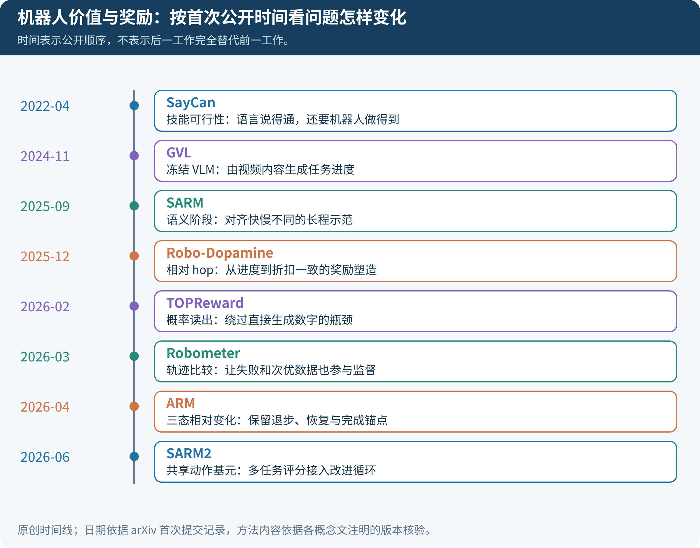
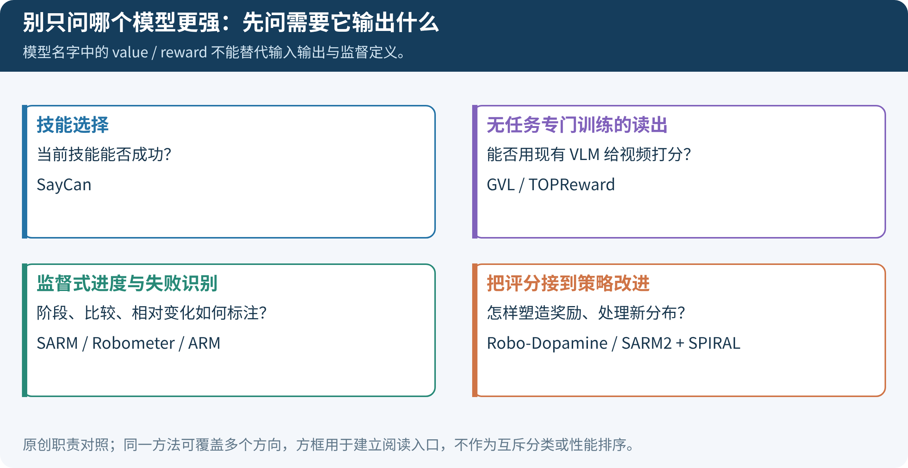

# 机器人价值函数与奖励模型：从技能可行性到策略改进

机器人不仅需要生成动作，还需要知道当前能做什么、任务推进了多少，以及哪段经验值得学习。这些问题都涉及打分，却不对应同一个数学对象。**这条研究线的发展，不是一个“更强价值网络”依次取代另一个，而是从技能可行性扩展到通用进度、失败识别和闭环策略改进，同时不断改变监督来源与评分用途。** 本文按首次公开时间组织方法，详细机制与推导放在各自概念文中。

## 1. 阅读前先区分四个对象

| 对象 | 核心含义 | 不应直接等同于 |
|---|---|---|
| 奖励 | 任务定义或学习系统给出的逐步反馈 | 任意视觉进度百分比 |
| 价值 | 按指定策略继续执行的期望回报 | 与策略无关的完成比例 |
| 进度 | 任务已经推进的程度 | 校准过的最终成功概率 |
| 优势 | 特定动作相对策略平均表现的增益 | 任意相邻帧进度差 |

“value learner”“reward model”是论文使用的术语，还要继续看输出定义。进度可被转换成奖励或动作训练权重，但转换方式会影响优化目标。独立基础解释见 [机器人价值函数：奖励、进度、成功率与优势](../../00-concepts/01-embodied-ai/robot-value-functions.md)。

*原创时间线。按 arXiv 首次提交日期排列；不以本库整理时间、期刊会议时间或最后修订时间代替首次公开时间。*

## 2. 2022：SayCan 把“语言上有用”与“当前能做”结合

[SayCan](../../00-concepts/01-embodied-ai/robot-value-2022-saycan.md) 的出发点是让语言规划面对机器人能力：从技能库里选下一步，既看技能文字对用户任务的相关性，也看技能在当前状态的可行性。价值函数充当语言与物理执行之间的接口。

这条路线的重点不是给所有视频帧估百分比，而是**在已有技能之间选择**。低层技能能做什么、可行性模型对新场景是否准确，决定高层规划能否落实。相关接口与概率解释条件见 [原论文 §2–4](https://arxiv.org/html/2204.01691v2)。

## 3. 2024：GVL 从预训练视觉语言模型中读出进度

[GVL](../../00-concepts/01-embodied-ai/robot-value-2024-gvl.md) 不为每种机器人重新训练 TD 价值网络，而是让 VLM 生成逐帧进度；保留首帧、打乱其余帧，减轻按输入位置报数的偏差，也可用上下文示例提高表现。

重点转向**能否在很多任务上复用已有视觉语言知识**。代价是进度语义、数字生成和上下文组织都依赖 VLM；整视频分析也不自动满足在线因果要求。它提供的是通用进度代理，不等同于精确的策略条件价值。依据 [原论文 §3](https://arxiv.org/html/2411.04549v1#S3)。

## 4. 2025：阶段标签和相对进度，让长任务更细致

### 4.1. SARM：对齐语义阶段，而不只对齐时间

[SARM](../../00-concepts/01-embodied-ai/robot-value-2025-09-sarm.md) 针对快慢不同的长程示范，用人工阶段边界生成一致的进度监督。先判断阶段，再估计段内进度，并通过 RA-BC 调整动作样本权重。

它把通用语义判断转成**任务内更细的监督设计**，但增加阶段协议和标注成本；阶段内仍存在时间插值近似。见 [原论文 §3](https://arxiv.org/html/2509.25358v4#S3)。

### 4.2. Robo-Dopamine：不仅预测进度，还检查怎样用于奖励

[Robo-Dopamine](../../00-concepts/01-embodied-ai/robot-value-2025-12-robo-dopamine.md) 学习带起点、目标和多视角状态的相对 hop，结合多种锚点估计降低漂移。Dopamine-RL 进一步讨论进度势与折扣奖励之间的关系。

它提醒我们：**评估器觉得接近目标，不代表由此构造的奖励会鼓励真正完成任务**。势函数塑造有边界与状态假设；若自动成功检测本身出错，数学上的策略不变性也不会修复真实任务目标。见 [原论文 §3](https://arxiv.org/html/2512.23703v1#S3) 与 [原始奖励塑造理论](https://people.eecs.berkeley.edu/~russell/papers/icml99-shaping.pdf)。

## 5. 2026：读出方式、失败监督与多任务改进并行发展

### 5.1. TOPReward：从生成数值改为读取概率

[TOPReward](../../00-concepts/01-embodied-ai/robot-value-2026-02-topreward.md) 延续冻结 VLM 路线，改读“任务已完成”答案的 token 对数概率，而不是要求模型生成百分比。它降低了数值输出这一层的负担，但仍需要理解视频和任务。

轨迹内 min-max 会让最高点接近一，因此不能只凭归一化满分判断成功；整轨迹归一化也不能未经修改直接充当实时标定。见 [原论文 §3](https://arxiv.org/html/2602.19313v2#S3)。

### 5.2. Robometer：失败样本不必有精确百分比，也可以比较

[Robometer](../../00-concepts/01-embodied-ai/robot-value-2026-03-robometer.md) 用轨迹比较补充专家帧级进度监督，另预测成功，让失败、次优和回退增强都能参与学习。

这是对**监督可扩展性**的改变：不必为每个失败状态精确标一个绝对分数，仍可提供“哪条更符合任务”的约束。但偏好正确不保证每个接触时刻的进度都准确。见 [原论文 §III](https://arxiv.org/html/2603.02115v2#S3)。

### 5.3. ARM：把退步与恢复直接纳入局部标注原语

[ARM](../../00-concepts/01-embodied-ai/robot-value-2026-04-arm.md) 以进步、退步、停滞的三态变化监督因果时序模型，用完成锚点重建进度，再对动作块增益作长度缩放和加权学习。

它的核心不是“取消所有人工”，而是**把更难的绝对百分比标注换成更直观的相对关系**。局部因果网络和依赖终点锚的全局离线重建要分开；相对进展也不自动成为精确策略优势。见 [原论文 §3](https://arxiv.org/html/2604.03037v2#S3)。

### 5.4. SARM2：复用动作基元，把评分接入改进循环

[SARM2](../../00-concepts/01-embodied-ai/robot-value-2026-06-sarm2.md) 将任务特定阶段扩展为可复用动作基元，用基元组 gate 调用共享专家池；再通过 SPIRAL 结合 rollout、奖励适配和残差 RL。

问题从**怎样给示范打分**继续走到**策略变化后怎样保持反馈可靠**。这要求区分预训练示范、奖励模型适配和自主运行阶段；一次适配不是所有未来分布都安全的保证。见 [原论文 §3.1–3.2](https://arxiv.org/html/2606.10305v1#S3)。

## 6. 把时间线换成一张选择地图

*原创职责图。各方向可以交叉，不是互斥算法分类，更不是性能排名。*

| 方法 | 主要输出／角色 | 关键监督或依赖 | 更适合回答的问题 |
|---|---|---|---|
| SayCan | 技能组合选择分数 | LLM、预训练技能与可行性价值 | 接下来哪个现有技能有用且可行？ |
| GVL | 生成式逐帧进度 | 冻结 VLM，可选上下文示例 | 能否用预训练知识批量评估视频？ |
| SARM | 阶段条件进度 | 任务特定阶段标注 | 如何对齐长任务快慢不同的示范？ |
| Robo-Dopamine | hop、融合进度与塑造奖励 | 阶段化相对监督、锚点、任务适配 | 如何兼顾精细进度与奖励目标？ |
| TOPReward | 肯定答案对数分数与轨迹内进度 | 冻结 VLM 及指定概率接口 | 不生成数字，能否得到可用进度信号？ |
| Robometer | 进度、成功、轨迹偏好 | 专家进度、真实／增强失败比较 | 失败数据怎样在缺少绝对标签时参与？ |
| ARM | 区间三态与完成锚 | 相对标注、时序模型 | 怎样保留退步与恢复信息？ |
| SARM2 | 基元条件剩余距离，供 SPIRAL 使用 | 基元标签、多任务评分、rollout 适配 | 如何复用阶段并持续改进策略？ |

## 7. 跨论文比较时，先对齐四件事

**指标是否一样。** VOC、人工进度误差、偏好准确率、失败检测与真实策略成功率测量不同能力。专家时间相关性不能替代失败识别或概率校准。

**是否读取未来。** 整视频上下文、轨迹终点锚、全回合归一化可能适合离线重标注；在线奖励要求更严格。不能仅看模型内部是否有因果掩码。

**成本算在哪。** 冻结 VLM 免的是任务专门奖励训练，不是免预训练成本、接口费用或下游策略训练；有监督方法还要计算阶段协议、失败采集和新任务适配。

**奖励目标是否一致。** 优化一个视觉代理有可能学会取巧。策略变强后访问的新状态又会改变评估器的可靠性，因此评估器、数据和策略构成闭环，不是离线测一个相关系数就结束。

本文不合并各论文不同任务、不同 backbone 和不同评测设置中的数字做总排名。未复现策略训练，未声称某方法已经在本库环境运行成功。

## 8. 时间与版本索引

| 首次提交日期（arXiv 记录） | 方法 | 本次重点核验版本／章节 |
|---|---|---|
| 2022-04-04 | [SayCan](../../00-concepts/01-embodied-ai/robot-value-2022-saycan.md) | v2，§2–4、算法 1 |
| 2024-11-07 | [GVL](../../00-concepts/01-embodied-ai/robot-value-2024-gvl.md) | v1，§3–4 |
| 2025-09-29 | [SARM](../../00-concepts/01-embodied-ai/robot-value-2025-09-sarm.md) | v4，§3 |
| 2025-12-29 | [Robo-Dopamine](../../00-concepts/01-embodied-ai/robot-value-2025-12-robo-dopamine.md) | v1，§3 |
| 2026-02-22 | [TOPReward](../../00-concepts/01-embodied-ai/robot-value-2026-02-topreward.md) | v2，§3；权重按原始对数分数增量 |
| 2026-03-02 | [Robometer](../../00-concepts/01-embodied-ai/robot-value-2026-03-robometer.md) | v2，§III-B–D |
| 2026-04-03 | [ARM](../../00-concepts/01-embodied-ai/robot-value-2026-04-arm.md) | v2，§3 |
| 2026-06-09 | [SARM2](../../00-concepts/01-embodied-ai/robot-value-2026-06-sarm2.md) | v1，§3 |

[逐项来源、旧文修正与归档状态](../../../raw/entries/2026-11-21-robot-values.md)。独立概念文可按问题直接阅读；若从头建立直觉，先读价值函数基础，再按这张时间表浏览。
